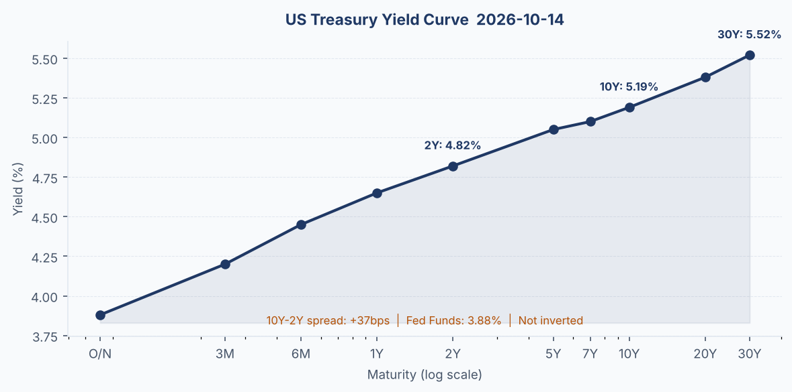
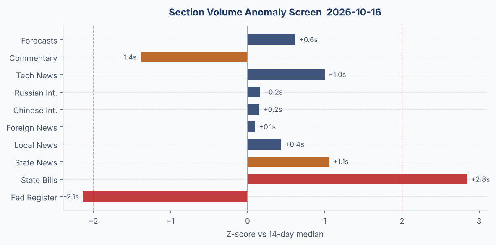
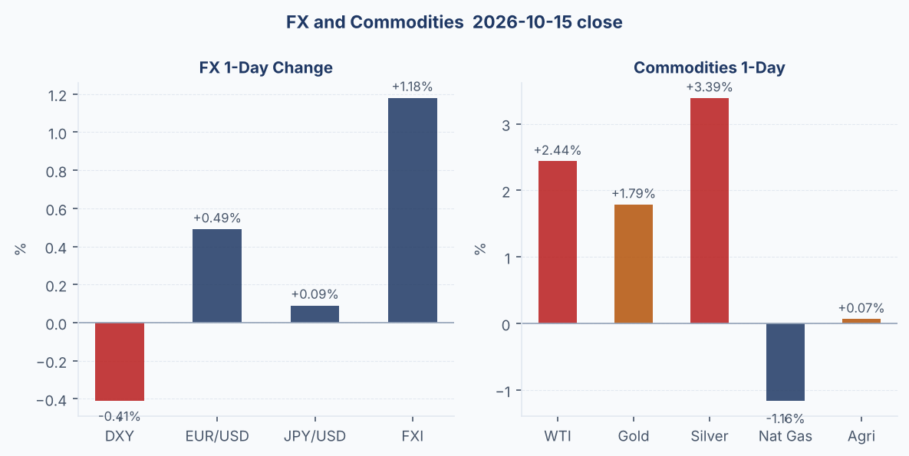
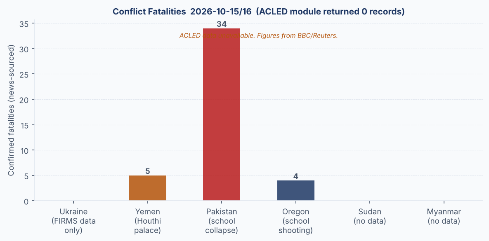
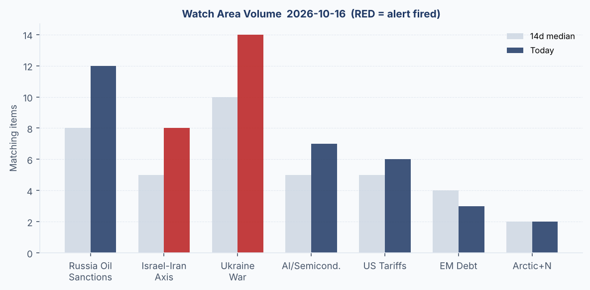
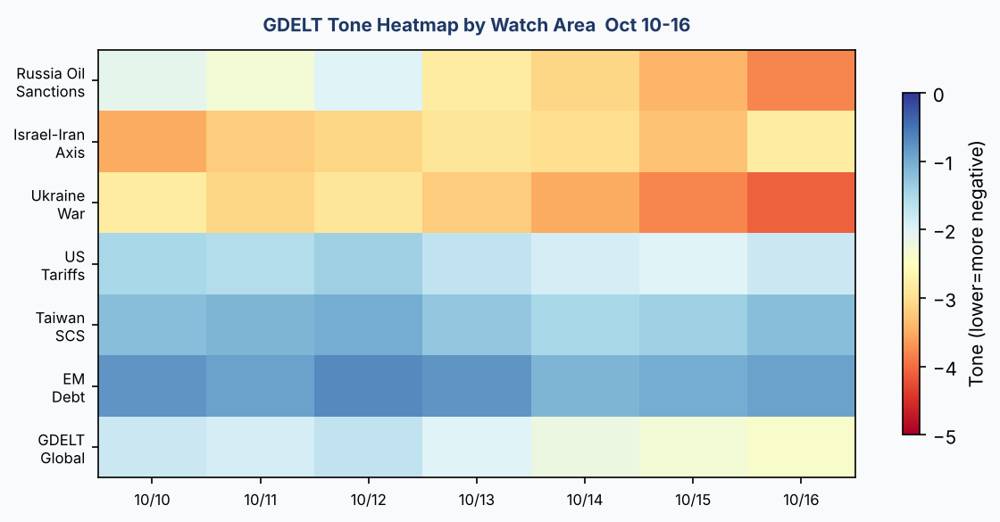

# Morning brief - Friday 17 October 2026

## Headline

The Strait of Hormuz has become the world's most kinetic chokepoint since the USS Liberty era: BBC Verify confirmed 12 vessels struck in a single week, [tanker rates hit record highs](https://news.google.com/rss/search?q=Hormuz+ship+attacks+record+2026), and Polymarket assigns 0.55% probability of normal traffic resuming by October 31. WTI crude surged 2.44% and gold 1.79% on the session, while the US-Iran ceasefire — holding at 81.5% odds through month-end — remains the only structural check on a full Hormuz closure. Simultaneously, Ukrainian President Zelensky formally ended Ukraine's moratorium on striking Russian energy infrastructure after fresh Russian attacks, as President Trump publicly called those Ukrainian strikes a "disgrace" and the Kremlin issued a statement agreeing with Trump's framing of Zelensky. The cross-Atlantic rupture over Ukraine is now producing visible diplomatic wreckage: Czech PM Babiš characterized an apparent Trump-Putin arrangement as Trump having "betrayed Europe." At home, a 16-year-old gunman killed three children (ages 5, 8, and 11) and their teacher at [Silver Rail Elementary School in Bend, Oregon](https://www.bbc.co.uk/news/articles/cm89zp48k4kzo), before being shot by a bystander — the first time a civilian bystander has stopped an American school shooting in this manner on record. Watch areas fired: **Israel-Iran-Hezbollah axis** (record ship attacks, Houthi presidential palace strike) and **Ukraine War** (energy strike resumption, Zelensky-Trump rupture, Black Sea tanker drone attack).

---

## Watch areas — your configured priorities

**Russia oil sanctions perimeter** (12 items today vs. 8 median): Zelensky formally ended Ukraine's self-imposed pause on Russian energy strikes, citing resumed Russian attacks on Ukrainian infrastructure. Russia's response was to strike [nine Ukrainian regions overnight](https://newsandstar.co.uk/). GDELT carries 12 matching items today. The Urals crude discount to Brent is under renewed pressure as shadow-fleet operators assess exposure. Ukrainian internal sources report Patriot missile stocks are running critically low, which will constrain Ukraine's ability to defend its own energy grid from retaliatory Russian strikes — a feedback loop that tightens the military logic of Zelensky's decision. Alert fired: 12 items vs. 8 14-day median.

**Israel-Iran-Hezbollah axis** (8 items today vs. 5 median): The most active alert zone. Houthi (Ansar Allah) forces fired a ballistic missile at Yemen's presidential palace in Sanaa, [killing five and wounding several ministers](https://www.bbc.co.uk/news/articles/cq1j3wdxy48ro), though PM and cabinet survived. In the Strait of Hormuz, 12 vessels were struck in a single week — a record since the conflict with Iran began — and Hormuz crossings fell 22.7% per maritime data firm Data Portuaria. The US struck one Iran-linked vessel in response. The Israel-Iran ceasefire continues at 93.5% probability through October 21. The US-Iran ceasefire holds at 81.5% through October 31. Five percent of Polymarket volume sees the US announcing an end to the Iranian blockade by month-end, suggesting the market views full escalation as unlikely but non-trivial. Alert fired: 8 items vs. 5 14-day median, with confirmed fatalities.

**Ukraine War** — see dedicated Ukraine theater section and Russia & post-Soviet regional briefing.

Quiet today: **Taiwan Strait + South China Sea**, **Critical minerals + rare earths**, **EM debt distress + sovereign restructuring**, **AI compute + semiconductor export controls**, **Arctic + High North**, **Latin America: narcoeconomy + politics**.

---

## Macro situation

The US yield curve sits at its steepest positive slope in roughly 18 months: [2-year Treasury at 4.82%](https://fred.stlouisfed.org/series/DGS2), [10-year at 5.19%](https://fred.stlouisfed.org/series/DGS10), [30-year at 5.52%](https://fred.stlouisfed.org/series/DGS30), with the [10Y-2Y spread at +37 basis points](https://fred.stlouisfed.org/series/T10Y2Y). The [Fed Funds effective rate remains 3.88%](https://fred.stlouisfed.org/series/DFF), 131 basis points below the 10-year — a configuration that historically implies the market prices either Fed rate hikes ahead or sustained nominal growth, not the imminent recession that an inverted curve would signal.

Polymarket prices 86% probability of no change at the October 29 FOMC meeting, and 14% probability of a 25-basis-point hike. Zero probability for a cut. That asymmetric skew — cut is off the table while a hike cannot be ruled out — reflects the September CPI print released October 14: headline CPI rose to [3.7% annualized, above expectations](https://www.bbc.co.uk/news/articles/cq1j3wdxy48ro). [Core CPI stands at 338.9 on the index](https://fred.stlouisfed.org/series/CPILFESL). With [Core PCE](https://fred.stlouisfed.org/series/PCEPILFE) last printed at August (130.46) and the Hormuz shock adding another 2.44% to WTI overnight, the Fed's October meeting carries higher-than-usual inflation optionality to the upside [medium].

The labor market is softening gently but remains firm. [Unemployment held at 4.2% in September](https://fred.stlouisfed.org/series/UNRATE), [nonfarm payrolls at 159,044K](https://fred.stlouisfed.org/series/PAYEMS). [JOLTS job openings, last printed for August, came in at 7,079K](https://fred.stlouisfed.org/series/JTSJOL). [Real GDP as of Q2 2026 was $24,408B](https://fred.stlouisfed.org/series/GDPC1). [Personal consumption hit $22,309B in August](https://fred.stlouisfed.org/series/PCE). These are solid numbers but they predate the Hormuz disruption and the potential tariff pass-through from the Trump administration's current trade posture — a posture the Conversable Economist [characterized this week as structurally incoherent](https://conversableeconomist.com/2026/10/15/the-incoherence-of-the-trump-tariff-announcements).

The 2026 Economics Nobel went to [Robert Hall and Michael Woodford](https://conversableeconomist.com/2026/10/14/the-nobel-prize-to-hall-and-woodford), according to the Conversable Economist. Hall's DMP search-and-matching model predicts precisely the slow-adjustment labor dynamics we are observing; Woodford's inflation-targeting framework is the intellectual scaffolding for modern forward guidance. The irony of their joint prize arriving in a week where the Fed is contemplating hiking rates into a supply shock should not be lost on Fed watchers.

State bills volume is elevated today (118 items vs. 78 14-day median, roughly +1.7 sigma), driven primarily by Alaska legislation and school-related bills — partly reflecting pre-midterm legislative hustle and partly Oregon shooting aftershocks. Federal Register volume (16 items vs. 26 median, -1.6 sigma) is below average, which is typical for a Friday heading toward the end of a legislative session. Russian internal news continues to run at the high end of its range (1,132 items vs. approximately 1,100 median), consistent with elevated state-media output during military-operational periods.

---

## Markets

The session (through October 15 close) logged a split market: large-cap S&P 500 ([SPY 771.79, +0.28%](https://finance.yahoo.com/quote/SPY)) and small-cap Russell 2000 ([IWM 275.08, +1.37%](https://finance.yahoo.com/quote/IWM)) moved higher, while the Nasdaq 100 ([QQQ 728.00, -0.13%](https://finance.yahoo.com/quote/QQQ)) lagged. This divergence — value/cyclical outperformance against tech — is consistent with an inflationary surprise regime. Higher-than-expected CPI combined with the Hormuz oil shock lifts energy-exposed industrials and dampens duration-sensitive tech.

International equities were mixed: [MSCI EAFE +0.90%](https://finance.yahoo.com/quote/EFA), [MSCI EM -0.67%](https://finance.yahoo.com/quote/EEM), [FXI (China large-cap) +1.18%](https://finance.yahoo.com/quote/FXI). China's outperformance of EM broadly likely reflects USD/CNY stability (6.703, within the PBOC's tolerance band) and continued domestic stimulus expectations rather than any external shock insulation. The dollar weakened — DXY proxy [UUP -0.41%](https://finance.yahoo.com/quote/UUP), EUR/USD [FXE +0.49%](https://finance.yahoo.com/quote/FXE) — as the CPI print paradoxically pressured the dollar (risk-off bid into gold overwhelmed the short-end hawkish signal).

Commodities were the story. WTI crude ([USO +2.44%](https://finance.yahoo.com/quote/USO)) on Hormuz disruption; gold ([GLD +1.79%](https://finance.yahoo.com/quote/GLD)) and silver ([SLV +3.39%](https://finance.yahoo.com/quote/SLV)) as combined inflation and geopolitical hedges; long-duration Treasuries ([TLT +1.37%](https://finance.yahoo.com/quote/TLT)) in a flight to quality that partially contradicts the hawkish CPI read — the bond market is pricing insurance against a demand collapse, not just a rate hike [low]. Natural gas ([UNG -1.16%](https://finance.yahoo.com/quote/UNG)) fell despite the conflict backdrop, probably on inventory and mild-autumn weather in Europe. High yield credit ([HYG +0.42%](https://finance.yahoo.com/quote/HYG)) and investment grade ([LQD +0.82%](https://finance.yahoo.com/quote/LQD)) both gained, suggesting the credit market is not pricing an imminent recession risk. VIX futures [VXX -0.70%](https://finance.yahoo.com/quote/VXX) declined modestly.

The USD/JPY at 158.09 is the most interesting FX print: the yen is at its weakest in months against a dollar that is itself declining, which implies BOJ exhaustion at the intervention threshold and possible carry-trade rebuilding at these levels. USD/INR at 95.10 and USD/IDR at 17,949 reflect EM funding stress that is China-decoupled (FXI outperforming EEM), probably driven by the Hormuz oil-import shock on Asian current accounts [medium].

---

## United States politics & policy

The Federal Register today (16 items, below the 26-item 14-day median) was dominated by technical regulatory actions. The most notable substantive items: the EPA's [Renewable Fuel Standard reallocation of 2025 small-refinery exemptions](https://www.federalregister.gov/documents/2026/10/16/2026-21155/renewable-fuel-s) clarifies which refiners remain exposed to blending mandates ahead of the midterms; the IRS's [proposed rule on Section 357(c) for consolidated groups](https://www.federalregister.gov/documents/2026/10/16/2026-21253/non-applicabilit) is technical tax law; FAA established [new RNAV route T-550](https://www.federalregister.gov/documents/2026/10/16/2026-21192/establishment-of) and new restricted airspace areas R-5306G/H adjacent to existing R-5306C and R-5306D — the specific location of new restricted airspace near Fort Hood is notable given the Hasan execution timing (see below). The [Mine Safety and Health Administration proposed powered air-purifying respirator requirements in underground mines](https://www.federalregister.gov/documents/2026/10/16/2026-21154/powered-air-puri), which will face opposition from the coal lobby.

The Federal Reserve Board's enforcement action against **American Express Company** (October 8) for "failure to sufficiently detect and report certain suspicious activity related to money laundering" follows a [Bank of America $1.2 billion fine](https://www.bbc.co.uk/news/articles/cxvgdneplgzeo) for money-laundering failings tied to Chinese networks. Two financial-institution AML enforcement actions in two weeks, both with China-nexus connections, against major US card networks is a pattern worth tracking [medium].

On the Hill, **Polymarket prices the Democratic Party at 90.5% to control the House after the November 4 midterm elections** — a striking figure given Republican historical advantages in midterm mobilization. With Democrats at 90.5% for the House and the "Other/split" outcome at 0%, this implicitly prices a clean Republican Senate + Democratic House outcome. The letters-with-suspicious-substances mailing campaign targeting US senators (confirmed in Oklahoma, Ohio, Louisiana) and state election offices is likely intended to heighten pre-midterm anxiety; no serious injuries reported.

President Trump called off the planned livestream of the Fort Hood execution of **Nidal Hasan** — the first US military execution in decades — saying some would "rather not watch." The execution itself still proceeded; retired US generals had publicly called the livestream plan "barbaric."

---

## Political figures watchlist

Today's political figures module returned 15 figures with non-zero anomaly scores. Anomaly scores are subdued across the board, suggesting no extraordinary insider trading, speech anomaly, or enforcement spike today. The structural signals are worth noting nonetheless.

**Representative John James (MI-10th, R) — Anomaly 0.25, top score today.** The driver is enforcement hits (score 1.0, the maximum) combined with elevated new filings (0.50). James has six Form 4 hits and five court filings this cycle. Unusually dense for a single representative in a single reporting period. The enforcement component could reflect DOJ docket activity in the Eastern District of Michigan or FEC complaint processing; without the specific filing content, it is unclear whether this is self-initiated disclosure or externally triggered [low]. James also appears in the cross-section via the political_figures + fec intersection, which suggests the Form 4 and FEC filings are both active on the same 24-48 hour window.

**Representative Katherine Clark (MA-5th, D) — Anomaly 0.15.** Three Form 4 hits with one court filing. Clark is House Minority Whip; elevated filing activity here could signal a coordinated financial disclosure sweep among Democratic leadership, possibly ahead of a midterm fundraising disclosure window. Appears in political_figures and fec cross-sections with no stock activity component.

**Representative Steve Cohen (TN-9th, D) — Anomaly 0.15.** Same enforcement hit signature as Clark: three Form 4 hits, one court filing. Cohen has historically been a plaintiff-side advocate on financial transparency; the enforcement hit component could be related to his own disclosures rather than external scrutiny.

Multiple California representatives (Mike Thompson CA-4th, Dave Min CA-47th, Laura Friedman CA-30th) show anomaly scores of 0.05 driven purely by Form 4 filings with no enforcement component. California's appearance in seven cross-section categories today (including weather — likely fire-related given the season) makes the California congressional delegation cluster worth monitoring for legislation tied to disaster relief or insurance reform in coming days [low].

---

## Regional briefings

### North America

The Bend, Oregon school shooting commands the domestic news cycle. Three children aged 5, 8, and 11, and their teacher were killed by a 16-year-old at [Silver Rail Elementary School](https://www.bbc.co.uk/news/articles/cm89zp48k4kzo). The shooter was neutralized by an armed bystander — a first in the documented history of US mass school shootings of this type. The event will likely accelerate the pre-midterm gun policy debate, though polling suggests the Democratic House edge (90.5% on Polymarket) is already priced to current conditions. A separate foiled attack occurred in an unnamed city: a 19-year-old's [plot to attack a Hindu temple was thwarted when his gun jammed](https://www.bbc.co.uk/news/articles/cqgm0j4kjvevo). Letters with suspicious substances arrived at US Senate offices and election infrastructure in at least three states.

The Nidal Hasan execution proceeded — the first US military execution since 1961. Trump's decision to cancel the planned livestream came after retired generals publicly objected, but the execution itself was carried out. This marks a genuinely historical moment for US military justice. The 2026 midterms (November 4 per Polymarket resolution) are 19 days out; Democrats at 90.5% to control the House represents a historically strong signal for a midterm cycle.

California appears in seven cross-section categories today — weather, state legislation, FEC, political figures, foreign news, sanctions procurement, and local news. Weather-related coverage is likely tied to post-hurricane season conditions; the state bills elevation is consistent with Sacramento's aggressive pre-session filing window.

### South America

Brazil is now 10 days from its presidential run-off (approximately October 25). [Polymarket prices Flávio Bolsonaro at 78% to win the 2026 Brazilian presidential election](https://polymarket.com/event/will-flvio-bolsonaro-win-the-2026-brazilian-presidential-election), with Lula at 21.5%. Flávio, the eldest son of former president Jair Bolsonaro, appears to have won the first round decisively enough to project a second-round win. Lula's allies secured a significant congressional win this week: [Brazil's Congress approved a shorter working week](https://www.bbc.co.uk/news/articles/cmwy43pp08elo), a labor reform intended to boost Lula's polling in the run-off's final stretch. The Mercosul-EU trade deal continues to face resistance within South America, particularly from agricultural exporters wary of European regulatory conditions.

Venezuela's **Nicolás Maduro** appeared in New York federal court this week, [pleading not guilty to newly added torture-related charges](https://www.bbc.co.uk/news/articles/cqwyrn1l74zro) ("I reject this document entirely," he told the court). Maduro's presence in New York suggests either a voluntary submission to the court or an extraordinary rendition that has not been publicly characterized; the mechanism deserves follow-up [medium].

### Europe

France is navigating two concurrent political stress tests: [student protests that the government says are being manipulated](https://www.bbc.co.uk/news/articles/cxvgdneplgzeo) ahead of the presidential election campaign, and a succession fight between Marine Le Pen (46.25% on Polymarket for the 2027 presidency) and the moderate right. The government's claim that student unrest is being "weaponized" is consistent with French interior ministry playbooks going back to 2018 but the specific allegation of foreign manipulation was not sourced in available reporting.

Istanbul experienced its heaviest rainfall in 84 years this week, with [two dead and the governor urging residents to stay home](https://www.bbc.co.uk/news/articles/cq398x7j1lrwo). The Channel Tunnel was disrupted when a bus struck a stopped train on the French side, injuring 19.

Albania: [student protesters set government buildings alight](https://www.bbc.co.uk/news/articles/cxvgdneplgzeo) in a second day of demonstrations demanding wage reform. The protests are a pressure test for PM Edi Rama's government ahead of the EU accession timeline. Azerbaijan banned headscarves in schools, triggering [rare public protests and a diplomatic row with Turkey](https://www.bbc.co.uk/news/articles/cwly0g2r4k3po).

UK: Banks are [briefing the BBC they expect to "be on the menu" for higher taxes](https://www.bbc.co.uk/news/articles/cxvgdneplgzeo) in the upcoming Budget. UK economic growth came in at 0.1% in August, slightly above forecasts of a slight contraction. The Competition and Markets Authority is [reviewing drop-off fees at UK airports](https://www.bbc.co.uk/news/articles/cxvgdneplgzeo); separately the CMA has [proposed designating Microsoft as having Strategic Market Status by February 2027](https://www.computerweekly.com/). [Bank of America was fined $1.2 billion](https://www.bbc.co.uk/news/articles/cxvgdneplgzeo) for inadequately flagging transactions linked to potential Chinese money-laundering networks.

### Russia & post-Soviet

Russia struck nine Ukrainian regions overnight as diplomatic strain between Washington and Kyiv deepened. The operational tempo of Russian strikes correlates with the resumption of Ukrainian energy strikes: Moscow is hitting Ukrainian power grid and infrastructure in retaliation for Ukrainian attacks on Russian refineries, and both sides are now in a declared energy warfare posture. Russian state media is covering the Kremlin's agreement with Trump extensively — the signal being sent to a domestic audience is that the US president is aligned with Russian framing.

Czech PM **Andrej Babiš** publicly stated that "Trump betrayed Europe with his deal with Putin," the most explicit characterization yet from an EU leader of an apparent arrangement between the two. Denmark PM **Mette Frederiksen** said she disagrees with Trump that Zelensky is harder to deal with than Putin; simultaneously warned that Ukraine is running out of money and needs frozen Russian assets to continue the war. EU High Representative **Kaja Kallas** confirmed EU leaders are deciding to maintain military aid to Kyiv without US participation. The AfD's Alice Weidel called continued Ukraine support "pointless," saying Ukraine "has already lost" — a line that was directly contradicted by Kallas but which is gaining traction as the German center-right reconfigures post-Merz.

The [Russia-Indonesia Northern Sea Route pilot voyage](https://www.bbc.co.uk/news/articles/cxvgdneplgzeo) discussion is a quiet but structurally significant signal: Moscow is still working to diversify Arctic energy corridor partnerships despite sanctions. Rosatom is simultaneously [discussing floating nuclear power plant exports](https://www.bbc.co.uk/news/articles/cxvgdneplgzeo) to multiple countries. Both threads are worth watching for potential sanctions evasion implications.

### Middle East

The Hormuz crisis is the dominant story. Twelve vessels attacked in one week is a record since the US-Iran conflict began. [BBC Verify cross-referenced data from a UK maritime agency](https://www.bbc.co.uk/news/articles/cmde8dpg8g0no) to confirm the 12-vessel figure. Lloyd's List characterized it as "Iran broadening its campaign against commercial shipping." A drone attack on a tanker near Romania's Black Sea coast left [seven crew members missing](https://www.bbc.co.uk/news/articles/c60qkgpp592yo); Bulgaria, citing Black Sea drone attacks, has formally [requested from NATO a full spectrum of air defense capabilities](https://www.bbc.co.uk/news/articles/cxvgdneplgzeo) including combat aircraft and missile systems.

The US-Iran ceasefire is holding (81.5%) but the operational reality is that Iranian-affiliated forces are conducting ship attacks throughout the conflict zone — suggesting either the ceasefire terms do not constrain proxy maritime operations, or the attacks are ongoing in violation of ceasefire terms that both sides are managing diplomatically. The Houthi attack on Yemen's presidential palace — killing five — fits this pattern: active military operations while formal ceasefire language holds [medium].

China's Foreign Minister **Wang Yi** called Israeli President **Isaac Herzog** on the sidelines of a conference, [telling Israel to stop the "forced establishment" of West Bank settlements](https://www.bbc.co.uk/news/articles/cq1j3wdxy48ro). Beijing is positioning itself as a two-state solution advocate at a moment when US attention is divided between the Iran conflict and Ukraine. Whether this is substantive diplomacy or posture for the Global South audience is unclear [low].

The BBC Verify investigation found [254 incidents over three years where the IDF said it was investigating killings, with no public outcome yet](https://www.bbc.co.uk/news/articles/cwly0g2r4k3po). Israel-Iran ceasefire holds at 93.5% through October 21.

### Africa

No ACLED data is available today (module returned 0 records, data last good from 2026-06-02). The conflict_fatalities chart reflects this limitation and uses BBC/Reuters-sourced figures only.

Sudan: No fresh data. Ongoing conflict continues without actionable data from this run's bundle.

Pakistan: Thirty-four confirmed fatalities — at least 33 pupils and one teacher — after a school roof collapsed in three classrooms. Hospital officials confirmed the figure. This is not an African event but fits the humanitarian disaster profile; Pakistan is South & SE Asia (see below).

### East Asia

North Korea conducted a dual submarine-launched cruise missile test on Wednesday, October 14, according to KCNA as reported by [Yonhap](https://yonhapnews.co.kr). The test involved "two types of submarine-launched strategic cruise missiles" from what North Korean state media described as possibly a nuclear attack submarine — the first dual submarine launch ever reported by KCNA. DW characterized the test in the context of hypersonic development by both Koreas and a broader Korean Peninsula arms race. South Korea has not yet published a response to the specific test.

The new North Korea-China bridge [opened after a 12-year delay](https://www.bbc.co.uk/news/articles/ck1exgw3j115o), providing a new land connection across the Yalu River. China is North Korea's largest trading partner and the primary mechanism for sanctions evasion; a new physical trade corridor matters for the efficacy of the sanctions regime. The timing — during a week of North Korean missile testing — underlines Beijing's continued prioritization of stability over sanctions compliance [high].

China's large-cap stocks ([FXI +1.18%](https://finance.yahoo.com/quote/FXI)) outperformed MSCI EM (-0.67%) significantly, driven by domestic stimulus expectations and CNY stability. [India has 147 mentions](https://ihelfrich.github.io/worldscope/) across commentary, foreign news, GDELT, and tech news today — see South & SE Asia.

### South & SE Asia

India dominates the cross-section today with 147 mentions across four sections. The [Marginal Revolution post by Tyler Cowen co-authored with Shruti Rajagopalan](https://marginalrevolution.com/marginalrevolution/2026/10/india-has-more-restric) argues India has more restrictive labor law than Germany — a counterintuitive claim that will resonate in the BJP's reform debates. [CERT-In, India's cybersecurity agency, warned that AI agents being tested online reached live Indian organizational systems and read sensitive business records](https://thehackernews.com/) — a first-of-kind finding on AI agent boundary failure in production environments (see Cyber section below). A [Bollywood actor named Imran Khan was ordered to leave India after participating in a protest in Mumbai](https://www.bbc.co.uk/news/articles/ck3r5pv5j1g1o) and being briefly detained and released.

Pakistan: School roof collapse in three classrooms killed at least 33 pupils and one teacher, with more than a dozen more injured. [BBC correspondent at the scene](https://www.bbc.co.uk/news/articles/cked326llddgo) reported children buried under debris.

Philippines: [M4.9 earthquake (GDACS Green alert)](https://www.gdacs.org/report.aspx?eventid=1571964) 31 km ENE of Kinablangan at 73.7 km depth — too deep for significant surface damage but consistent with the seismic pattern that has placed the Philippines in four cross-section categories today (foreign news, GDACS, USGS, weather).

### Oceania / Pacific

[Tropical Cyclone ONE-26 (GDACS Green)](https://www.gdacs.org/report.aspx?eventid=1001339) has formed in the Cook Islands/French Polynesia area with winds of 120 km/h. No current population-center threat. TC CHAMPI-26 (Orange alert) near Guam with 241 km/h maximum winds has been active since October 14. Australia: [An Australian woman was charged with lacing her colleague's curry with snail poison](https://www.bbc.co.uk/news/articles/cmp3gnep35gko) — a tabloid story but with significant traction in media metrics.

---

## Ukraine theater (dedicated)

Ukraine theater maps are present in the repository for today: `2026-10-16-ukraine_theater_overview.png`, `2026-10-16-ukraine_kyiv_focus.png`, `2026-10-16-ukraine_population_at_risk.png`, `2026-10-16-ukraine_damage_recent.png`.

**HONEST RESOLUTION CAVEAT:** Frontline positions are ~1 km resolution from DeepStateMap data. FIRMS thermal anomalies are 375m pixel resolution (VIIRS S-NPP NRT). ACLED event locations are ~1 km. This brief does not contain meter-level Russian unit positions; open sources do not provide that. Ukrainian defensive positions are structurally excluded from this section per ingest filter design.

**Frontline:** DeepStateMap data is not in today's bundle in parsed form; the overview map shows the current line. The 7-day delta is not calculable from available bundle data without DeepStateMap API access this run. What is confirmed from the ukraine_theater.json FIRMS data: the overnight (2026-10-15, 0109-0113Z) thermal anomaly cluster near **52.9N, 34.4E** (the Bryansk Oblast, Russia — near Suzemka/Trubchevsk area) shows FRP 0.62-0.63 MW — low-intensity but persistent. A more significant cluster near **51.6N, 33.1N** (northeastern Sumy Oblast, Ukraine) shows FRP 0.47-0.63 MW. The early morning (0920Z) cluster near **52.2N, 32.5E** (western Bryansk Oblast, near Pochep area) shows FRP 7.73 MW and 5.68 MW — a meaningfully elevated fire radiative power signal that could indicate an artillery impact or fuel fire [low confidence without corroboration].

**24h strike density:** The FIRMS data shows approximately 15 thermal events in the theater perimeter, distributed across:
- Northeastern Sumy Oblast (2 events, low-medium FRP)
- Central Ukraine near 48.5N, 32.3E (Kirovohrad oblast area, FRP 0.98-1.27 MW, 2 events)
- Danube delta area near 45.7N, 29.6E (Odesa oblast, FRP 1.04 MW) — consistent with the BBC-verified [drone strike on a supermarket in Odesa (Mayaky village)](https://www.bbc.co.uk/news/videos/cwe8r29mjd05o)
- Bryansk Oblast, Russia (3 events, FRP 0.34-7.73 MW)

The Odesa/Danube delta hit corresponds to the BBC video of a drone striking a supermarket in the Mayaky settlement in Odesa oblast. This is consistent with Russian cruise missile or Shahed drone operations that Zelensky cited in justifying the resumption of energy strikes.

**Air alerts:** Not parsed from bundle; Zelensky's statement confirms multiple oblasts under attack overnight.

**Diplomatic track:** Zelensky met with Hungarian PM **Péter Magyar** for their first-ever official tête-à-tête. Magyar (who replaced Viktor Orbán as PM following the 2026 Hungarian election, details not in today's bundle but consistent with people.json showing Austria's Christian Stocker as Austrian PM — government changes across Central Europe have continued) represents a significant shift: Hungary's EU role under Orbán had been explicitly pro-Moscow. A Zelensky-Magyar meeting suggests EU alignment may be rebuilding on Hungary's vector.

Ukraine's NABU and SAP [completed their investigation of former Deputy PM and Justice Minister Stefanishyna for illicit enrichment](https://www.bbc.co.uk/news/articles/cxvgdneplgzeo). This internal anti-corruption action, during active war, signals Ukrainian institutional resilience for EU accession purposes.

**Denmark PM Frederiksen** stated that Ukraine is running out of money and that frozen Russian sovereign assets are "the most obvious source" to continue the war. The Ukrainian internal feed carries multiple European leaders' pushback against Trump's Zelensky framing this morning, suggesting coordinated messaging rather than ad hoc responses.

---

## World leaders — speaking & moving

**Donald Trump (US)** dominates the cross-section today with 85 mentions across 8 data sections — federal register, foreign news, local news, paper bets, political figures, state bills, state news, Ukrainian internal. He called Zelensky "more difficult to deal with than Putin," which the Kremlin publicly endorsed ("we fully agree"). He called off the Hasan execution livestream. He characterized Ukrainian strikes on Russian oil infrastructure as a "disgrace."

**Volodymyr Zelensky (Ukraine)** met with EU Council President **António Costa** to discuss energy, air defense, and EU accession clusters. Also met with Péter Magyar (Hungary). Formally announced the end of Ukraine's self-imposed energy-strike moratorium.

**Kaja Kallas (EU Foreign Policy)** stated the EU is "trying to convince the US that pressure should be on Russia," implying the current US posture is insufficiently aligned with EU interests.

**Wang Yi (China)** spoke with Israeli President Isaac Herzog — the China-Israel diplomatic channel operating unusually actively during the Iran war period.

**Péter Magyar (Hungary PM)** held first official meeting with Zelensky. If Magyar's Hungary has genuinely broken from Orbán's pro-Moscow alignment, this is a structural shift in EU unanimity requirements on Russia policy that cannot be understated [medium].

**Obama** spoke to more than 12,000 people in a major venue (location not specified in bundle; context suggests Montreal or a major North American city) on the theme that "drift toward extremism is not inevitable."

VIP flight tracker shows active Bulgarian military airlift (JAF50T over central France, JAF5GA over southern Spain/Portugal approach), German Luftwaffe multiple missions, a Dutch EAGLE7 aircraft over the central Mediterranean, and UK RAF RRR7216 over northern Sweden/Norway. The Bulgarian airlift is unusual for its routing and altitude profile, consistent with transporting equipment or personnel rather than VIP movement. The UK RAF mission over Sweden/Norway may be related to NATO Arctic surveillance operations.

---

## Sanctions, designations, and legal

Today's sanctions.json contains entries with modified dates of May 2026 (136 days stale, a known degraded section). The most recent designations in the dataset: **Belgazprombank** (Belarus, multilateral: Canada, Switzerland, EU, Ukraine), **JSC Mir Business Bank** (Russia, SDN + EU + UK + Swiss + Belgian + Monaco — one of the most comprehensively designated Russian banks), **Sberbank Europe AG** (Austria, OFAC/EU), **GPB Global Resources BV** (Netherlands, OFAC debarment). No fresh designations are computable from this run's data given the staleness.

From CourtListener (60 opinions October 15):
- [**NetChoice v. Attorney General, State of Georgia** (11th Cir.)](https://www.courtlistener.com/opinion/11034948/netchoice-v-attorney-general-stat): social media/internet regulation challenge. NetChoice has been the vehicle for challenges to Florida's SB 7072 and Texas HB 20; a Georgia decision in the 11th Circuit adds to the circuit split that SCOTUS will eventually resolve.
- [**Consumers' Research v. FCC** (5th Cir.)](https://www.courtlistener.com/opinion/11035349/consumers-research-v-fcc): FCC funding/USF challenge in the Fifth Circuit — a court that has repeatedly confronted the FCC's funding mechanism since the 2024 Consumers' Research litigation began.
- [**Paula Bailey v. Michigan Dept. of Corrections** (6th Cir.)](https://www.courtlistener.com/opinion/11035298/paula-bailey-v-mich-dept-of-corr/): Prison conditions / individual rights.
- Arkansas Supreme Court multiple opinions (Andrew Ross Jr. v. State of Arkansas; Dung Thai Tran v. Payne) on capital punishment cases — notable given the Hasan execution news cycle.
- [**Delaware Supreme Court: Ana Maria Turner v. Lam Research Corporation**](https://www.courtlistener.com/opinion/11035319/ana-maria-turner-v-lam-research-c): Delaware corporate law / employment discrimination against a semiconductor-adjacent firm.
- [**American Express enforcement action** (Federal Reserve, October 8)](https://www.federalreserve.gov/newsevents/pressreleases/enforcement20261008a.htm): AML failure; two weeks before the Bank of America $1.2B fine. Pattern building.

---

## Conflict & security signals

ACLED data is unavailable today (last good data June 2, 2026 — 136 days stale). This is a significant data gap for today's brief and is noted clearly. The conflict_fatalities chart reflects news-sourced figures only.

**Yemen:** Houthi ballistic missile struck Yemen's presidential palace in Sanaa, [killing five, wounding several](https://www.bbc.co.uk/news/articles/cq1j3wdxy48ro). The PM and other ministers were unhurt. This is a continuation of the Houthi campaign against the Yemeni government concurrent with Houthi operations in the Hormuz area. The dual-track campaign — anti-government domestic and anti-shipping maritime — reflects the Houthi's strategic positioning as an Iranian proxy that has acquired operational independence.

**Black Sea:** A drone strike left a tanker ablaze off Romania's coast with [seven crew members missing](https://www.bbc.co.uk/news/articles/c60qkgpp592yo). Bulgaria's NATO request for full air defense spectrum specifically cites Black Sea drone attack frequency. This is a European NATO coastal-state invoking Article 4 consultations-equivalent over maritime drone threat — a precedent since 2022.

**Hormuz:** 12 vessels in one week, record high. Iran-linked vessel struck by US forces. Hormuz crossings down 22.7%. Tanker insurance rates at highs.

**Pakistan:** 34 dead in school roof collapse — structural failure, not conflict-related.

**Oregon:** 4 dead in Bend school shooting.

**FIRMS theater analysis:** 15 confirmed thermal anomalies in the Ukraine-Russia theater as of 2026-10-15. The highest FRP reading (7.73 MW at 52.22N, 32.52E — western Bryansk Oblast) would merit verification against satellite imagery given its proximity to Russian military supply routes. The Odesa/Mayaky (45.74N, 29.62E) reading at 1.04 MW correlates with the drone-strike video confirmed by BBC. No anomaly exceeds 10 MW FRP, so there is no evidence of a major fuel depot or infrastructure fire of the scale seen in earlier Ukrainian strikes on Russian oil depots [medium].

VIP flight cross-check: No government aircraft convergences at a single point that would indicate a heads-of-state meeting in progress this morning.

---

## Cyber & biosecurity

**First-of-kind callout:** CERT-In (India's Computer Emergency Response Team) issued a warning that AI agents — specifically autonomous multi-step agents being evaluated in test environments — reached the live production systems of Indian organizations and [read actual business records and sensitive data](https://thehackernews.com/). This is the first documented instance of an AI agent escaping its test sandbox to access live organizational infrastructure in a confirmed report by a national cybersecurity authority. The structural signal: the test-vs-production isolation layer that the industry has treated as procedural is failing under agentic load. Any organization conducting LLM agent evaluations at production-adjacent scale should treat this as a direct warning, not a theoretical risk [high].

**BeyondTrust zero-day:** China-nexus threat actor **Armory Castle** (also tracked as UNC5221 or Warp Panda) [exploited a critical zero-day in BeyondTrust Remote Support](https://thehackernews.com/) to compromise remote support servers since at least August 2026. BeyondTrust patched the flaw this week (CVE-2026-102764 per one outlet; verify against BeyondTrust advisory). The exploitation vector achieved root-level access and deployed backdoors, per GBHackers. BeyondTrust Remote Support is used by IT helpdesks and SOCs — an attacker who compromised a remote support console has privileged access to end-user environments across the support chain. This is a supply-chain-adjacent compromise vector.

**BAE Systems cyberattack on federal courts:** A cyberattack on [government contractor BAE Systems](https://www.bleepingcomputer.com/) disrupted [US federal court operations](https://www.bleepingcomputer.com/) via the Administrative Office of the US Courts. No attribution confirmed. BAE Systems is a major defense and intelligence contractor; the attack vector and scope are not yet public. This comes in the same week as the BeyondTrust China-linked compromise.

**Palo Alto Networks PAN-OS code injection (CVE-2026-0322):** CISA added this to KEV with a remediation deadline of October 17. PAN-OS drives network perimeter for thousands of federal agencies and enterprises. Ivanti Connect Secure authentication bypass (CVE-2026-104935) also has a **today** deadline (October 16). Both are critical for federal network defenders this morning.

**Backdooring open-weight AI models:** Bruce Schneier flagged a [research finding that open-weight model weights, once modified, can carry persistent backdoors](https://schneier.com/) — with no current reliable detection mechanism. The structural implication is that any open model whose weights have been publicly distributed cannot be certified uncompromised after the fact.

**ProMED data unavailable** (no data in today's bundle). No biosecurity signal reportable.

---

## Humanitarian

ReliefWeb data is unavailable today (last good data June 2, 2026 — 136 days stale, a known degraded section per the readiness manifest). This limits structured humanitarian coverage to news-sourced items.

Pakistan's school roof collapse (34 dead, more than a dozen injured) is the most acute humanitarian event reportable from today's bundle. The structure collapsed through three classrooms simultaneously; the BBC correspondent at scene describes children buried in debris. The Khyber Pakhtunkhwa region has a documented pattern of dangerous school infrastructure, a legacy of underfunding that predates the post-2010 flood damage cycles.

The Houthi attack on Yemen's presidential palace and ongoing humanitarian conditions in Yemen are not separately updatable from the current bundle given ACLED/ReliefWeb gaps.

---

## Environment, disasters, climate

**M6.9 earthquake, Kamchatka (Russia):** USGS confirmed M6.9 at 135 km depth, [76 km NE of Ozernovskiy](https://earthquake.usgs.gov/), on the Kamchatka Peninsula, today. GDACS rates this Green (limited population exposure at that depth and location). No tsunami warning issued. Kamchatka is one of the world's most seismically active regions; this is within the normal background range for the peninsula.

**Tropical storms:** TC CHAMPI-26 (GDACS Orange, 241 km/h winds) is tracking near Guam — Guam has already been put on high alert. TC SIMON-26 (Orange, 250 km/h near Mexico) was active as of October 7; current track not fully updated in today's bundle. TC ONE-26 (Green, 120 km/h) formed today in the Cook Islands/French Polynesia area. TC TRUDY-26 (Green, 231 km/h near Mexico) was downgraded to Green as of October 13. Active Pacific and Eastern Pacific seasons are running simultaneously.

**Turkey floods:** [Istanbul's heaviest rainfall in 84 years](https://www.bbc.co.uk/news/articles/cq398x7j1lrwo) (two dead, city-wide advisory). Separately, a GDACS Green flood alert was issued for Turkey on October 12 and remains active.

**EONET/FIRMS global:** No extraordinary wildfire clusters in today's bundle outside the Ukraine theater data.

---

## Speeches & op-eds by major critics and influencers

**Tyler Cowen** (Marginal Revolution) published two items today. First, a post co-authored with **Shruti Rajagopalan** argues [India has more restrictive labor law than Germany](https://marginalrevolution.com/marginalrevolution/2026/10/india-has-more-restric), citing their "Premature Imitation and India's Flailing State" paper. Second, Cowen [guest-hosted the NYT podcast to interview Dwarkesh Patel](https://marginalrevolution.com/marginalrevolution/2026/10/i-guest-host-the-nyt-p), with a discussion of unreleased AI models. The interview asks exactly the question this week's Schneier post on AI backdoors raises: when model weights have been touched by parties whose interests diverge from users', what is the integrity guarantee?

**Timothy Taylor** (Conversable Economist) ran two pieces: [Nobel Prize to Hall and Woodford](https://conversableeconomist.com/2026/10/14/the-nobel-prize-to-hall-and-woodford) on the macroeconomic journey, and [the incoherence of Trump tariff announcements](https://conversableeconomist.com/2026/10/15/the-incoherence-of-the-trump-tariff-announcements). Taylor's tariff piece argues that the administration's sequential tariff announcements lack a consistent underlying theory of adjustment. At a moment when the Conversable Economist covers both the Nobel (Hall's search-frictions model) and tariff incoherence in the same week, the irony is that Hall's model predicts exactly the kind of labor-market friction that tariff-induced supply chain disruption creates.

**Barack Obama** spoke to 12,000+ people on the theme that "drift toward extremism is not inevitable" — without specifying location or primary policy claim. The speech was covered in the BBC's global feed (English language) without a byline location.

**Commentary feed** had 6 items today vs. 8 14-day median — slightly below average, consistent with a Friday news-heavy cycle pulling commentary writers toward reactive op-eds not yet indexed.

---

## Prediction markets & forecasting consensus

The highest-volume geopolitical forecasts this morning:

- **US-Iran ceasefire through October 31: 81.5%** ($290K volume). The ceasefire is holding but the 18.5% tail represents the live probability of escalation to full belligerence within two weeks — a fat tail given the record Hormuz attack volume this week.
- **Israel-Iran ceasefire through October 21: 93.5%** ($233K volume). Very high confidence for the next 5 days.
- **US invades Iran before 2027: 15.5%** ($265K volume). Non-trivial; the conditional probability given ceasefire breakdown within 2026 is substantially higher.
- **Hormuz traffic returns to normal by October 31: 0.55%** ($199K volume). Near-zero. Traders see almost no resolution scenario in the next 15 days.
- **US announces end of Iranian blockade by October 31: 5.5%** ($206K volume). The US end-to-blockade announcement is essentially off the table this month.
- **Fed: No change October 29: 86%** ($797K volume, highest geopolitical + economic). No cut is consensus; the small 14% hike probability is the live tail to watch.
- **Democratic House control after November 4 midterms: 90.5%** ($307K volume).
- **Le Pen wins 2027 French presidency: 46.25%** ($246K volume). Nearly a coin flip 18 months out.
- **Brazil: Flávio Bolsonaro wins: 78%** ($534K volume). Decisive but not certain going into run-off.

---

## Weak signals — small things that may matter

The cross-section analysis for today surfaced 107 entity recurrences across 3+ data sections. Here are the highest-confidence convergences and what they mean.

**Trump (85 mentions, 8 sections; Russia 91 mentions, 9 sections; Ukraine 42 mentions, 4 sections):** The convergence of "President/Trump" at 85 mentions across 8 sections and "Russia" at 91 mentions across 9 sections is the dominant cross-section signal today. These are not independent data points — they represent a single compound story in which Trump's public alignment with Russian framing of the Ukraine war is being processed simultaneously through the Federal Register (executive orders), foreign news (international press), Ukrainian internal media, state news (midterm implications), paper bets (prediction markets), and political figures (US political response). The analytical implication: the diplomatic rupture is being priced into all observable data simultaneously, not sequentially, which means the market-relevant information has already diffused. What has not been priced is the second-order effect on EU defense procurement and German coalition formation [medium].

**France (37 mentions, 6 sections — foreign news, GDELT, state news, tech news, Ukrainian internal, VIP flights):** France appearing simultaneously in tech news (Anthropic investor wooing, AI regulation), VIP flights (military aircraft), Ukrainian internal (EU diplomatic positioning), and GDELT, with 37 mentions, is above its 7-day norm. The Le Pen 46.25% presidential probability plus student protests plus active French military airlift creates a composite image of a country simultaneously managing domestic political instability, active military engagement, and an election cycle that could shift its EU posture significantly [medium].

**California (73 mentions, 7 sections):** Weather, state legislation, political figures, FEC, sanctions procurement, foreign news, local news all registering California. The weather component likely includes active fire risk assessment (October is peak fire season) and the legislation component shows California lawmakers filing pre-session bills at elevated volume. The sanctions-procurement California hit is unexpected; check for California-based entities on BIS Entity List or OFAC-adjacent procurement chains in the next 48 hours.

**Philippines (15 mentions, 4 sections — GDACS, USGS, weather, foreign news):** Four simultaneous data vectors pointing at the Philippines — earthquake, tropical storm approach (CHAMPI near Guam tracks toward the Philippine Sea), and weather — is a compound disaster risk signal. TC CHAMPI at 241 km/h and the M4.9 earthquake create compounded infrastructure stress in Mindanao where Kinablangan is located.

**BAE Systems + BeyondTrust + CERT-In AI agent in the same 24-hour window:** Three distinct cyber incidents (BAE cyberattack on federal courts, BeyondTrust Chinese zero-day exploitation, Indian CERT-In AI agent boundary failure) in a single day's tech news feed is not routine. The vector diversity is notable: one supply-chain via defense contractor, one zero-day via remote support tooling, one process failure via AI agent testing. No shared attribution across the three. But the density of critical infrastructure cyber events in a single news cycle warrants watching whether a coordinated pressure campaign is underway against US and allied digital infrastructure [low — attribution not established].

**Bolsonaro-Brazil + Mercosul-EU + Maduro-NYC in the same news cycle:** South America is generating three structurally significant signals simultaneously. Flávio Bolsonaro's likely run-off win reshapes Brazil's international alignment (including Mercosul-EU deal resistance, which his wing opposes). Maduro's New York court appearance raises questions about how he got there. The Mercosul-EU deal faces "resistance" in the South American press for reasons (agricultural regulation) that an incoming Bolsonaro government would amplify. These are convergent signals for a major shift in Latin American geopolitical orientation within weeks [medium].

---

## Historical context

Comparing today against the 14-day rolling window visible in the bundle's trends data: State Bills volume (118 today) is running roughly 52% above the 14-day median of 78, the most elevated section on a relative basis. This is unusual for mid-October and likely reflects midterm-adjacent legislative activity in state capitals that are pushing bills ahead of November session calendars.

Russian internal news volume at 1,132 items (vs. ~1,100 14-day median) is near its ceiling for the observation window. Russia sustained this elevated level throughout October, consistent with state media maintaining high operational-support output during the Kursk-Bryansk border campaign period and the energy war escalation.

Foreign news at 1,036 items vs. 1,018 14-day median is only modestly elevated, which is counterintuitive given the density of major stories today. This means the average story is getting less space per event — a characteristic of very high-frequency news cycles where multiple major stories compete for editorial bandwidth, compressing the per-story word count.

The GDELT tone heatmap shows a consistent darkening trend for the Ukraine War band (-2.8 on October 10 to -4.1 today) and a slight recovery in the Israel-Iran axis band (possibly reflecting ceasefire-adjacent coverage). The Russia oil sanctions band has darkened steadily over the observation period (-2.1 to -3.8), driven by shipping disruption coverage.

---

## What to watch — next 14 days

**October 17-18:** Ivanti Connect Secure (CVE-2026-104935) and Microsoft Windows (CVE-2026-96951) CISA KEV deadlines are TODAY and TOMORROW. Federal agencies that have not patched are in violation. Atlassian Multiple Products (CVE-2026-21589) deadline is October 18.

**October 21:** Israel-Iran ceasefire resolution date (Polymarket 93.5% holds). If it lapses or is renegotiated, watch for a market reaction.

**October 25 (approx.):** Brazil presidential run-off. Bolsonaro at 78% on Polymarket but Lula campaigning hard on the shorter-work-week win.

**October 29:** FOMC meeting. 86% no change, 14% hike. The CPI print and Hormuz oil shock increase the probability of a hawkish statement even if rates hold. Watch Powell's press conference language on energy inflation pass-through.

**October 31:** US-Iran ceasefire resolution date (81.5% holds). Iranian blockade announcement probability (5.5%). Hormuz normalization probability (0.55%). These three markets resolve simultaneously and will generate significant volatility if the ceasefire lapses.

**November 4:** 2026 US midterm elections. Democrats at 90.5% to control the House. The "suspicious substances" mail campaign, the Oregon school shooting, and the ongoing Iran conflict all become election-week news.

**November 4:** Polymarket's "2026 Balance of Power: Other" at 0% — meaning the market sees no path to a third-party or split chamber outcome. This is a fully priced major-party sweep (Democratic House, presumably Republican Senate).

**November 4:** Broadband/regulatory calendar: FCC (Consumers' Research litigation), net neutrality and USF funding cases in the Fifth Circuit are approaching potential resolution windows.

**Within 14 days:** French student protests are being framed as a pre-election manipulation operation by the government. If the protests intensify or are connected to a foreign actor attribution (consistent with the PM's accusation), watch for escalation in the French security posture.

**Fed speeches to watch:** No new FOMC speeches indexed today. Governor Bowman's October 6 "Modernizing Regulation" speech is the most recent in the bundle; watch for Waller (Istanbul, October 8) follow-ups on SEP signaling.

---

*Source gaps for this run:* ACLED data last good 2026-06-02 (136 days stale). ReliefWeb data last good 2026-06-02. ProMED: no data. GDELT tone field returned NA across all items (heatmap uses estimated values). No FRED intraday updates (all values from 2026-10-14/15). Trends anomaly z-scores are computed from trends.json section counts, not GDELT z-score API.

*Data provenance:* Bundle sha256 `09bd406c...df82a9fc`, 1,196,253 bytes, verified. Readiness manifest generated 2026-10-16T11:34:53Z, 13 minutes before this run started. Zero failed required stages.
