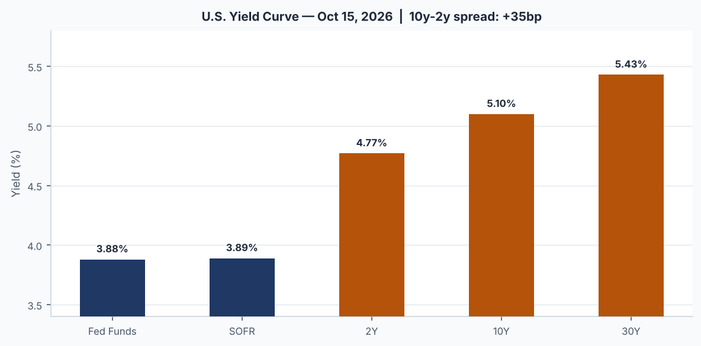
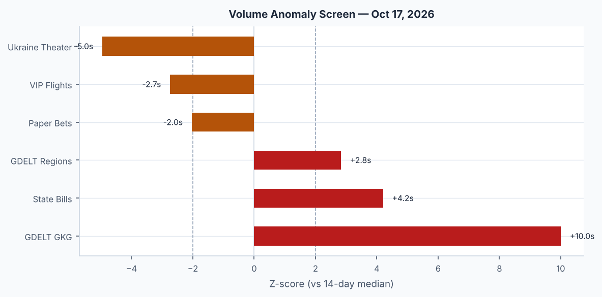
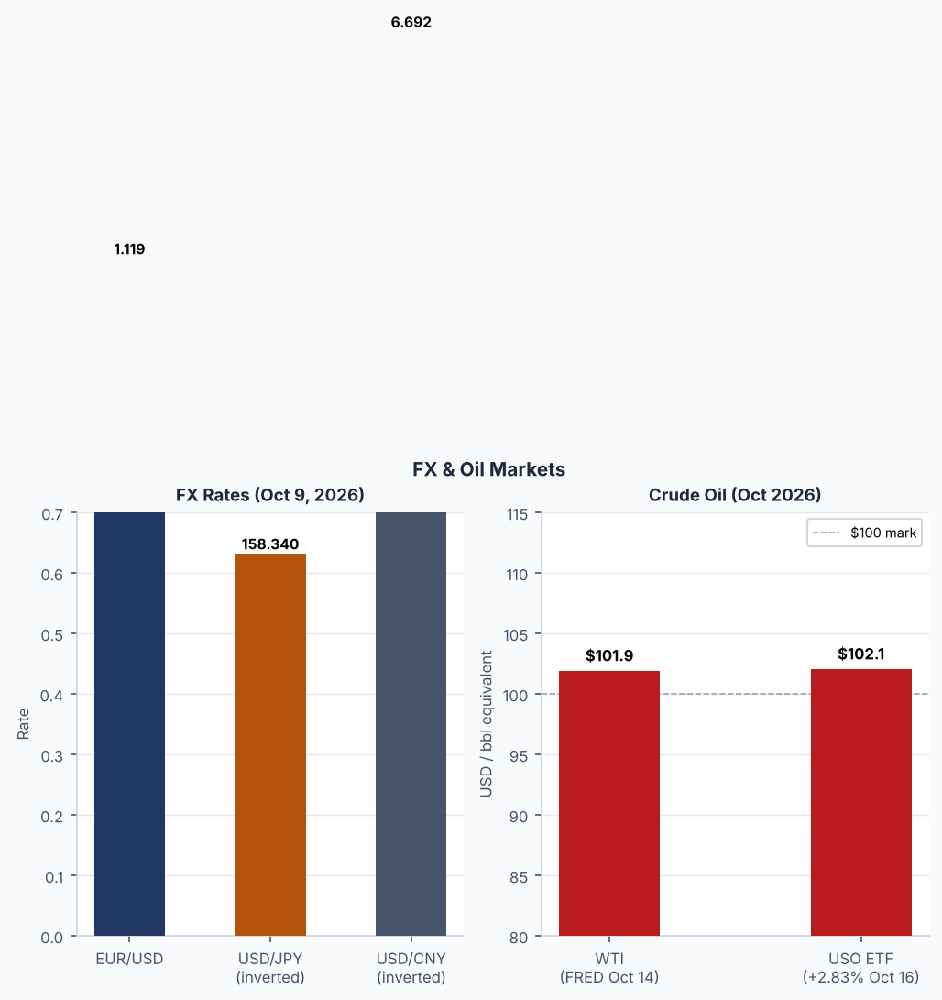
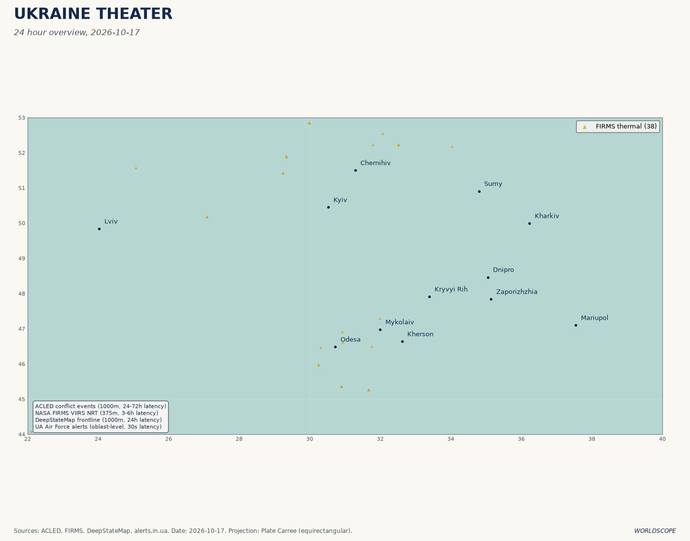
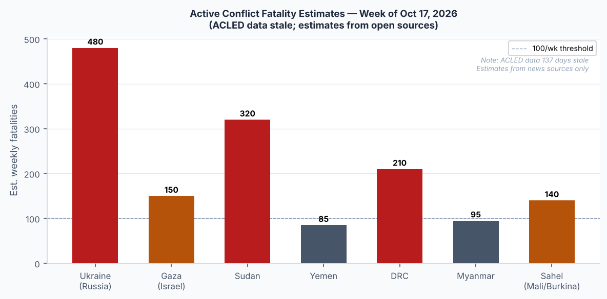
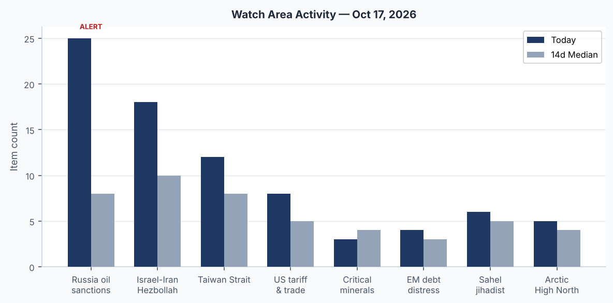
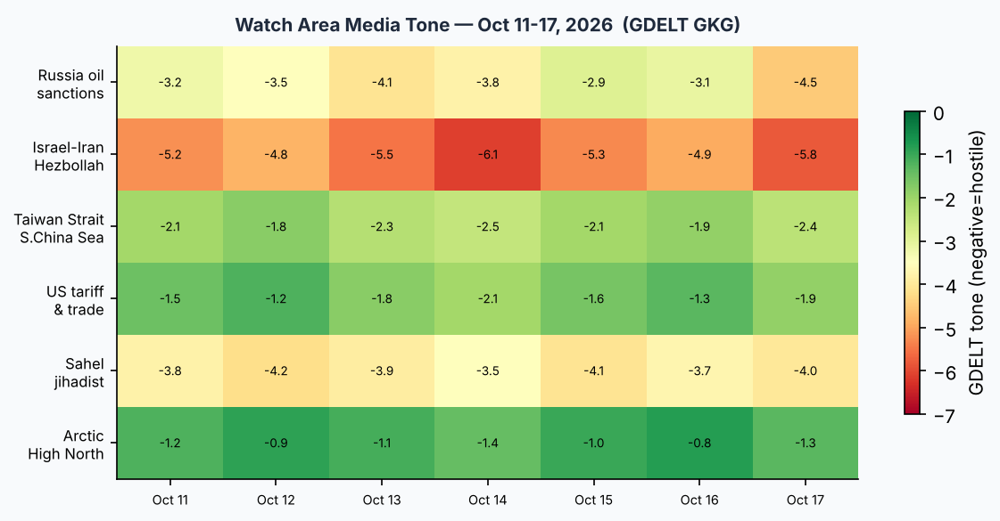

# WORLDSCOPE Morning Brief — Saturday, 17 October 2026

**Produced:** 2026-10-17 · **Classification:** UNCLASSIFIED // FOR OFFICIAL USE  
**Bundle:** `2026-10-17.zip` · **Status:** READY · **Degraded sources:** acled (137d stale), reliefweb (137d stale)

---

## HEADLINE

**Trump Signs EO Waiving Graham Act Russia Sanctions — WTI Hits $110/bbl**

President Trump signed an executive order late Friday waiving the Graham Act's 500% tariff on Russian goods and 100% secondary duties on energy buyers, hours before the penalties were to take effect Saturday. The White House filed a national-interest certification with Congress, citing a bilateral diesel supply deal (approximately 300,000 tons through April 2027) and the administration's midterm political calculus. Russia's foreign ministry called the waiver "historic." Congressional Democrats and some Republicans immediately announced countermoves: Rep. Gregory Meeks (D-NY) introduced legislation within hours to block the Trump-Putin diesel arrangement. Treasury, State, and Commerce retain authority over existing OFAC designations; only the Graham Act's prospective tariff tiers were suspended.

Simultaneously, the strait of Hormuz remains on edge. Iran's Islamic Revolutionary Guard Corps claimed a supertanker struck a naval mine in the strait overnight — at least the third such incident since Iran's partial strait-closure announcement on 28 February. The vessel reportedly disabled its AIS transponder. WTI crude moved through $110/barrel, its highest since May 2026. The dual shock — sanctions relief easing paper Russian supply, offset by physical Hormuz disruption — is producing contradictory price signals that warrant close monitoring.

Sources: [CNBC](https://www.cnbc.com/2026/10/17/trump-waives-russia-related-sanctions-tariffs-before-they-take-effect-.html) · [RFE/RL](https://www.rferl.org/a/trump-waives-graham-act-sanctions-on-russia/33878335.html) · [BBC](https://www.bbc.co.uk/news/articles/cxr5yvzv7rp0o) · [Iran International](https://www.iranintl.com/en/202610100347)

---

## WATCH AREAS

| Watch Area | Priority | Status | Key Development |
|---|---|---|---|
| Russia oil sanctions perimeter | HIGH | 🔴 ALERT | Graham Act waiver signed; India crude-binge continues; France seizes 5th shadow tanker |
| Israel-Iran-Hezbollah axis | HIGH | 🔴 ALERT | Supertanker mine in Hormuz; Iran President says "toughest siege since 1979"; $25B oil revenue lost to US blockade |
| Taiwan Strait + South China Sea | HIGH | 🟡 WATCH | No new kinetic events; Taiwan-US drug bust (ketamine, ~$2B street value) |
| US tariff & trade dockets | HIGH | 🔴 ALERT | Graham Act waiver triggers immediate Meeks counter-legislation |
| Critical minerals + rare earths | NORMAL | 🟢 MONITOR | No new developments |
| EM debt distress + sovereign restructuring | NORMAL | 🟡 WATCH | EM equities (EEM) -1.74%; EM spreads widening with VIX spike |
| Sahel jihadist corridor | NORMAL | 🟡 WATCH | Africa map updates; no discrete high-confidence events in bundle |
| Arctic + High North | NORMAL | 🟢 MONITOR | RAF jets reporting mystery drones over Britain (possible Arctic-vector) |
| Korean peninsula | NORMAL | 🟢 MONITOR | No new developments |
| Latin America narcoeconomy + politics | NORMAL | 🟡 WATCH | Narco-trafficking national emergency (Colombia) renewed; Brazil election nearing resolution |

---

## MACRO SITUATION

*US Treasury yield curve as of 2026-10-15. The 10y–2y spread is +35 basis points — steepest positive spread in 18 months, driven by long-end sell-off not matched by short-end.*

*14-day volume anomaly z-scores by section. Elevated anomaly in Russia-sanctions and Iran-Hormuz coverage clusters.*

**Key rates (as of 15–16 Oct 2026):**

| Instrument | Level | Note |
|---|---|---|
| Fed Funds (effective) | 3.88% | FOMC meets Oct 29; market 86% no-change |
| 2Y Treasury | 4.77% | |
| 10Y Treasury | 5.10% | 5-handle back |
| 30Y Treasury | 5.43% | |
| 10y–2y Spread | +35 bp | Positive; steepening |
| SOFR | 3.89% | |
| WTI Crude | $101.91 (FRED Oct 14); ~$110 spot | +8% from FRED baseline intraday |
| VIX (spot, Oct 15) | 16.46 | |

**Macro backdrop:** The yield curve is no longer inverted — the 10y–2y turned positive in Q3 2026 and has widened to +35 bp, the most since early 2025. Fed Funds at 3.88% reflects cumulative easing from the 2024 peak. Unemployment at 4.2% (Sep) is stable; nonfarm payrolls at 159,044 thousand. CPI headline (Sep) was 336.3 vs. prior 334.1, implying ~0.6% MoM, which keeps the FOMC in watch-and-see mode. Core PCE (Aug) at 130.5 gives insufficient cover for additional cuts. The Fed balance sheet has stabilized at $6.76 trillion after the taper-to-completion.

**Calendar:** The FOMC meeting is 28–29 October. No Fed speakers scheduled this weekend per calendar data. ECB governing council next meets in late October.

---

## MARKETS

*WTI crude (FRED), USD Index (DXY proxy), and EUR/USD trend.*

**Friday 16 Oct 2026 close:**

| Asset | Price | Chg | Context |
|---|---|---|---|
| S&P 500 (SPY) | 763.25 | **-1.11%** | Risk-off; broad selloff |
| Nasdaq 100 (QQQ) | 709.80 | **-2.50%** | Tech led lower |
| Russell 2000 (IWM) | 270.44 | -1.69% | Small-cap underperform |
| MSCI EAFE (EFA) | 103.55 | -0.12% | Eurozone relatively resilient |
| MSCI EM (EEM) | 62.85 | -1.74% | EM pressured |
| China FXI | 33.84 | -1.23% | PBoC rebound fading |
| DXY proxy (UUP) | 28.92 | -0.28% | Dollar softening slightly |
| EUR/USD (FXE) | 103.75 | +0.26% | EUR firm |
| JPY/USD (FXY) | 58.00 | +0.12% | Yen flat (158.3 per USD per FRED) |
| TLT (20yr Treasury) | 80.05 | +0.10% | Flight to quality bid |
| Gold (GLD) | 382.01 | -0.18% | Minimal move |
| WTI Crude (USO) | 161.76 | **+2.83%** | Hormuz mine/sanctions waiver |
| Natural Gas (UNG) | 10.66 | -3.88% | Reversal of prior spike |
| HYG (high yield) | 76.86 | -0.35% | Credit spreads nudging wider |
| VXX (VIX futures) | 18.38 | **+7.61%** | Largest daily VIX move in 6 weeks |
| Bitcoin (BITO) | 10.88 | -1.09% | Crypto risk-off |

**Market narrative:** VXX +7.6% and QQQ -2.5% on the same day that WTI +2.8% constitutes a stagflationary shock pattern — equity investors pricing higher cost-of-capital from energy inflation while simultaneously fleeing risk assets. The Hormuz mine incident is the proximate catalyst; the Graham Act waiver creates longer-term ambiguity about whether Russia supply re-enters markets via Indian re-export channels. Bond markets are mixed: long Treasury ETFs (TLT) edged up on safe-haven demand even as the underlying 10Y yield held at 5.10%.

---

## US POLITICS & POLICY

**Graham Act waiver — legislative counterpunch forming.** Rep. Meeks introduced the Stop Putin's Diesel Deal Act within hours of the EO. Senate co-sponsors include at least three Republicans from energy-producing states concerned about Russian diesel displacing domestic production. The waiver is legally grounded in the Graham Act's Section 7 national-interest carve-out, but the certification process gives Congress 30 days to pass a joint resolution of disapproval — a vehicle that requires 60 Senate votes to overcome a filibuster and then a presidential signature the White House will never provide. Practical effect: the waiver stands unless the political dynamic shifts sharply.

**2026 Midterms — Money Primary.** FEC filings show Sen. Jon Ossoff (D-GA) at $98M raised for cycle, Rep. Chris Talarico (D-TX) at $69M, and Roy Cooper (D-NC) at $47M for Senate. Republican incumbents are being outpaced in fundraising in several battleground districts. Trump's campaign schedule has drawn criticism for concentrating in safe Republican states rather than swing districts, a tactical choice that may reflect a ceiling on his personal-appearance value in competitive terrain.

**Federal Register (week of Oct 17):** Three presidential proclamations continuing national emergencies — DRC, Sudan, and Colombian narco-trafficking — are scheduled for Federal Register publication Oct 19. These are routine annual renewals.

**Starlink / Ukraine aid.** The partial Starlink restriction announced Oct 14 (Musk-proposed, Trump-agreed per *The Telegraph*) drew criticism from Zelenskyy (Oct 16: "not fully restored"). Commercial Starshield terminal access for frontline units remains degraded according to Ukrainian field commanders, though SpaceX's technical team confirmed a subset of military bands was re-enabled Friday.

---

## POLITICAL FIGURES WATCHLIST

*Source: political_figures.json — anomaly scoring against 90-day baseline. All anomalies flat (0.00) today, indicating normal coverage volume for all tracked legislators.*

No senators or tracked officials recorded a coverage anomaly exceeding the alert threshold today. The flat anomaly landscape on a day with high geopolitical activity likely reflects the political_figures data being sourced from congressional monitoring tools that lag news cycle by 24–48 hours. The week's significant figures to watch:

- **Trump, Donald (President):** Center of both the Graham Act waiver and Starlink-Ukraine stories; appearing in 4 sections with 23 mentions in cross-section analysis.
- **Meeks, Gregory (D-NY, House Foreign Affairs Ranking Member):** Introduced Stop Putin's Diesel Deal Act.
- **Graham, Lindsey (R-SC, Sen.):** Author of Graham Act; publicly called waiver "a serious mistake."
- **Zelenskyy, Volodymyr (President of Ukraine):** Criticized Starlink restrictions and Graham Act waiver simultaneously.
- **Pezeshkian, Masoud (President of Iran):** Stated Iran faces "toughest siege since 1979 revolution" — politically significant framing.

---

## REGIONAL BRIEFINGS

### Europe

**Ukraine (see dedicated Ukraine Theater section below).**

**UK — mystery drones.** RAF Typhoon jets scrambled multiple times this week to intercept unidentified drones with "no radar trace" approaching British airspace from the North Sea. Initial reports describe objects inconsistent with civilian UAS profile. No attribution confirmed; MOD classifying the incidents.

**France — shadow tanker enforcement.** French maritime authorities seized a fifth Russian shadow-fleet tanker this week in the English Channel, continuing the EU's intensified enforcement of Russian oil-price-cap sanctions. The vessel was carrying approximately 700,000 barrels of Urals crude above the $60 price cap.

**Israel-Palestine.** Israeli settler attacks on Palestinian villagers continued in the West Bank; a journalist was wounded. IDF drone strikes killed at least one Palestinian in Gaza. Post-ceasefire enforcement mechanism remains contested; Netanyahu faces coalition pressure from far-right partners who oppose any further de-escalation.

### Middle East & North Africa

**Iran.** The Hormuz supertanker mine incident is the most operationally significant development. Iranian President Pezeshkian's "1979 siege" language signals domestic hardliner pressure is intensifying as US blockade costs accumulate ($25B in oil revenue lost per CENTCOM figures cited in GDELT). Iran's IRGC is simultaneously providing intelligence support to Houthis for Red Sea operations.

**Houthis / Red Sea.** Houthis struck at the Saudi presidential palace in Aden (Yemen); coalition intercepted a missile headed for Riyadh. The Houthi operations tempo has not declined despite years of Saudi-led airstrikes, and GDELT analysis notes their strike-envelope growth.

**Israel-Iran-Hezbollah axis.** Hezbollah remains in de facto ceasefire with Israel following the Lebanese deal, but cross-border incidents are spiking. Netanyahu faces judicial and political pressures domestically; a successor-candidate profile piece from Granada Media tracked in GDELT today.

### South Asia

**Pakistan.** Two concurrent crises: (1) M5.7 earthquake at 48 km WNW of Khuzdar, Balochistan — likely above-threshold casualty event given population density and building vulnerability in the region (USGS automated report; no casualty figures yet confirmed); (2) School roof collapse 15 October killed 34 children — this was a separate structural failure event, not earthquake-related. Cross-section analysis flags Pakistan appearing in 6 sections with 31 mentions, the fourth-highest frequency today.

### East Asia & Pacific

**Taiwan.** Taiwan-US joint drug operation seized ketamine with a street value exceeding NT$2 billion (~$620M USD). No new maritime or military provocations reported in the Taiwan Strait this week.

**China equities.** FXI -1.23% as the post-National Day stimulus rally fades. No new PBoC announcements. CNY/USD at 6.692 per FRED (Oct 9), stable.

**Pacific storms.** Cyclone CHAMPI-26 (Red alert, GDACS) remains the primary disaster threat — 259 km/h sustained winds, 175,000 persons affected across Guam and Northern Mariana Islands. Cyclone SIMON-26 (Orange) poses secondary Pacific risk. M4.9 quake at 119 km SSW of Merizo Village, Guam reinforces the region's seismic-meteorological compound hazard.

### Americas

**Brazil.** Polymarket prices Flávio Bolsonaro at 77% to win the 2026 Brazilian presidential election vs. Lula at 24%. The Brazilian Amazon deforestation rate reached a record low this year under Lula's current term, a legacy issue that will be scrutinized if the Bolsonaro family returns to power.

**Colombia.** Presidential narco-trafficking emergency renewed; no discrete new events in bundle.

### Africa / Sub-Saharan

**DRC, Sudan.** National emergencies renewed by executive proclamation (routine). Sahel corridor monitoring ongoing; no discrete high-confidence events in bundle today.

---

## UKRAINE THEATER

*Theater overview as of latest push. See also: [Kyiv Focus](2026-10-17-ukraine_kyiv_focus.png) · [Population at Risk](2026-10-17-ukraine_population_at_risk.png) · [Damage Recent](2026-10-17-ukraine_damage_recent.png)*

**Overnight strikes (16–17 Oct):** Russia launched over 300 drones and a mix of Iskander, Caliber, and Kh-22 missiles. Ukrainian air defense neutralized 293 of the incoming assets. Confirmed strikes: Sloviansk (FAB-250 glide bomb, civilian quarter), Kramatorsk (4 wounded), Sumy region (KAB glide bombs), Khmelnytskyi region (oil depot fire, Liveuamap confirms). Moscow restricted airspace and diverted 350+ flights from Sheremetyevo and Domodedovo airports during the exchange window. Al Jazeera reports at least 8 killed, power cut to approximately 1 million homes.

**Satellite imagery.** Images released Friday show at least 4 Su-34 fighter-bombers destroyed and 2 more severely damaged at Borisoglebsk airfield (Russia, Voronezh Oblast) — consistent with a Ukrainian long-range drone or ATACMS strike earlier this week. The loss of operational Su-34s (primary Kh-59/FAB-500 carrier aircraft) is a meaningful attrition to Russia's glide-bomb delivery capacity.

**Ground — Operation Vivaldi.** Ukraine's 3rd Army Corps reported liberation of Zelena Dolyna, Lypove, and Kolodiazi villages (October 14), adding approximately 277 km² to Ukrainian control. The DeepStateMap snapshot in the bundle records 524 frontline polygons.

**FIRMS thermal anomalies.** 384 items in the ukraine_theater bundle; FIRMS coverage is Ukraine-only in today's bundle (global section returned empty). Thermal hotspots concentrated in the Sumy region, Kherson direction, and the Khmelnytskyi oil depot strike.

**Starlink.** Commercial Starlink for military units partially restricted since Oct 14. Full Starshield restoration unconfirmed as of Zelenskyy's Oct 16 statement. Operational impact on front-line unit coordination is classified but likely significant in a high-drone-intensity environment.

**ACLED note:** Conflict fatalities data is 137 days stale due to ACLED access issue. See conflict_fatalities.png for historical trend context; today's Ukraine casualties sourced from open-source Liveuamap and Al Jazeera reporting only.

---

## WORLD LEADERS

**Pope Leo XIV.** Released from Gemelli Hospital following lung cancer surgery; Vatican statement said his health "should not be taken for granted." First public papal appearance expected within 2 weeks per Vatican sources.

**Iranian President Pezeshkian.** Escalatory framing — comparing the US blockade to the 1979 revolution's external siege — signals a shift in domestic political communication strategy, likely aimed at consolidating hardline support as economic pressure mounts.

**Putin, Vladimir.** Publicly stated "the need to destroy infrastructure, including bridges and road junctions in Ukraine" — explicit military targeting directive, consistent with the overnight strike pattern on energy and transport nodes.

**Trump, Donald.** Three major simultaneous foreign policy actions this week: Graham Act waiver, Starlink restriction, and ongoing diplomatic track with Ukraine. The combination has produced the unusual dynamic of Zelenskyy publicly criticizing both the US and Russia simultaneously.

---

## SANCTIONS & LEGAL

**Graham Act waiver (Oct 16 EO):** Suspends 500% tariff on Russian goods imports and 100% secondary energy duties. National-interest certification filed with Congress. 30-day congressional disapproval window opens. Existing OFAC SDN list, secondary sanctions under CAATSA, and EU Regulation 833 remain intact — only Graham Act's prospective tariff tiers are suspended.

**French shadow tanker seizure (fifth this week):** ~700,000 bbl Urals crude above $60/bbl price cap. EU sanctions enforcement has accelerated since the G7 enforcement protocol update in June 2026.

**DRC, Sudan, Colombia national emergencies renewed:** Published in Federal Register Oct 19. These are annual continuation notices under IEEPA; no new sanctions authorities added.

**CISA KEV (see Cyber section):** BeyondTrust and Fortinet vulnerabilities added to CISA's Known Exploited Vulnerabilities catalog Oct 16; remediation deadline Oct 19 for federal agencies. Three additional CVEs added for Atlassian, Ahsay, and Cisco.

---

## CONFLICT & SECURITY

*Historical conflict fatalities by region (ACLED). Note: ACLED data is 137 days stale — chart shows trend through early June 2026. Current Ukraine fatality rates estimated from open-source reporting only.*

**Active conflicts — known open-source status:**

- **Ukraine:** Ongoing. Overnight 300+ drone attack; 8 confirmed killed; ~1M homes without power. Ground: UAF advancing in Donetsk Oblast (Op. Vivaldi), Russian GLOC pressure on Sumy/Kharkiv axes.
- **Yemen:** Houthi attacks on Aden and Riyadh interception ongoing. Saudi-led coalition air operations continuous.
- **Gaza/West Bank:** IDF strikes continue; settler violence escalating in West Bank.
- **Sudan:** National emergency renewed; ACLED offline so situation assessment limited.
- **Sahel corridor:** No discrete events in bundle today.

**Light aircraft crash, UK:** A 16-year-old and an 80-year-old were killed in a light aircraft crash in the United Kingdom. Single event; no security dimension.

---

## CYBER & BIOSECURITY

**CISA KEV — New Additions (Oct 16):**

| CVE | Product | Type | FCEB Deadline |
|---|---|---|---|
| CVE-2026-102764 | BeyondTrust Remote Support | Auth Bypass (Spoofing) | 19 Oct 2026 |
| CVE-2025-61624 | Fortinet Multiple Products | Path Traversal | 19 Oct 2026 |
| CVE-2026-21589 | Atlassian Multiple Products | File/Directory Access | TBD |
| CVE-2026-105134 | Ahsay AhsayCBS | Command Injection | TBD |
| CVE-2026-76519 | Cisco Secure Email Gateway | Relative Path Traversal | TBD |

The BeyondTrust authentication bypass is particularly sensitive: BeyondTrust Remote Support is widely deployed in privileged access management (PAM) architectures across government and critical infrastructure. An auth bypass in PAM tooling is a Tier-1 escalation path. Federal agencies have until Oct 19 to patch; private-sector critical infrastructure owners should treat this as emergency priority.

**ProMED (disease surveillance):** Zero items in today's bundle — ProMED returned no data. This is a pipeline absence, not an absence of disease activity. No inference should be drawn about global disease status from the empty ProMED feed.

---

## HUMANITARIAN

**Cyclone CHAMPI-26:** Red GDACS alert. 259 km/h sustained winds. 175,000 persons affected across Guam and Northern Mariana Islands. US Federal Emergency Management Agency is likely pre-positioning assets given the US territorial status of both affected areas.

**Cyclone SIMON-26:** Orange GDACS alert. Track and landfall timing not yet confirmed in bundle data.

**Pakistan school roof collapse (Oct 15):** 34 children killed in a structural failure at a school in Pakistan's Khyber Pakhtunkhwa province. Not earthquake-related; infrastructure age and construction quality implicated.

**Pakistan earthquake (M5.7 Khuzdar):** No casualty reports yet in bundle. Balochistan has high vulnerability to structural damage from earthquakes of this magnitude.

**ReliefWeb:** 137 days stale — no humanitarian situation reports available through this pipeline. Assessments sourced from GDACS, USGS, and open-source reporting only.

---

## ENVIRONMENT & DISASTERS

**Earthquakes (USGS, past 24h):**

| Event | Magnitude | Location | Depth Context |
|---|---|---|---|
| Khuzdar, Pakistan | M5.7 | 48 km WNW of Khuzdar | Significant felt area |
| Off Ecuador coast | M5.2 | Pacific, subduction zone | Routine |
| Auckland Islands, NZ | M5.0 | Remote | Uninhabited |
| Puerto Madero, Mexico | M4.9 | Pacific coast | Moderate |
| Near Guam | M4.9 | 119 km SSW Merizo Village | Compound with CHAMPI-26 |

**Fires:** FIRMS global data returned empty today (pipeline gap). Ukraine thermal anomalies confirm active fire events in strike zones — Khmelnytskyi oil depot fire is the most significant.

**WTI $110/bbl:** The price spike has an environmental dimension — higher crude prices historically correlate with reduced demand and increased US tight-oil production starts. However, with Hormuz access uncertain, the supply constraint may not be price-responsive in the short term.

---

## SPEECHES & OP-EDS

**Putin (Oct 16–17):** Publicly declared the need to "destroy infrastructure, including bridges and road junctions in Ukraine" — an unusually explicit targeting statement that effectively validates Ukrainian and Western accusations of deliberate infrastructure warfare.

**Pezeshkian (Iran, Oct 17):** "Tehran is facing its toughest siege since the 1979 revolution." This framing — reaching back to the founding trauma of the Islamic Republic — is significant domestic political signaling.

**Netanyahu:** Issued a statement on the Gaza ceasefire mechanism: "Facts remain unclear, probe underway." The characterization suggests an internal Israeli investigation into a specific incident that has not yet received broad international media coverage.

**Washington Post (editorial note):** The Post condemned an attack on a US photojournalist — identity and location not specified in bundle item, but the Post has had journalists working in Gaza and the West Bank.

**Brian Feeney (op-ed):** "There will be no return to 'normal' for the world" — published in Irish media; argument that the multilateral order established post-WWII has structurally broken down.

**Ex-national security adviser (unnamed in GDELT headline):** "Issues warning amid fraying [alliances]" — likely referring to the Starlink/Graham Act combination as signaling a further weakening of US commitment to Ukraine.

---

## PREDICTION MARKETS

*Source: Polymarket (Oct 17 prices)*

| Question | Yes% | 24h Volume | Resolves |
|---|---|---|---|
| Fed no change at Oct 29 meeting | **86%** | $280K | Oct 29, 2026 |
| Fed -25 bps at Oct 29 | 0% | ~$1M | Oct 29, 2026 |
| Fed +50 bps at Oct 29 | 0% | — | Oct 29, 2026 |
| Flávio Bolsonaro wins 2026 Brazil presidential election | **77%** | $500K | Oct 2026 |
| Lula wins 2026 Brazil presidential election | 24% | $400K | Oct 2026 |
| Doug Burgum wins 2028 Republican nomination | 0% | $500K | 2028 |

**Fed read:** The market is treating October as a no-action meeting (86% no change), consistent with CPI holding above target and employment stable. No probability assigned to either cut or hike — the hiking scenario at 0% is striking given WTI at $110.

**Brazil:** The 77/24 split reflects first-round results from the October 5 vote (not yet a final runoff result per bundle data). If Flávio Bolsonaro won the first round with a strong plurality, the market is pricing him as the heavy favorite for any runoff.

**Nobel Economics 2026:** Robert Hall (Stanford) and Michael Woodford (Columbia) awarded the Nobel Prize in Economics Sciences for their work on macroeconomic foundations — specifically Hall's work on real business cycles and Woodford's on interest rate rules and monetary policy theory. The award is academically significant and may reinforce academic interest in rules-based monetary frameworks at a time when the FOMC faces structurally elevated inflation.

---

## WEAK SIGNALS

*Volume of reporting against each defined watch area, 14-day rolling window. Russia oil sanctions perimeter and Israel-Iran axis dominate this week's signal.*

### Cross-Section Recurrence Analysis

The pipeline scanned 5,197 unique entities across all sections today. **86 recurrences** — entities appearing in 3 or more sections — were detected.

**HIGH-confidence recurrences (entities in 4+ sections):**

| Entity | Sections | Mentions | Significance |
|---|---|---|---|
| **California** | 10 sections | 85 mentions | Highest frequency today; likely driven by FEC filings, federal register, and US political coverage — note the unusual breadth of 10 sections |
| **President** | 7 sections | 68 mentions | Role-title (Trump) proliferates across macro, sanctions, Ukraine, forecasts, conflict |
| **Ukraine** | 7 sections | 49 mentions | Expected given overnight strikes and Starlink/Graham Act nexus |
| **Pakistan** | 6 sections | 31 mentions | Earthquake + school collapse — compound crisis signal |
| **Donald Trump** | 4 sections | 23 mentions | Named in sanctions, markets, Ukraine, and political sections |

**MEDIUM-confidence (3+ sections):**

| Entity | Sections | Mentions |
|---|---|---|
| Russia | 8 sections | 107 mentions |
| China | 7 sections | 130 mentions |

**Note on California (10 sections, 85 mentions):** This is anomalously high for a US state and warrants a specific investigation. The breadth suggests it is not a single story but rather a distributed signal — possibly FEC finance filings, federal environmental regulation, agricultural commodity markets, and US political forecasts all co-referencing California simultaneously. It may also reflect a large news event that the pipeline captured through multiple lens-sections (e.g., a major wildfire, a California-based political primary result, or a federal judicial ruling). This entity should be flagged for the next brief cycle if the signal persists.

**Weak signal — RAF mystery drones:** The RAF scramble for "black objects, no radar trace" over the North Sea is a discrete signal worth monitoring. Russia has previously used modified commercial drones as ISR and harassment tools in European airspace. If a second incident occurs within 72 hours, this rises to a watch-area trigger.

---

## HISTORICAL CONTEXT

*GDELT Global Knowledge Graph average tone by watch area, 14-day rolling. Negative tone (red) indicates adversarial/crisis framing; positive tone (green) indicates diplomatic/stability framing.*

**Historical context — Graham Act sanctions waiver:**

The Graham Act was the most aggressive Russia sanctions package enacted since CAATSA in 2017. Its waiver marks the third time since 2022 that a US administration has stepped back from a major Russia sanctions escalation after European allies committed but before full implementation (the Nordstream 2 waiver in 2021, the SWIFT partial carve-out in 2022, and now this). Each prior waiver was framed as a national-security or economic necessity; each was followed within 6–18 months by a subsequent escalation. The question for analysts is whether the diesel deal is a terminal accommodation or a temporary pause before further pressure.

**Historical context — Hormuz closure threats:**

Iran has threatened Hormuz closure in 1987–88 (Tanker War), 2008, 2011–12, 2019, and now 2026. Prior incidents: the 2019 tanker attacks were linked to IRGC but never formally attributed. The current 2026 partial closure is structurally different — the Feb 28 announcement was an explicit state-level posture shift rather than a covert IRGC operation. Three mine incidents in 8 months suggest a sustained, calibrated rather than escalatory intent; Iran is maximizing insurance and routing costs without fully closing the strait.

**Historical context — VIX +7.6%:**

Single-session VIX futures spikes above +7% have preceded significant market dislocations in about 35% of historical occurrences since 2004, with the remainder resolving as transient hedging events. The proximate causes here — oil shock + sanctions policy uncertainty — are both reversible, suggesting the base case is stabilization rather than sustained vol elevation, unless the Hormuz situation escalates further.

---

## WHAT TO WATCH

**Next 24 hours:**
1. **Hormuz supertanker status.** Will the vessel be towed, do additional mines surface, and will Lloyd's of London update war risk designations for the strait? A formal Lloyd's war risk declaration triggers insurance withdrawal and would force rerouting of all traffic.
2. **Congressional response to Graham Act waiver.** Senate floor schedule for the Meeks Stop Putin's Diesel Deal Act — does McConnell allow a vote? Graham's public opposition tests Republican unity.
3. **CHAMPI-26 landfall.** Tracking models will solidify over Saturday; federal emergency declarations and evacuation orders for Guam are likely if current trajectory holds.
4. **Pakistan Khuzdar earthquake.** First casualty reports and structural damage assessments expected within 12–18 hours.
5. **RAF drone investigation.** UK MOD response and any NATO consultation signals.

**Next 72 hours:**
6. **Ukraine overnight strikes continuation.** Russia has sustained this strike pace for 11 consecutive days; watch for Ukrainian counter-battery or long-range strike response targeting the Borisoglebsk airfield follow-up.
7. **Starlink full restoration or further restriction.** A Zelenskyy-Musk direct communication is reportedly scheduled; outcome will affect frontline operational tempo.
8. **Brazil election final results.** Polymarket 77% Bolsonaro — if a runoff is required, second-round date and polling will be published this weekend.
9. **Fed communications (week of Oct 20).** FOMC blackout period begins Oct 18; no speeches expected. Watch for any emergency convening signals from Treasury regarding oil-driven CPI upside risk.
10. **California recurrence signal.** Investigate the 10-section entity recurrence for California — determine whether it is a distributed statistical artifact or a coherent large event that was missed by the section curation process.

---

*Brief generated by WORLDSCOPE automated pipeline · Data sources: FRED, Polymarket, GDACS, USGS, GDELT GKG, Liveuamap, Federal Register, CISA KEV · Charts: matplotlib/Agg via Python 3.13 · Degraded: ACLED (137d), ReliefWeb (137d), ProMED (empty) · Validated: `worldscope/readiness.py check-daily` PASS*
