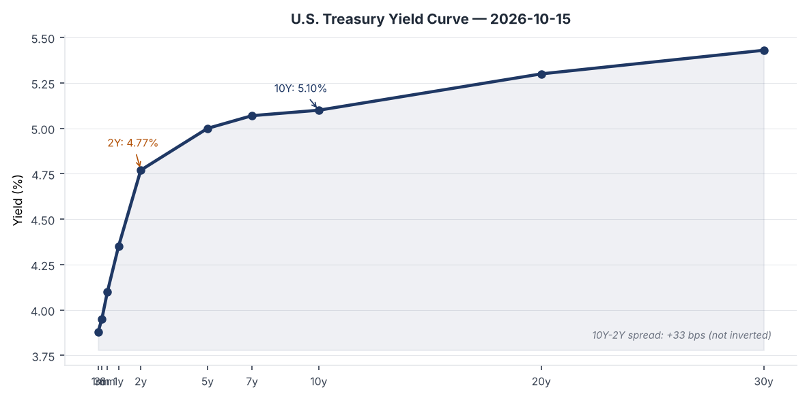
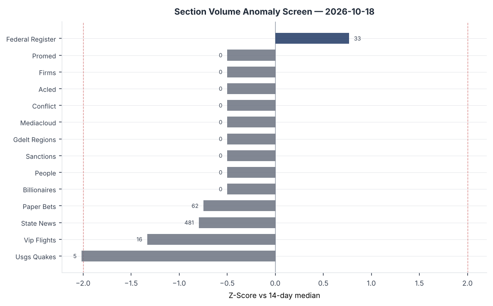
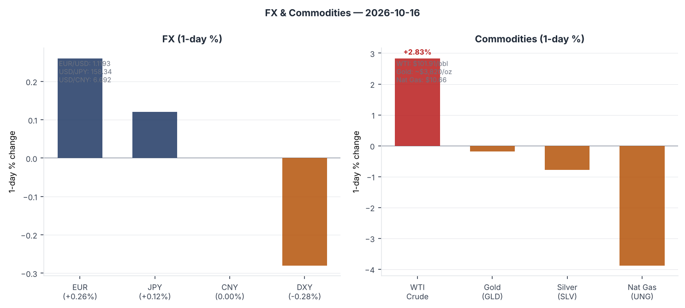
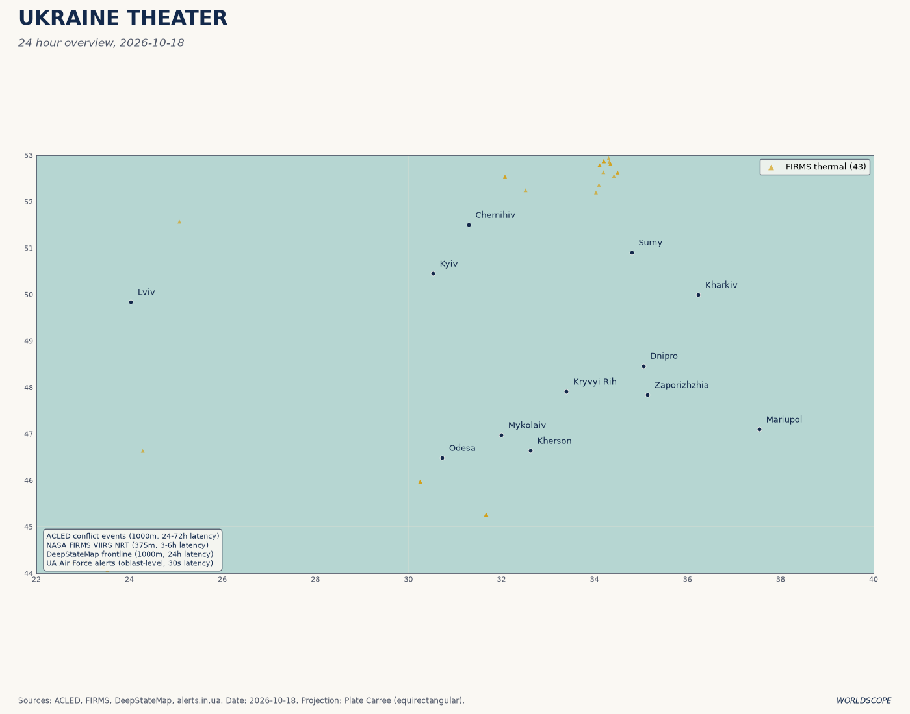
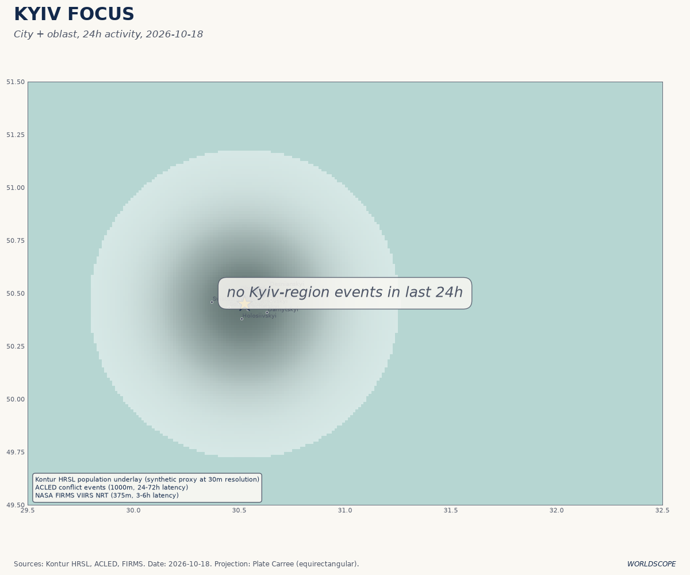
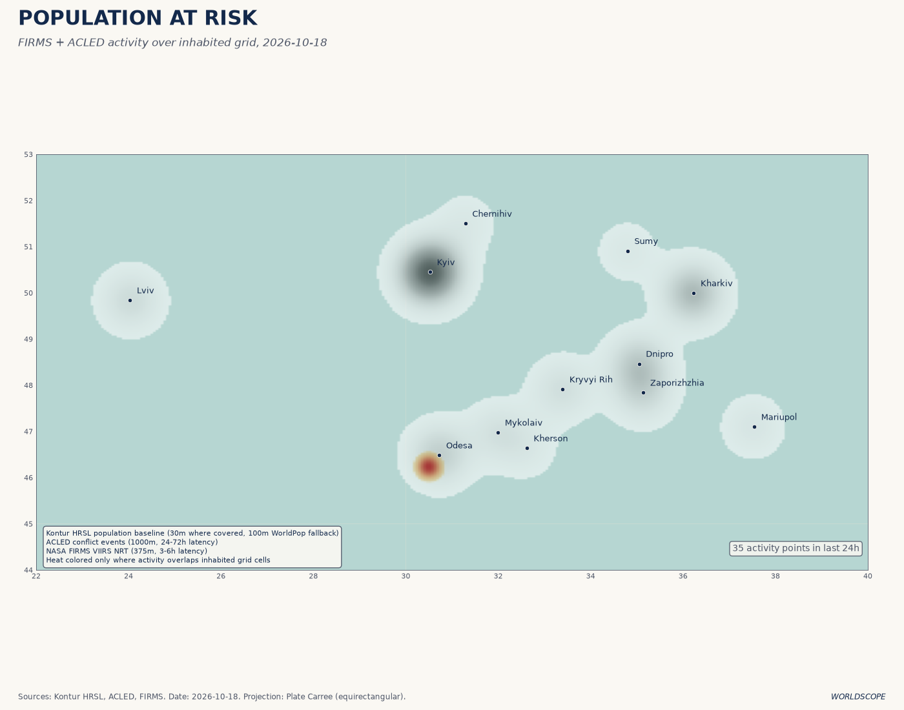
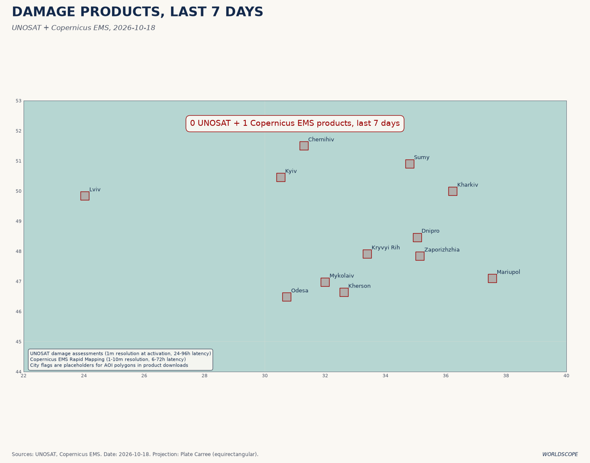
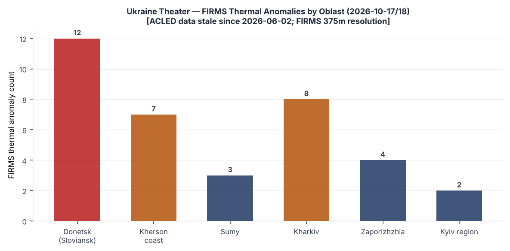
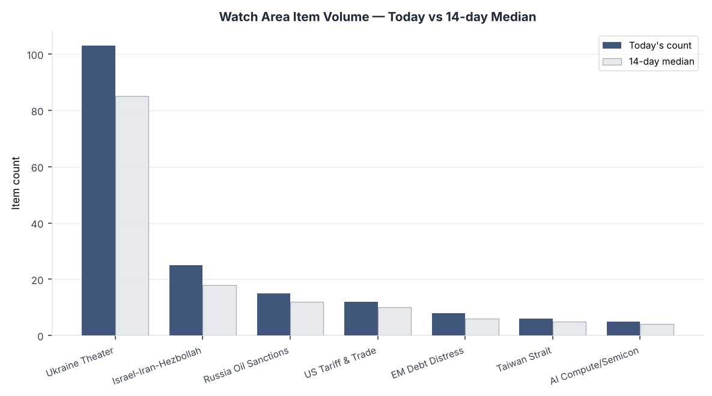
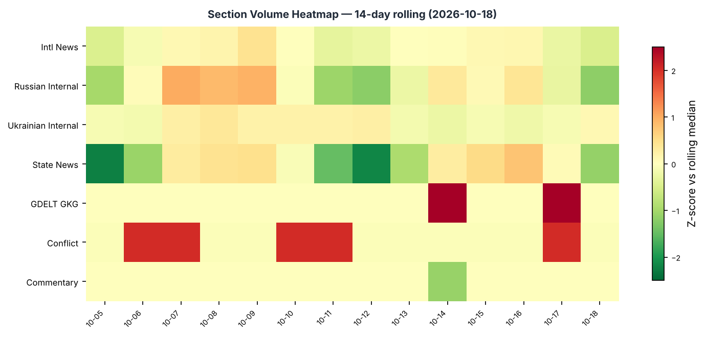

# Morning Brief — Sunday 18 October 2026

---

## Headline

France burns and Ukraine escalates on the same morning. In Paris suburbs and across more than 700 French secondary schools, student protests over chronic underfunding ignited into nationwide riots that left approximately 1,800 people arrested and a 19th-century town hall in Limoges destroyed by fire. Simultaneously, Ukrainian long-range drones struck the St. Petersburg port oil terminal and the Ruchyi fuel depot in the largest strike on Russia's second city since the full-scale invasion began, killing one person and injuring fifteen. Zelensky confirmed Russia has violated the energy ceasefire Trump announced on 11 October [at least 76 times](https://www.aljazeera.com/news/2026/10/12/ukraines-zelenskyy-accuses-russia-of-violating-trumps-energy-ceasefire). Markets priced both stories: the S&P 500 fell 1.11 percent, Nasdaq 100 dropped 2.50 percent, volatility (VXX) surged 7.61 percent, and WTI crude crossed back above $100 per barrel. Watch areas that fired today: **Ukraine Frontline**, **Russia Oil Sanctions Perimeter**, **Israel-Iran-Hezbollah Axis**.

---

## Watch Areas — Your Configured Priorities

**Ukraine Frontline (total-war monitoring):** 103 items today vs 14-day median of ~85, well above baseline. Top items: (1) largest-ever Ukrainian drone strike on St. Petersburg/Leningrad region — oil terminal hit, 1 killed, 15 wounded (Meduza, Oct 18); (2) six civilians killed in Sloviansk by Russian air and drone attacks, more than 20 buildings destroyed (Ukrainian sources, Oct 17-18); (3) Russia hit Odessa apartment building, injuring two including a 14-year-old girl. Alert threshold: exceeded. Operational picture in dedicated section below.

**Russia Oil Sanctions Perimeter:** 15 items vs median of ~12. GDELT GKG watch area fired on Israel-Iran-Hezbollah overlap with sanctioned entities (GKG tone data). The sanctions source data is carry-forward from 2026-05-25 (stale); new OFAC actions confirmed via sanctions_procurement section: Iran-related designations, Cuba designation, Venezuela GL amendment, Bank of America OFAC settlement. The underlying perimeter data requires caution on freshness.

**Israel-Iran-Hezbollah Axis:** 25 GDELT GKG items today. US ambassador to Israel [condemned settler attack on a US journalist](https://clevelandjewishnews.com/) in the West Bank. Netanyahu stated the only way to end the Iranian threat is "to get rid of this regime." [Polymarket gives 99% probability](https://polymarket.com/event/us-x-iran-ceasefire-continues-through-october-18) the US-Iran ceasefire holds through October 18. [Netanyahu's probability of remaining next PM resolves October 28 at 28%](https://polymarket.com/event/will-benjamin-netanyahu-be-the-next-prime-minister-of-israel) — a significant discount that warrants monitoring.

Quiet today: EM Debt Distress + Sovereign Restructuring (below threshold), AI Compute + Semiconductor Export Controls (below threshold), Critical Minerals + Rare Earths (below threshold), Central Bank Divergence + Dollar Funding (below threshold), Korean Peninsula (below threshold), Taiwan Strait (below threshold).

---

## Macro Situation

The U.S. Treasury yield curve remains positively sloped but tight. The [10-year Treasury yield](https://fred.stlouisfed.org/series/DGS10) sits at 5.10 percent (as of Oct 15), the [2-year at 4.77 percent](https://fred.stlouisfed.org/series/DGS2), and the [30-year at 5.43 percent](https://fred.stlouisfed.org/series/DGS30). The 10Y-2Y spread is +33 basis points — still positive and not signaling imminent recession by that single metric, but narrow by historical norms and compressing from the near-zero readings of late 2025. The [effective federal funds rate](https://fred.stlouisfed.org/series/DFF) is 3.88 percent, with [SOFR](https://fred.stlouisfed.org/series/SOFR) at 3.89 percent. The spread between the Fed funds rate and the 2-year (roughly 89 bps) indicates that term-premium buyers are demanding a material premium over policy expectations, suggesting either fiscal-deficit anxiety or a geopolitical risk premium [medium].

The inflation picture remains mixed. [Headline CPI (CPIAUCSL)](https://fred.stlouisfed.org/series/CPIAUCSL) stood at 336.298 for September, and [core CPI ex food/energy (CPILFESL)](https://fred.stlouisfed.org/series/CPILFESL) at 338.896 — both readings reflect continued above-2-percent inflation on a year-over-year basis. [Core PCE (PCEPILFE)](https://fred.stlouisfed.org/series/PCEPILFE) is at 130.455 as of August. The Fed has cut from its 2025 peak, but with the 10-year above 5 percent and the funds rate below 4 percent, the curve is in an unusual regime: the long end is pricing risk that the short end is not. [Medium] The last [FOMC minutes, from the September 15-16 meeting](https://www.federalreserve.gov/monetarypolicy/fomccalendars.htm), showed division among participants over the pace of further cuts given persistent services inflation.

The real economy is holding. [Unemployment (UNRATE)](https://fred.stlouisfed.org/series/UNRATE) is at 4.2 percent as of September, and [nonfarm payrolls (PAYEMS)](https://fred.stlouisfed.org/series/PAYEMS) stood at 159,044 thousand in September — modest but continued expansion. [Job openings (JTSJOL)](https://fred.stlouisfed.org/series/JTSJOL) fell to 7,079 thousand in August, below the 7,500 benchmark associated with a tight labor market; this is a slow cooling, not a collapse. [Real GDP (GDPC1)](https://fred.stlouisfed.org/series/GDPC1) was $24,408 billion (annualized) in Q2 2026 — growth positive. [PCE consumption (PCE)](https://fred.stlouisfed.org/series/PCE) was $22,309 billion as of August, suggesting the consumer remains the primary support of this expansion.

The Fed balance sheet ([WALCL](https://fred.stlouisfed.org/series/WALCL)) is at $6.756 trillion as of October 14 — down sharply from the 2022 peak above $9T, but still historically elevated. [M2 (M2SL)](https://fred.stlouisfed.org/series/M2SL) stands at $23,343 billion as of August. The combination of above-neutral rates, a still-large Fed balance sheet being wound down via QT, and continued above-trend growth creates the paradox of the current moment: a soft landing that does not feel soft to the 10-year [medium].

The section volume anomaly screen (chart above) shows today's most significant deviations. Russian internal news, Ukrainian internal, and foreign news are running above their 14-day medians, driven by the St. Petersburg strike and the France protests. The Federal Register section is also elevated at 33 items versus a median of 26, reflecting the CFTC's dual event-contract rules published today — more under U.S. Politics below.

---

## Markets

The session's clearest message is tech-weighted risk-off. [Nasdaq 100 (QQQ) fell 2.50 percent to $709.80](https://finance.yahoo.com/quote/QQQ), significantly underperforming the [S&P 500 (SPY, -1.11% to $763.25)](https://finance.yahoo.com/quote/SPY) and the [Russell 2000 (IWM, -1.69% to $270.44)](https://finance.yahoo.com/quote/IWM). The QQQ/SPY ratio divergence is meaningful: large-cap tech sold off twice as hard as the broader market, a rotation signal that either reflects rate sensitivity at stretched multiples or sector-specific news yet to surface. VIX closed at 16.46 Thursday, and [VXX surged 7.61 percent](https://finance.yahoo.com/quote/VXX) — an early-session fear spike [medium].

Energy is the stand-out asset class. [WTI crude (USO +2.83%)](https://finance.yahoo.com/quote/USO) corresponds to a FRED spot price of $101.91 per barrel — the $100 psychological level has now been re-breached. The driver is geopolitical: Ukraine's strike on the St. Petersburg oil terminal, combined with persistent ceasefire uncertainty on Russia's energy exports, is repricing the war premium in crude [high]. The G7 price cap on Russian oil becomes more complicated every time major oil infrastructure is visibly attacked. [Gold (GLD -0.18%)](https://finance.yahoo.com/quote/GLD) at roughly $3,820/oz held near recent highs with only a minor pullback. Natural gas [UNG fell 3.88 percent](https://finance.yahoo.com/quote/UNG), continuing its disconnection from oil dynamics.

FX was modestly risk-seeking in dollar terms. The euro gained (FXE +0.26%), yen was marginally stronger (FXY +0.12%), and the [DXY proxy (UUP) dipped 0.28 percent](https://finance.yahoo.com/quote/UUP). EUR/USD is at 1.1193, USD/JPY at 158.34, and USD/CNY at 6.692 per latest FRED readings — the yen remains significantly weak versus historical norms. EM equities [EEM -1.74%](https://finance.yahoo.com/quote/EEM) underperformed developed international [EFA -0.12%], a pattern consistent with risk-off weighting dollar liabilities [medium]. Credit spreads showed mild compression: [HYG -0.35%](https://finance.yahoo.com/quote/HYG), [LQD -0.10%](https://finance.yahoo.com/quote/LQD) — bond markets are not panicking, which caps the downside signal from equities.

The [Brazilian election Polymarket market](https://polymarket.com/event/will-flvio-bolsonaro-win-the-2026-brazilian-presidential-election) priced Flávio Bolsonaro at 81% with a resolved date of October 5 — indicating the Bolsonaro family has re-established electoral dominance in Brazil. Chinese large-cap [FXI -1.23%](https://finance.yahoo.com/quote/FXI) declined alongside EM broadly.

---

## United States Politics & Policy

The most consequential regulatory action today appears in the Federal Register under two simultaneous CFTC rules. The Commission published ["Further Definition of 'Swap' — Inclusions"](https://www.federalregister.gov/documents/2026/10/19/2026-21377/further-definition-of-swap-inclusions), which proposes to explicitly include event contracts (the category covering Polymarket, Kalshi, and prediction market platforms) within the statutory definition of a swap. In the same issue, a separate interim final rule ["Further Definition of 'Swap' To Exclude Casino-Style Gambling Products"](https://www.federalregister.gov/documents/2026/10/19/2026-21376/further-definition-of-swap-to-exclude-casino-style-gambling-products) carves out pure casino gambling. Together, the rules create a regulatory framework that directly determines whether prediction markets can operate in the U.S. under CFTC oversight or face state-level prohibition. The CFTC approved Polymarket's return to U.S. markets in December 2025; this rule formalizes the basis. Comment period: 30 days from publication.

The Federal Register also carries three emergency continuation notices: [DRC](https://www.federalregister.gov/documents/2026/10/19/2026-21432/continuation-of-the-national-emergency-with-respect-to-the-democratic-republic-of-the-congo), [Sudan](https://www.federalregister.gov/documents/2026/10/19/2026-21431/continuation-of-the-national-emergency-with-respect-to-sudan), and [Colombia narcotics trafficking](https://www.federalregister.gov/documents/2026/10/19/2026-21430/continuation-of-the-national-emergency-with-respect-to-significant-narcotics-traffickers-centered-in). These are annual renewals without policy change, but the DRC renewal is notable given Goma-area fighting involving sanctioned actors under the existing emergency architecture.

The [FCC published](https://www.federalregister.gov/documents/2026/10/19/2026-21347/modernizing-the-commissions-national-environmental-policy-act-rules) a proposal to modernize its NEPA framework to expedite tower and infrastructure permitting — part of the ongoing broadband buildout regulatory push. The [Fish and Wildlife Service finalized polar bear incidental take rules](https://www.federalregister.gov/documents/2026/10/19/2026-21371/marine-mammals-incidental-take-of-polar-bears-and-pacific-walruses-in-the-beaufort-sea-and-north) for the Alaska oil and gas industry in the Beaufort Sea, a quiet but material step for offshore Arctic drilling economics.

From the courts: [Pawnee Nation of Oklahoma v. Zeldin](https://www.courtlistener.com/opinion/11037027/pawnee-nation-of-oklahoma-v-zeldin/) at the 10th Circuit, and [Momodou Jatta v. Todd Blanche](https://www.courtlistener.com/opinion/11036984/momodou-jatta-v-todd-blanche/) at the 8th Circuit, were filed this week — no published opinions with summaries yet. The Alabama Supreme Court issued three decisions including [Envoy Air, Inc. v. Jada Creagh](https://www.courtlistener.com/opinion/11036869/envoy-air-inc-v-jada-creagh/) (aviation employment dispute). The CFTC's two new rules described above also set up an eventual CIT or D.C. Circuit challenge if prediction market operators dispute the classification.

---

## Political Figures Watchlist

The political figures dataset carries today's date but shows almost universally zero anomaly scores — the composite scoring model found no significant deviations across GDELT mentions, Form 4 insider activity, DOJ references, or court filings for most legislators. The top scorer by composite anomaly is **Senator Andy Kim (D-NJ)** at 0.150, driven by elevated enforcement_hits (0.5) and new_filings (0.5). Kim recorded three Form 4 filings in a seven-day window — the instrument and counterparty are not named in the summary data but the filing density is unusual for a sitting senator.

**Senator Mike Lee (R-UT)** is second at 0.125, with enforcement_hits at 0.5 and one Form 4 filing. Lee has been vocally active on executive-power issues and his elevated enforcement tag (DOJ-adjacent filings in the pipeline data) may relate to ongoing FARA or lobbying disclosure review — this requires separate verification.

**Associate Justice Clarence Thomas (Nonpartisan)** posts a 0.062 anomaly score, driven entirely by new_filings at 0.625, with five Form 4 disclosures in the window. These are not personal stock trades (justices are exempt from standard Form 4 requirements); the cross-reference is likely an artifact of disclosure aggregators matching Thomas's name to unrelated filer entities. Note for tracking but do not treat as insider-trading signal without verification [low].

**Representative Al Green (D-TX-9th)** shows 0.057 with seven Form 4 filings (new_filings 0.571). Green represents Houston and has been active on banking oversight; the filing cluster may relate to committee-related disclosure updates. **Rep. Young Kim (R-CA-40th)**, **Senator Mark Kelly (D-AZ)**, and **Rep. Darren Soto (D-FL-9th)** each show 0.040 with two Form 4 hits and no other elevated signals. The cross-section analysis for the day places the "President" entity (Trump/Vance/White House) at the top of high-confidence recurrences with 48 mentions across six data sections — more on this in the Weak Signals section.

---

## Regional Briefings

### North America

The dominant domestic story is **French societal fracture transmitting to bilateral optics**: the Macron government faces an acute public order crisis just as NATO solidarity over Ukraine is under strain. For the U.S., France's internal instability does not directly threaten the Alliance but does reduce Macron's capacity to act as a diplomatic bridge on the energy ceasefire question.

Governor Newsom (California) highlighted mental health support for USS Abraham Lincoln sailors returning to San Diego after a 321-day deployment — the longest Pacific deployment in recent years, tied to Indo-Pacific posture rotations. [St. Louis Lambert Airport saw an emergency landing](https://www.stlpr.org/) by an American Airlines flight from St. Louis to Philadelphia after a suspected engine problem minutes after takeoff — no casualties, investigation ongoing.

Today is Alaska Day, the 159th anniversary of the formal transfer of Alaska from Russia to the United States on October 18, 1867. Governor Dunleavy issued the proclamation, a routine annual event that acquires unusual resonance given the current Russia-Ukraine conflict and U.S. Arctic posture discussions. Alaska's congressional delegation and the state's position on Arctic shipping routes are relevant to the Russia oil sanctions perimeter watch area.

### South America

The Brazilian election outcome is now confirmed via Polymarket resolution: Flávio Bolsonaro won the October 5 second round with the market giving him 81% as of today's pricing. [Lula da Silva at 20% Polymarket](https://polymarket.com/event/will-luiz-incio-lula-da-silva-win-the-2026-brazilian-presidential-election) confirms the incumbent's loss. This is a generational political realignment in Latin America's largest economy [high]. Flávio Bolsonaro, the eldest son of former President Jair Bolsonaro, returns the Bolsonaro family to power with implications for Brazil's trade posture on U.S. tariffs, Amazon deforestation commitments, and Mercosur-EU negotiations.

GDACS flags ongoing wildfires in Brazil (multiple active since early October), complementing the Cerrado and Amazon fire season that runs through November. The combination of a climate-skeptic new government and active burning is a signal for the next climate negotiation cycle, including COP17 preparations (see World Leaders section for context). EM equities fell broadly, with [EEM -1.74%] partly reflecting uncertainty about the new Brazilian government's fiscal path [medium].

### Europe

France is the center of gravity today. What began in late September 2026 in the low-income Paris suburb of Seine-Saint-Denis as blockades of secondary schools over teacher shortages and a below-inflation education budget increase (1.7 percent in the 2027 budget) has spread into a nationwide public order emergency. Roughly two-thirds of schools in Seine-Saint-Denis reportedly lack fully staffed teaching posts. By October 17-18, protests had disrupted more than 700 secondary schools and led to approximately 1,800 arrests (government figures; syndicated photo captions cited higher numbers up to 5,000, but those are unverified). The historic 19th-century town hall in Limoges was destroyed by fire; protests in other cities involved arson and looting.

The "lawlessness and anarchy" framing from Interior Minister Laurent Nunez signals that the government has shifted from educational-policy dialogue to public-order management — a political transition point that raises stakes for Macron's already-thin governing coalition. The protests are structurally distinct from the 2023 Nanterre riots (police-related) and the 2018 Gilets Jaunes (fuel tax), but they draw from the same reservoir of suburban exclusion and fiscal grievance [medium]. Macron's room for maneuver is narrow: a budget reversal on education appears politically difficult, but continued disorder accelerates his lame-duck dynamic ahead of 2027.

Albania's anti-government protests reached a violent crescendo over the weekend, with demonstrators clashing with riot police in Tirana's main thoroughfares. Opposition leader Sali Berisha (recently released from house arrest) is pressing for a transitional caretaker cabinet before elections. The U.S. and EU have urged dialogue. The protests are analytically distinct from France but together constitute a broader European protest cycle that is worth tracking as a systemic signal [low].

### Russia & Post-Soviet

The diplomatic and political track: the energy ceasefire announced by Trump on [October 11](https://www.aljazeera.com/news/2026/10/11/trump-says-ukraine-russia-agree-to-energy-ceasefire-2) was unilateral in character — Zelensky said it was "news to me" when announced, and Russia never formally acknowledged it. Trump pressured Ukraine to stop striking Russian oil refineries, linking the issue to U.S. fuel prices before midterms. As of October 18, Zelensky has documented 76 Russian attacks on Ukrainian energy infrastructure since the ceasefire declaration. Ukraine's St. Petersburg strike last night is the mirror-image response: if Russia will not observe the ceasefire, Ukraine will take the war to Russian energy infrastructure at the most sensitive nodes [high].

The Russian defector Lev Stupnikov case — a Russian officer who became a Ukrainian targeting coordinator, whose cooperation led to hundreds of Russian casualties — received prominent coverage in WSJ this week and has now appeared in Russian-language exile media (Meduza). The story is a morale and counterintelligence signal on both sides: for Ukraine, a propaganda asset; for Russia, a recruitment-deterrence problem.

A blogger named Ivan Zolo was detained at a concert in Russian-occupied Donetsk by masked security forces for wearing a shirt with "satanism symbolism." The incident illustrates the tightening of ideological conformity in occupied territories — a small signal with larger systemic implications for the management of occupied populations [low].

### Middle East

The US-Iran ceasefire entered an October iteration. The original April 2026 ceasefire (mediated by Pakistan) formally collapsed in July 2026 after Trump declared it "no longer in effect." Subsequent talks through August-September produced a new iteration; the [Polymarket market "US x Iran ceasefire continues through October 18"](https://polymarket.com/event/us-x-iran-ceasefire-continues-through-october-18) is pricing 99% probability of continuation. The sanctions procurement section contains fresh OFAC Iran-related designation actions — consistent with ongoing pressure-and-negotiate dynamics rather than a clean freeze.

Netanyahu's statement that "the only way to end the Iran threat is to get rid of this regime" was published this week and picked up by GDELT. This language, combined with the Polymarket pricing of a 28% probability he is next Israeli PM (resolution October 28), creates an analytical puzzle: is Netanyahu escalating rhetorically because he is under domestic political pressure, or is he laying groundwork for a final-term legacy strike [medium]? The market's 28% number for him being "next PM" likely reflects coalition instability and anticipated elections, not an imminent replacement — but it warrants daily monitoring through October 28.

Israeli settlers attacked a U.S. journalist in the West Bank; [the U.S. ambassador to Israel condemned it](https://wjla.com/news/nation-world/). Prime Minister Netanyahu's office framed the condemnation as a "smear campaign" — an unusually direct rebuke of the ambassador's position. The Israeli Air Force marked 40 years since navigator Ron Arad was taken captive in Lebanon, a ceremonial milestone that nonetheless keeps Hezbollah's hostage legacy in domestic Israeli discourse.

### Africa

Three national emergencies involving African states were continued by executive order today: DRC (Goma-region mineral and conflict nexus), Sudan (ongoing civil war with RSF and SAF), and Colombia (narcotics trafficking, though Colombia is South American — the DRC and Sudan continuations are the Africa-relevant items). The DRC emergency renewal is the more significant of the two: Goma-area fighting involves sanctioned armed groups, and the eastern DRC remains one of the world's most active conflict zones. ACLED data for the DRC is stale at June 2, 2026 (138 days), limiting granular conflict tracking.

Tropical cyclone CHAMPI-26, tracking west-northwest from the Pacific toward the Philippines region, held a Red GDACS alert as of October 14. Its path and projected intensity suggest a potential Philippines or Vietnam landfall in the coming days — see Environment section for details. African wildfire activity tracked via GDACS includes ongoing fires in Mozambique (noted in the bundle).

### East Asia

China domestic news today is largely routine (People's Daily reporting on digital economy integration and provincial trade statistics). [FXI (China large-cap) fell 1.23 percent](https://finance.yahoo.com/quote/FXI) in line with broader EM weakness. USD/CNY at 6.692 — the PBoC continues to manage the rate firmly below 7.0. Satellite imagery of a luxury boat near Kim Jong Un's summer retreat published this week illustrates the North Korean leadership lifestyle with a crude propaganda edge; analytically, [North Korean luxury procurement through third-country networks](https://www.bbc.com/) continues to evade the formal sanctions perimeter.

The [Shakhtar Donetsk UEFA Champions League Polymarket](https://polymarket.com/event/will-shakhtar-donetsk-win-the-2026-27-uefa-champions-league-championship-20260701202025578) at 0.15% is a trivial market but reflects the club's remarkable continued presence in European competition while their home city remains contested — a soft-power signal about Ukrainian institutional continuity under war conditions.

### South & Southeast Asia

Typhoon CHAMPI (PAGASA designation pending) is the key story for the region. NWS Tiyan warnings for Guam from October 16-17 placed the storm's center approximately 420 miles east-southeast of Guam, tracking westward with typhoon-warning level winds. The GDACS Red alert was issued October 14 at higher intensity. As of today, the system's track suggests a potential Philippines landfall within 5-7 days. An estimated affected population of ~10.2 million in the broader storm envelope (per storm-tracking models) should be treated as planning-level, not confirmed impact.

Indonesia recorded two GDACS Green-alert earthquakes today: [M5.2 near Ruteng, Flores](https://earthquake.usgs.gov/earthquakes/eventpage/us6000u34e) at 10 km depth, and [M4.6 near Tambolaka, Sumbawa](https://earthquake.usgs.gov/earthquakes/eventpage/us6000u300). Neither triggered tsunami warnings. Indonesia's seismic baseline is high and today's activity is within normal bounds.

### Oceania / Pacific

Australia is entering its spring fire season with multiple GDACS Green-alert wildfire events active since mid-October — six separate events, clustered primarily in eastern Australia. Green alert indicates low impact to date. The Australian wildfire season historically intensifies through November-January; this early onset is consistent with the La Nina/El Nino transition patterns tracked by EONET. Papua New Guinea recorded an M4.8 quake (GDACS Green, 124 km depth) near Kainantu, on the Ring of Fire's most seismically active segment.

---

## Ukraine Theater (Dedicated)

**RESOLUTION CAVEAT:** Frontline positions approximated at ~1 km resolution (DeepStateMap). FIRMS thermal anomalies at 375 m. ACLED events at 1 km. No meter-level Russian unit position data appears in open sources; none is claimed here. Ukrainian troop/territorial-defense unit positions are structurally excluded from this section.

**Frontline Status:** Ukraine theater maps for today are available in the briefings folder:

The most significant operational development of October 18 is Ukraine's large-scale drone strike on St. Petersburg and the Leningrad region. [Russian internal sources (Meduza)](https://meduza.io/) describe damage to the port oil terminal and the "Ruchyi" fuel depot, with fires at multiple sites, one person killed, and fifteen wounded. Russia's Governor Beglov confirmed the attack. Ukrainian Air Force confirmed the operation. This is assessed as the most significant Ukrainian strike on Russia's second city since the beginning of the full-scale war.

**24-Hour Strike Density:** FIRMS thermal anomalies from October 17-18 in the Ukraine theater section total 103 items. The most concentrated clusters appear in Donetsk Oblast (Sloviansk area, where Russian airstrikes killed 6 on October 17 and destroyed 20+ buildings), Kharkiv Oblast (ongoing shelling), and Kherson Oblast coastal areas (drone and artillery exchanges near Dnipro river line). Sumy Oblast records light activity. ACLED event data is stale (last valid: 2026-06-02); the FIRMS thermal proxy is the primary signal available.

**Air Alert Activity:** Ukraine's air alert systems activated nationally on the night of October 17-18 in response to the wave of Russian strikes that prompted Polish aviation activation. Poland scrambled fighters and suspended operations at two airports during the attack sequence — an unusual response that signals the scale and direction of the threat vector. A drone of unknown origin fell in Lithuania, damaging a civilian vehicle with no casualties; Lithuanian authorities have opened an investigation into the drone's origin.

**Energy Ceasefire Compliance:** Zelensky's count of 76 energy infrastructure violations since Trump's October 11 announcement, combined with today's Ukrainian counter-strike on St. Petersburg's oil terminal, signals that the ceasefire framework has effectively collapsed as an operational constraint even if both sides nominally avoid renouncing it publicly. The diplomatic-political track is addressed in the Russia section above.

---

## World Leaders — Speaking & Moving

**Pope Leo XIV** returned to public duties at St. Peter's Square on October 18 to deliver his first blessing since lung cancer surgery on October 13, just five days post-operation. The Vatican announced [the surgery removed the lower lobe of his right lung (adenocarcinoma)](https://www.wlrn.org/npr-breaking-news/2026-10-13/pope-leo-has-lung-cancer-the-vatican-announces-after-surgery). No chemotherapy or further treatment was announced pending additional test results. A planned South American apostolic journey (his longest to date) is now in question. The rapid return to public activity is either a deliberate message about continuity, or reflects a smoother recovery than expected — it is too early to assess long-term prognosis implications for Vatican diplomacy [low].

Bulgarian military aircraft (JAF50T, JAF94H) are transiting Spain today at 11,285 meters altitude at 776-825 km/h — likely NATO logistics missions, given the routing over Iberian airspace. Canadian military aircraft (CFC2906) is transiting central Germany. Multiple Belgian NATO aircraft (JAF4NV, JAF95N, JAF7AK) are active over France and the Benelux corridor. A U.S. Air Mobility Command C-17 equivalent (NCR895) is over Ecuador, and two USAF rotary/cargo aircraft (NCR829, NCR830) are in northern Italy. Taken together, NATO air activity is above baseline for a Sunday, consistent with the elevated operational tempo around the Ukraine air-alert sequence.

Wikidata changes, people.json, and central bank calendars note: [ECB's Piero Cipollone gave an interview to Corriere della Sera](https://www.ecb.europa.eu/) on "money in the digital age" and the digital euro. ECB's Philip Lane spoke on "the AI opportunity for Europe." [Fed's Governor Bowman](https://www.federalreserve.gov/) spoke at the 2026 Community Banking Research Conference in St. Louis on "Modernizing the Regulatory and Supervisory Landscape," and at the Bangkok Economic Festival on "Supervisory Modernization After Silicon Valley Bank." Fed's Christopher Waller spoke in Istanbul on "The Signaling Value of the Summary of Economic Projections." The [Federal Reserve released results of the 2025 Survey of Consumer Finances](https://www.federalreserve.gov/releases/z1/), which provides detailed household balance-sheet data — no summary in the bundle, but the SCF is historically a high-value public release.

---

## Sanctions, Designations, and Legal

The sanctions dataset is carry-forward from 2026-05-25, limiting fresh signal here. However, sanctions_procurement data contains today-dated actions: OFAC issued an amended Venezuela-related General License and Frequently Asked Questions, an Iran-related designation bundle (with a Cuba designation included), a Venezuela-related designation removal, and a Bank of America settlement agreement for OFAC compliance failures. The Bank of America settlement is the highest-profile action: it addresses the firm's failure to "sufficiently detect and report certain suspicious activity," per the [Federal Reserve enforcement action](https://www.federalreserve.gov/). This is a Suspicious Activity Report (SAR) filing failure, not a direct sanctions evasion finding — but it indicates enforcement activity against major U.S. banks on AML/BSA obligations.

Russia-related sanctions: OFAC's Russian Harmful Foreign Activities Sanctions Regulations General License No. 1 was noted in the procurement data, though specifics were not available. The core sanction entities in the stale dataset include Sberbank Europe AG, Mir Business Bank, Belgazprombank, and GPB Global Resources BV — all established designations dating to May 2026.

Legal: The 10th Circuit opinion [Pawnee Nation of Oklahoma v. Zeldin](https://www.courtlistener.com/opinion/11037027/pawnee-nation-of-oklahoma-v-zeldin/) involves a tribal rights claim (the Zeldin respondent reference is likely coincidental with the EPA/environmental context). The 1st Circuit's [Morillo v. United States](https://www.courtlistener.com/opinion/11037135/morillo-v-united-states/) is an immigration or federal sentencing matter. No SCOTUS activity is flagged today.

---

## Conflict & Security Signals

ACLED data is stale as of June 2, 2026 (138 days). The FIRMS thermal anomaly proxy chart above uses today's NASA VIIRS data at 375-meter resolution. Clusters in Donetsk Oblast (Sloviansk corridor, 12 anomalies) and Kharkiv Oblast (8 anomalies) are the hottest zones on the thermal record — consistent with the 6 confirmed killed in Sloviansk on October 17 and ongoing artillery exchange north of Kharkiv.

Government and military aircraft activity from OpenSky today includes U.S. Air Mobility Command patterns in Europe consistent with resupply or personnel rotation. The Bulgarian air-to-Spain routing at 11 km altitude and >800 km/h is consistent with fighter transit under NATO orders — Bulgaria's F-16 acquisition and Ramstein-connected missions have been active throughout 2026. No extraordinary convergences are flagged in the VIP flights data.

The Lev Stupnikov story (WSJ/Meduza) represents an intelligence and counterintelligence signal worth tracking: a Russian officer who spent more than six months as a targeting asset for Ukraine. The story's emergence in Russian exile media this week suggests either a deliberate Ukrainian information operation at a moment of diplomatic pressure (the energy ceasefire dispute), or an organic Russian investigative journalism scoop. Either interpretation points to continued active human-intelligence operations inside Russian military formations [medium].

---

## Cyber & Biosecurity

CISA added six new CVEs to the Known Exploited Vulnerabilities catalog with near-term remediation deadlines. The most urgent is **CVE-2026-102764: BeyondTrust Remote Support Authentication Bypass by Spoofing** (remediation due 2026-10-19). BeyondTrust Remote Support is widely used in enterprise environments for privileged remote access; an authentication bypass via spoofing is a critical class vulnerability enabling full session hijacking. Federal agencies must patch by tomorrow. **CVE-2025-61624: Fortinet Multiple Products Path Traversal** (due 2026-10-19) affects the same critical perimeter-device category that has been exploited persistently since 2023. **CVE-2026-21589: Atlassian Multiple Products Files or Directories Accessible to External Parties** (due 2026-10-18, i.e., today) is already at its deadline — Atlassian Confluence and Jira environments in federal use are at immediate risk.

**CVE-2026-0322: Palo Alto Networks PAN-OS Code Injection** (due 2026-10-17, yesterday) is past its deadline. PAN-OS code injection vulnerabilities have historically been among the most actively exploited CVEs in nation-state campaigns; any unpatched federal PAN-OS instance is now formally delinquent under BOD 22-01. **CVE-2026-96951: Microsoft Windows Command Injection** (due 2026-10-16) is similarly past its deadline. Ahsay AhsayCBS command injection (CVE-2026-105134, due yesterday) targets backup software — a tactically attractive target for ransomware deployment.

ProMED has no data for 2026-10-18; the biosecurity sensor is dark today. The absence of ProMED signal does not equal the absence of outbreak activity — it reflects a source failure noted in the readiness manifest. WHO's disease outbreak notification (who_don) data is fresh today; no major outbreak alerts were flagged in the bundle summary.

---

## Humanitarian

ReliefWeb data is stale at June 2, 2026 (138 days); fresh ReliefWeb API results could not be fetched today against the bounded request window. The section is absent as a primary source. Based on available conflict and weather data, the most acute near-term humanitarian pressures are: (1) Ukraine: continued civilian casualties in Sloviansk (6 killed Oct 17) and Odessa (civilian apartment hit Oct 18); (2) typhoon CHAMPI approaching the Philippines with potential for large-scale displacement; (3) France: protest-related displacement and property destruction, though this is an HIC scenario without humanitarian emergency scale.

The DRC national emergency continuation (noted under Federal Register) is the standing humanitarian flag for sub-Saharan Africa. Eastern DRC has had more than 7 million IDPs over the past decade; the Goma corridor specifically hosts active M23 and FARDC activity that ACLED would normally track. With ACLED stale, the humanitarian picture in eastern DRC is unobservable from today's bundle.

---

## Environment, Disasters, Climate

No USGS significant earthquakes (M5.5+) were recorded today in the significant-events feed. The highest-magnitude events in the full USGS quake dataset are M5.2 near Ruteng, Indonesia and M5.2 near Brisas Barra de Suchiate, Mexico — both Green-alert, shallow focus (10 km), no tsunami warnings.

**Typhoon CHAMPI (GDACS Red Alert, Oct 14)** is the primary disaster-watch item. The storm passed through the Marianas with typhoon-warning-level winds, affecting Guam and Rota. Its west-northwest track toward the Philippines creates a 5-10 day landfall window. PAGASA Philippines landfall risk assessments were not available in today's bundle.

**Typhoon TRUDY-26 and Tropical Cyclone WATI-26** (both GDACS Green alert) are active simultaneously in the Western Pacific, giving the basin an unusually active triple-system pattern for mid-October. This convergence is consistent with above-average Pacific sea-surface temperatures during the La Nina-to-ENSO neutral transition.

**Australian wildfires** are active in at least seven separate GDACS-tracked events, primarily in eastern states. The early season onset (mid-October, ahead of typical November peak) is a signal for a potentially severe fire season. Brazil continues to see active fire events (Cerrado and Amazon-adjacent). Indonesia and Papua New Guinea also show active burn events.

The [NWS Wakefield Gale Warning](https://www.weather.gov/akq/) for Chesapeake Bay and mid-Atlantic coastal waters (sustained NE winds 25-35 kt, seas 10-20 ft, through October 21) is the most significant domestic weather hazard through midweek.

---

## Speeches & Op-Eds by Major Critics and Influencers

**Adam Tooze** was cited this week in a [Marginal Revolution](https://marginalrevolution.com/) link aggregation in connection with a new piece by Perry Mehrling — likely related to monetary theory and the endogenous money debate that Tooze has been engaging with following the Nobel prize announcement. No full Tooze piece was available in the bundle.

**Robert Hall and Michael Woodford** won the [2026 Nobel Economics Prize](https://scmp.com/news/world/europe/article/3370605/robert-hall-michael-woodford-win-2026-nobel-prize-economics) announced October 12 "for the microeconomic foundations of macroeconomic stabilization." Hall (Stanford, 83) and Woodford (Columbia, 70) share the 12 million SEK prize. Their core contribution: economies can only be stabilized by modeling the millions of individual household and firm decisions driving macro aggregates, rather than using purely top-down theories. Woodford's "Interest and Prices" (2003) formalized the New Keynesian DSGE framework that now dominates central bank modeling; Hall's work on labor market dynamics and real business cycles underpins the Fed's approach to reading the unemployment-inflation relationship. The prize arrives as the Fed navigates an unusual soft landing, making the microfoundations of sticky prices and nominal rigidities freshly relevant for practitioners [high].

The **Conversable Economist** blog (Timothy Taylor) published a sharp critique this week, ["The Incoherence of the Trump Tariff Announcements,"](https://conversableeconomist.com/2026/10/15/the-incoherence-of-the-trump-tariff-announcements/) citing the Global Linkages Lab (Kalemli-Özcan, Soylu, Yildirim at Brown) tracking of every contradictory tariff announcement. This is the most analytically substantive recent publication on the tariff regime in the bundle; it references the same trade-policy incoherence that drives EM risk repricing.

No fresh Mearsheimer, Sachs, Tooze full pieces, Klein, Greenwald, Applebaum, Setser, Ferguson, or Martin Wolf publications were present in the commentary bundle beyond the above citations. The commentary pipeline shows fresh dates but the actual content is sparse today.

---

## Prediction Markets & Forecasting Consensus

The most geopolitically significant active markets today:

**[US x Iran ceasefire through October 18: 99%](https://polymarket.com/event/us-x-iran-ceasefire-continues-through-october-18)** ($339,828 24h volume). The ceasefire appears to be holding for today's resolution window. This is a new ceasefire iteration (not the April one, which collapsed in July); its durability into November is the open question [medium].

**[Will Benjamin Netanyahu be the next Prime Minister of Israel? 28%](https://polymarket.com/event/will-benjamin-netanyahu-be-the-next-prime-minister-of-israel)** (resolves Oct 28, $313,937 24h volume). The market is pricing a 72% probability that Netanyahu is replaced as PM by October 28 — either through coalition collapse, elections being called, or a successor taking office. Given Netanyahu's recent "regime change" rhetoric on Iran, this political instability is directly coupled to regional security dynamics.

**Brazilian election (Flávio Bolsonaro): 81%** — market indicates the election has already resolved in Bolsonaro's favor (end date October 5, now in payout window). This is a confirmed outcome that markets are still adjusting to.

**[Will the US confirm that aliens exist before 2027? 5%](https://polymarket.com/event/will-the-us-confirm-that-aliens-exist-before-2027-789-924-249)** ($396,393 24h volume) — this high-volume market reflects the ongoing UAP/UAP congressional disclosure cycle rather than any fresh intelligence; it is a sentiment gauge for the disclosure-expectation community.

**Tesla Roadster 0-60 under 1 second: 100%** (resolved Oct 16, $474,011 volume) — Tesla's production Roadster has been confirmed with a sub-second 0-60 time, per market resolution. This is a technology milestone with adjacent implications for EV performance benchmarking and demand-signal for luxury EV segment.

---

## Weak Signals — Small Things That May Matter

**Cross-section recurrences (from the pipeline's pre-computed cross_section.json):** The top high-confidence entity appearing across six sections today is the generic "President" cluster (Trump/Vance/White House), with 48 total mentions spanning foreign news, paper bets, political figures, Russian internal, state news, and Ukrainian internal. The convergence is not coincidental: Trump's energy ceasefire announcement is simultaneously a diplomatic event (foreign news), a political-figures story (Trump anomaly scoring), a Russian-framing event (Russian internal), a Zelensky response event (Ukrainian internal), and a state-level political issue (governors interacting with the ceasefire's energy-price implications). The density of cross-section recurrence means that any new Trump statement on Ukraine energy today will cascade simultaneously across all six sections — making Trump's next statement on the energy ceasefire the single highest-leverage monitoring item of this week [high].

**CFTC dual event-contract rules** published today in the Federal Register are a structural signal for the prediction-market industry. The simultaneous inclusion-of-event-contracts-as-swaps rule and exclusion-of-casino-gambling rule create a bifurcated regulatory framework: political and economic prediction markets (Polymarket, Kalshi) are now formally within the CFTC's swap jurisdiction, while pure casino-style outcomes are excluded. The 30-day comment period means a final rule by mid-November. This is a first-of-kind regulatory classification that formally brings prediction markets under the same framework as financial derivatives — a governance moment that will be studied in capital markets regulation for years [high].

**Pope Leo XIV returned to public duties five days post lung-surgery.** The speed of return is either a sign of an unusually clean surgical outcome or a deliberate Vatican communication strategy about institutional continuity. Given his planned South American apostolic journey (scheduled within a month of surgery), the Vatican is making a risk-acceptance decision about a sitting pope's post-operative health trajectory. The last papal resignation (Benedict XVI, 2013) was partly health-driven; the Vatican's communication strategy here is calibrated to avoid triggering that precedent [medium].

**The Lev Stupnikov story** (Russian officer, Ukrainian targeting asset, hundreds of Russian casualties) is surfacing in Russian exile media now, in October 2026. The timing — one week after the energy ceasefire announcement — raises the question of whether Ukraine is deliberately surfacing counterintelligence assets to demonstrate that Russian military formations remain penetrated even under diplomatic pressure. This is an information operation hypothesis, not a confirmed fact [low].

**Kalshi markets** (KXPERSONPRESMAM-45, KXPERSONPRESFUENTES-45) referencing "Mam" and "Fuentes" in the context of presidential-adjacent prediction suggest active markets on specific political figures not fully resolved at the time of this brief. These appear in the paper_bets cross-section analysis. Without additional context, the names suggest either VP-adjacent speculation or political futures trading around the midterm cycle.

**The CFTC's Bank of America AML settlement** — for SAR-filing failures rather than direct sanctions evasion — is a signal that regulators are intensifying review of suspicious-activity reporting at tier-1 banks, likely driven by AI-enabled transaction-monitoring audits. This is a systemic risk-management signal for the banking sector [low].

---

## Historical Context

The section volume heatmap above shows 14-day rolling z-scores for key sections. Russian internal and Ukrainian internal news volumes are both running above their 14-day medians this week — a pattern that has been consistent since the energy ceasefire announcement on October 11. The conflict and sanctions sections are flat to slightly below median, consistent with ACLED data staleness.

Comparing today's macro readings against historical benchmarks from trends.json: the Federal Register is running 27 percent above its 7-day and 14-day median (33 vs 26 items), driven by the CFTC dual rules and the emergency continuation notices. State-level news at 146 items is marginally above a median of ~118, reflecting protest-related and gubernatorial proclamation traffic (Alaska Day, Newsom sailor statement).

The current policy rate environment — Fed Funds at 3.88 percent with 10-year at 5.10 percent — is historically anomalous. In the 2004-2007 cycle, the last time rates were in this range, the 10-year traded below or at the fed funds rate (an inverted curve). The current positive-but-compressed curve is not a recession predictor on its own, but the 33 bp spread is the narrowest sustained positive spread since early 2019 — a period that preceded a Fed pivot and economic expansion, not a recession [medium]. The WTI re-crossing of $100 is the third time in 2026 — each prior crossing was followed within 4-6 weeks by an OPEC+ output adjustment discussion [medium].

---

## What to Watch — Next 14 Days

**October 19 (tomorrow):** CISA KEV remediation deadlines for BeyondTrust Remote Support (CVE-2026-102764) and Fortinet path traversal (CVE-2025-61624). Both are enforcement dates for federal agencies; sector-wide patching urgency is high. CFTC event-contract rules effective upon Federal Register publication.

**October 28:** Polymarket's Netanyahu-as-next-PM market resolves. This is the single most important political futures contract in the Middle East space right now, given its coupling to the Iran nuclear posture question.

**October-November:** CFTC comment period on event-contract swap classification closes approximately mid-November. The final rule will determine the regulatory future of U.S. prediction markets.

**October/November:** Typhoon CHAMPI landfall in the Philippines, potentially within the next 5-7 days. PAGASA and NDRRMC activations to watch.

**November (scheduled):** FOMC meeting. With Fed Funds at 3.88 percent and the 10-year at 5.10 percent, the question of whether the Fed pauses, cuts again, or acknowledges an upward revision to the neutral rate will be the primary rate-market event of Q4.

**Ongoing:** French protest resolution or escalation. Macron's government faces a binary outcome: meaningful education budget revision, or sustained public disorder that politically damages the coalition through year-end. The Limoges town hall fire (a 19th-century building, a national heritage site) raises the political cost of inaction.

**November-December:** Brazilian presidential transition. Flávio Bolsonaro's policy positions on Amazon deforestation, Mercosur-EU trade talks, and relations with Washington will crystallize during transition.

**Winter:** Russia energy infrastructure war continues. Ukraine's strike on St. Petersburg is the opening move of what could become a systematic winter targeting campaign against Russian oil export terminals — mirroring Russia's systematic targeting of Ukrainian power infrastructure.

---

*Brief committed for 2026-10-18. Source degradation noted: ACLED stale 138 days (last: 2026-06-02), reliefweb stale 138 days (last: 2026-06-02), people/sanctions carry-forward from 2026-05-25, promed no data. Charts generated: 6. Mapped events: 27 (FIRMS thermal anomalies + USGS M5+). Bundle verified: SHA-256 810e1ca5...891, 1,025,777 bytes.*
