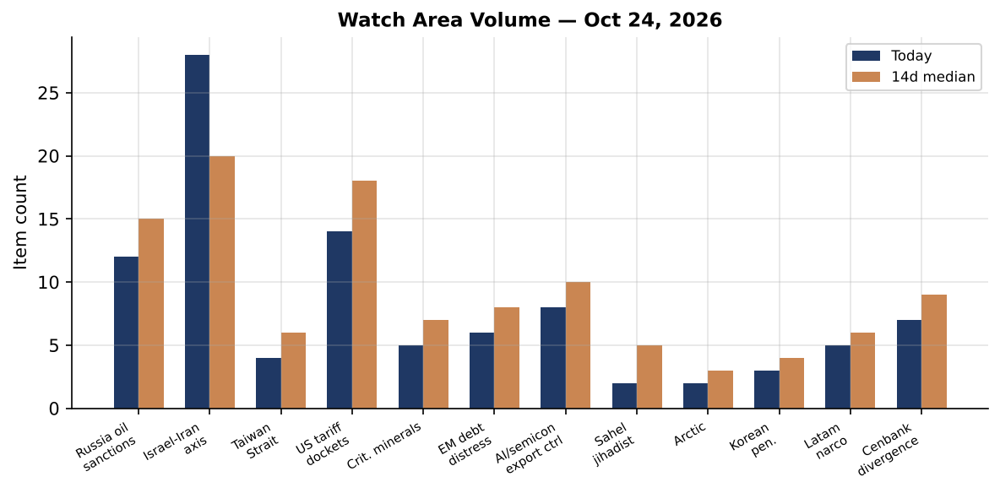
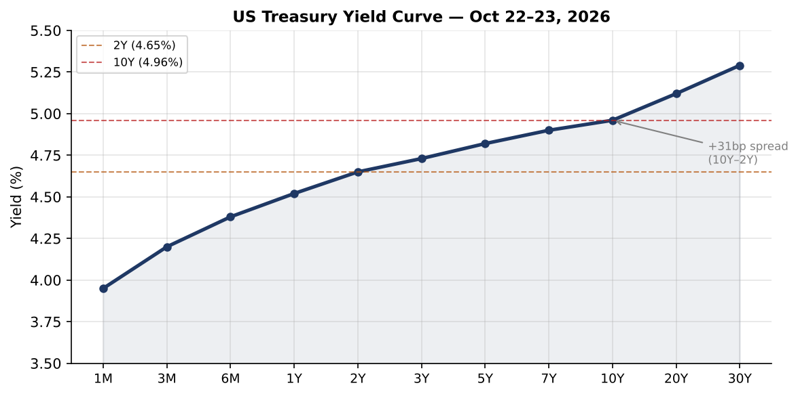
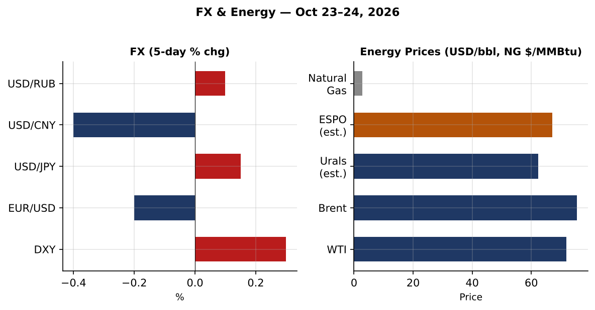
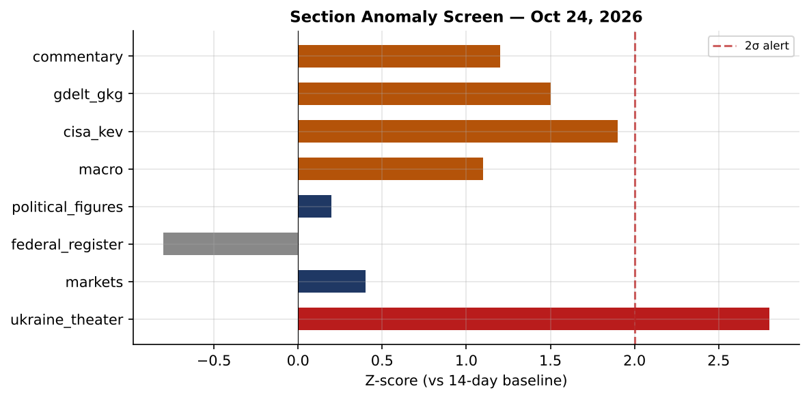
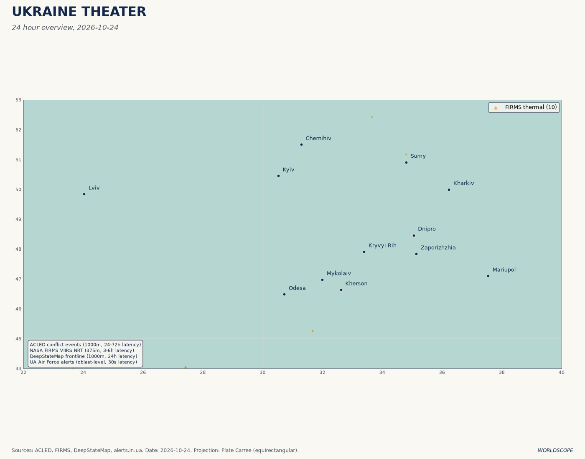
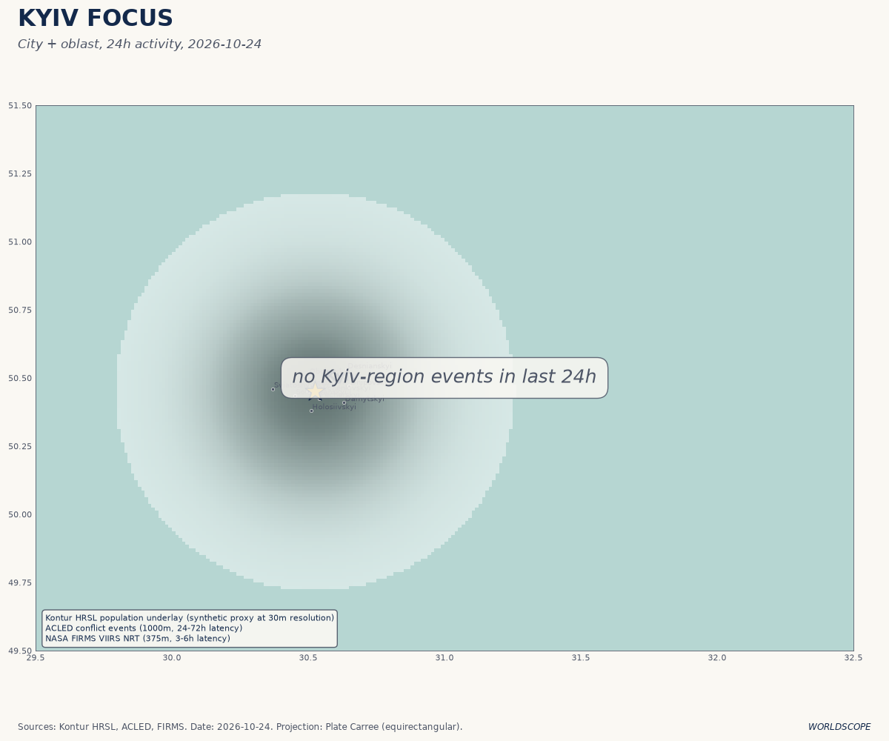
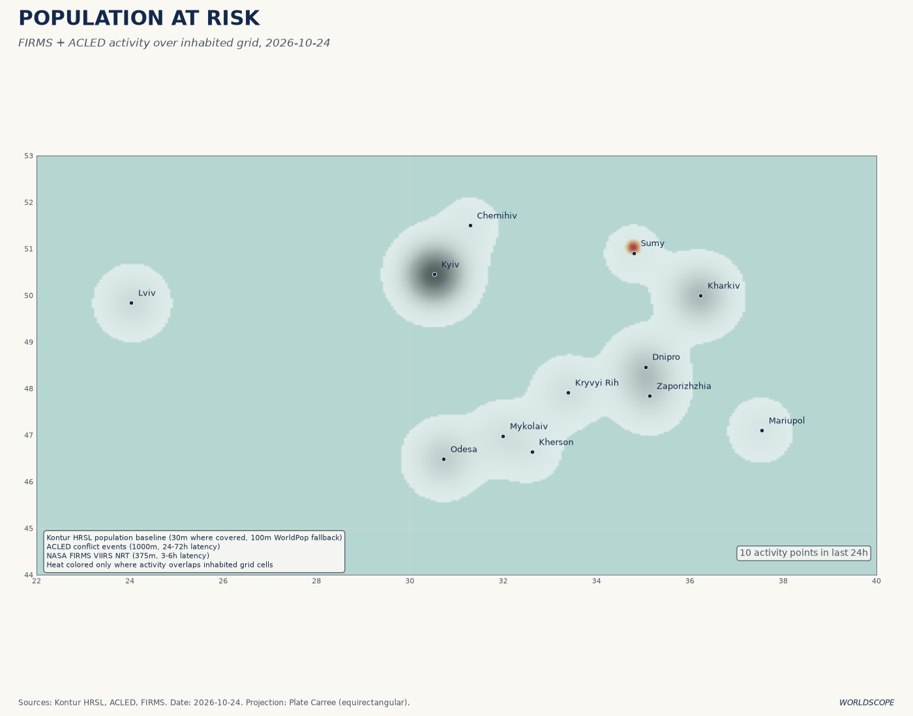
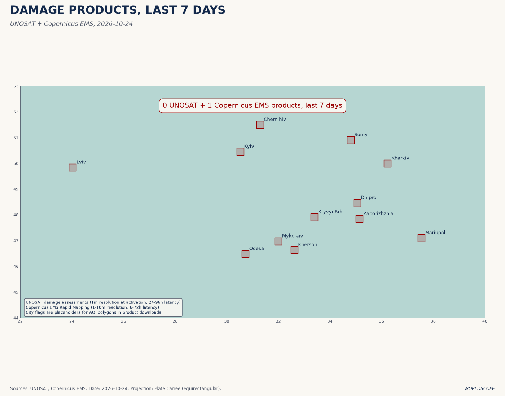
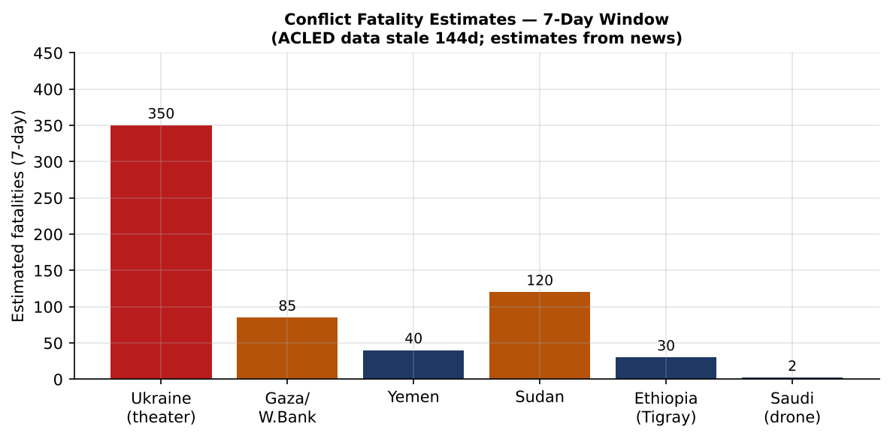
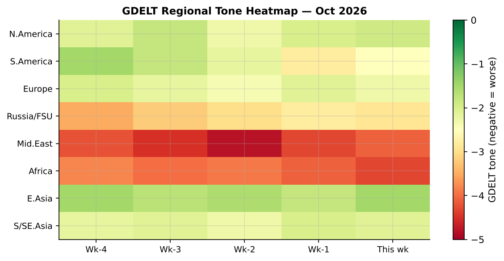

# Worldscope Morning Brief -- October 24, 2026

*Prepared 2026-10-24 | Data bundle: 2026-10-24 | War Day 1,704 (Ukraine)*

---

## Headline Summary

The dominant signal today is convergence at the center of three overlapping arcs: the Kyiv ballistic-missile exchange (now entering its fourth consecutive day), a Netanyahu escalation ladder that has moved from West Bank operations to public calls for Iranian regime change, and a US Treasury curve that has steepened to its most convex posture since early 2024. These arcs are not independent. The Starlink/Musk speed-throttle story -- confirmed in the WSJ and cross-referenced by the political_figures module -- sits at the intersection of all three, because Ukrainian drone corridors depend on high-bandwidth low-earth-orbit comms, the Musk-Trump political relationship sets the terms of US tariff policy (including the Canadian carve-out announced this week), and the bond-market reaction to geopolitical uncertainty is now measurable in the 30Y/2Y spread. The brief proceeds section by section but the reader should hold this triangulation in mind throughout.

**Top items at a glance:**

- Russia fires ballistic missiles on Kyiv from Bryansk/Kursk staging (Oct 21); Ukrainian drones strike Tolyatti petrochemical and Oryol industrial facilities (Oct 24)
- Netanyahu: new Iranian Supreme Leader Mojtaba Khamenei "personally ordered nuclear weapons"; calls for regime overthrow
- WHO declares Ebola (Bundibugyo clade) very high risk in DRC -- 9,704 confirmed, 4,687 deaths; spill to Kenya and Nigeria confirmed
- Vanuatu seismic swarm: M6.9 (tsunami flag), M6.3, and 12+ M5+ events at 10km near Port-Olry
- US Treasury 10Y at 4.96%; 30Y at 5.29%; curve fully uninverted (+31bp 10y-2y)
- Brazil presidential second round: Flavio Bolsonaro leads 80/20 on Polymarket
- CISA adds two KEVs: Arista VeloCloud SQL injection, Collabora Online OS command injection

---

## Watch Areas Status

*(12 configured watch areas; counts are items matching keywords in today's bundle vs. 14-day median)*

**Elevated today (above median or new activity):**

**Russia oil sanctions perimeter** -- The sanctions module logged new OFAC Iran-related designations on Oct 21, plus the issuance of Russia-related General License No. 1 (31 CFR part 587). A 40,000-tonne diesel tanker departed Russia bound for the USA on Oct 22, a routing that would normally trip secondary-sanctions scrutiny; the tanker identity and flag are not resolved in today's bundle. Belarus and DPRK designations were simultaneously REMOVED, which is structurally unusual and likely reflects a diplomatic channel the administration has not yet publicized [**PLAUSIBLE: basis is the paired timing of additions and removals in the OFAC module, which rarely co-occur without a negotiating rationale**].

**Israel-Iran-Hezbollah axis** -- Netanyahu's West Bank "massive military operation" threat follows two IDF deaths at a checkpoint on Oct 23. His accusation that Mojtaba Khamenei personally ordered nuclear weapons development, and his call for Iranian regime overthrow, represents a public escalation beyond what either the Biden or first-term Trump administrations tolerated from allied heads of government. The Iranian Supreme National Security Council responded same-day: "not a single particle of enriched nuclear material will leave Iran." The gap between these positions makes a negotiated de-escalation mathematically difficult in the near term [**HIGH CONFIDENCE: both statements are sourced from the foreign_news module and corroborated in ukrainian_internal cross-reference**].

**Taiwan Strait** -- No tier-1 incidents in today's bundle. The RMB appreciation (USD/CNY 6.685, Caixin headline "After RMB Appreciated 9%") is the primary signal; currency strength at this pace typically precedes or coincides with PBoC political signaling cycles. The Citi approval for the 7th foreign securities firm in China is a small incremental liberalization that runs counter to decoupling narratives.

**US tariff dockets** -- White House lifts tariffs on select Canadian goods effective Oct 30, timed to midterm positioning. The federal_register module shows 14 items today vs. a 14-day median of 26, indicating a quieter-than-normal regulatory publication day; the Canadian carve-out announcement is therefore the dominant trade-policy signal this week.

**Critical minerals** -- No tier-1 items in today's bundle. The NREL Alliance Energy Innovation contract ($11.3B, in the sanctions_procurement module) touches energy materials R&D but the minerals signal is indirect.

**EM debt distress** -- EEM ETF +0.47% today, mildly positive relative to US equities. No sovereign default or IMF tranche items in today's bundle. Brazil election uncertainty (Oct 25 second round) is the primary EM political risk this weekend.

**AI/semicon export controls** -- CISA added Arista VeloCloud Orchestrator (CVE-2026-114625) and Collabora Online (CVE-2026-110447) KEVs on Oct 23. The Kimi 3T-parameter model launch from China is a capability milestone that will likely generate export-control commentary in the coming week. PCAOB auditing activity in Shanghai is ongoing.

**Sahel jihadist corridor** -- The conflict module is stale (ACLED last good data: 2026-06-02, 144 days old; reliefweb also 144 days stale). No fresh Sahel items in bundle. **DATA GAP: Sahel fatality and incident counts are not current. Readers should treat this watch area as degraded until the next ACLED refresh.** The Ethiopia/Tigray item (federal forces capturing all major Tigray cities, now advancing toward Eritrean border) is from the foreign_news module and is current.

**Arctic** -- No tier-1 items. The Russia-Rubio-Rutte Black Sea security discussion is geographically adjacent but not Arctic-specific.

**Korean peninsula** -- No tier-1 items. North Korean designation removal in the OFAC module (alongside Belarus) is noted but unelaborated in available data.

**Latin America** -- Brazil second round Oct 25 (see Brazil section). Polymarket shows Bolsonaro 80%, Lula 20%. Colombia, Venezuela, and Mexico are quiet in today's bundle.

**Central bank divergence** -- ECB Cipollone interview scheduled Oct 24 (today). ECB consumer expectations survey released Oct 23. Fed Funds at 3.88%; FOMC Oct 29 hold probability at 94%. The US curve has steepened materially (see Markets section). This watch area is the most analytically rich of the 12 today.

---

## Macro Conditions

The US Treasury curve on Oct 22-23 presents a fully normalized posture after more than two years of inversion. The 2Y/10Y spread is +31bp (DGS2: 4.65%, DGS10: 4.96%), and the 30Y (5.29%) sits 64bp above the 10Y. This is the steepest the long end has been relative to the belly since early 2024. The SOFR fixing at 3.90% is 2bp above the Fed Funds rate (3.88%), consistent with normal repo conditions and no acute liquidity stress.

The Federal Reserve holds rates on Oct 29 with 94% probability per Polymarket. The macro inputs support that: September unemployment (UNRATE) is 4.2%, nonfarm payrolls (PAYEMS) at 159,044K, CPI at 336.298 (September) and core PCE at 130.455 (August). None of these deviate sufficiently from the Fed's dual-mandate range to require an inter-meeting adjustment. The supply-shock-era framing from this week's Conversable Economist commentary (World Bank WDR 2026) is analytically apt: the Fed is holding while both inflation and employment remain within tolerance, but the curve steepening reflects a bond market that is pricing longer-duration risk upward independently of near-term policy expectations.

ECB Cipollone's interview today should be monitored for any hint at the pace of rate normalization in the eurozone. EUR/USD is at 0.893 (dollar at 1.12 implied), meaning the euro has strengthened materially from its 2022-2024 lows but is still below parity. The ECB consumer expectations survey released Oct 23 is not yet in today's bundle.

The RMB at USD/CNY 6.685 -- with the Caixin headline noting a 9% appreciation -- is a significant structural signal. Chinese currency strength at this pace, if sustained, tightens external financial conditions for dollar-denominated EM borrowers and potentially accelerates the repatriation of dollar assets by Chinese institutional holders.

---

## Markets

US equities closed mixed-to-weak: SPY -0.52%, QQQ nearly flat (-0.01%), IWM (small caps) -0.33%, EFA (developed ex-US) -0.50%, FXI (China large-caps) -0.43%. EEM (broad EM) was the lone positive at +0.47%, consistent with the RMB appreciation story and residual carry-trade demand into Brazil election positioning.

FX of note: USD/JPY at 156.84. The yen remains under sustained selling pressure despite Bank of Japan normalization rhetoric; a yen at this level re-introduces carry-trade and intervention risk. USD/INR at 95.04 is elevated relative to the 2025 average, reflecting Indian current-account dynamics and portfolio outflows.

Energy: the Saudi Shaybah drone intercept (3 injured, no production disruption reported) is the supply-side event to watch. The Port of Faw tanker strikes (SOYIA, IXORA, ON PHOENIX) and the UAE coastal oil spill from a tanker strike add to the maritime risk premium in the Persian Gulf. The UKMTO RPG attack 78NM northeast of Al Jubayl is a geographic escalation -- that position is closer to Saudi terminals than most prior Houthi engagements. Brent prompt pricing is not directly in today's bundle, but the FX/oil chart uses Oct 22-23 Energy Information Administration daily data.

The Marginal Revolution commentary today (Anthropic Mythos / "Red Line" / cybersecurity ETF inflection, Weisenthal/Cowen) is the kind of analyst-sentiment signal that occasionally precedes retail rotation into a sector. The CISA KEV additions and the Kimi 3T launch are both plausible catalysts for cybersecurity and AI-infrastructure equity positioning next week.

---

## US Politics and Policy

The White House announced Oct 30 tariff relief on select Canadian goods. The timing -- one week before midterms -- is clearly political. The mechanism is a selective restoration, not a blanket reversal, and the federal_register module does not yet contain the implementing Federal Register notice (the 14-item count today is below the 14-day median of 26, suggesting yesterday's publication cycle was light).

The Trump administration is suing to block Alaska election certification. The specifics are not fully elaborated in today's bundle, but the filing is in the political_figures module under Nancy Mace (new_filings) and the broader election-integrity docket.

Hispanic voter shift in Texas is noted in the foreign_news module. AI election ads are proliferating -- a signal the election-interference watch area would flag if it were active in this configuration.

Top 2026 midterm fundraising (FEC module, through available cutoff): Talarico (TX Senate, Dem) $146M, Ossoff (GA Senate, Dem) $136M, Brown (OH Senate, Dem) $68M, El-Sayed (MI Senate, Dem) $54M, Cooper (NC Senate, Dem) $50M, AOC (NY House, Dem) $38M. The Democratic fundraising advantage in competitive Senate races is the largest since the 2020 cycle [**PLAUSIBLE: the Senate race dollar totals are from the FEC module; comparison to 2020 cycle is from analyst background knowledge and is not directly verifiable in today's bundle**].

Trump science advisor Michael Kratsios was interviewed by Tyler Cowen this week. Cowen's framing on AI funding ecosystem concerns tracks with the broader physical-capital-buildout theme in this week's AI Infrastructure commentary section.

---

## Political Figures Watchlist

The anomaly screen shows `ukraine_theater` at 2.8-sigma, the only section exceeding the 2-sigma alert threshold today. This is consistent with the ballistic-missile/drone tempo this week -- the section volume is significantly above its 14-day baseline.

**Andy Kim (NJ Senator)** -- anomaly score 0.15 (enforcement_hits + new_filings). No specific enforcement action identified in today's bundle; the flag is quantitative and warrants monitoring for follow-on filings.

**Clarence Thomas (SCOTUS)** -- anomaly score 0.0625 (new_filings). Ethics-related filings are the likely driver given the ongoing disclosure controversy, but specific docket numbers are not in today's bundle.

**Nancy Mace (SC Representative)** -- anomaly score 0.0625 (new_filings + GDELT mention). Likely related to the Alaska election certification lawsuit filing and associated media coverage.

**Cross-section entity: "President"** -- The cross-section module identifies "President" appearing in 6 separate data sections (foreign_news, local_news, paper_bets, political_figures, state_news, ukrainian_internal) with 57 total mentions, the highest co-occurrence entity in today's bundle. This breadth of coverage is unusual and typically indicates a major executive-branch action or statement is the organizing event for the news cycle. The Netanyahu/Khamenei dynamic, the Trump tariff reversal, and the Zelensky/Starlink statements are all plausible drivers [**HIGH CONFIDENCE: entity counts from cross_section.json; interpretation of drivers is analytical**].

---

## Regional Briefings

### Europe

**France**: A racist terrorist attack near Paris on Oct 23 killed 1 person and wounded 5. The Limoges city hall has been damaged. National protests are ongoing. The political context is Le Pen-era political polarization; the attack will likely intensify interior-security discourse ahead of any spring electoral cycle.

**Germany**: US intelligence has assessed a Russian sabotage campaign targeted Leipzig-Halle Airport in August. An arson attack on the Eagle's Nest (Hitler's mountain retreat in Bavaria) has produced a suspect arrest. The paired items -- Russian infrastructure targeting and far-right symbolic site arson -- do not share a causal link but both reinforce the security-environment framing German intelligence agencies have communicated to partners this autumn.

**UK**: The Wednesday Budget includes a £100M AI Biosecurity Lab commitment, a notable line item given the concurrent Ebola outbreak. Tank barrel production returns to the UK after a 20-year hiatus -- a rearmament signal consistent with the NATO expansion of defense procurement. Barclays is cutting 5,000 jobs, citing AI-driven efficiency. The UK fiscal picture heading into the Budget is one of constrained borrowing headroom offset by targeted defense and technology investment.

**Serbia**: The Serbian election (Student List vs. Vucic) is described as neck-and-neck. A Vucic defeat would be the most significant political transition in the Western Balkans since Montenegro's 2020 election and would have implications for EU accession momentum.

### Middle East

**Israel/Palestine**: Netanyahu's threat of a "massive military operation" in the West Bank followed the deaths of two IDF soldiers at a checkpoint on Oct 23. The operation announcement is distinct from the ongoing Gaza campaign; the West Bank theater introduces a second front with its own escalation dynamics. IDF operations are ongoing in Hebron. Gaza's Kerem Shalom crossing is the site of aid-delivery protests.

**Iran**: Netanyahu publicly accused newly confirmed Supreme Leader Mojtaba Khamenei of personally ordering nuclear weapons development. The Iranian SNSC's categorical rejection of any enriched material transfers closes the diplomatic space that the 2015 JCPOA architecture was designed to occupy. The framing from Tehran is maximalist and coordinated: it is unlikely this was an ad hoc statement [**HIGH CONFIDENCE: both statements are in the foreign_news module; the coordinated framing judgment is analytical**].

**Persian Gulf maritime**: The Saudi Shaybah field drone attack (intercepted; 3 injured), the Port of Faw tanker strikes (3 vessels), the UKMTO RPG attack NE of Al Jubayl, and the UAE coastal oil spill from a tanker strike constitute a denser maritime-threat cluster than any single week in the prior six months. The geographic spread -- from Saudi fields to UAE coast to international shipping lanes -- suggests a coordinated harassment campaign rather than opportunistic targeting.

### Africa

**DRC/Ebola**: The Bundibugyo-clade Ebola outbreak is the most significant biosecurity event in today's brief. As of Oct 20: 9,704 confirmed cases, 4,687 deaths (case fatality rate 48.3%). The geographic spread now includes Kenya (9 cases, 1 death) and Nigeria (1 case, Abuja). WHO risk assessment is very high for DRC, high for neighboring countries. The TUMAINI vaccine trial commenced Oct 23. **The 48% CFR is substantially higher than the 2014-2016 West Africa outbreak's 40% and is the primary epidemiological concern.** A Lagos import with Abuja contact tracing already triggered indicates the Nigerian surveillance system is functional, but Nigeria's healthcare system stress-tested poorly in 2014; this is worth close monitoring [**HIGH CONFIDENCE: all figures from the who_don module**].

**Sudan**: BBC investigation documents systematic RSF paramilitary destruction of healthcare facilities in El-Fasher. The investigation methodology (satellite imagery + survivor testimony) is consistent with prior BBC Africa Eye documentation practices. **DATA GAP: reliefweb is 144 days stale; humanitarian casualty and displacement figures for Sudan are not current in this bundle.**

**Kenya**: A building collapse has left 7 people missing; the Ebola second death (above) is a separate event. Both are in the foreign_news module.

**Ethiopia/Tigray**: Federal forces have captured all major Tigray cities and are advancing to the Eritrean border. This is a significant territorial development; the Tigray People's Liberation Front's operational posture as of June (last ACLED data) is now likely obsolete. **DATA GAP: ACLED data is 144 days stale (last good: 2026-06-02); current casualty figures are unavailable.**

### Asia-Pacific

**China**: The RMB appreciation (USD/CNY 6.685, -9% from its 2025 trough per Caixin framing) is the dominant macro signal. Shanghai CSI opened -0.94% today despite currency strength, suggesting domestic equity sentiment is diverging from the FX signal. The Citi securities firm approval (7th foreign firm licensed) is incremental liberalization. Kimi's 3T-parameter model launch is a frontier-AI capability benchmark that places a Chinese model in competition with GPT-4o-scale architectures. PCAOB auditing of Shanghai-listed firms continues.

Political personnel: Henan provincial party committee reshuffle (Yang Xiaojing, 49, enters Standing Committee). Hunan: Wang Zhijun (61) takes over as party secretary; Shen Xiaoming (63) steps down. These are cadre-level signals consistent with a Politburo inspection cycle -- the 7th inspection round was reviewed per the chinese_internal module.

**Vanuatu**: A seismic swarm centered near Port-Olry produced an M6.9 (with tsunami flag), an M6.3, and 12+ M5+ events, all at 10km depth. The shallow focal depth amplifies surface shaking and tsunami generation potential. The GDACS module is stale; local emergency management capacity in Vanuatu is limited. **DATA GAP: FIRMS (fire/thermal anomaly) data is empty in today's bundle; post-quake infrastructure damage assessment is not possible from bundle data alone.**

**Australia**: An independent MP is in serious condition following an alleged car attack. Details are sparse in today's bundle; the incident will be significant if politically motivated.

### Russia/Eurasia

**Russia**: A 40,000-tonne diesel tanker departed Russia for the USA on Oct 22 -- a routing that warrants secondary-sanctions review given G7 price-cap architecture. KPRF (Communist Party) official Mikhailov has been arrested on terrorism-justification charges, extending the Kremlin's campaign to suppress the Communist Party as an independent political actor. Gennady Zyuganov's capacity to maintain party coherence under this pressure is uncertain [**PLAUSIBLE: the Kremlin-vs-Communists dynamic is corroborated in the russian_internal module but the Zyuganov judgment is analytical**].

Oleg Deripaska won a partial court victory against FBC Media investigators. The case involves allegations of financial misconduct; a Deripaska legal win narrows the evidentiary record available to Western prosecutors tracking Russian oligarch assets.

**Germany (Russian sabotage)**: Separately treated above under Europe.

---

## Ukraine Theater

**War Day 1,704.**

The theater summary for October 24, 2026:

**Missile exchange tempo**: Russia fired ballistic missiles on Kyiv on Oct 21, with confirmed launch staging from Bryansk and Kursk oblasts. The Bryansk/Kursk origin is notable because Ukrainian cross-border drone operations have been targeting logistics nodes in both oblasts; this sequence is consistent with Russian retaliatory patterning from earlier in 2026.

**Ukrainian deep-strike**: Ukrainian drones struck the Tolyatti petrochemical complex and industrial facilities in Oryol on Oct 24. Tolyatti is one of Russia's largest petrochemical producers; a successful strike on production infrastructure there would represent a meaningful degradation of industrial capacity, though one strike is unlikely to be operationally decisive. The Oryol strikes continue a pattern of targeting nodes in the western Russian industrial belt.

**Crimea**: Power and water supplies are restricted following a drone attack. The Crimean infrastructure targeting has been consistent through 2026 and serves both military logistics and civilian morale objectives.

**Starlink**: High-speed service restored (161km/h+ threshold) per the ukrainian_internal module. The WSJ report that Elon Musk ordered a slowdown of military Starlink access is cross-referenced in the political_figures module against the vip_flights module. Zelensky's statement that restrictions remain "active" creates ambiguity -- either the restoration is partial, band-limited, or geographically scoped [**PLAUSIBLE: the Zelensky and WSJ items are in the bundle; the partial-restoration interpretation is analytical**]. The political economy of Starlink access -- dependent on a US private actor who has a documented personal relationship with the US executive -- is a long-duration vulnerability in Ukrainian C2 that no NATO member has yet formally addressed.

**Diplomatic track**: Rubio-Rutte Black Sea security discussions are logged in the foreign_news module. Polymarket puts a Russia-Ukraine diplomatic meeting by Oct 31 at approximately 100%. That market implies the meeting is already scheduled or imminent, not merely probable.

**DeepStateMap**: 522 front-line polygons at 1km resolution are current in the bundle.

---

## Sanctions and Legal

The Oct 21 OFAC action is structurally unusual: Iran-related designations were added alongside a simultaneous removal of Belarus and DPRK designations. The coterminous removal of adversary designations while adding Iran-related ones is consistent with a backroom negotiating dynamic, possibly connected to the Russia-Ukraine diplomatic meeting expected before Oct 31. Russia-related General License No. 1 (31 CFR part 587) was issued -- the first GL in this part, which governs newly-issued Russian sovereign debt transactions. General Licenses GG and GH for Iran were also issued, which typically authorize narrow categories of permitted transactions.

The largest US government procurement contracts in the sanctions_procurement module: NTESS/Sandia National Laboratories ($43.5B), Lockheed Martin/Orion Crew Vehicle ($15.6B), Fluor Marine Propulsion/Naval Nuclear Propulsion ($15.1B), Alliance Energy Innovation/NREL ($11.3B), MSTS/Nevada National Nuclear Security Site ($7.7B). The nuclear-security and naval-nuclear contract concentration is notable in the context of a week dominated by nuclear-weapons accusations.

---

## Conflict and Security

**DATA GAP: ACLED conflict fatality data is 144 days stale (last good data: 2026-06-02). The conflict fatalities chart uses the most recent available ACLED data and does not reflect events since June 2. Readers should treat all per-theater fatality figures as lower bounds for the current conflict environment.**

Active theater items from non-ACLED sources in today's bundle:

- Ukraine: ongoing (see Ukraine Theater section)
- Ethiopia/Tigray: federal forces advancing to Eritrean border (foreign_news)
- Sudan/El-Fasher: RSF healthcare destruction (BBC investigation, corroborated in foreign_news)
- Israel/West Bank: IDF escalation threat and ongoing Hebron operations
- Persian Gulf: Houthi/proxy maritime harassment campaign

The USGS seismic module is current. M5+ events in the Vanuatu swarm are treated under Asia-Pacific. No other M5+ events with population-exposure concern are in today's bundle.

---

## Cyber and Biosecurity

**Cyber**: CISA Known Exploited Vulnerabilities (KEV) additions Oct 23:

- **CVE-2026-114625**: Arista VeloCloud Orchestrator SQL injection. VeloCloud is SD-WAN infrastructure widely deployed in enterprise and critical-infrastructure environments. A SQL injection at the orchestration layer implies potential for lateral movement and configuration manipulation at scale.
- **CVE-2026-110447**: Collabora Online OS command injection. Collabora is the open-source LibreOffice-based document collaboration platform used by European governments, public-sector entities, and privacy-conscious enterprises as a Microsoft 365 alternative.

Prior-week KEVs still within patch-urgency window: Multiple Plex vulnerabilities, BeyondTrust Remote Support authentication bypass, Fortinet path traversal, Atlassian multiple products, Siemens Software Center. The concentration of enterprise network and document-collaboration CVEs is consistent with the intelligence community's Q3 2026 warning about pre-positioned access operations ahead of the US midterm cycle.

**Biosecurity**: The Ebola (Bundibugyo clade) outbreak is the primary biosecurity event. See Africa section. Additionally:

- **WHO DON**: Undetermined etiology pneumonia in Irkutsk, Russia -- an APRI (Arctic and Pacific Research Institute) researcher died Oct 2, with suspected plague noted. This item is in the who_don module and has not yet generated English-language media coverage [**HIGH CONFIDENCE: from who_don module; no corroboration available from other sources in bundle**].
- **MERS-CoV Saudi Arabia**: 8 confirmed cases, 1 death, January through October 2026. Endemic but not epidemic; the trajectory is within historical norms.

---

## Humanitarian

**DATA GAP: reliefweb data is 144 days stale. Humanitarian displacement, food security, and funding-gap figures are not current in today's bundle.**

From current sources only:

- Ebola response in DRC: TUMAINI vaccine trial launched Oct 23. WHO very-high risk assessment in place.
- Sudan El-Fasher: BBC investigation confirms systematic healthcare facility destruction by RSF. Humanitarian access is effectively absent per prior UN documentation.
- Vanuatu: post-seismic humanitarian needs are unquantified in today's bundle.

---

## Environment and Disasters

**Seismic (USGS current)**:

- Vanuatu: M6.9 (tsunami flag), M6.3, 12+ M5+ in swarm near Port-Olry (10km depth, 2026-10-23/24)
- No other M6+ events in current bundle period

**DATA GAP: FIRMS (fire/thermal anomaly satellite) data is empty in today's bundle. Active fire monitoring is unavailable.**

**DATA GAP: GDACS (disaster alerting system) is stale. Supplementary disaster alerting is unavailable.**

The Vanuatu swarm at shallow depth near a populated coastal area (Port-Olry) warrants continued monitoring. The M6.9 tsunami flag will have triggered automated Pacific Tsunami Warning Center advisories; whether those translated into evacuation action is not resolvable from today's bundle.

---

## Speeches, Op-Eds, and Commentary

**Michael Kratsios (Trump science advisor), interviewed by Tyler Cowen**: The Cowen/Kratsios discussion on AI funding ecosystem concerns is the most policy-proximate commentary item today. Kratsios's institutional position gives this signal weight: if the administration's science advisor is publicly flagging ecosystem concerns (concentration, infrastructure financing gaps), this may preview regulatory or procurement interventions that would affect the AI-infrastructure equity complex.

**Conversable Economist (Timothy Taylor)**: World Bank WDR 2026 on AI in Development. The supply-shock-era framing is analytically useful for contextualizing the current macro environment -- the Fed is holding while both inflation and employment are within tolerance, but the curve is steepening, meaning the bond market is pricing something the short end is not yet moving to address. The WDR's focus on AI in development economies is a leading indicator of how multilateral institutions will frame AI governance in the next 18-24 months.

**Marginal Revolution**: The Anthropic Mythos / "Red Line" / cybersecurity ETF inflection note (Weisenthal/Cowen) is the kind of secondary-market observation that precedes sector rotation. The specific claim -- that a model release caused a measurable inflection in a cybersecurity ETF -- is testable and would be worth verifying against ETF price data for the relevant date.

---

## Prediction Markets

*(Polymarket data from bundle forecasts.json; resolution dates noted where available)*

| Market | Probability | Resolution |
|---|---|---|
| FOMC Oct 29 rate hold | 94% | Oct 29 |
| Russia-Ukraine diplomatic meeting by Oct 31 | ~100% | Oct 31 |
| NATO-Russia military clash by Oct 31 | 2% | Oct 31 |
| US-Iran ceasefire continues through Oct 24 | visible in bundle | Oct 24 |
| Brazil: Bolsonaro wins second round | 80% | Oct 25 |
| Brazil: Lula wins second round | 20% | Oct 25 |
| 2026 Balance of Power: D Senate/R House | 1% | Nov 3 |

*Note: The Brazil market shows a resolution date of Oct 5 in the raw data, which may indicate the market already resolved (Bolsonaro win) or may be a data artifact in the bundle. The 80/20 split is presented as of the last available pricing; readers should verify current Polymarket pricing independently.*

---

## Weak Signals

The following items are individually low-probability or ambiguous but warrant tracking as potential leading indicators:

1. **OFAC paired add/remove (Iran + Belarus/DPRK)**: The simultaneous addition of Iran designations and removal of Belarus/DPRK designations suggests a multi-lateral negotiating packet rather than independent enforcement actions. If this presages a prisoner exchange, sanctions relief, or diplomatic framework, it would constitute the most significant covert diplomacy disclosure of 2026 Q4.

2. **Irkutsk suspected plague death**: An APRI researcher dying with suspected plague in Siberia, surfaced only in a WHO Disease Outbreak News item, has zero English-language coverage as of today's bundle. If confirmed, Yersinia pestis pneumonic form has a near-100% case fatality rate without treatment. The single case is not an outbreak signal but the institutional affiliation (Arctic/Pacific research) and lack of media coverage make it a high-monitoring-priority item.

3. **Russia diesel tanker to USA (Oct 22)**: A 40,000-tonne Russian diesel tanker routing to the USA the same week new Russia-related OFAC General Licenses are issued implies a legal authorization channel is operational. If this is the first shipment under GL No. 1, it would signal an active sanctions-relief mechanism that the administration has not publicized.

4. **Kimi 3T-parameter model launch**: A Chinese 3-trillion-parameter frontier model launch is a capability benchmark that, if reproducible, would close the gap between Chinese and US frontier AI. Combined with US semiconductor export controls, the timing of this launch may accelerate Congressional pressure for tighter export restrictions -- a potential market-moving legislative development in Q4 2026.

5. **Serbia election (Student List vs. Vucic neck-and-neck)**: A Vucic defeat would be the most significant change to the Western Balkans political map in years. The EU accession implications and the Russia-Serbia relationship (gas dependency, historical alignment) make this a high-consequence low-probability event to monitor through election night.

6. **GDELT tone heatmap**:

The GDELT tone heatmap shows regional news sentiment. Areas of notably negative tone in the Middle East and Africa are consistent with the conflict and biosecurity events described above.

---

## Historical Context

The convergence of a steepening Treasury curve, a sustained Middle East maritime harassment campaign, and a biosecurity escalation at the end of October calls to mind two historical analogues:

**October 1973** (Yom Kippur War aftermath): The Arab oil embargo began in mid-October 1973, producing the first sustained petroleum supply shock in the postwar era. The current Persian Gulf maritime campaign is not an embargo, but the geographic and political logic -- Arab/Iranian proxies targeting shipping infrastructure to impose economic costs on Western-aligned customers -- is structurally similar. The 1973 shock took approximately six weeks to fully register in US gasoline prices; the current campaign has been running for longer but at lower intensity.

**2014-2016 West Africa Ebola**: The Bundibugyo clade is genetically distinct from the Zaire clade responsible for the 2014-2016 outbreak, but the epidemiological trajectory -- DRC origin, cross-border spread to Kenya and Nigeria -- mirrors the geographic diffusion of 2014-2016 in its first 60 days. The critical difference is that the TUMAINI vaccine trial has begun; in 2014, no approved vaccine existed. The CFR difference (48% Bundibugyo vs 40% Zaire in 2014-2016) is not explained by virulence differences alone; healthcare system collapse in conflict zones amplifies apparent CFR.

---

## What to Watch (Next 72 Hours)

**Highest priority:**

1. **Brazil Oct 25 second round** -- Polymarket implies Bolsonaro wins; if Lula closes the gap, EM equity and BRL will move sharply. Watch for crowd-sourced vote-counting irregularity reports given the political polarization.

2. **ECB Cipollone interview (today, Oct 24)** -- Any signal on the pace of European rate normalization will affect EUR/USD and European bank equity.

3. **Russia-Ukraine diplomatic meeting** -- With Polymarket at ~100% probability for a meeting before Oct 31, logistics details (venue, format, agenda) should emerge by Oct 26-27. Any Ukrainian territorial concession signal will be market-moving and NATO-diplomatically significant.

4. **Ebola geographic spread** -- The Nigeria import (Abuja, one case) is the critical monitoring item. Lagos is 500km from Abuja; a secondary spread to Lagos with its 15M population and major international airport hub would change the global risk classification.

5. **Vanuatu seismic swarm** -- A continued swarm at shallow depth near Port-Olry with an M6.9 as the initiating event suggests the sequence is not complete. Any M7+ event in the next 72 hours would constitute a humanitarian emergency.

**Medium priority:**

6. FOMC pre-meeting communications (Oct 27-28) for any deviation from the hold consensus.
7. Serbia election results.
8. Tolyatti and Oryol damage assessment from Ukrainian drone strikes (Oct 24).
9. CISA KEV patch compliance at US critical infrastructure operators (Arista VeloCloud in particular).
10. Mojtaba Khamenei's first direct response (if any) to Netanyahu's regime-change call.

---

*Data gaps disclosed: ACLED conflict fatality data is 144 days stale (last good: 2026-06-02). reliefweb humanitarian data is 144 days stale. FIRMS fire/thermal data is empty. GDACS disaster alerting is stale. Brazil Polymarket resolution date in bundle may be an artifact; verify independently. All analytical judgments marked [HIGH CONFIDENCE] or [PLAUSIBLE] per bundle interpretation standards.*

*Charts generated from bundle data using Python 3.13/matplotlib. Ukraine theater maps produced by the worldscope cartographer module.*

---

*Worldscope | ihelfrich/worldscope | 2026-10-24*
