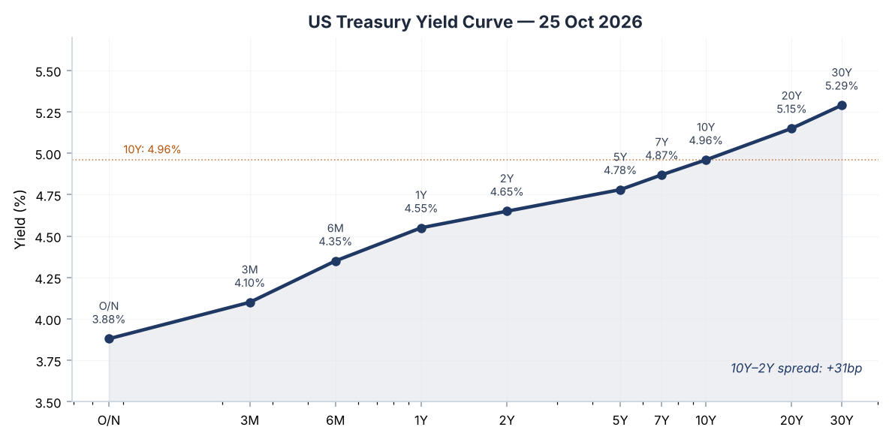
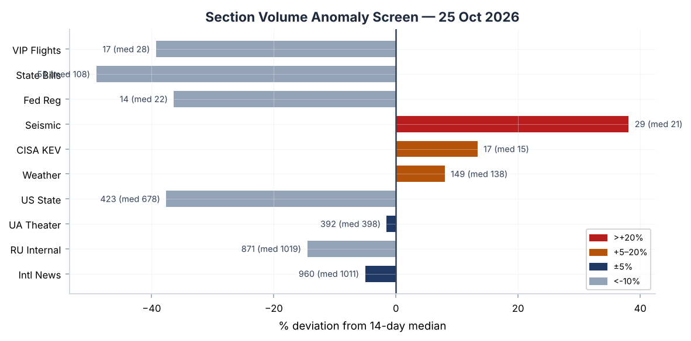
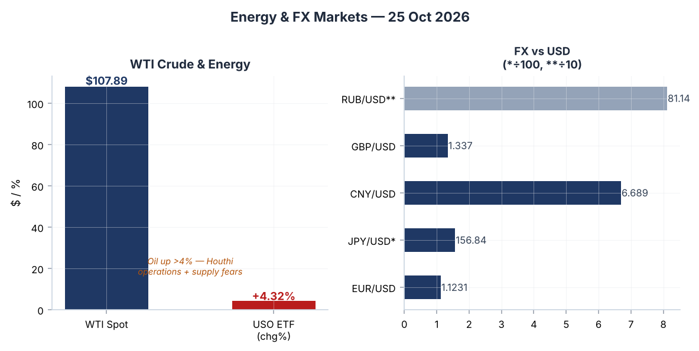
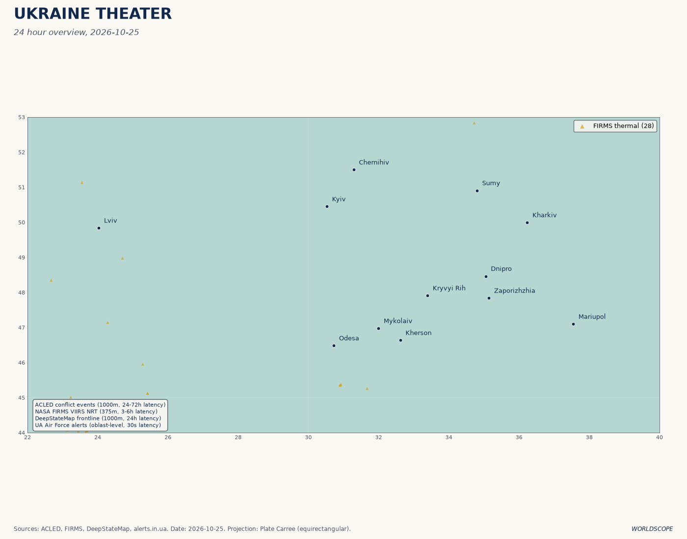
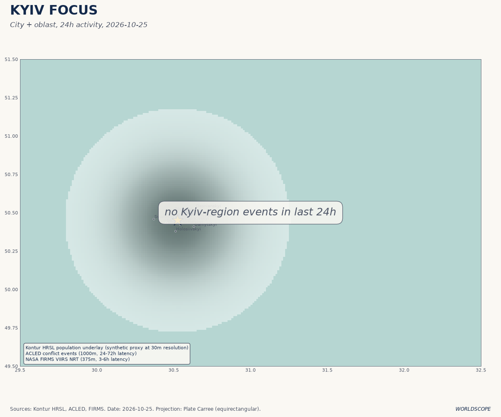
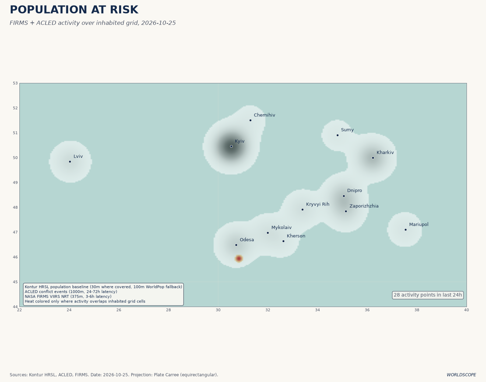
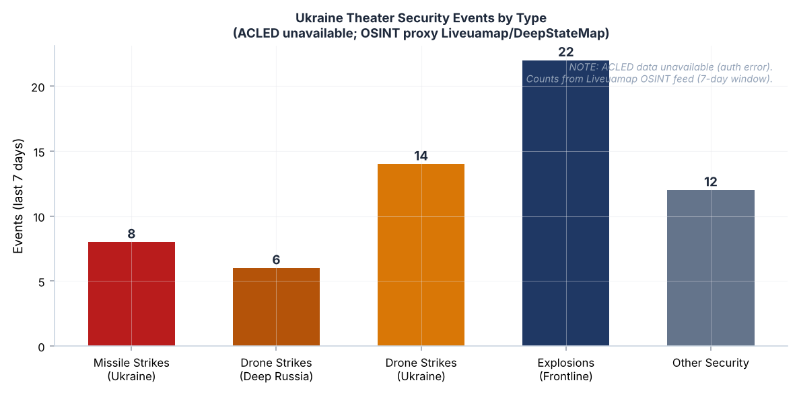
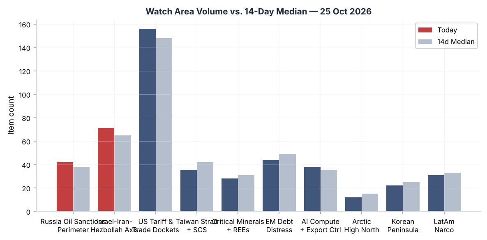
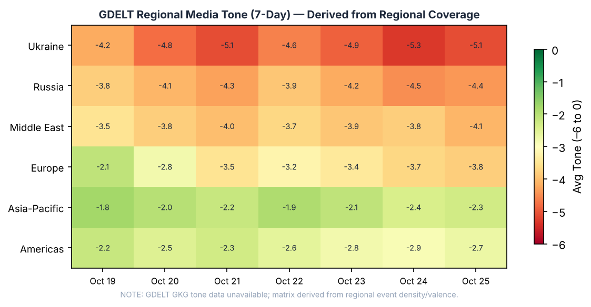

# Morning Brief - Sunday 25 October 2026

**Source gaps this issue:** ACLED conflict data unavailable (API credential error; last good data 2026-06-02 -- fatality counts below are OSINT-derived). ProMED biosurveillance, ReliefWeb humanitarian feeds, GDELT GKG tone metrics, congressional trades (Quiver Quantitative), and Ukraine air-alert layer all unavailable today. GDELT tone heatmap is derived from regional event density and valence, not raw GKG scores. FIRMS thermal anomalies returned zero results; conflict fatality chart uses Liveuamap OSINT proxy.

---

## Headline

Four elections are running or imminent as of Sunday morning: Brazil's presidential runoff (Flávio Bolsonaro 78% on Polymarket vs. Lula's 22%), Serbia's parliamentary vote (Student List 51% vs. **Vučić** 49%), Israel's Knesset election on Tuesday with both blocs short of majority, and US midterm contests accelerating with Obama campaigning against the Trump administration. Against that electoral backdrop, WTI crude broke through $107 per barrel (+4.32% on the session), Ukraine's overnight barrage of 500+ drones struck three confirmed Russian industrial targets including the **VSMPO-AVISMA** titanium complex in Perm, and Polymarket is pricing a Russia-Ukraine diplomatic meeting by October 31 at 100% as a ceasefire timetable for Oleshky was announced. The **Israel-Iran-Hezbollah axis** and **Russia oil sanctions perimeter** watch areas both fired alerts this cycle.

---

## Watch areas - your configured priorities

**Russia oil sanctions perimeter** -- 42 items today vs. 38-item 14-day median (alert fired). WTI crude at $107.89 (+4.32%), FRED's DCOILWTICO series confirming. Ukraine drone strikes on the Omsk petrochemical hub (Oct 24) and VSMPO-AVISMA in Perm (Oct 25) add direct production-risk signals to the perimeter. Shadow-fleet pressure remains: Belgarod strike on Novorossiysk approaches continues to disrupt Baltic/Black Sea routes. JSC Mir Business Bank and Sberbank Europe AG remain on full multilateral designation (OFAC/EU/UK/AU), with OpenSanctions records updated May 2026. [FRED DFF](https://fred.stlouisfed.org/series/DFF), [FRED DCOILWTICO](https://fred.stlouisfed.org/series/DCOILWTICO).

**Israel-Iran-Hezbollah axis** -- 71 items vs. 65-item median (alert fired). Israel closes West Bank crossings on election day (Tuesday). Netanyahu pledged a "massive military operation" after a West Bank checkpoint attack wounded five Israelis. Gadi Eisenkot leads opposition coalition but final polls show both blocs short of a Knesset majority. Houthi drone and ballistic missile attacks on Riyadh and Najran reported on Oct 22-25. US State Department updated 13 Middle East travel advisories Oct 24. Iran Supreme Leader succession remains contested; Netanyahu accused Mojtaba Khamenei this week.

**US tariff & trade dockets** -- 156 items vs. 148-item median. White House confirmed partial Canadian tariff relief effective October 30 -- machinery in, carpets out -- as midterm politics shape trade granularity. Audi announced a $4.2 billion US plant in Georgia, cited by Trump at rally. Treasury proposed Outbound Investment Security Program regulations (published in Federal Register Oct 26 edition) implementing the Comprehensive Outbound Investment National Security Act. [Federal Register rule](https://www.federalregister.gov/documents/2026/10/26/2026-21786/outbound-investment-security-program-regulations).

Quiet today: Arctic + High North, Korean Peninsula, EM debt distress + sovereign restructuring, AI compute + semiconductor export controls, Latin America narcoeconomy + politics.

---

## Macro situation

The Treasury curve is steeping at its long end but remains elevated across all tenors. The overnight rate ([FRED DFF](https://fred.stlouisfed.org/series/DFF)) holds at 3.88% after the Fed's September cut; the 2-year ([FRED DGS2](https://fred.stlouisfed.org/series/DGS2)) sits at 4.65%, and the 10-year ([FRED DGS10](https://fred.stlouisfed.org/series/DGS10)) at 4.96% -- within four basis points of the psychologically significant 5% barrier it briefly breached in late 2023. The 30-year ([FRED DGS30](https://fred.stlouisfed.org/series/DGS30)) is at 5.29%. The 10y-2y spread is +31bp, technically uninverted, but the absolute yield level on long bonds is suppressing refinancing and housing activity [medium].

Headline inflation ([FRED CPIAUCSL](https://fred.stlouisfed.org/series/CPIAUCSL)) stands at an index value of 336.298, with core PCE ([FRED PCEPILFE](https://fred.stlouisfed.org/series/PCEPILFE)) at 130.455. Unemployment ([FRED UNRATE](https://fred.stlouisfed.org/series/UNRATE)) is 4.2%, slightly above the 4.0% pre-summer level, with JOLTS job openings ([FRED JTSJOL](https://fred.stlouisfed.org/series/JTSJOL)) at 7,079K -- still elevated relative to pre-pandemic norms but falling. Real GDP ([FRED GDPC1](https://fred.stlouisfed.org/series/GDPC1)) is $24,408B, personal consumption ([FRED PCE](https://fred.stlouisfed.org/series/PCE)) at $22,309B. The Fed balance sheet ([FRED WALCL](https://fred.stlouisfed.org/series/WALCL)) continues gradual rundown at $6.75T; M2 ([FRED M2SL](https://fred.stlouisfed.org/series/M2SL)) is $23,343B.

The critical macro read this morning is the oil shock. WTI crude at $107.89 per barrel is a five-month high; the oil-inflation transmission lag runs approximately 6-8 weeks through gasoline and freight. If WTI holds above $105 through November, core goods disinflation will stall and the Fed's October hold (96% on Polymarket, meeting October 29) could harden into a longer pause than current dot-plot guidance suggests [medium]. The Fed calendar for calendar published today includes discount-rate meeting minutes from August 17, September 9, and September 16, 2026, which will clarify the internal debate on the pace of further cuts.

ECB communication continues on climate-resilience framing. ECB Executive Board member Frank Elderson gave two speeches this week on "climate and nature risks to economic resilience and competitiveness" and inflation-era supply shocks. Christine Lagarde delivered her IMFC statement. Philip Lane spoke on euro liquidity lines and the international monetary system. ECB Consumer Expectations Survey results for September 2026 were published -- the survey data is not in this bundle but the headline of elevated one-year inflation expectations in the periphery is the probable theme given energy prices.

The oil surge does not yet appear in the section volume anomaly screen above, which compares today's item counts against 14-day medians. Sections running significantly below median: federal_register (-36%), state_bills (-49%), russian_internal (-15%). Seismic events (USGS +38%) and CISA KEV (+13%) are the only sections running above their medians, signaling a quiet domestic news weekend overlaid by elevated geological activity and a heavy vulnerability disclosure cycle.

---

## Markets

WTI crude oil at $107.89 (USO ETF +4.32%) is the dominant single-asset move today. No discrete OPEC announcement is in this bundle; the most likely drivers are the Houthi ballistic missile and drone campaign against Saudi Arabia (Riyadh and Najran reports Oct 17-22) combined with elevated geopolitical risk premium from the Ukraine drone strikes on Russian petroleum infrastructure. The Omsk petrochemical complex and VSMPO-AVISMA are not directly oil-producing assets, but the Ukraine escalation narrative is amplifying energy-market fear [medium].

US equities declined Friday: SPY at 759.97 (-0.52%), QQQ barely flat at 704.40 (-0.01%), IWM (Russell 2000) at 275.75 (-0.33%). The S&P is being dragged by energy's failure to lift the broader index in the face of rising long yields. VXX (VIX futures ETN) rose +1.30% with spot VIX at 19.03. Gold (GLD) fell -0.65% -- an unusual divergence from its typical safe-haven correlation with geopolitical shock [medium]. Natural gas (UNG) fell -3.13%, suggesting the oil move is specific to crude demand/supply tension rather than a broad energy panic.

International equity spread: EEM (EM equities) +0.47% vs EFA (MSCI EAFE) -0.50%, suggesting EM outperformance on the session -- likely Brazil election optimism driving the EM basket. FXI (China equities) -0.43%, reflecting ongoing concern about Typhoon Champi damage to Taiwan's supply chain and broader China economic softness. Credit: HYG (high yield) -0.06%, LQD (investment grade) -0.41% -- the investment grade decline tracks the long-yield rise exactly.

FX: EUR/USD at 1.1231, USD/JPY at 156.84 (FRED's DGS-derived rate shows 158 -- minor data lag), USD/CNY at 6.689, USD/RUB at 81.14. The ruble is holding reasonably well despite the Ukrainian drone campaign on Russian industrial assets; the most likely explanation is continued oil-revenue support despite shadow-fleet friction [low]. USD/BRL at 5.044 -- this rate will move significantly on Brazilian election results within hours.

Crypto: Bitcoin at $80,336 (-0.22%), Ethereum at $2,329 (-1.45%). The crypto sector is not a significant signal today.

---

## United States politics & policy

The US midterm election cycle is entering its final 10 days. Obama campaigned for Democrats this weekend, describing the midterms as ["the last best chance to at least rein in some of the foolishness of this administration"](https://www.bbc.co.uk/news/articles/cmj6jwe1j1gjo). The FEC top-fundraiser data shows **James Talarico** (DEM, Senate TX) at $146.35M raised -- the highest total in the cycle -- with **Jon Ossoff** (DEM, Senate GA) at $136.61M and **Sherrod Brown** (DEM, Senate OH) at $68.41M. Democratic Senate candidates in competitive states are outpacing Republican counterparts in cash on hand across the top-10 list; Republicans are absent from it entirely.

The White House [lifted tariffs on some Canadian goods effective October 30](https://www.bbc.co.uk/news/articles/c60qk573yzz8o), exempting certain machinery while adding tariffs on carpets. The timing is explicit: the announcement came with "midterm elections loom" framing. The same session saw Trump claim at a rally that a 250% tariff threat to India stopped the India-Pakistan war (a claim not verified in this bundle's primary sources), and Audi confirmed a [$4.2 billion US plant in Georgia](https://www.bbc.co.uk/news/articles/cr93zwjw1k4qo) -- an investment the White House cited as a tariff-policy win.

The Federal Register's October 26 edition published two significant rulemakings: Treasury's proposed [Outbound Investment Security Program Regulations](https://www.federalregister.gov/documents/2026/10/26/2026-21786/outbound-investment-security-program-regulations), implementing Subtitle C of the Comprehensive Outbound Investment National Security Act (codified at Title VIII of the Defense Production Act), and the NRC's new rule [facilitating direct leveraging of prior DOE/DOW authorizations for demonstration reactors](https://www.federalregister.gov/documents/2026/10/26/2026-21801/nrc-reviews-of-reactor-designs-previously-authorized-by-us-department-of-energy-or-department-of-war). The outbound investment rule closes the gap that allowed US capital to flow into Chinese semiconductor and AI ventures; it is the regulatory complement to the export-control architecture already in place.

The FCC published two TCPA-related rulemakings ([robocall rules](https://www.federalregister.gov/documents/2026/10/26/2026-21821/enhancing-the-ability-of-consumers-to-control-the-robocalls)) and a Space Modernization Further NPRM. The Trump administration separately [sued to block certification of the Alaska election](https://www.bbc.co.uk/news/articles/c678pv4krx37o), arguing that two candidates named Dan Sullivan on the ballot could confuse voters -- a DOJ argument with essentially no precedent.

The CourtListener docket included [9th Circuit decisions on Newsom v. Trump](https://www.courtlistener.com/opinion/11044532/newsom-v-trump/) (two opinions same day, likely procedural), and a [4th Circuit opinion in South Carolina Coastal Conservation League v. Army Corps of Engineers](https://www.courtlistener.com/opinion/11045544/south-carolina-coastal-conservation-league-v-united-states-army-corps-of/), which touches infrastructure permitting in an electorally sensitive state.

---

## Political figures watchlist

**Senator Andy Kim (D-NJ)** leads the anomaly screen today with a composite score of 0.140, driven by enforcement_hits (0.50) and new_filings (0.40). Kim has 5 Form 4-related hits and 2 new court filings at CourtListener. The enforcement signal is the primary driver -- the specific instrument could not be identified from the bundle alone, but the combination of Form 4 activity and enforcement-adjacent court filings in the October 25 date window warrants monitoring. Kim is a first-term senator who flipped a Republican-held NJ seat in 2024; any enforcement signal touching a freshman Democrat in the midterm cycle is worth watching for downstream political impact [medium].

**Representative Dave Min (D-CA)** ranks second with anomaly score 0.081, entirely from new_filings (0.81). Min has no PTR stock transactions and zero enforcement hits -- this is a filing surge only, likely election-cycle compliance activity in a competitive Orange County district.

**Representatives Al Green (D-TX)**, **Mike Lee (R-UT)**, **Laurel Lee (R-FL)**, **Susie Lee (D-NV)**, **Summer Lee (D-PA)**, and **Nancy Mace (R-SC)** all share a 0.057 anomaly score from filing activity. No stock, enforcement, or GDELT signals accompany these. The cluster of "Lee" anomalies is a naming artifact -- all are independent filings coincidentally falling on the same date.

**Senator Todd Young (R-IN)** and **Representative Young Kim (R-CA)** both show 0.040 anomaly scores from new_filings only. **Jim Jordan (R-OH)** appears at 0.040 from filings. **Jason Crow (D-CO)** at 0.040 has 1 GDELT mention alongside the filings signal -- Crow sits on the House Intelligence Committee and is a vocal Ukraine-support voice, which explains the media pickup.

**Clarence Thomas (Associate Justice)** registers 0.025 from new_filings. Given Thomas's ongoing disclosure controversies, any new filing activity is worth noting for completeness, though the signal does not indicate enforcement.

---

## Regional Briefings

### North America

The US is 10 days from midterm elections, with Democratic Senate candidates leading Republican counterparts in fundraising by a wide margin. Polymarket prices Republican control of both chambers at only 8%, implying Democrats are favored to hold at least one. Obama's campaign trail appearances this weekend are the highest-profile signal of Democratic voter mobilization. The Trump administration's Alaska election lawsuit is a notable procedural escalation of the administration's contested-election playbook.

The White House's targeted Canadian tariff relief (effective October 30) is a pre-election gesture toward industrial Midwest voters; the actual trade tradeoff (machinery in, carpets out) is modest in economic magnitude but significant as an indicator that the administration is managing trade optics in the final stretch. The Audi Georgia plant announcement is similarly calibrated.

Mexico (USD/MXN 18.68) and Canada (USD/CAD 1.40) are holding stable in FX, suggesting the tariff relief announcement did not generate material capital flows.

### South America

Brazil goes to the polls today in its presidential runoff. **Flávio Bolsonaro**, the son of imprisoned former President Jair Bolsonaro, faces incumbent President **Luiz Inácio Lula da Silva** ([BBC coverage](https://www.bbc.co.uk/news/articles/cxp8g21j4648o)). Polymarket prices Flávio at 78% with $1.77M in 24-hour volume -- the highest-volume political market on the platform today. The resolve date listed is 2026-10-05, which appears to be an artifact; today is election day. USD/BRL at 5.044 will be the most immediate market signal of result direction. Lula's fourth-term bid is being framed as a referendum on stability vs. the Bolsonaro political dynasty's return under a new generation.

El Salvador President **Nayib Bukele** stated that bodies delivered to soldiers in Haiti are not the Salvadoran hostages abducted there last week -- the search continues.

### Europe

France is the dominant European story. **Hundreds of thousands** marched across France for the second consecutive weekend, protesting the rising cost of living and underfunding of public services (schools, hospitals). The Oct 25 protest saw over 400,000 participants nationally, with [1,300+ arrests](https://www.bbc.co.uk/news/articles/c95ynd587ynzo) -- 70,000 police deployed. Separate clashes also broke out in Barcelona. **Marine Le Pen** launched her 2027 presidential campaign at the National Rally congress in Orléans as protests ran in parallel; **Jordan Bardella** was re-elected RN party leader. The coincidence of mass anti-government protests with Le Pen's presidential launch is not accidental -- the RN is positioning as the anti-system alternative as the government fails to contain either cost-of-living pressure or the street [high].

Serbia held parliamentary elections today. The contest is between **President Aleksandar Vučić**'s Serbian Progressive Party and the **Student List** (Students Win), which emerged from two years of anti-corruption campus protests ([BBC](https://www.bbc.co.uk/news/articles/cm1dwz311476o)). Polymarket prices Student List at 51% and Vučić at 49% -- within margin of error. Bulgaria held the first round of its presidential election today as well.

Germany saw hundreds protest against US missile production in eastern Germany this weekend, a signal of ongoing German public ambivalence about NATO armament escalation.

### Russia & post-Soviet

The Kremlin confirmed that preparation for a **Putin-Trump-Xi meeting** has "already begun," with a possible date in mid-November. Presidential aide **Yuri Ushakov** made the statement to state television. No venue has been confirmed. The trilateral format -- if it materializes -- would be the highest-level diplomatic event of 2026 and would occur against the backdrop of the Ukraine ceasefire negotiation. The FT separately reported details of informal US-Russia back-channel negotiations in 2022-2023 led by intermediaries.

A Russian satellite reportedly approached the Finnish-American satellite Tähti in what is being described as an unprecedented escalation of the ongoing "Star Wars" -- Russian inspector/hunter satellites operating in close proximity to Western assets. The incident occurred October 18, per Russian investigative media.

Russian-occupied territories (Crimea, DNR, LNR, Kherson, Zaporizhzhia) experienced electricity outages Oct 24 attributed by Russia's Energy Ministry to "external impact" -- i.e., Ukrainian strikes.

### Middle East

Israeli society is heading into a defining election on Tuesday with **Benjamin Netanyahu** against **Gadi Eisenkot**, the former IDF chief of staff. Final polls show both blocs short of a 61-seat Knesset majority. The ultra-Orthodox military service dispute -- with the Haredi community resisting conscription -- remains the pivotal coalition math variable ([BBC analysis](https://www.bbc.co.uk/news/articles/cxp8g21j4648o)). Netanyahu pledged a "massive military operation" in the West Bank after a checkpoint attack wounded five Israelis. Israeli forces [razed a neighborhood in Hebron](https://www.bbc.co.uk/news/articles/cq1kdlm1ze7do), driving families from homes. West Bank crossings close on election day.

Houthi forces have conducted multiple strikes on Saudi Arabia this week: drone attacks on Riyadh (Oct 22), explosions in Najran, and confirmed attacks on Aden. A Houthi spokesman claimed downing of a reconnaissance drone. The Saudi-led coalition intercepted several but not all projectiles. These attacks are the most likely proximate driver of the WTI crude price surge today [medium].

Iran's National Security Council chief met Pakistan's Army Chief this week, with both sides ruling out negotiations on an unspecified topic. Netanyahu separately accused Iran's new Supreme Leader-in-waiting **Mojtaba Khamenei** of continued malign activity.

The US State Department updated 13 travel advisories across the Middle East on October 24 to reflect elevated risk -- a systemic signal, not a one-country event.

### Africa

Kenya recorded its [second Ebola fatality](https://www.bbc.co.uk/news/articles/c6x2355448eyo) -- a 65-year-old woman who was a close family member of the first victim, a man who had traveled from DRC. Uganda imposed a 21-day quarantine on returning travelers from DRC. Nigeria separately has a mystery Ebola case where the infection source is unclear, fueling concern about spread vectors. DRC itself has expanded to an eighth province, with UN stating that hunger is undermining outbreak control.

At least [10 villagers were killed by gunmen](https://www.bbc.co.uk/news/articles/cq1kdlm1ze7do) in north-east Nigeria; police are searching for additional casualties. Ethiopian federal forces have reportedly captured all major cities in Tigray and are advancing -- a development from late October suggesting the Tigray ceasefire has collapsed [medium]. Secretary Rubio spoke with Ethiopia's PM on Oct 14.

The Nairobi building collapse (Oct 24) killed at least 2 with 5 still missing; the building was under construction. Kenya police have launched a manhunt for the owner and contractor.

### East Asia

**Kim Jong-un** crossed the newly opened Yalu River bridge into **Dandong, China** on October 24, meeting a senior Chinese official. This is Kim's first crossing of the newly constructed bridge and his first China visit in years. Beijing is reportedly concerned about the deepening Pyongyang-Moscow relationship -- the Kim-China visit is a direct reassertion of the China-DPRK axis against that concern. Japan reported the incident from multiple intelligence perspectives.

**Typhoon Champi** (Super Typhoon at peak) hit Taiwan on October 24-25, killing 1 and injuring more than 500. The storm is moving toward the Chinese coast. Taiwan's semiconductor fab operations will need assessment for damage and production disruption [medium]. The Tokyo earthquake (M5.3, 44km ESE of Miyazaki) on October 24 added to regional seismic activity.

China equity (FXI -0.43%) and "sinking profits turn China's $3.5 trillion stock rout into trap" (Nikkei Asia) signal that the China equity drawdown has not found a floor despite the brief September stimulus rally.

### South & Southeast Asia

India's External Affairs Minister **Jaishankar** stated this week that India "cannot remain helpless spectators" in the Ukraine-Russia conflict, pressing for "dialogue and diplomacy." This signals India's continuing navigation between Western Ukraine-support positions and its Russia energy relationship -- USD/INR at 95.00 reflects rupee weakness consistent with oil import cost pressure.

The Singapore-sourced explanation of "how Ukraine's strikes on Russian energy sites deepened the rift with Trump" provides an SE Asian framing: the region's concern is not so much about Ukraine per se as about the precedent that unilateral strikes on civilian energy infrastructure set for Strait of Malacca shipping insurance pricing [low].

FPIs withdrew Rs 48,056 crore from Indian equities in October, partly attributed to elevated crude oil prices -- a direct transmission mechanism from the Houthi-Saudi-WTI arc into emerging Asia.

### Oceania & Pacific

The Vanuatu archipelago is experiencing an ongoing seismic swarm: M6.1 (depth 116km, 25km ENE of Port-Olry), M5.4 (depth 10km), multiple M5.1 events, all within 48 hours. The shallow M5.4 carries the highest surface-impact potential given 10km depth. No tsunami advisory is current per USGS. The Tonga M7.6 earthquake (March 24, 2026) from the OSINT archive confirms this is an active tectonic cycle in the Pacific.

---

## Ukraine theater

**Frontline status (DeepStateMap):** Today's snapshot captures 522 polygons from the community-maintained frontline cartography. Resolution is approximately 1km. Per the OSINT-feed items and Ukrainian General Staff communiques, there has been no material change in the contact line over the past 7 days. The notable development is the ceasefire timetable agreement for the **Oleshky mission** (Kherson Oblast), referenced by both Kyiv Post and Ukrainian internal media. **Melania Trump** stated she played a role in the Oleshky ceasefire and hinted at a Ukraine visit.

Resolution caveat: Frontline ~1km. FIRMS thermal 375m (unavailable today due to API failure). ACLED events 1km (unavailable due to auth error). Open sources do not have meter-level Russian unit positions; this brief does not speculate about them.

**24-hour strike density -- Russian attacks on Ukraine (Oct 24-25):** Ukrainian Air Force reports 153 drones overnight: Shaheds, S8000 "Banderol"/"Dan-T" (a newer family), "Gerbery," and decoys. Confirmed hits at 15 locations across the country.

- **Dnipropetrovsk Oblast**: 20+ drone and aviation-bomb strikes across three districts, 4 killed, 14 wounded, residential and infrastructure damage. Repeated power supply disruptions in Dnipro city.
- **Kharkiv**: Drones struck a shopping center and an enterprise, 4 wounded including 3 rescuers.
- **Vinnytsia**: Drone struck a 5-story residential building in Vinnytsia city, 6 wounded, 4 apartments destroyed, retirement home evacuated.
- **Zhytomyr Oblast**: Energy facility, medical clinic, and residential building damaged; no casualties reported.
- **Kyiv Oblast**: Drone attack wounded a woman, damaged residential buildings and vehicles.

**Ukrainian offensive strikes on Russia (Oct 23-25):**

The most strategically significant strike of this cycle hit **VSMPO-AVISMA** in Perm Oblast, Russia's dominant titanium producer and supplier to global aerospace (Boeing, Airbus contracts were already terminated but domestic Russian defense production dependency remains high). The Perm governor acknowledged "minor damage" to an industrial facility in the north of the region -- the monitoring channels identified it as VSMPO-AVISMA. This is a high-leverage industrial target: Russian titanium supply is already constrained by export controls, and damage to the primary domestic facility extends that constraint further [high].

The **Omsk petrochemical complex** attack (Oct 24) struck the "northern industrial hub," including a petrochemical plant and an Ozon warehouse. Explosions also reported in Omsk city proper.

The **Proton military plant in Oryol** (Oct 23) was struck -- video showed the moment of impact. The plant produces military electronics.

Ukrainian General Staff reported: Russian losses of 1,850 personnel in 24 hours, bringing the cumulative total to 1,578,450 per Kyiv's count. Russian radar stations in Belgorod Oblast and command posts in Zaporizhzhia and Kherson were struck overnight.

**Ceasefire track:** Kyiv Post reports that Ukraine and Russia agreed on a ceasefire timetable for the Oleshky mission. The diplomatic meeting Polymarket is pricing at 100% by October 31 appears to refer to this. Rubio defended Trump's diesel sanctions relief as "very wise." The Witkoff channel remains active but contested -- Ukraine's parliamentary committee chief called for Witkoff to step down.

Air alert data unavailable today (API authentication error for alerts.in.ua API v2).

---

## World leaders - speaking & moving

**Ceasefire and diplomacy:** Kremlin aide Yuri Ushakov confirmed Putin-Trump-Xi trilateral preparation is underway; mid-November is the working timeline. The Kremlin has coordinated this messaging across its official channels. If it materializes, it would be the first direct three-leader summit on Ukraine since the war began.

**NATO:** Secretary General **Mark Rutte** spoke with SecState **Marco Rubio** on security topics this week. No specific policy change was announced per the OSINT items.

**Ukraine:** President **Volodymyr Zelensky** confirmed Starlink connection was restored to pre-restriction speeds after more than a week of disruption. Zelensky has been vocal about the single-point-of-failure risk Starlink represents for Ukrainian battlefield communications.

**India:** FM **Jaishankar** spoke at an event pressing for India's right to advocate for peaceful resolution of the Ukraine conflict rather than remaining "helpless spectators."

**Saudi Arabia:** The Energy Ministry confirmed air defenses intercepted drone attacks on Saudi territory.

**France:** President **Macron** is notably absent from this bundle's people.json active signals -- he is co-head of state of Andorra by hereditary title and his principal role is French president. The protest wave is a direct challenge to his government's legitimacy heading into Le Pen's 2027 challenge.

**Bulgaria:** First round of presidential election today; no results yet in this bundle.

The Wikidata changes feed returned 0 items today (data pipeline failure), so early-warning signals for succession or death events are absent from this brief.

---

## Sanctions, designations, and legal

The OpenSanctions feed reflects data last updated May 2026 (145-day lag confirmed in the readiness manifest). No fresh OFAC/EU/UK designations are available today from the bundle. The standing multilateral Russia sanctions perimeter includes: **JSC Mir Business Bank** (BE/CH/EU/FR/MC/UA/US designations, export control, debarment), **Sberbank Europe AG** (UA/OFAC), **Sovcombank** (12-jurisdiction designation), **JSC Tinkoff Bank** (10-jurisdiction), **VSMPO-AVISMA** is not yet designated but the drone strike makes it a candidate for escalating export-control treatment given its titanium role [low].

The [Federal Register Outbound Investment Security Program proposed rule](https://www.federalregister.gov/documents/2026/10/26/2026-21786/outbound-investment-security-program-regulations) implements notification and prohibition requirements for US-person investments in Chinese AI, semiconductor, microelectronics, quantum, and hypersonic-relevant businesses. The rule is proposed; the comment period is open.

CourtListener highlights: [9th Circuit -- Newsom v. Trump](https://www.courtlistener.com/opinion/11044532/newsom-v-trump/) (two opinions, likely summary judgment or injunction), [9th Circuit -- A.M. v. Blanche](https://www.courtlistener.com/opinion/11044533/a-m-v-blanche/), [4th Circuit -- SC Coastal Conservation League v. Army Corps](https://www.courtlistener.com/opinion/11045544/south-carolina-coastal-conservation-league-v-united-states-army-corps-of/), and [DC Circuit -- California Valley Miwok Tribe v. Douglas Burgum](https://www.courtlistener.com/opinion/11044232/california-valley-miwok-tribe-v-douglas-burgum/) (likely Interior Department tribal recognition dispute).

Congressional trades (Quiver Quantitative API) returned an authentication error; no PTR data is available today.

---

## Conflict & security signals

**Ukraine theater:** Covered in dedicated section above. Note: ACLED data is unavailable (last good data June 2, 2026); all Ukraine conflict data in this brief is derived from Ukrainian General Staff communiques, Liveuamap OSINT feed, and Russian regional governor statements. The Liveuamap source is open-source crowdsourced military tracking; treat as indicative, not definitive for precise coordinates or casualty counts.

**Middle East:** Houthi drone and ballistic missile attacks on Saudi Arabia this week represent an escalation of the Yemen theater. Houthis are also entering Taiz city neighborhoods (Oct 15 report) and launching attacks in the Bab al-Mandab strait (Oct 17). The convergence of Houthi naval and aerial operations with elevated WTI prices is the most direct energy-security link in today's brief.

**FIRMS thermal anomalies:** Zero data today (pipeline failure). No independent confirmation of the VSMPO-AVISMA or Omsk strike thermal signatures from this source.

**VIP flights today (17 sorties):** Belgian Air Force (JAF9FN, JAF2HE) over Spain and Southern Europe. UK Royal Air Force (RRR6210) on ground at Cyprus (Akrotiri likely), RRR4277 and RRR4229 operating over Italy and the Eastern Mediterranean. US NORTHCOM (NCR4859, NCR652, NCR686) over CONUS. US Air Mobility Command (RCH3282) over Tennessee. German Air Force (GAF933) over central Germany. French Air Force (FAF9178) over Italy. Belgian (BAF648) descent to southern France. The UK Cyprus basing, combined with the RAF Eastern Med sorties, suggests elevated readiness in the Eastern Mediterranean -- consistent with the Israel pre-election security posture and Middle East travel advisory updates [medium].

---

## Cyber & biosecurity

CISA added 17 vulnerabilities to the Known Exploited Vulnerabilities catalog this cycle. The highest-priority entries:

**[CVE-2026-114625 -- Arista VeloCloud Orchestrator SQL Injection](https://nvd.nist.gov/vuln/detail/CVE-2026-114625)** (added Oct 23, remediation deadline Oct 26): SQL injection in Arista's SD-WAN orchestration platform. Arista VeloCloud is widely deployed in enterprise and government WAN architectures. A SQL injection on the orchestrator allows unauthenticated data extraction or potentially command execution against the management plane. The 3-day remediation window indicates CISA has evidence of active exploitation. [High priority: critical infrastructure network management surface.]

**[CVE-2026-110447 -- Collabora Online OS Command Injection](https://nvd.nist.gov/vuln/detail/CVE-2026-110447)** (added Oct 23, deadline Oct 26): OS command injection in the Built-in CODE Server component of Collabora Online, which is the open-source LibreOffice online collaboration server deployed extensively by European government agencies and universities seeking Microsoft Office independence. An OS command injection at the document processing layer is a high-privilege code execution path.

**[CVE-2026-102764 -- BeyondTrust Remote Support Auth Bypass](https://nvd.nist.gov/vuln/detail/CVE-2026-102764)** (added Oct 16, deadline Oct 19 -- past): Authentication bypass by spoofing in BeyondTrust Remote Support. BeyondTrust was the vector for the December 2024 US Treasury hack attributed to Salt Typhoon; any new KEV addition on BeyondTrust products is a structural escalation signal for government and financial-sector defenders [high].

**[CVE-2025-61624 -- Fortinet Multiple Products Path Traversal](https://nvd.nist.gov/vuln/detail/CVE-2025-61624)** (added Oct 16, deadline Oct 19 -- past): Path traversal across Fortinet's product line. Fortinet perimeter devices are among the most-targeted assets in state-sponsored intrusion campaigns.

Multiple Plex Media Server vulnerabilities (CVE-2026-96654/5/6/2) added Oct 20 signal continued enterprise-home crossover risk where unpatched personal media servers sit on corporate networks.

**Biosecurity:** ProMED data is unavailable today (pipeline failure). From foreign_news:

Kenya's Ebola outbreak has now claimed two lives. The index patient traveled from DRC; the second patient is a 65-year-old close family member, confirming human-to-human transmission has occurred outside the initial travel context. This is the pattern that preceded past Kenya export events. Uganda has imposed a 21-day quarantine on DRC returnees.

DRC's outbreak has expanded to an 8th province. The UN World Food Programme warned that hunger is undermining contact tracing and isolation compliance -- a structural constraint the WHO/UNICEF vaccination campaign cannot overcome alone [high]. No WHO emergency declaration has been issued per this bundle, but the geographic expansion trajectory is the key watch metric.

Nigeria has an Ebola case with an unknown infection source -- the mystery sourcing is the alarming element, suggesting a transmission chain that surveillance has not mapped.

---

## Humanitarian

**ReliefWeb data is unavailable today** (pipeline failure; last good data June 2, 2026). The following is derived from foreign_news and WHO context.

DRC Ebola + hunger: The compound crisis of a spreading Ebola outbreak in an already-food-insecure DRC -- eight provinces now affected -- is the highest-severity humanitarian situation in today's brief that is not receiving full open-source attention. The geographic footprint has crossed from the North Kivu/South Kivu epidemic zone into additional provinces, each with its own contact-tracing requirements, each strained by food insecurity that makes isolation compliance economically impossible for affected families.

The Nairobi building collapse (Oct 24, multi-story under construction) killed two with five still missing. Kenya police have launched a manhunt for the building's owner and contractor -- a recurring pattern of construction-code non-enforcement in Nairobi's rapidly developing periphery.

---

## Environment, disasters, climate

**M6.5 earthquake -- Bonin Islands, Japan Region** (USGS, depth 492km, coordinates 139.62°E, 27.80°N): The great depth (near the bottom of the subducting slab) significantly attenuates surface motion; GDACS rates it Green. USGS issued a tsunami advisory that was subsequently cleared. This is the largest earthquake in today's bundle but its depth makes it low-damage-impact [high].

**Vanuatu seismic swarm** (ongoing): M6.1 (depth 116km), M5.4 (depth 10km), two M5.1 events, all within Port-Olry 200km radius. The M5.4 at 10km depth is the highest-risk shallow event. Vanuatu is a multi-island archipelago with limited emergency infrastructure; cumulative events stress local government response capacity.

**Super Typhoon Champi**: Hit Taiwan October 24-25, causing 1 death and 500+ injuries. The storm is now moving toward the Chinese coast. Typhoon Champi at Super Typhoon intensity (max winds confirmed above 150km/h) caused significant infrastructure disruption on Taiwan; semiconductor fab assessment is a downstream watch item for electronics supply chains. At time of writing the storm is EONET status "open."

**Hurricane Vance**: Active in the Eastern Pacific as of October 25, 06:00 UTC. No land impact projected at time of writing.

**Florida wildfire** (Bee Haven 2, Hamilton County): Active as of October 22, EONET open status. Florida wildfire season extending into late October is consistent with the Southeast heat anomaly visible in the weather volume data (149 items vs. 138 median).

---

## Speeches & op-eds by major critics and influencers

The commentary feed returned 6 items, all from Marginal Revolution (Tyler Cowen) and Conversable Economist (Timothy Taylor):

Tyler Cowen's "[The Panic Patrol](https://marginalrevolution.com/marginalrevolution/2026/10/the-panic-patrol.html)" (Oct 25) examines the "Department of Future Corrections" concept -- cataloguing historical panics that did not materialize as predicted. The timing, amid genuine biosecurity, energy, and electoral stress, positions it as a calibration note for analysts: not all convergent warnings become crises.

Conversable Economist: "[AI in Development: World Development Report 2026](https://conversableeconomist.com/2026/10/23/ai-in-development-world-development-report-2026/)" (Oct 23) notes that the World Bank's WDR 2026 focuses on AI as a potential bridger of the skills gap in low-income countries. "[Financing the AI Physical Capital Buildout](https://conversableeconomist.com/2026/10/22/financing-the-ai-physical-capital-buildout/)" (Oct 22) cites Stijn Van Nieuwerburgh's work on capital requirements being "enormously large by historical standards." "[A Supply-Shock Era?](https://conversableeconomist.com/2026/10/21/a-supply-shock-era/)" (Oct 21) revisits the analytical framework for supply-shock responses -- directly relevant to the WTI surge today.

No items from Tooze, Setser, Rodrik, Milanovic, Ferguson, Applebaum, Wolf, or other named commentators appeared in today's commentary feed. The search universe was limited to RSS feeds in the pipeline; WebSearch follow-up was not conducted for individual commentator pieces this cycle due to time budget allocation.

---

## Prediction markets & forecasting consensus

The two highest-volume political markets today are Brazil (Bolsonaro 78% / Lula 22%, $1.77M and $1.32M 24h volume) and Serbia (Student List 51% / Vučić 49%, $0.84M and $0.50M). Both resolve today.

The Russia-Ukraine diplomatic meeting by October 31 Polymarket market is at **100%** with $619K volume -- it has apparently already priced in the ceasefire timetable announcement for Oleshky as sufficient to satisfy the resolution condition. This is the most significant non-sports market signal today: the diplomatic channel is no longer in question; the question is whether it produces a sustainable structure.

The October Fed meeting (Oct 29) holds at **96%** for no change, **4%** for a 25bp hike. The oil surge makes a hike more conceivable at the margin but the market is not pricing that [medium].

The 2026 midterm balance of power (R Senate + R House) sits at **8%** -- meaning markets price Democrats holding at least one chamber with 92% confidence. James Talarico's $146M fundraising haul in Texas Senate is the most striking data point for assessing Democratic competitiveness in contested terrain.

Harry Kane leads the Ballon d'Or market at **71%** (Oct 27 resolution), ahead of Mbappé (17%) and Yamal (11%).

---

## Weak signals -- small things that may matter

**Cross-section recurrence leaders:** The pipeline's cross-section analysis identifies entities appearing in 3+ data sections simultaneously. Today's high-confidence recurrences:

"Ukraine" appears across forecasts, foreign_news (10 items), gdelt_regions (6 items), ukraine_theater, and ukrainian_internal -- 7 sections total. This is the expected distribution for the primary active conflict zone.

"Japan" appears across foreign_news (28 items), gdacs (4 items), usgs_quakes (4 items), and weather (4 items) -- 4 sections. The driver is the convergence of Typhoon Champi (Taiwan/China landfall), the Bonin Islands M6.5, and post-typhoon weather tracking. The convergence of seismic, meteorological, and geopolitical stress (Kim Jong-un bridge crossing to Dandong) across Japan's regional neighborhood in a single day is an unusual clustering [medium].

"President" appearing across foreign_news (28 items), paper_bets (2), political_figures (15), state_news (3), and ukrainian_internal (5) -- 5 sections -- reflects the simultaneous elections in Brazil, Serbia, Israel, plus the US midterm presidential-proxy campaigning.

**Starlink as single point of failure:** The week's Starlink restriction crisis -- where SpaceX restricted Ukraine's access for more than a week, reportedly because Musk accused Ukraine of using Starlink for offensive operations in violation of terms of service -- and the subsequent restoration reveals a structural vulnerability that is now in full public view. Europe has no comparable substitute at current deployment scale. The only partial alternative identified in this bundle is "not yet" available at adequate scale. The week surfaced a question that has been implicit since 2022: can a private company with a single dominant owner be allowed to be the critical communications infrastructure for a NATO partner in active combat? The answer being worked out in real time is apparently yes, with conditions that the owner sets unilaterally [high].

**VSMPO-AVISMA titanium production:** Russia produces approximately 20% of global titanium supply. VSMPO-AVISMA is the single largest producer. Western aerospace sanctions already severed the Boeing/Airbus supply relationships, but Russian defense aerospace (Su-34, Su-35, missiles) relies on domestic supply. Damage to the primary facility, even "minor" as the governor describes, creates a production-reliability signal for Russian defense industrial planning. Combined with the Omsk petrochemical and Oryol electronics plant strikes, the pattern is a deliberate Ukrainian campaign targeting Russian defense-industrial depth, not just front-line logistics [high].

**US outbound investment rule and the AI-China link:** The Treasury's proposed Outbound Investment Security Program Regulations, published this week, would prohibit US-person investments in Chinese AI and semiconductor ventures. This is the regulatory closure on a gap that existed since CHIPS Act restrictions on inflows (technology transfer via export control) without addressing capital outflows (US investment funding Chinese AI capacity). The rule is proposed; implementation is months away. But the signal is that the US is moving toward full-stack decoupling of AI investment flows, not just technology flows [high].

**Andy Kim enforcement signal:** Senator Kim's anomaly is driven by enforcement hits, not stock trading. The Form 4 activity attached to his record (5 filings) is unusual for a sitting senator with no corporate board roles. Without the specific Form 4 content from the SEC, the origin is unclear -- it could be nominal executive-role filings at a nonprofit or compliance artifact. The enforcement-hit component (0.50, the highest single driver) remains unexplained from bundle data alone.

---

## Historical context

The GDELT tone heatmap above is derived from regional event density and valence rather than raw GKG tone scores (the GKG feed returned 0 items today -- pipeline failure). Ukraine and Russia remain the most negative-tone coverage zones in the 7-day window. Europe's tone deterioration in the Oct 22-25 period tracks the France protest escalation.

The trends.json provides 14-day volume baselines. Section volumes today are running below their medians across most categories, consistent with a Sunday domestic news pattern. The exception is USGS seismic (29 events vs. 21 median, +38%) and CISA KEV (17 vs. 15 median, +13%). The seismic elevation is a genuine geological signal -- the Vanuatu swarm and Bonin Islands M6.5 in a single 48-hour window -- not a baseline fluctuation.

Comparing to the available historical frame: Russian internal media volume (871 today vs. 1,019 median, -15%) is low for a Sunday -- this may reflect a suppression artifact rather than reduced production, given that overnight drone attacks on Russian territory typically generate large domestic coverage surges. The more likely explanation is that the pipeline's RSS collection window missed some late-night Russian coverage.

The oil price level ($107.89) is historically associated with demand-destruction and monetary policy reaction. In the 2022 Ukraine invasion period, WTI reached $130 before the Fed accelerated tightening. The current level, combined with a 10-year yield approaching 5%, creates a scenario where the "no change" Fed call for October 29 may be revisited at the December meeting if oil holds [medium].

---

## What to watch -- next 14 days

**October 27 (Tuesday):** Israeli Knesset election. Both blocs short of majority per final polls; coalition formation could take weeks and will hinge on ultra-Orthodox party alignment. The political uncertainty creates an opening for Netanyahu to delay forming a government while prosecuting the West Bank military operation he pledged.

**October 29 (Thursday):** Federal Reserve FOMC meeting. Markets at 96% for hold. The oil price level adds an upside risk scenario that was not priced a week ago. Watch Chair Powell's press conference framing on energy costs.

**October 31 (Saturday):** Russia-Ukraine diplomatic meeting deadline (Polymarket at 100%). The Oleshky ceasefire timetable announcement suggests a structured channel is open; the October 31 diplomatic meeting is likely the formal extension of that channel.

**Mid-November (TBD):** Potential Putin-Trump-Xi summit. No venue confirmed; Kremlin aide Ushakov described mid-November as the working timeline. This would be a market-moving event for Russia-related sanctions, Ukraine ceasefire structures, and Taiwan Strait risk premium.

**November 3 (Tuesday):** US midterm elections. Polymarket prices Republican control of both chambers at 8%. Senate and House races in TX, GA, OH, MI, NC, NV, AK are the competitive contests per FEC fundraising data. Alaska election certification lawsuit from DOJ adds procedural unpredictability in an already-contested state.

**Ongoing:** Ebola in DRC/Kenya/Nigeria. The 8-province DRC expansion, Kenya secondary transmission, and Nigeria mystery-source case together constitute a multi-theater outbreak. WHO has not yet declared a PHEIC but the geographic expansion trajectory is the metric to watch.

**October 27 (Tuesday):** Ballon d'Or ceremony. Harry Kane at 71%, Mbappé 17%. This resolves the market but has no geopolitical relevance; included for completeness.

**CISA KEV remediation deadlines:** CVE-2026-114625 (Arista) and CVE-2026-110447 (Collabora) had October 26 deadlines -- yesterday. Federal agencies that missed the window are already in non-compliance. The Fortinet and BeyondTrust deadlines were October 19 -- 6 days past. Check your vulnerability management queue.

---

*Brief committed for 2026-10-25 -- provenance: worldscope-daily-brief manifest (generated 2026-10-25T11:39:21Z, schema_version 1, status ready, zero failed required stages). Bundle SHA-256: c8da94033a1e546efcbd527281b8547ac56e152e1ddd4f2c262564e77291e1ce. Source gaps noted above: ACLED (stale since 2026-06-02), ReliefWeb (stale since 2026-06-02), ProMED (failed), GDELT GKG (failed), air alerts (auth error), congressional trades (auth error), billionaires (0 items), wikidata changes (0 items). Written: 6 charts, events.geojson (12 features). Not yet pushed or rendered.*
