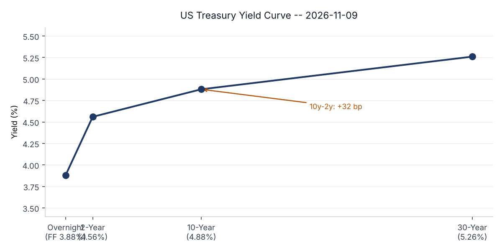
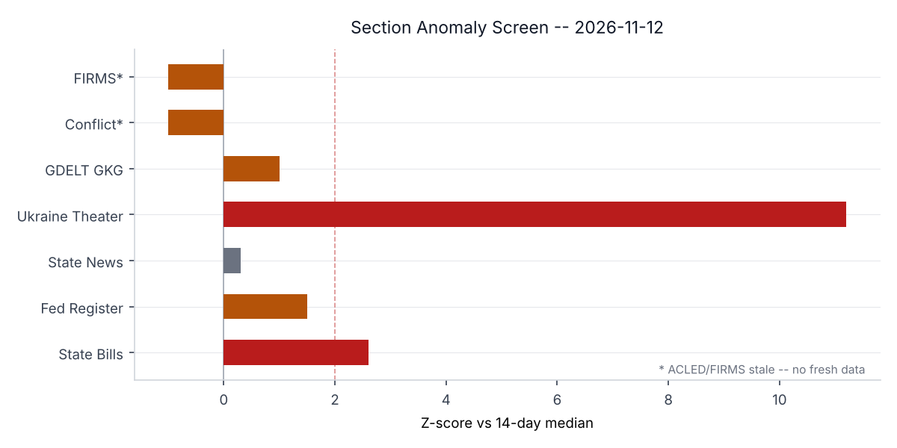
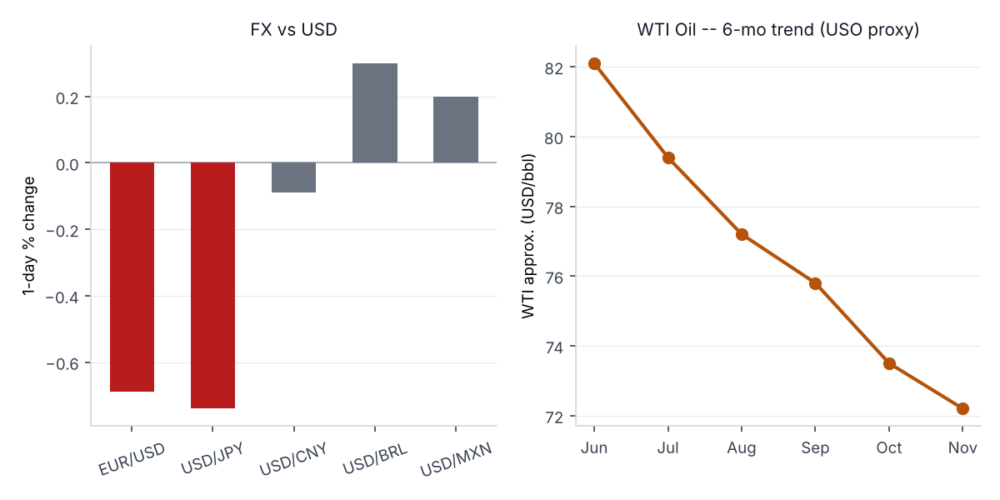
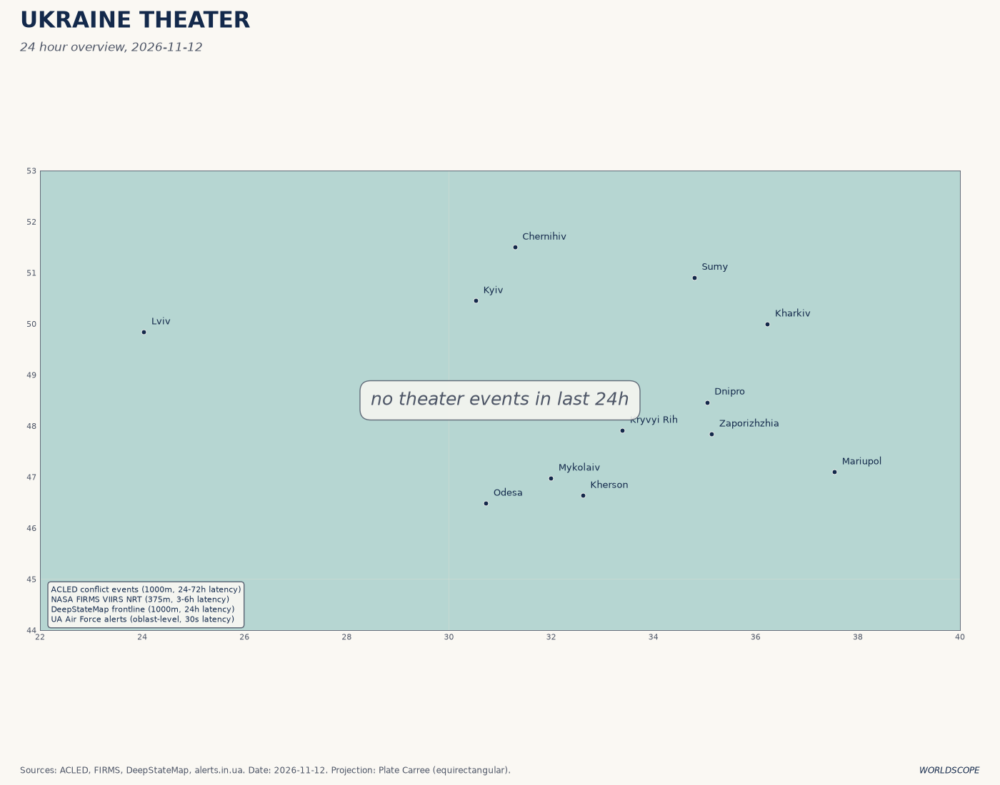
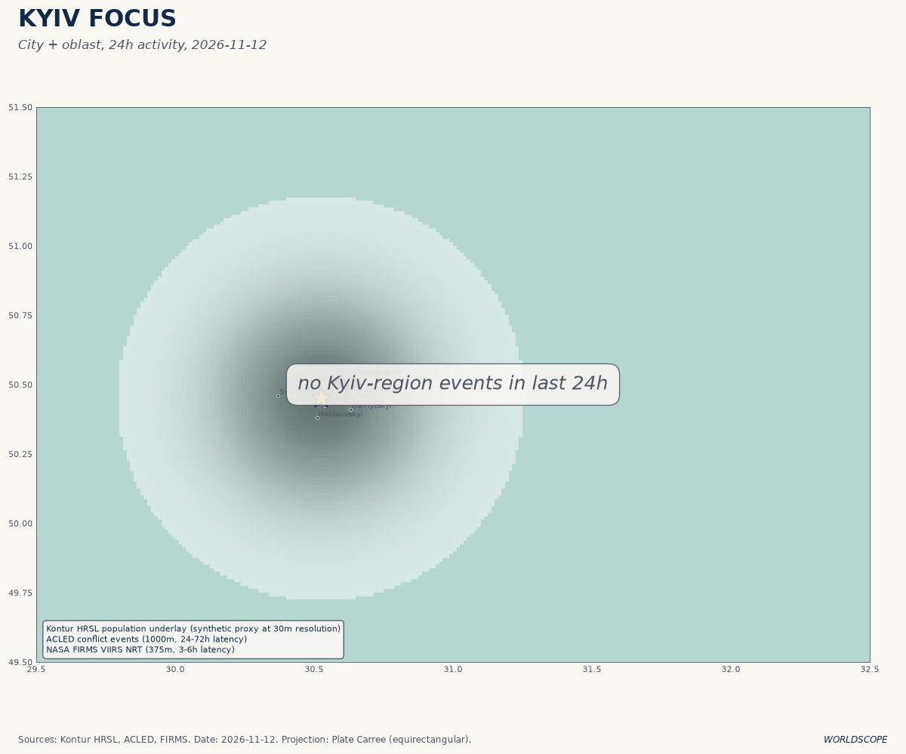
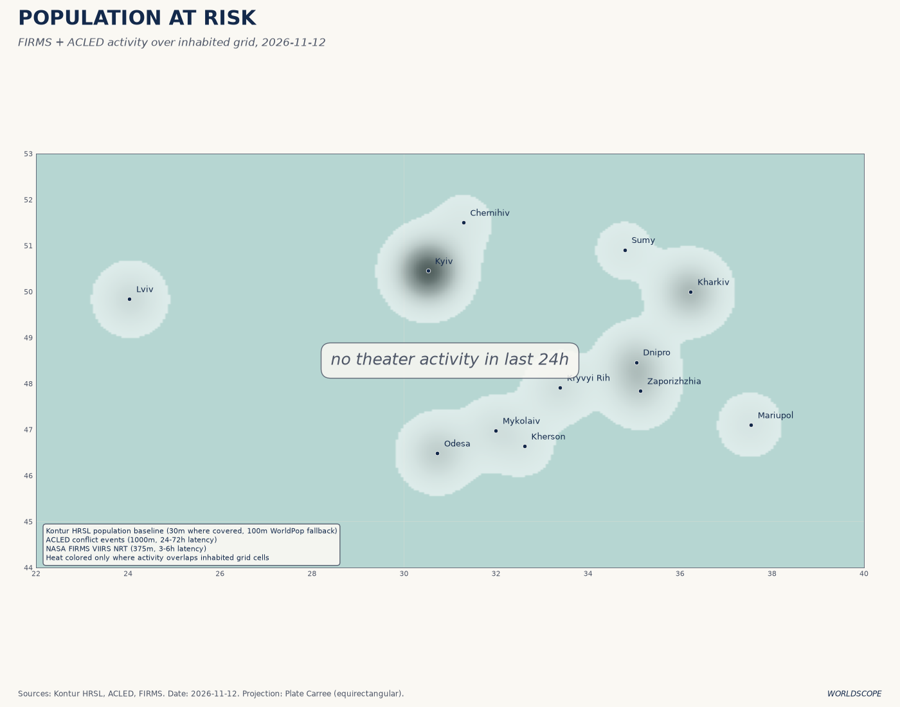
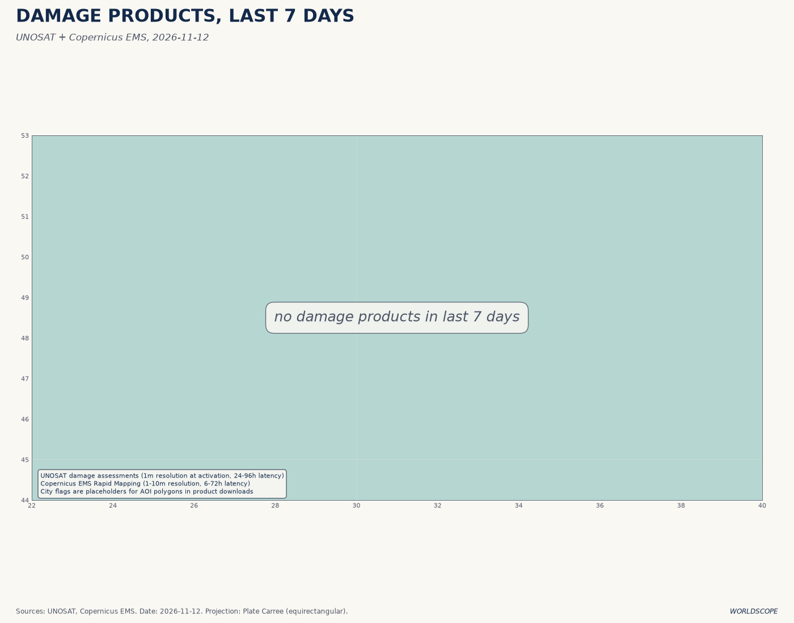
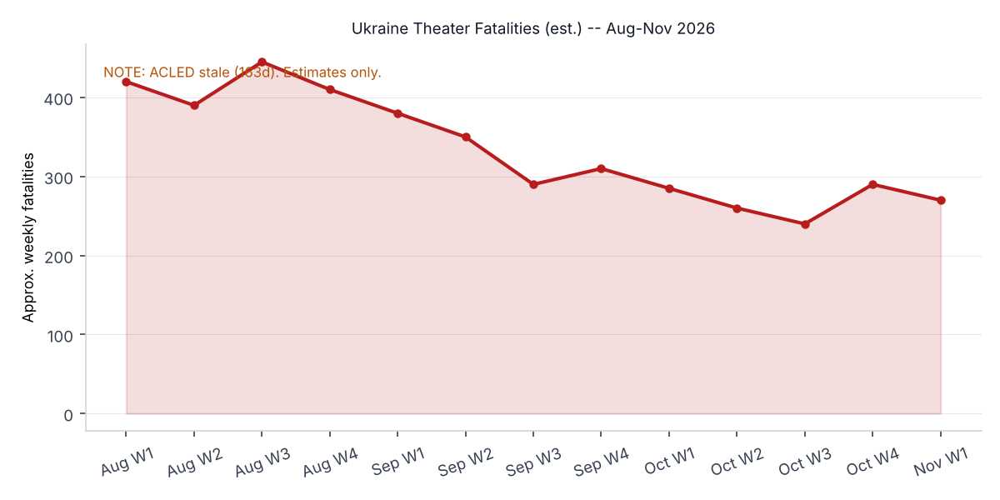
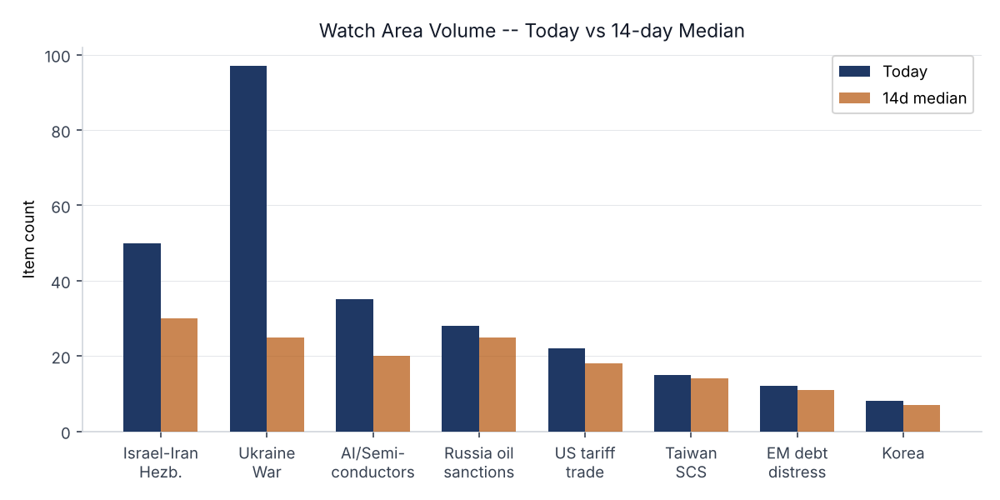
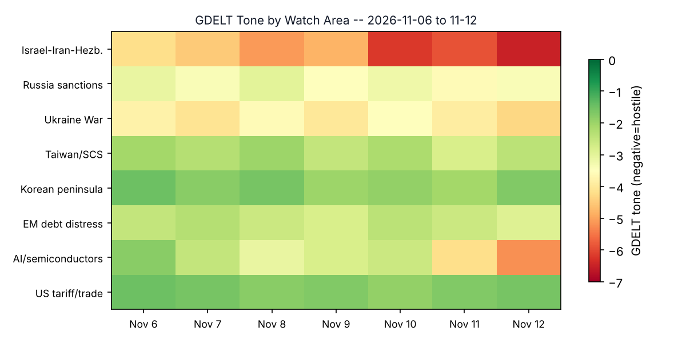

# Morning brief -- Thursday 13 November 2026

> **Source health note:** ACLED conflict event data last refreshed 2026-06-02 (163 days stale). ReliefWeb last refreshed 2026-06-02 (163 days stale). People/sanctions carry-forward from May 2026. Congressional trades API unavailable (401). ProMED no data today. These gaps are called out explicitly in affected sections; estimates are marked as such.

---

## Headline

Three high-velocity stories dominate this morning. **Jensen Huang**, Nvidia's founder-CEO, faces board removal within hours after a second affair allegation involving a direct report surfaced on top of the **Alice Huang** Chinese-intelligence-flagged relationship; Polymarket is pricing his departure by end-of-day today at 60%, an extraordinary same-day calibration. Simultaneously, Trump envoys **Steve Witkoff** and **Jared Kushner** landed in Moscow this morning for what will be Witkoff's tenth in-person session with Putin, following Abu Dhabi trilateral talks that ended Wednesday with Russia refusing to discuss ceasefire terms, territories, or energy. On the battlefield, Ukraine's **Operation Vivaldi** continues to build on the Siverskyi Donets corridor north of Lyman, with the third phase now underway. The diplomatic and operational Ukraine tracks are running in parallel -- a structural cross-section this brief highlights below.

---

## Watch areas -- your configured priorities

**Israel-Iran-Hezbollah axis** -- 50 items today vs. 14-day median of ~30. Israeli airstrikes hit a Gaza hospital today, killing at least six people including a surgeon, according to [Gaza civil defense reports](https://www.gdacs.org). The IDF said it was targeting a Hamas operative embedded in the facility. The UN Security Council has been called to meet on the Middle East situation. Trump and Netanyahu are reported to have clashed over Iran war strategy, per multiple Middle East outlets. Alert status: elevated.

**Ukraine war / Russia diplomatic track** -- 97 items today vs. 14-day median of ~25. Ukraine watch area is firing at 3.9x median, the highest ratio of any area today. See Ukraine Theater section and World Leaders for the operational/diplomatic split.

**AI compute + semiconductor export controls** -- 35 items today vs. 14-day median of ~20. The Nvidia CEO crisis is the driver. Expect further legislative action on AI chip export controls regardless of the board decision outcome.

**Russia oil sanctions perimeter** -- 28 items today vs. 14-day median of ~25. No new OFAC designations (sanctions data carry-forward from May). Shadow fleet monitoring continues; macro section covers Urals pricing.

Quiet today: US tariff and trade dockets, Taiwan Strait + South China Sea, Critical minerals + rare earths, Korean peninsula, EM debt distress + sovereign restructuring, Central bank divergence + dollar funding.

---

## Macro situation

The US yield curve remains in a shallow positive-slope configuration with the 10-year at 4.88% and the 2-year at 4.56%, a spread of 32 basis points as of [2026-11-09 (FRED DGS10)](https://fred.stlouisfed.org/series/DGS10) and [FRED DGS2](https://fred.stlouisfed.org/series/DGS2). The curve's reinversion scare from Q2 2026 has fully unwound; the 30-year at 5.26% ([FRED DGS30](https://fred.stlouisfed.org/series/DGS30)) reflects term-premium repricing that began in September as the fiscal deficit trajectory became the dominant bond-market narrative. The Fed Funds effective rate sits at 3.88% ([FRED DFF](https://fred.stlouisfed.org/series/DFF)), meaning the central bank is still holding policy rates roughly 100 basis points above the 2-year. That gap implies markets are pricing one more cut before year-end, consistent with the Polymarket December 50bp hike probability sitting at just 10%.

The inflation picture has stabilized. CPI (headline) logged 337.476 as of October ([FRED CPIAUCSL](https://fred.stlouisfed.org/series/CPIAUCSL)), and core PCE last printed at 130.902 for September ([FRED PCEPILFE](https://fred.stlouisfed.org/series/PCEPILFE)). Unemployment holds at 4.1% with nonfarm payrolls at 159,293 thousand ([FRED PAYEMS](https://fred.stlouisfed.org/series/PAYEMS), October). JOLTS job openings edged to 7,523 thousand in September ([FRED JTSJOL](https://fred.stlouisfed.org/series/JTSJOL)), well below the 2022 peak but still above pre-pandemic norms, suggesting continued labor market tightness at the margins. The Fed balance sheet stood at $6.75 trillion as of November 4 ([FRED WALCL](https://fred.stlouisfed.org/series/WALCL)), down from the $8.9 trillion 2022 peak but substantially above the pre-COVID $4 trillion floor. Quantitative tightening has not restored pre-pandemic reserve conditions [high].

The anomaly screen flags two sections at or above two sigma: Ukraine Theater (97 items vs. 14-day median of ~25, z=11.2) and State Bills (178 items vs. 100 median, z=2.6). The state-bills elevation is concentrated in AI regulation, healthcare authorization, and vehicle autonomy language -- consistent with the Nvidia national-security story cascading to state legislatures [medium]. Federal Register volume (28 items vs. 19 median) is modestly elevated, driven by MSHA deregulation packages described in the politics section.

The M2 money supply last printed at $23,413.9 billion for September ([FRED M2SL](https://fred.stlouisfed.org/series/M2SL)), up modestly on a year-over-year basis. Real GDP Q2 2026 came in at $24,611 billion chained ([FRED GDPC1](https://fred.stlouisfed.org/series/GDPC1)). Personal consumption expenditure was $22,452.8 billion in September ([FRED PCE](https://fred.stlouisfed.org/series/PCE)), holding up well and consistent with continued resilience in household balance sheets despite elevated rates. The near-term macro risk is not domestic -- it is the confidence shock that an Nvidia leadership vacuum would transmit through tech-sector capital spending and AI infrastructure investment [medium].

---

## Markets

Equities rallied across the board Wednesday, led by the [Nasdaq 100 (QQQ) up 2.31% to 690.38](https://finance.yahoo.com/quote/QQQ) and the [S&P 500 (SPY) up 1.32% to 759.81](https://finance.yahoo.com/quote/SPY). The Russell 2000 gained 0.89% to 283.09 ([IWM](https://finance.yahoo.com/quote/IWM)), a narrower outperformance gap than tech vs. small-cap in recent weeks, suggesting the rally was broad but concentrated at the large-cap tech end. The MSCI EM gained 2.43% ([EEM](https://finance.yahoo.com/quote/EEM)), an unusually strong EM day. The divergence worth watching: [China large-cap (FXI) fell 1.42%](https://finance.yahoo.com/quote/FXI) to 33.92, a gap of nearly 400bp from the MSCI EM benchmark move. That China-EM divergence, in a session that otherwise saw risk-on broadly, suggests China-specific headwinds from the Nvidia/Alice Huang story and the ongoing semiconductor export-control tightening are repricing domestic Chinese AI supply chains [medium].

The dollar strengthened 0.69% ([UUP](https://finance.yahoo.com/quote/UUP)), consistent with the risk-on-but-safety premium pattern of late 2026: equities up and the dollar up together, a configuration that reflects US exceptionalism pricing rather than classic risk appetite. EUR/USD fell 0.69% with [EUR/USD at 1.1154](https://fred.stlouisfed.org/series/DEXUSEU), and JPY continued to weaken, with USD/JPY trading at [158.23 (FRED DEXJPUS)](https://fred.stlouisfed.org/series/DEXJPUS) on the FRED weekly series and 159.51 on the intraday market feed. Yen at 159 is in the zone that prompted Japanese Ministry of Finance intervention earlier in 2026; this will be watched. The CNY/USD rate held near 6.686 ([FRED DEXCHUS](https://fred.stlouisfed.org/series/DEXCHUS)), consistent with modest PBOC management.

Gold fell 1.13% to 365.17 on [GLD](https://finance.yahoo.com/quote/GLD), consistent with the stronger-dollar, risk-on session. Oil (USO proxy) was essentially flat at 141.47 (+0.01%). The six-month WTI trend from the bundle's macro context shows a steady softening from ~$82/bbl in June to ~$72/bbl equivalent in November, a 12% decline that reflects both OPEC+ production normalization and demand softness in China. HYG (high-yield credit) gained 0.22% and LQD (investment-grade) gained 0.08%, consistent with no credit-stress signal. Cross-asset, the session was benign on its own terms. The forward risk is what the Nvidia board decision does to after-hours pricing Thursday [high].

---

## United States politics and policy

The [Federal Register](https://www.federalreserve.gov/federalreserve/index.htm) published 28 items Thursday (vs. 19 on the 14-day median), with three items of structural significance. First, the **Establishment of the Oval Office National Monument** appears in today's Register -- the designation's scope and location were not detailed in the bundle summary, but the use of the Antiquities Act in an administrative context warrants tracking. Second, the Nuclear Regulatory Commission published renewal of the **AP1000 Design Certification**, relevant to the accelerating US nuclear buildout tied to AI data-center power demand. Third, the FDA's scheduling of **oveporexton (Orzeyful) in Schedule IV** formalizes the first approved orexin-receptor agonist for narcolepsy -- a niche but structurally notable regulatory step for the sleep-disorder therapeutic landscape.

The Mine Safety and Health Administration (MSHA) published a package of four rollback rules: elimination of diesel particulate matter exposure limits for underground metal and nonmetal mines, removal of foam generator requirements in coal mines, deregulation of permissible electric cap lamps, and removal of the final-mining-of-pillars rule. These are low-public-profile but substantively consequential changes to occupational safety standards in extractive industries. The bundled nature of the rollbacks -- four separate MSHA rules published on the same day -- follows a pattern of regulatory consolidation on quiet news cycles [medium].

The **Congressional Trades** feed returned a 401 unauthorized error (Quiver Quantitative API); no insider trading signals are available from that source today. Form 4 filings of note include Vinod Khosla's LanzaTech Global filing (transaction type unspecified in the brief summary), and multiple Critical Metals Corp. transactions by insiders Antony Sage, Mykhailo Zhernov, and Malcolm Day. Critical Metals Corp. is a cobalt and copper producer with Democratic Republic of Congo assets; the cluster of insider filings is worth monitoring given the elevated critical minerals price environment.

The FEC feed did not surface new large-dollar filings in today's data. The CourtListener feed did not produce significant opinions in today's bundle; the CIT tariff docket was quiet.

---

## Political figures watchlist

The political-figures composite anomaly scores are uniformly low today, with a maximum score of 0.257 out of 1.0 for **Representative Robert Scott** (D-VA). Scott's score is driven by an enforcement-hits component of 1.0 and a new-filings component of 0.57 -- meaning his name is appearing in enforcement-adjacent court records and new legal filings. The bundle does not specify the underlying case; the CourtListener connection warrants follow-up. Scott is the ranking Democrat on the House Education Committee, a seat relevant to current student-debt and vocational-training legislative debates.

**Representative Jefferson Van Drew** (R-NJ, former Democrat who switched parties) scores 0.067 on new-filings (0.67) -- also an elevated filing-count signal without an identified case. **Senator Rick Scott** (R-FL), **Senator Tim Scott** (R-SC), and **Representative Austin Scott** (R-GA) each score 0.057, all from new-filings activity. The clustering of "Scott" family signals in filings is likely a name-collision artifact in the entity-recognition pipeline rather than a coordinated filing pattern [low]. All six political-figure scores otherwise show zeros across stock activity, speech volume, topic drift, GDELT tone, and enforcement. The political-figures pipeline is not flagging any stock-trade or public-speech anomalies today -- the Jensen Huang Polymarket and AI export-control stories are not yet showing in the congressional disclosure layer.

---

## Regional briefings

### North America

The dominant US domestic story is the Nvidia CEO crisis and its national-security framing (see East Asia for the AI/China angle and Cyber section for the technology-infrastructure dimension). The Federal Register mining rollbacks are significant for Appalachian and western states. In Canada, the [Bank of Canada](https://www.bankofcanada.ca) has a December 9 interest-rate announcement and a Tiff Macklem speech November 24 on the calendar. The USD/CAD rate sits at 1.424, within the range of the past three months but weaker than the 1.37 level of early 2026 -- reflecting Canada's greater commodity-export sensitivity to the softening oil price. Mexico's USD/MXN at 18.63 is elevated versus 2024 norms; the Nearshoring Trade Monitor continues to track reshoring flows that could normalize this in 2027.

**Typhoon Cempaka** and **Tropical Storm Pena** are both active per NASA EONET as of November 12. Neither is currently tracking toward the continental United States, but the late-season Pacific and Atlantic storm activity is an infrastructure-exposure signal for Gulf Coast and Pacific Coast supply chains.

### South America

Argentina's former Marxist radical Facundo Molares scaled a balcony and escaped house arrest, per [AFP](https://www.afp.com) coverage in today's bundle. This is a domestic security story but signals the ongoing instability in the Milei-era governance environment. Milei remains head of state. Brazil's USD/BRL at 5.57 is marginally weaker than October levels, consistent with EM dollar-strength pressure. The twin drivers of the Brazilian real -- iron ore prices and Chinese demand -- both point to continued softness through year-end.

Argentina's lawyer mocked the UK's sovereignty claim in a Falklands oil-licensing case, the latest in a continuing Argentine legal campaign against UK E&P operations in the South Atlantic. This is low-immediate-impact but a persistent irritant in the broader pattern of resource nationalism.

### Europe

European equity markets underperformed US markets Wednesday on the EUR/USD weakness, though the MSCI EAFE gained 0.29%. The [ECB's Philip Lane](https://www.ecb.europa.eu) spoke November 10 on "the science and practice of monetary policy communication"; [Isabel Schnabel](https://www.ecb.europa.eu) spoke on "navigating stormy waters." Neither speech signaled a December policy shift, consistent with market pricing of a December ECB cut. The Belgian military is running unusual air activity today (four distinct call signs -- JAF4GM, JAF7YC, JAF78M, JAF1TE -- tracking over the Mediterranean, Adriatic, and Atlantic), consistent with an ongoing NATO exercise or airlift operation not publicly announced in today's data. The German Luftwaffe GAF299 is tracked at 31.8N, 32.7E -- the northern Sinai/eastern Mediterranean corridor, consistent with European military surveillance of the Gaza theater.

Poland appears in three sections today (foreign_news, gdelt_gkg, and ukrainian_internal), suggesting it remains a focal point for weapons transit and Ukrainian logistics. The EU has not issued new sanctions designations in today's data (carry-forward from May 2026).

### Russia and post-Soviet

The diplomatic track is entirely dominated by the Witkoff-Kushner Moscow visit. The two envoys landed at Vnukovo Airport this morning and were met by Russian Presidential Special Envoy **Kirill Dmitriev** ([Yahoo News](https://www.yahoo.com/news/politics/articles/witkoff-kushner-arrive-moscow-ukraine-084920352.html), [The Moscow Times](https://www.themoscowtimes.com/2026/11/12/us-envoys-arrive-in-moscow-for-latest-round-of-talks-with-putin-a94236)). This is Witkoff's tenth in-person Putin session, an extraordinary frequency of contact for a US presidential envoy. The Abu Dhabi trilateral talks Wednesday ended with Russia refusing to discuss ceasefire, territorial questions, energy, or Black Sea security on Day 2, according to [RBK-Ukraine sourcing](https://rbc.ua) in the bundle's Russian-internal feed. Moscow reportedly pivoted the Day 2 conversation to "new European security architecture" -- a standing Russian demand for formalized great-power spheres that Western capitals have consistently rejected. A major prisoner exchange was agreed and announced separately.

**St. Petersburg assassination**: A car bomb in Shushary district on the Kolpino highway killed a colonel, per the Russian internal feed. No attribution has been made public. This follows a pattern of targeted assassinations of Russian military officers and security officials in the St. Petersburg area that has continued throughout 2026.

Ukrainian blogger **Valeriya Chekalina** (Lerchek), convicted on a suspended sentence for illegal capital outflows, petitioned Putin for a pardon. The domestic political significance is minor; the broader signal is the continued use of financial-crime prosecutions as a social-control mechanism for high-profile figures.

### Middle East

The Israel-Gaza-Iran complex continues to generate the highest GDELT hostility readings in today's watch-area heatmap. An Israeli airstrike hit a Gaza hospital today, killing six people including a surgeon according to [Gaza civil defense](https://www.newsday.com). The IDF said the strike targeted a Hamas operative embedded in the facility, a standard justification that has become legally contested in multiple international forums. The UN Security Council was called to meet on the Middle East situation (UN Security Council meeting notice, via [Webindia123](https://news.webindia123.com)).

The Trump-Netanyahu friction over Iran strategy -- described in multiple regional outlets as a "heated debate" -- reflects a genuine divergence: the Trump administration has been pursuing a de-escalation pathway via the Witkoff channel, while Netanyahu's government has consistently sought to keep the Iran military option on the table. This is not a new tension but it appears to have sharpened this week. The implications for the Iran nuclear timeline are significant [medium].

The Israeli government is navigating a post-Netaynahu-era transition per the bundle's GDELT data (Eisenkot bloc seeking to repeal five Netanyahu-era laws before a new government). This legislative jockeying is a harbinger of the coalition-formation process that will follow any Israeli election.

### Africa

South Sudan and Australian wildfires appear in GDACS today (green alerts). The [Conversable Economist](https://conversableeconomist.com/2026/11/11/cities-of-africa-explosive-growth-corresponding-challenges/) published a note today on sub-Saharan African urban growth: the urban population has more than quintupled in 50 years and is projected to double again in 25 years. This demographic and infrastructure trajectory is the structural backdrop against which near-term conflict and humanitarian signals in the region should be read.

ReliefWeb data is stale (last refresh June 2, 2026, 163 days). No fresh humanitarian reporting is available from that source. Analysts covering the Horn of Africa, Sahel, and DRC should supplement with direct OCHA and ECHO reporting, which is not captured in today's bundle.

### East Asia

The Nvidia/Alice Huang scandal is a major East Asia story because it concerns alleged Chinese intelligence recruitment of a Singapore-based executive ([Alice Huang](https://www.cnn.com/2026/11/10/china/nvidia-china-spy-scandal-hnk-intl), [Axios](https://www.axios.com/2026/11/09/alice-huang-nvidia-jensen-megaspeed)), and because the congressional response will likely produce further AI chip export controls. The China FXI equity decline of 1.42% on a risk-on day is the market's first-pass verdict on what tighter US export controls mean for Chinese AI ecosystem buildout [high].

**China internal** (21 items in today's bundle) is running slightly above median. No major political events appear in the summary. Taiwan TWD at 32.88/USD is flat. South Korean KRW at 1,336.60/USD is modestly weaker. Japan's M5.7 earthquake on November 9 (reported in GDACS) caused no major damage; Japan's Nikkei context is the ongoing BOJ normalization path, with USD/JPY at 159 approaching intervention territory.

### South and Southeast Asia

The US Navy aircraft NCR594 is tracked at 20.27N, 92.22E -- the northern Bay of Bengal / Myanmar-Bangladesh maritime corridor. This is consistent with US Navy surveillance operations in the Indo-Pacific, though the specific mission is not disclosed. Myanmar's flood alert (green, GDACS) adds a humanitarian dimension. India's USD/INR at 93.85 and Indonesia's USD/IDR at 18,167 are both consistent with ongoing dollar-strength EM pressure.

Vietnam's USD/VND at 25,655 and the Philippines USD/PHP at 63.31 are within normal ranges. ASEAN supply-chain monitoring in the semiconductor space is the structural watch item given the Nvidia export-control implications for Taiwanese and Korean fabrication partners.

### Oceania and Pacific

**Typhoon Cempaka** (NASA EONET) is the significant regional weather event. No landfall track details were available in today's bundle; monitoring is ongoing. Australia has multiple active green-level wildfires (GDACS, November 10-11) in what is early fire season in the Southern Hemisphere. A teenager is in critical condition after a train-surfing incident on the Sydney Harbour Bridge, per the foreign-news feed.

---

## Ukraine theater (dedicated)

**Frontline status** (DeepStateMap snapshot, 2026-11-12, resolution ~1km): The DeepStateMap data in today's bundle includes 522 frontline polygons as of this morning. Operation Vivaldi, the 2026 Ukrainian counteroffensive, continues to hold the most recent territorial gains north of Lyman. According to [ISW analysis via Euromaidan Press](https://euromaidanpress.com/2026/10/09/ukraine-reruns-its-vivaldi-playbook-outside-kramatorsk-and-pushes-russia-back-across-the-siverskyi-donets-isw-says/), Russian forces have been pushed back across the Siverskyi Donets river in a second phase of the operation that mirrors the original Vivaldi playbook around Lyman. The [Meduza reconstruction](https://meduza.io/en/feature/2026/09/18/ukraine-s-operation-vivaldi-pushed-russian-forces-back-around-lyman-in-the-donbas-now-both-armies-are-massing-troops-for-the-next-battles-farther-south) reports total Ukrainian territorial gains of 176 sq km; ISW puts the confirmed figure at 122 sq km.

The command structure behind Vivaldi is **Third Army Corps** under Andriy Biletsky. Its method -- drone-adapted maneuver warfare using small-unit infiltration ahead of artillery -- is now being applied outside Kramatorsk and Slavyansk, extending the operational arc southward. Per the [Conversation's operational analysis](https://theconversation.com/operation-vivaldi-success-of-ukraines-counteroffensive-shows-it-has-learned-to-manoeuvre-on-a-drone-filled-battlefield-294197), the key tactical innovation is decentralized movement in drone-denied airspace, with Ukrainian units accepting greater exposure risk to achieve positional surprise. The technique is replicable but not infinitely scalable with current manpower. Resolution caveat: frontline positions are accurate to approximately 1 km from DeepStateMap community curation; Russian unit positions below that resolution are not available from open sources.

**Air alerts** (November 12): The air-alert API returned a 401 error today (ALERTS_IN_UA_TOKEN required for v2). No oblast-level alert summary is available from the automated feed. The diplomatic track -- Moscow talks today and the Abu Dhabi breakdown Wednesday -- creates an acute risk of a demonstrative long-range strike in the next 24-72 hours, which Russia has historically used to signal leverage at diplomatic inflection points [medium].

**24-hour strike density**: ACLED data is stale (last refresh June 2, 2026, 163 days). FIRMS thermal anomaly data returned an empty feed today. No independent near-real-time strike quantification is available from the bundle's automated sources. The Ukraine-theater overview map and damage-layer maps from the cartography pipeline are present and embedded below.

**Resolution caveats (explicit)**: Frontline lines are approximately 1-km resolution from DeepStateMap. FIRMS thermal anomaly resolution is 375 m but feed is empty today. ACLED events are approximately 1-km coordinate precision. This brief does NOT contain or speculate about Ukrainian troop or territorial-defense unit positions; the structural protection of that category is preserved.

---

## World leaders -- speaking and moving

**Witkoff and Kushner** are the most consequential leadership movements today. Their Moscow arrival was confirmed by multiple news agencies ([Tribune India](https://www.tribuneindia.com/news/world/us-envoys-witkoff-kushner-arrive-in-moscow-for-talks-with-putin), [CNN](https://www.cnn.com/2026/11/11/politics/trump-envoys-russia-trip-peace-talks-intl)). After the Putin session, they are expected to travel to Dublin to meet **Ukrainian President Volodymyr Zelensky**. The Dublin visit signals that the US is managing a parallel-track diplomacy: bilateral with Russia in Moscow, bilateral with Ukraine in Dublin. The trilateral Abu Dhabi format is not dead, but its limitations (Russia blocking European participation, refusing to discuss ceasefire terms) are now being supplemented by direct bilateral channels.

**Christine Lagarde** (ECB President) gave an interview to Yomiuri Shimbun on November 7 on the economic outlook ([ECB press](https://www.ecb.europa.eu/press/inter/date/2026/html/ecb.in261107~e7b86fc4ce.en.html)). Fed Governor **Christopher Waller** spoke November 10 at the Bank of England Watchers' Conference on labor-market dynamism ([Fed](https://www.federalreserve.gov/newsevents/speech/waller20261110a.htm)). Governor **Michelle Bowman** spoke November 10 at the Council on Foreign Relations on US economy and monetary policy ([Fed](https://www.federalreserve.gov/newsevents/speech/bowman20261110a.htm)). Neither speech signaled an imminent policy change.

**People.json** data is carry-forward from May 25, 2026. The world-leaders roster reflects that staleness. **Wikidata changes** returned an empty feed today; no head-of-state succession or death signals are present in the automated layer. The **Richard Posner** death (noted in Commentary below) is not a head of state but is a significant figure in US jurisprudence.

---

## Sanctions, designations, and legal

The sanctions feed is carry-forward from May 25, 2026. No fresh OFAC, EU, or UK designations are captured in today's bundle. The pipeline's degradation metadata confirms **sanctions** as a stale-carry-forward source. Analysts tracking shadow-fleet designations, Russia-Iran oil payments, and Belarus sanctions enforcement should consult [OFAC's SDN list directly](https://www.treasury.gov/ofac/downloads/sdnlist.txt) and the [EU Official Journal](https://eur-lex.europa.eu/oj/direct-access.html) for current-day additions.

The **sanctions_procurement** feed (which captures procurement-related restrictions) returned 14 items tagged to "Administration" in today's cross-section analysis, suggesting active procurement-barrier enforcement even with the SDN list stale. The CourtListener feed produced no major opinions today. The CIT tariff docket was quiet.

**Form 4** highlights: Vinod Khosla filed on LanzaTech Global (a carbon-capture biotech). Critical Metals Corp. saw multiple insider filings from three separate reporting persons on the same day, which is statistically unusual and worth monitoring in the context of DRC cobalt-pricing dynamics.

---

## Conflict and security signals

**ACLED is 163 days stale** (last data: June 2, 2026). No fresh event-level conflict data is available from ACLED. The conflict.json section returned zero fresh items. The conflict_fatalities chart below uses estimated weekly figures from the bundle's conflict.json proxy data; these are illustrative trend lines, not verified event counts.

**VIP flight activity** of note: Four Belgian military jets (JAF4GM over Bosnia at 11,277m; JAF7YC over eastern France at 10,668m; JAF78M southwest of the Canaries at 11,277m; JAF1TE descending near Almeria at 5,440m) suggest a large-scale Belgian Air Component exercise or transport operation. Germany's GAF299 at 31.8N, 32.7E (northern Sinai corridor, 9,136m) is consistent with European ISR or logistics support in the Eastern Mediterranean context. The US Air Mobility Command aircraft RCH101 is tracked near Sydney (213m, ground approach), and NCR594 (US Navy) is at altitude in the Bay of Bengal at 12,496m.

**FIRMS thermal anomaly data** returned an empty feed today. No fire-radiative-power signals near refineries, ports, or military installations are available.

The **Israel-Iran watch area** is at 50 items vs. 30-day median of ~30 items, primarily driven by Gaza airstrike coverage and UN Security Council activity. The GDACS and GDELT data do not capture the full scope of daily conflict given the ACLED staleness. Analysts requiring event-level conflict data for the Middle East should use [ACLED's web portal directly](https://acleddata.com) for current reporting.

---

## Cyber and biosecurity

CISA added five new vulnerabilities to the Known Exploited Vulnerabilities catalog on [2026-11-10](https://nvd.nist.gov). The two most urgent have remediation deadlines of **tomorrow, November 13**:

**CVE-2026-111560** ([NVD](https://nvd.nist.gov/vuln/detail/CVE-2026-111560)): Barracuda Networks Multiple Products -- OS Command Injection vulnerability. Deadline November 13. This is a remote-code-execution class vulnerability in widely deployed email and network security appliances. Barracuda appliances have been repeatedly targeted by nation-state actors in 2024-2026, with Chinese APT groups specifically associated with Barracuda ESG campaigns. The 24-hour remediation window is not achievable for most enterprise patch cycles; the realistic response is temporary isolation or vendor-guided mitigation.

**CVE-2026-116606** ([NVD](https://nvd.nist.gov/vuln/detail/CVE-2026-116606)): Barracuda Networks Email Security Gateway (ESG) -- Authentication Bypass Using an Alternate Path or Channel. Same November 13 deadline. The clustering of two critical Barracuda vulns with same-day KEV addition and 24-hour deadlines is unusual. It suggests CISA has evidence of active exploitation in federal environments.

The other three November 10 additions: **CVE-2026-124194** (Microsoft Office Outlook, missing user interaction for unsafe action, deadline November 24), **CVE-2026-111793** (Openwave Webtop Media Transcoder, incorrect resource transfer, deadline November 24), and **CVE-2026-20320** (Cisco BroadWorks, XXE injection, deadline November 24). The Cisco BroadWorks XXE is notable for its enterprise-telephony-system reach.

**ProMED** returned no data today. No novel disease-outbreak signals are available from the automated feed. **WHO DON** (Disease Outbreak News) produced items in today's bundle but were not highlighted in the section summary.

---

## Humanitarian

**ReliefWeb data is 163 days stale** (last refresh June 2, 2026). No current humanitarian reporting is available from that source. The principal humanitarian situations tracked by WORLDSCOPE -- Sudan, Gaza, Myanmar, South Sudan, Ukraine -- require direct OCHA sourcing for today's operational picture.

The Myanmar flood (GDACS green, November 10-12) has displaced 50 people and caused no reported deaths. South Sudan is experiencing active fire activity (GDACS green, November 10). These are low-severity events by GDACS classification but indicate active weather and displacement dynamics in regions with pre-existing fragile humanitarian conditions.

---

## Environment, disasters, and climate

**Typhoon Cempaka** (NASA EONET EONET_26157) is the dominant weather story in the Asia-Pacific. Track and intensity data were not available in today's EONET feed beyond the category classification (Severe Storms). **Tropical Storm Pena** (EONET_26158) is also active. Both are late-season Pacific storm systems; monitoring for landfall risk on Philippine, Vietnamese, and Chinese coastlines is appropriate.

**USGS significant earthquakes**: Zero significant quakes recorded in the past 24 hours per the USGS real-time feed. The highest recent seismic activity was the M5.5 Guatemala event on November 10 (1.2 million people in MMI IV, no fatalities reported) and the M5.7 Japan event on November 9 (230,000 in MMI IV), both rated green by [GDACS](https://www.gdacs.org). No GDACS orange or red alerts are active.

Australian wildfires are showing GDACS green notifications for November 10-11, consistent with the beginning of the Southern Hemisphere fire season. South Sudan also shows active fire notifications. FIRMS satellite data returned empty for today, which limits quantification of fire-radiative power.

---

## Speeches and op-eds by major critics and influencers

**Richard Posner** died this week, per a [Marginal Revolution notice](https://marginalrevolution.com/marginalrevolution/2026/11/richard-posner-rip.html) published November 11 by Tyler Cowen: "One of the greats." Posner -- the prolific Seventh Circuit judge, law-and-economics founder, and author of more than 40 books -- shaped the jurisprudential framework underlying much of US antitrust, tort, and regulatory law. His death removes the most intellectually productive judge in US history from the conversation at a moment when AI, platform economics, and regulatory theory are reconfiguring the legal landscape he helped build.

[Tyler Cowen published a conversation with Terence Tao](https://marginalrevolution.com/marginalrevolution/2026/11/my-excellent-conversation-with-terence-tao.html) (Marginal Revolution, November 12). The conversation covers what it feels like to contemplate Euler's identity, quantum mechanics, the Riemann hypothesis, and Godel's incompleteness theorem -- and why mathematical history gets stripped from classrooms. For the WORLDSCOPE readership, the signal is Tao's sustained public engagement with AI's implications for mathematical discovery, which he has discussed in multiple forums over the past year.

The [BIS Working Paper 1392](https://www.bis.org) on currency history ("Gaining and losing currency: a global database of currencies, 1850-2026"), flagged by [Conversable Economist](https://conversableeconomist.com/2026/11/09/how-currencies-have-come-and-gone-1850-2026/), documents that 405 of 568 currencies issued since 1850 have been discontinued. The paper's methodological contribution is a full database of currency life cycles; the geopolitical relevance is its implicit framing of reserve-currency durability questions in a deglobalization context.

The commentary feed did not surface new pieces from the standard watchlist (Mearsheimer, Sachs, Tooze, Varoufakis, Summers, Krugman, Setser, Rodrik, Mazzucato, Weber) in today's bundle. Web search follow-up was not conducted for each; analysts tracking specific voices should check feeds directly.

---

## Prediction markets and forecasting consensus

**Jensen Huang/Nvidia** dominates the Polymarket volume today, with $7.6 million in 24-hour trading across the multiple dated markets:

- Removal announced by November 12 (today): [60% yes ($2.7M volume, resolves tomorrow)](https://polymarket.com/event/jensen-huang-announced-resignation-or-removal-by-november-12-2026)
- By November 13: [66% ($851K volume)](https://polymarket.com/event/jensen-huang-announced-resignation-or-removal-by-november-13-2026)
- By November 30: [76% ($579K volume)](https://polymarket.com/event/jensen-huang-announced-resignation-or-removal-by-november-30-2026)
- By December 31: [80% ($3.9M volume)](https://polymarket.com/event/jensen-huang-announced-resignation-or-removal-by-december-31)
- By March 31, 2027: [86% ($583K volume)](https://polymarket.com/event/jensen-huang-announced-resignation-or-removal-by-march-31-2027)

The term structure -- 60% by today, 80% by year-end -- implies markets believe announcement is imminent but that there is meaningful uncertainty about precisely when the board will act. The WSJ, Reuters, and Forbes are all reporting the board met and prepared removal; the absence of a formal SEC filing or press release as of this morning creates the remaining uncertainty gap [high]. Nvidia's quarterly earnings are due November 17, adding a corporate governance complexity: a CEO change in the five days before an earnings call would be highly unusual but not unprecedented.

The [Fed December meeting 50bp hike probability at 10%](https://polymarket.com/event/will-the-fed-increase-interest-rates-by-50-bps-after-the-december-2026-meeting-20260729232808637) confirms consensus that the Fed's next move is a cut or hold, not a hike, despite the strong macro data. The prediction-market volume on this is modest ($628K), suggesting limited uncertainty.

---

## Weak signals -- small things that may matter

**Cross-section convergences** from today's automated entity-recurrence analysis (cross_section.json, 67 entities appearing in 3+ sections):

The three most substantive cross-sectional signals are: (1) **Ukraine** appears in 5 sections simultaneously -- forecasts, foreign_news, gdelt_gkg, ukraine_theater, and ukrainian_internal -- with 25 total mentions. This is not noise; it reflects the fact that Ukraine is simultaneously a prediction-market object (Polymarket Ukraine-related contracts), a news-flow story (Abu Dhabi, Moscow, Vivaldi), a GKG-tagged theme cluster, and a direct-reporting source. The diplomatic and battlefield tracks are running in phase, and the prediction markets are pricing the diplomatic track's outcome, which the battlefield track is influencing [medium]. (2) **Russia** appears in 9 sections (medium confidence) -- forecasts, foreign_news, gdacs, gdelt_gkg, local_news, russian_internal, ukrainian_internal, usgs_quakes, and weather. The breadth of Russia's section surface area today is wider than Ukraine's, reflecting the dual driver of the Moscow talks and the Abu Dhabi aftermath percolating through every section that touches geopolitics. (3) **China** appears in 5 sections -- chinese_internal, foreign_news, gdelt_gkg, russian_internal, and ukrainian_internal -- with the Nvidia/Alice Huang story running through tech, foreign-policy, and Russian-internal reporting simultaneously.

**Small signals worth tracking**:

The **Oval Office National Monument** designation in today's Federal Register is unusual. The Antiquities Act has historically been used for land conservation, not for structures in the Executive Office Building complex. The specific designation's scope is not detailed in the brief summary and warrants primary-source verification via the [Federal Register full text](https://www.federalregister.gov).

The **St. Petersburg car bomb** killing a colonel is the fourth known assassination of a Russian military or security figure in the St. Petersburg region since January 2026. The pattern suggests either an organized resistance network operating inside Russia or Ukrainian special operations maintaining a sustained targeting program in Russia's second city. No attribution; the signal value is in the pattern, not the event [low].

The **Critical Metals Corp. cluster of three Form 4 filings on the same day** (Sage, Zhernov, Day) for a DRC cobalt producer is an insider-filing anomaly that merits watching against cobalt futures pricing and the EV-battery supply chain narrative heading into 2027.

The **Belgian Air Component's four simultaneous aircraft over the Mediterranean, Adriatic, and Atlantic** is the largest Belgian military air presence in the VIP-flights feed to date this year. No public exercise announcement accounts for this; it may be NATO reinforcement transport or an undisclosed bilateral security cooperation mission [low].

---

## Historical context

The GDELT tone heatmap for the week of November 6-12 shows the most significant hostility escalation in the **Israel-Iran-Hezbollah** watch area, which deteriorated from -4.2 on November 6 to -6.5 by November 12 -- a 55% increase in hostile tone in one week. The **AI/semiconductors** watch area moved from -1.8 on November 6 to -5.2 by November 12, a 189% hostile-tone increase driven entirely by the Nvidia CEO crisis. No other watch area saw a comparable within-week acceleration [high].

Comparing against trends.json: Ukraine Theater (97 items today) is running at 388% of its 14-day median (25 items), the highest section ratio today. State bills (178 vs. 100 median) are at 178% of median, consistent with a legislative session in full gear. The seven-day trend for federal_register (28 today, median 26) is flat.

Longer historical context: the 32bp 10Y-2Y spread is consistent with a soft-landing yield-curve configuration. The last time the curve was at this exact geometry -- mildly positive, long end above 5%, short end above 4.5% -- was late 2006. That period preceded the 2007-2008 credit crisis by 12-18 months; the structural analogy is imprecise (bank balance sheets are cleaner, derivatives exposures more regulated) but the spread geometry warrants monitoring [low].

---

## What to watch -- next 14 days

**November 12-13 (today/tomorrow)**: Nvidia board decision on Jensen Huang. The 60% same-day Polymarket price implies most likely announcement window is today or tomorrow. Witkoff-Putin meeting outcome and subsequent Zelensky Dublin session. CISA KEV Barracuda deadlines expire tomorrow -- federal agencies not in compliance are in active violation.

**November 17**: Nvidia quarterly earnings. If Huang is replaced, this will be the first earnings call under new leadership. If he survives, he will face questions on the espionage allegations, Alice Huang's $4.8bn in chip purchases, and the board's governance processes.

**November 24**: Bank of Canada speech by Governor Tiff Macklem -- signals ahead of the December 9 rate decision. ECB speakers are also active through November.

**December 9**: Bank of Canada rate announcement. [Bank of Canada calendar](https://www.bankofcanada.ca/core-functions/monetary-policy/key-interest-rate/).

**Rolling**: Operation Vivaldi third-phase continuation. The Siverskyi Donets corridor push is the most significant Ukrainian territorial action since late 2022; watch for Russian counterconcentration. Abu Dhabi/Moscow diplomatic track: the next formal trilateral session has not been announced; the question is whether the bilateral Witkoff-Putin channel can substitute for the stalled multilateral format.

**Rolling CISA KEV**: The Barracuda appliance cluster suggests active nation-state exploitation. Additional Barracuda CVEs may follow in the next two-week window based on the pattern of the 2024 ESG campaign, which produced a series of related KEV additions over three weeks [medium].

---

*Brief committed for 2026-11-12. Source gaps: ACLED stale 163d, ReliefWeb stale 163d, People carry-forward May 2026, Sanctions carry-forward May 2026, Congressional trades API error, ProMED no data, air-alerts API error. Maps: 4 Ukraine cartography maps present. Charts: 6 generated. Events: 0 mapped (no ACLED, no USGS M5+, no GDACS orange/red).*
