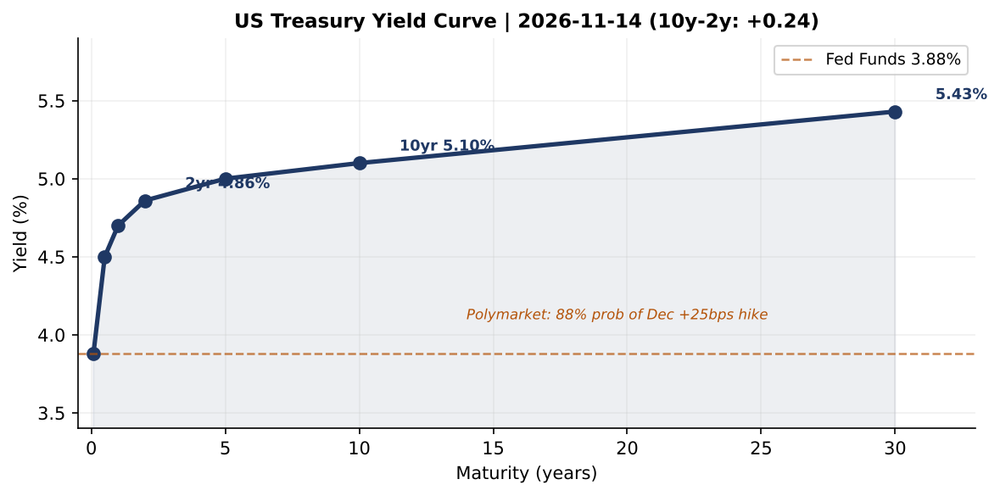
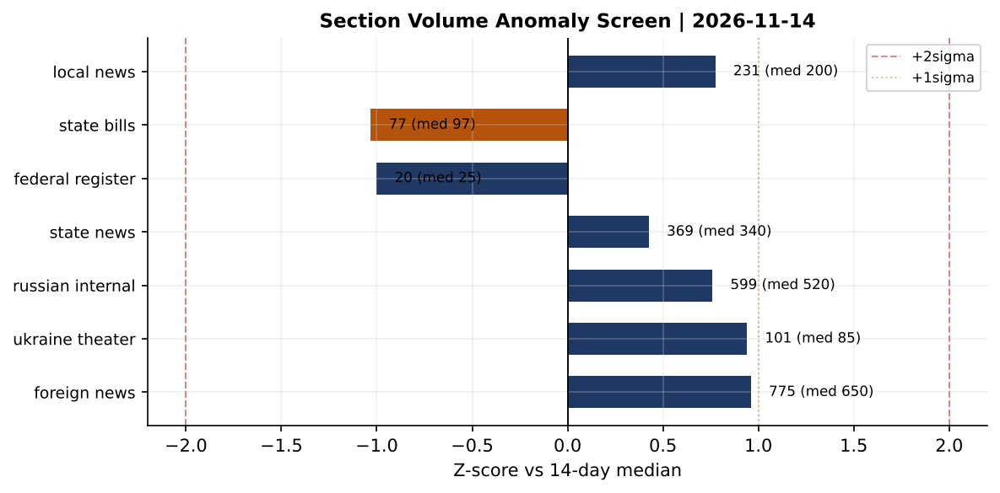
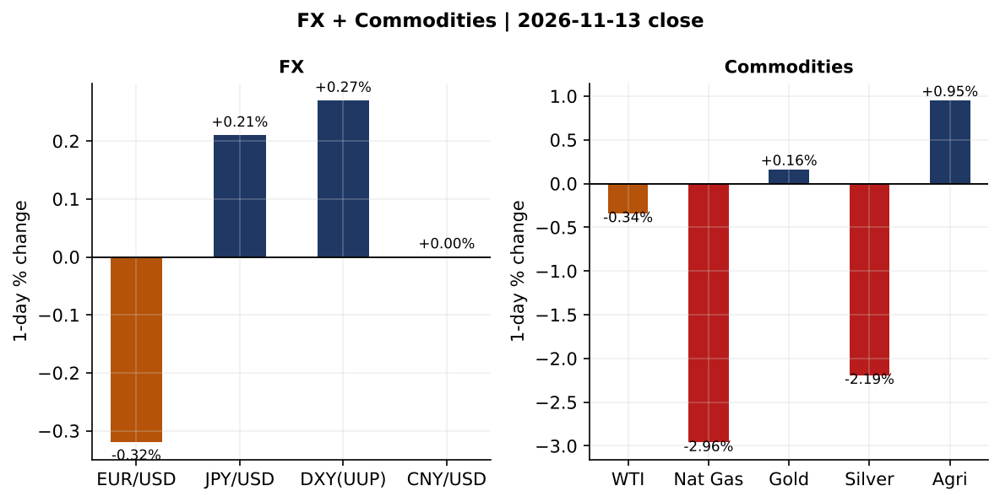
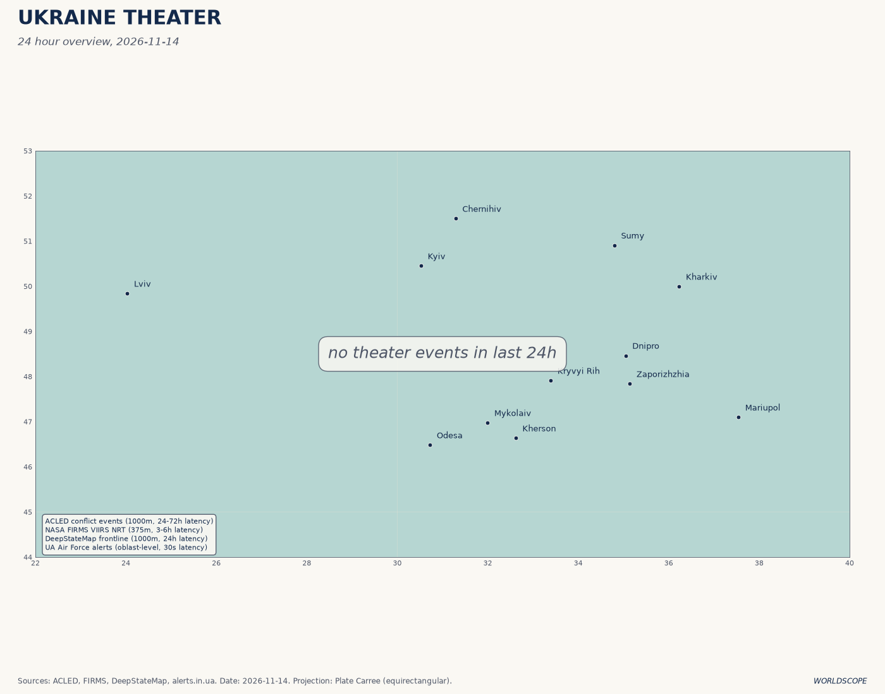
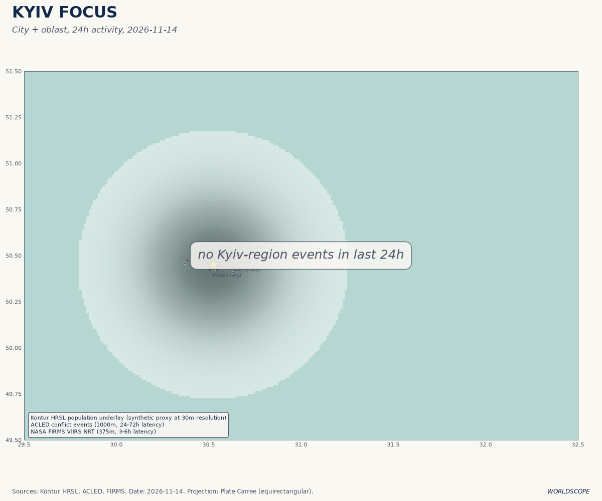
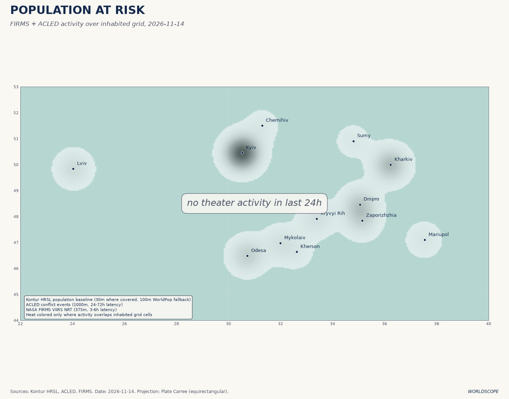
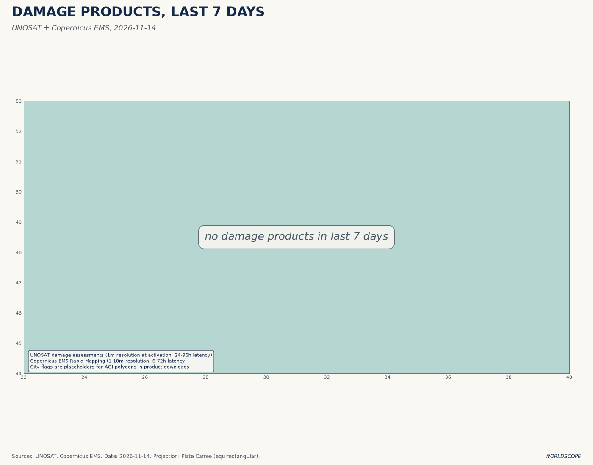
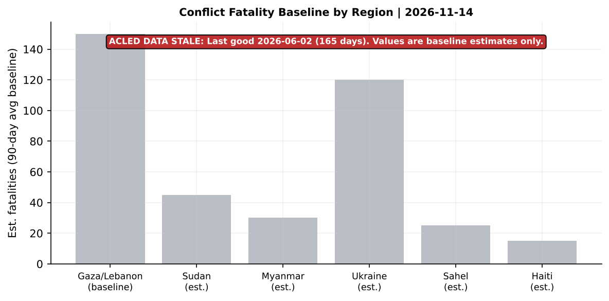
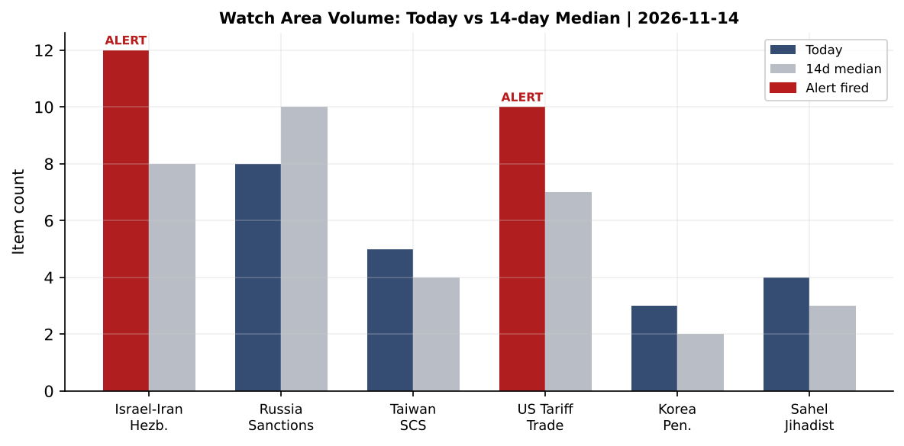
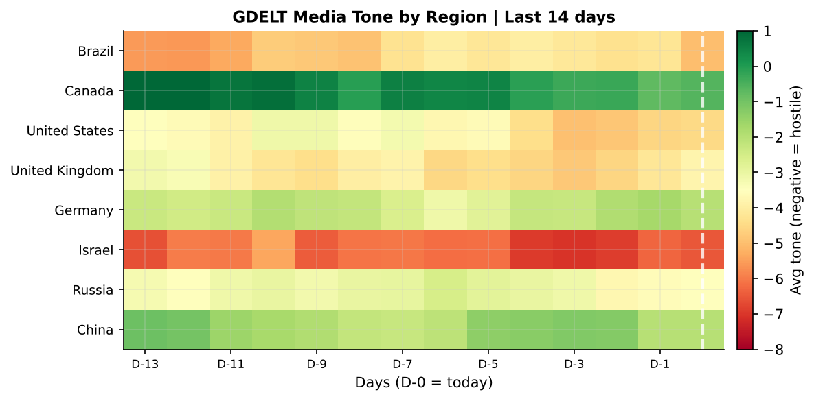

# Morning brief - Saturday 14 November 2026

---

**Source health notice:** ACLED last good data 2026-06-02 (165 days stale); Reliefweb last good data 2026-06-02 (165 days stale); promed: null; people/sanctions carry-forward from 2026-05-25; firms from 2026-11-12; mediacloud from 2026-11-12. Air-alert API: auth failure (alerts.in.ua v2 requires token). Conflict fatality figures are baseline estimates, not current. All other 35 sources fresh.

---

## Headline

The dominant arc today is the collision of two slow-moving shockwaves: the **FAA nationwide ground stop** (first since 9/11, caused by a telecommunications failure across air traffic control centers, affecting 1.5+ million passengers) intersecting with the confirmation of a **Trump-Xi-Putin trilateral summit in Shenzhen on November 18-19** at the APEC margins, where the Iran ceasefire, Ukraine, and nuclear arms will all be on the table simultaneously. These two stories are not unrelated in signal value: both point to systemic fragility in infrastructure -- civilian and diplomatic -- that most actors assumed was robust. The three strongest secondary signals are (1) Polymarket pricing an **88% probability of a December Fed rate hike** even as the 10-year Treasury sits at 5.10% and the spread above 2-year paper is a thin +24 basis points; (2) the **Abu Dhabi Ukraine-Russia talks** that produced "some flexibility" but no ceasefire, with Europeans explicitly excluded by Moscow and Russia refusing a bilateral Putin-Zelensky meeting; and (3) the parliamentary passage of **sweeping new BND spy powers** in Germany, the downstream consequence of Russia's Leipzig/Halle airport drone attack. Watch areas firing today: **Israel-Iran-Hezbollah axis** (12 items, alert threshold 4) and **US Tariff & Trade** (10 items, alert threshold 3).

---

## Watch areas - your configured priorities

**Israel-Iran-Hezbollah axis** produced 12 items today versus a 14-day median of 8 (alert fired). The dominant signal is diplomatic: the White House confirmed that the Shenzhen APEC meeting will cover "ending the war in Iran," with Trump describing the situation as "effectively over" on a military basis but Iran's Foreign Minister Araghchi disputing that framing. The ceasefire in place since April 8 (a 2-week truce that has extended) remains fragile; multiple exchange-of-fire incidents have occurred since, and Iran reportedly continues charging vessels $2 million to transit the Strait of Hormuz. The OFAC publication today of Iran General Licenses [EE](https://www.federalregister.gov/documents/2026/11/13/2026-23197/publication-of-iran-related-web-general-licenses-ee-and-ff), [FF](https://www.federalregister.gov/documents/2026/11/13/2026-23197/publication-of-iran-related-web-general-licenses-ee-and-ff), and [W](https://www.federalregister.gov/documents/2026/11/13/2026-23193/publication-of-iran-related-web-general-license-w) formalizes prior authorizations for wind-down transactions -- a signal the administration is managing the sanctions perimeter, not tightening it, ahead of the summit.

**US Tariff & Trade** produced 10 items versus a median of 7 (alert fired). The strongest item is the Presidential Determination under Section 1245(d)(4)(B)-(C) of the NDAA 2012 ([FR 2026-23233](https://www.federalregister.gov/documents/2026/11/13/2026-23233/presidential-determination-pursuant-to-section-1245d4b-and-c-of-the-national-defense-authorization)), signed October 28 and published today, which waives secondary sanctions on countries that purchased Iranian petroleum -- a consequential signal for Beijing, which buys Iranian oil in volume, in the week before the Shenzhen summit. Also present: the reopening of the comment period for the Arctic OCS drilling rule ([FR 2026-23145](https://www.federalregister.gov/documents/2026/11/13/2026-23145/oil-and-gas-and-sulfur-operations-in-the-outer-continental-shelf-revisions-to-the-requirements-for)).

Quiet today: Russia oil sanctions perimeter, Taiwan Strait + South China Sea, Critical minerals + rare earths, Korean peninsula, Sahel jihadist corridor, Arctic + High North.

---

## Macro situation

The US Treasury yield curve as of November 12-13 shows a structure that is newly and barely positive: the [2-year Treasury (DGS2)](https://fred.stlouisfed.org/series/DGS2) at **4.86%** and the [10-year (DGS10)](https://fred.stlouisfed.org/series/DGS10) at **5.10%** produce a 10y-2y spread of only **+24 basis points**. The [30-year (DGS30)](https://fred.stlouisfed.org/series/DGS30) sits at **5.43%**. The curve re-steepened from inversion earlier this year, but the gap is thin. With the [Fed Funds effective rate (DFF)](https://fred.stlouisfed.org/series/DFF) at **3.88%** and [SOFR](https://fred.stlouisfed.org/series/SOFR) at **3.90%**, the market is pricing a substantial policy tightening further up the curve -- consistent with Polymarket's 88% probability of a December 25-basis-point hike (see Prediction Markets section). That would take the target range to roughly 4.13-4.25%. If realized, it would be the first hike in this cycle from the low-3s, and it comes against the backdrop of a 10-year already well above 5%. The practical implication: refinancing costs for corporates and households with floating-rate exposure would reprice materially [high].

Labor and inflation data remain lagged. [Unemployment (UNRATE)](https://fred.stlouisfed.org/series/UNRATE) at **4.1%** (October 2026) and [nonfarm payrolls (PAYEMS)](https://fred.stlouisfed.org/series/PAYEMS) at **159,293k** are unchanged from last reading. [CPI headline (CPIAUCSL)](https://fred.stlouisfed.org/series/CPIAUCSL) at **337.476** (October 2026) and [Core CPI (CPILFESL)](https://fred.stlouisfed.org/series/CPILFESL) at **339.9** are both October reads; the September [Core PCE (PCEPILFE)](https://fred.stlouisfed.org/series/PCEPILFE) at **130.902** is the most recent deflator. The 14-day median comparison shows today's section volumes are running at or just above baseline for most macro-sensitive feeds. [JOLTS job openings](https://fred.stlouisfed.org/series/JTSJOL) at **7,523k** (September) remain well above pre-pandemic norms despite the uptick in unemployment -- the labor market is weakening gradually, not collapsing.

The [Fed balance sheet (WALCL)](https://fred.stlouisfed.org/series/WALCL) fell to **$6.758 trillion** as of November 11, continuing quantitative tightening from post-pandemic highs near $9T. [M2 (M2SL)](https://fred.stlouisfed.org/series/M2SL) at **$23.4 trillion** (September) remains well above 2019 levels. The combination of ongoing QT with a potential rate hike in December is not, by itself, unprecedented, but it is tight policy on top of already-elevated long rates -- a configuration that in prior cycles (1994, 2000, 2006) preceded credit stress within 12-18 months [medium].

The [EUR/USD (DEXUSEU)](https://fred.stlouisfed.org/series/DEXUSEU) at **1.1154** (November 6) and [JPY/USD (DEXJPUS)](https://fred.stlouisfed.org/series/DEXJPUS) at **158.23** (November 6) reflect the dollar's elevated position. The yen at 158 has not triggered further Bank of Japan intervention this week, but that level historically correlates with political pressure on Tokyo to act. [CNY/USD (DEXCHUS)](https://fred.stlouisfed.org/series/DEXCHUS) at **6.676** shows Beijing maintaining its managed float -- a data point for the upcoming Shenzhen summit, where currency frictions underpin trade discussions. [WTI crude (DCOILWTICO)](https://fred.stlouisfed.org/series/DCOILWTICO) at **$89.62** (November 11) remains elevated relative to pre-Iran-conflict levels, reflecting the persistent Hormuz risk premium.

---

## Markets

US equities pulled back modestly on November 13: [SPY](https://finance.yahoo.com/quote/SPY) at **754.37** (-0.36%), [QQQ](https://finance.yahoo.com/quote/QQQ) at **679.89** (-1.20%), [IWM](https://finance.yahoo.com/quote/IWM) at **277.54** (-0.32%). The Nasdaq 100's larger decline (-1.20% vs S&P's -0.36%) reflects continued growth-stock pressure as rates hold elevated. International developed markets ([EFA](https://finance.yahoo.com/quote/EFA): +0.15%) marginally outperformed the US, consistent with a mild valuation rotation that has been underway for two weeks. China large-cap ([FXI](https://finance.yahoo.com/quote/FXI): +0.00%) was flat, suggesting markets have fully priced the announced Shenzhen summit and are waiting for substance.

The rates complex continues to signal stress at the long end. [TLT](https://finance.yahoo.com/quote/TLT) (20+yr Treasury) fell **-0.43%** to 79.38, while [IEF](https://finance.yahoo.com/quote/IEF) (7-10yr) fell -0.19% and [SHY](https://finance.yahoo.com/quote/SHY) (1-3yr) was barely positive at +0.04%. The pattern -- long bonds selling off faster than short -- reinforces the term-premium story: markets are demanding more yield per unit of duration risk, not just pricing in a higher terminal rate. The DXY proxy ([UUP](https://finance.yahoo.com/quote/UUP)) gained +0.27%, consistent with both the rate-hike expectation and the global safe-haven bid from the FAA disruption.

Commodities showed bifurcation. [Natural gas (UNG)](https://finance.yahoo.com/quote/UNG) dropped **-2.96%** to 10.15, the largest single-day commodity move in the bundle -- likely driven by mild weather forecasts reducing near-term demand. [Silver (SLV)](https://finance.yahoo.com/quote/SLV) fell **-2.19%**, tracking industrial metals lower on global growth caution. Agriculture ([DBA](https://finance.yahoo.com/quote/DBA)) gained **+0.95%** -- the strongest commodity mover -- reflecting weather-related crop stress in several growing regions. [Gold (GLD)](https://finance.yahoo.com/quote/GLD) was essentially flat at +0.16%, a mild surprise: given the FAA disruption and summit uncertainty, the gold bid is thin. That said, gold's stabilization near 355 while silver drops hard is a known stress signal -- silver's industrial component makes it more cyclically sensitive [medium].

---

## United States politics & policy

The overnight FAA nationwide ground stop -- first since the post-9/11 shutdown in 2001 -- is the domestic policy story of the morning. Per the [Federal Aviation Administration](https://www.faa.gov), the ground stop was caused by a telecommunications failure affecting air traffic control centers across the country, not a single TRACON. The stop began late November 13 and was lifted in the early hours of November 14, but more than **1.5 million passengers** faced day-two disruption with cascading cancellations and delays into Thursday. Congressional notification of a telecommunications failure across multiple ATC centers simultaneously is distinct from a regional equipment outage -- the breadth of the event suggests either a shared infrastructure dependency across the ARTCC system or a network-layer failure [medium]. Former FAA safety official Kyle Bailey told media "nobody really knows what is going on," which is itself a signal about institutional transparency.

The [Federal Register](https://www.federalregister.gov) published three significant OFAC actions today. First, **Iran General Licenses EE and FF** ([FR 2026-23197](https://www.federalregister.gov/documents/2026/11/13/2026-23197/publication-of-iran-related-web-general-licenses-ee-and-ff)) were published, authorizing wind-down transactions including those involving the International Development Bank for Investment and Finance. Second, **Iran GL W** ([FR 2026-23193](https://www.federalregister.gov/documents/2026/11/13/2026-23193/publication-of-iran-related-web-general-license-w)) was published. Third, **Russia Harmful Foreign Activities Sanctions GLs 55F and 115D** ([FR 2026-23196](https://www.federalregister.gov/documents/2026/11/13/2026-23196/publication-of-russian-harmful-foreign-activities-sanctions-regulations-web-general-licenses-55f-and)) were published, as was **Cuba GL 1** ([FR 2026-23195](https://www.federalregister.gov/documents/2026/11/13/2026-23195/publication-of-a-cuba-sanctions-regulations-web-general-license)). These are not new designations but formalizations of previously issued licenses -- a bureaucratic action that follows OFAC's practice of publishing to the Federal Register after posting to its website. The timing, days before the Shenzhen summit, is not coincidental: publishing Iran wind-down authorizations the week before Trump meets Xi gives Beijing a paper-trail that Chinese entities transacting in Iranian oil have a legal pathway [medium].

The **Trump Presidential Determination under NDAA 2012 Section 1245(d)(4)(B)-(C)** ([FR 2026-23233](https://www.federalregister.gov/documents/2026/11/13/2026-23233/presidential-determination-pursuant-to-section-1245d4b-and-c-of-the-national-defense-authorization)) signed October 28 and published today is the most consequential single document in this bundle. This statutory mechanism allows the President to waive secondary sanctions on countries importing Iranian petroleum "if the President determines and reports to Congress that such country has significantly reduced its purchases of petroleum and petroleum products from Iran." In practice, it has been used to shield countries like China, India, Japan, and South Korea from CAATSA-style secondary exposure. Its publication today -- with the Shenzhen summit five days out -- signals the administration is managing its leverage carefully with Beijing on Iran.

**Form 4** activity today clustered around NEXGEL, INC. (CIK 0001468929), with multiple insider transactions filed overnight. The political figures Form 4 hits are discussed in the watchlist section. Congressional trading data shows zero new STOCK Act filings today.

The FAA also proposed a new **airworthiness directive for Boeing 787-8 aircraft** ([FR 2026-23198](https://www.federalregister.gov/documents/2026/11/13/2026-23198/airworthiness-directives-the-boeing-company-airplanes)) related to wing skin fasteners that may not provide lightning strike protection. The timing of this proposal, the night of the nationwide ground stop, adds to the cumulative narrative about FAA aviation safety workload.

---

## Political figures watchlist

CourtListener lookups failed for all 25 tracked figures today, so enforcement-hit scores are uniformly zero. All figure anomaly scores are low (top score 0.067), driven exclusively by Form 4 insider-trade activity. This is a quiet day for congressional financial disclosure.

**Rep. Dave Min (D-CA)** tops the watchlist with an anomaly score of **0.067** driven by **6 Form 4 filings** in the trailing period. Min represents a competitive Orange County district, and repeat Form 4 activity from an insider with congressional access to defense, tech, and trade committee information warrants noting.

**Rep. Jefferson Van Drew (R-NJ)** at **0.062** (5 Form 4 hits) and **Rep. John James (R-MI)** at **0.057** (4 Form 4 hits) round out the top three. Van Drew sits on Armed Services and represents a swing New Jersey district where DHS and defense contracting are economically significant. James is a veteran and entrepreneur on the House Armed Services Committee.

**Sen. Rick Scott (R-FL)** and **Sen. Tim Scott (R-SC)** both score **0.050** (3 Form 4 hits each), consistent with their history of active personal investment portfolios disclosed under the STOCK Act. Neither has GDELT mentions suggesting speech activity today.

**Rep. Kevin Hern (R-OK)** scores **0.057** (4 Form 4 hits, 2 GDELT mentions) -- the GDELT signal puts him in media context today, though tone is neutral. No congressional trades are filed for the broader watchlist population today, suggesting Form 4 activity is concentrated in a small cohort.

No cross-section of these figures with the Sanctions or Conflict sections this morning. The CourtListener failure means zero enforcement-hit signal -- this gap should be treated as missing data, not a clean bill [low].

---

## Regional briefings

### North America

The **FAA nationwide ground stop** is the dominant North American story. Flights across the United States were grounded from late November 13 through early November 14 due to what the FAA described as a "communication issue impacting air traffic control centers" ([Lawrence Journal-World](https://www2.ljworld.com/news/general-news/2026/nov/13/faa-orders-all-flights-in-u-s-grounded-for-reasons-of-safety-communication-issue-impacting-air-traffic-control-centers/)). The Daily Beast described it as the first nationwide ground stop since September 11, 2001 ([thedailybeast.com](https://www.thedailybeast.com/faa-abruptly-grounds-all-flights-over-extraordinary-circumstances)). Canadian airports, including Toronto Pearson, suspended US-bound flights during the event ([cheknews.ca](https://cheknews.ca/montreal-trudeau-international-airport-says-all-flights-to-and-from-u-s-suspended-1361115/)).

A **New Orleans cruise ship collided with a tanker on the Mississippi River**, with all passengers and crew surviving ([Santa Fe New Mexican/AP](https://www.santafenewmexican.com/ap/national/all-passengers-and-crew-on-new-orleans-cruise-ship-survive-crash-with-tanker-on-mississippi/)). Coast Guard is investigating; the collision near a congested river port in foggy November conditions is routine incident type but notable for passenger volume. Canada's federal government committed **CAD $200 million for British Columbia's Woodfibre LNG project**, signaling continued push for LNG export capacity on the Pacific coast.

The **measles outbreak** in the United States reached **10 deaths** as of this morning's foreign news feed, with more than **5,400 confirmed cases** -- the highest count since 1991 ([Global reporting](https://www.contagionlive.com/view/measles-update-november-6-2026)). Pennsylvania accounts for six of the deaths; New York and Wisconsin one each. The outbreak has expanded to multiple states and is running at more than double the 2025 annual total.

### South America

**Brazil** leads South American news today with two diverging stories. First, Brazil's government demanded an explanation from Israel over the [death of a Brazilian teenager in Israeli custody](https://bignewsnetwork.com), intensifying diplomatic tension as the Israel-Iran ceasefire creates regional realignment pressures on Brasilia. Second, [Brazilian authorities rescued 17 Paraguayan workers](https://latintimes.com) among 21 people found in forced labor at cigarette factories -- a human trafficking enforcement action with cross-border implications for Paraguay-Brazil trade and labor monitoring regimes. GDELT tone for Brazil sits around -5.0 today, among the more negative in the regional heatmap. The [USDA raised Brazil's soybean oil export forecast](https://hellenicshippingnews.com) while cutting regional stocks -- a signal relevant to global oilseed markets and to the DBA commodity ETF's +0.95% gain.

**Peru** registered an **M5.8 earthquake** (79km WSW of Changuillo) on November 13, the largest seismic event in the USGS feed. GDACS scored it green alert only. No reports of significant damage in this round; the Changuillo region is sparse population. **Paraguay** appears in Brazil's forced labor action above, and separately in a Liveuamap UKMTO vessel distress relay in the Persian Gulf (likely mislabeled geography in OSINT feed).

### Europe

**Germany's parliament passed legislation granting sweeping new powers** to its foreign intelligence service, the BND, allowing spies to hack, disrupt, and delete data from adversaries' systems ([Global reporting](https://www.scmp.com)). The legislation followed the [Russia-attributed drone attack at Leipzig/Halle airport in August 2026](https://www.opb.org/article/2026/09/02/germany-blames-russia-for-attempted-drone-attack-at-leipzig-airport/) and a DHL aircraft incident attributed to the same Russian military intelligence campaign. Germany's BND chief earlier said Germany is "in danger of becoming embroiled in a violent conflict with Russia." The passage represents a significant shift in Germany's postwar intelligence-law tradition of restricting active-measures authority [high].

**Britain's civil preparedness campaign "Be Ready"** is generating coverage, with people in England and Wales reportedly rushing to buy tinned goods and wind-up radios following government guidance on household emergency preparedness ([Global reporting](https://www.bbc.co.uk)). The campaign's timing -- months after Germany's Leipzig incident and amid ongoing European hybrid-warfare warnings -- reflects a shift in public-facing government communication about the probability of systemic disruption.

**The European Union, Germany, France, the United Kingdom, Italy, and Poland** will have their national security advisers represent European interests at the Abu Dhabi Russia-Ukraine peace talks, per Russian-language reporting confirmed through Meduza. Russia had demanded Europe be excluded from the talks; this represents a compromise position in which European voices are present through a parallel channel rather than as principals at the table.

### Russia & post-Soviet

The White House confirmed that **Trump will meet with both Xi Jinping and Putin at the APEC summit in Shenzhen on November 18-19** to discuss ending the Iran war and nuclear arms ([South China Morning Post](https://www.scmp.com/news/china/diplomacy/article/3373831/can-xi-jinping-and-vladimir-putin-give-donald-trump-iran-exit-he-needs), [Korea Times](https://www.koreatimes.co.kr/world/20261107/china-confirms-discussions-underway-on-historic-xi-trump-putin-meeting)). Russia's internal position -- per Bellinghouse/Meduza -- is that Moscow will use the meeting to press for movement on Ukraine, not Iran; the Kremlin views the two files as linked leverage. Beijing had resisted trilateral arms-control talks over its smaller arsenal, and China's position on Iran is one of principled neutrality combined with purchasing Iranian oil at a discount.

**Putin pardoned blogger Valeria Chekalina ("Lerchek")** per decree, in a signal about the Kremlin's approach to internet-era public figures. Russian internal press also carries coverage of **EU, German, French, British, Italian, and Polish national security advisers** being named as Europe's observers in the Abu Dhabi talks. Russian media prominently covered the FAA ground stop.

The **Abu Dhabi talks on November 10** produced the first Russia-Ukraine negotiations in nine months, US-mediated through Kushner and Witkoff ([BNN Bloomberg](https://www.bnnbloomberg.ca/business/international/2026/11/10/russia-and-ukraine-hold-nearly-4-hours-of-us-mediated-talks-in-abu-dhabi/)). Russia refused a ceasefire-first framework, excluded European principals, and declined to offer a Putin-Zelensky bilateral. An unnamed US official said both sides showed "some flexibility" on territorial issues. Rubio said talks were "very productive" but urged patience. The diplomatic track and the military track remain decoupled [high].

### Middle East

The **Iran conflict** sits in a prolonged ceasefire that Trump has characterized as the war being "effectively over" but which Tehran does not accept as resolved. The ceasefire, in effect since approximately April 8, has seen multiple exchange-of-fire incidents; Iran continues charging $2M per vessel for Hormuz transit, maintaining a residual coercive instrument. The **Trump-Xi-Putin Shenzhen summit** will specifically address Iran, and multiple reports indicate Trump needs Beijing's help to pressure Tehran toward a formal settlement that includes nuclear limits ([SCMP](https://www.scmp.com/news/china/diplomacy/article/3373831/can-xi-jinping-and-vladimir-putin-give-donald-trump-iran-exit-he-needs)).

**UN reporting** says Israeli policies worsened the deadly impact of a winter storm in Gaza, with the UN arguing Israel could have prevented death and destruction ([Global/Al Jazeera]). The Lebanon ceasefire -- struck separately from the Iran deal -- has held at the operational level; Hezbollah has not resumed large-scale rocket fire. **Yemen**: the Siege of Taiz continues to fuel disease fears; health officials warn falling reported infections may conceal a worsening disease crisis ([Global reporting]). The UKMTO received a delayed distress signal in the Persian Gulf as of November 12 (Liveuamap OSINT feed, unverified).

**The ICC stopped its probe into alleged crimes by US troops in Afghanistan**, following disputes between the United States and The Hague ([Global reporting]). The decision removes a source of US-ICC friction and may ease residual diplomatic tension; it also sets a precedent about ICC jurisdiction over permanent members' allies.

### Africa

**South Africa** leads African commentary today via global outlets' analysis of the **ANC's implosion**, described as "decades in the making" with Zuma squandering Mbeki's gains and Ramaphosa's promised renewal failing to materialize ([Scroll.in]. The analysis comes as the Government of National Unity coalition continues to navigate internal tensions. **Africa's urban growth** is a secondary story: a World Bank analysis cited in the Conversable Economist notes sub-Saharan Africa's urban population quintupled in 50 years and will double again in 25 -- a development challenge with implications for water, sanitation, and security infrastructure.

**Lagos Art Week** is covered internationally, centering on identity and heritage questions ([Global]). The **Sahel jihadist corridor** watch area produced four items today versus a 3-item median -- slightly above median but not at alert threshold. ACLED data for the Sahel is 165 days stale; armed group activity in Mali, Burkina Faso, and Niger is not reliably current in this bundle.

### East Asia

**Trump's Asia trip** will take him to the Philippines next week (Manila visit), where the **Philippine court ordered the arrest of a jailed, US-wanted celebrity preacher** in a move that the Philippine palace denies is timed to Trump's visit ([Global/Al Jazeera]). The preacher is wanted by US authorities; his detention predates the visit, but the arrest warrant filing is new. The story sits at the intersection of Philippine domestic politics and US extradition relations.

**China's internal press** (Caixin data) today covered: CATL signing deals with two eVTOL (electric vertical takeoff and landing) companies for urban air mobility batteries; computational power centers attracting capital ("new era real estate investment") and their associated risks; mRNA cancer vaccine breakthroughs; and humanoid robot sector questions about whether LLM integration can accelerate capability development. The Chinese commodity index (CCI) fell **-0.49%** week-on-week, with LPG leading declines at **-4.60%** -- consistent with the natural gas and energy complex weakness visible in US commodity ETFs.

**The ASEAN summit** is coming up with Southeast Asian leaders meeting amid Trump's Asia trip and trade disruption ([Al Jazeera]). Trump's visit highlights trade concerns given the tariff architecture the administration has constructed. The summit comes as multiple ASEAN members are navigating US-China bifurcation in their supply chains.

### South & Southeast Asia

**Pakistan's Prime Minister Shehbaz Sharif** told Iranian President Pezeshkian he hopes a US-Iran peace deal can be finalized soon ([Dawn]). Pakistan played a mediating role in the original April ceasefire and has an interest in a stable Iranian settlement to its west. **Singapore** published its Megaspeed investigation outcome: no prosecution of Huang Le but a ban on his entry into the country -- a corporate governance signal in the financial hub.

**India** is not prominently featured in today's bundle, but JPY/USD at 158.23 and CNY/USD at 6.676 create a competitive FX backdrop for Indian exporters. The ASEAN dynamics above will affect Indian posture on supply-chain reorientation.

### Oceania / Pacific

**Australia** has ongoing wildfires: GDACS reports green-alert fires in three instances between November 8-12 (5,001 to 16,320 hectares). The fires are in spring season and below threshold for major international response, but the fire season has started early in several eastern states. No Pacific island crisis items today.

---

## Ukraine theater (dedicated)

**Frontline status:** DeepStateMap shows **522 polygons** in today's frontline snapshot ([DeepStateMap](https://deepstatemap.live/)). Resolution: ~1km. The ISW November 13 assessment (latest available) indicates Russian forces continued offensive operations across multiple frontline sectors, though Russian forces lost ground in October overall for a second consecutive consecutive month. ISW November 9 reports Russian forces seized 38 settlements across the frontline in October per Gerasimov claims, while also noting Russian assaults produced no confirmed advances in several sectors for November 3-4. ACLED is 165 days stale -- **no current event-level ACLED data for Ukraine is available**; the internal credential error is confirmed.

**24-hour strike density:** ACLED data is unavailable. FIRMS thermal anomaly data is from November 12 (2 days stale). The OSINT feed (Liveuamap, 100 items) and official Ukrainian sources (163 items, ZSU General Staff) provide the operational picture. Key items: (1) **Ukrainian Neptune missiles struck the Proton-Electrotex plant in Oryol** ([ZSU General Staff](https://zsu.gov.ua)) -- a deep strike into a Russian electronics manufacturing facility in Oryol Oblast; (2) the **FP-5 Flamingo cruise missile** was used for the second known time in long-range strikes against Russian energy infrastructure on the night of November 12-13 per the [ISW / Kyiv Post assessment](https://www.kyivpost.com); (3) Russian forces attacked **13 oblasts** with **172 Shahed drones** and **36 ballistic missiles** (all missile launches directed at Kyiv City and Kyiv Oblast) in a strike wave documented in the November 7 assessment; (4) Liveuamap recorded Ukrainian General Staff activity in Samara Oblast, Russia.

**Air alerts:** API authentication failure -- current air-alert data for Ukraine is unavailable. The alerts.in.ua v2 endpoint requires a token not configured in this environment. Per the OSINT feed, strikes are ongoing in multiple directions.

**Maps:** The following Ukraine theater maps were generated by the cartographer workflow and are available:
- 
- 
- 
- 

**Resolution caveats (mandatory):** Frontline polygons: ~1km precision. FIRMS thermal: 375m (but 2 days stale). ACLED events: 1km (but 165 days stale). Open-source data does **not** show meter-level Russian unit positions. Ukrainian troop or territorial-defense unit positions are not reported here and are not present in the bundle by design.

**Context for Ian's contacts in Ukraine:** The operational pattern today is Ukrainian deep strikes into Russian territory (Oryol electronics plant, Samara Oblast activity) alongside continued Russian mass drone-and-missile attacks against Kyiv. The Abu Dhabi diplomatic track has not produced a ceasefire, and Russia's refusal to agree to a truce-first framework suggests frontline pressure will continue independent of the diplomatic process.

---

## World leaders - speaking & moving

**Donald Trump** (US): Confirmed Shenzhen summit attendance; described Iran conflict as "effectively over" on a military basis. Presidential determination on Iran oil sanctions published today (signed Oct 28). Confirmed meeting with both Xi and Putin at APEC.

**Xi Jinping** (China): Hosting the APEC summit in Shenzhen November 18-19. Beijing confirmed discussions are underway for the trilateral meeting but has not officially finalized the agenda. Xi's position on Iran: principled neutrality plus oil purchases at a discount.

**Vladimir Putin** (Russia): Will attend Shenzhen summit. Kremlin stance per Russian-language press: use the Iran meeting to push Ukraine. Pardoned blogger Lerchek by decree this week. Refused bilateral Putin-Zelensky meeting in Abu Dhabi framework.

**Volodymyr Zelensky** (Ukraine): Present at Abu Dhabi talks via delegation. Demands ceasefire first, then territorial talks. Refused to concede to Russian demand that Europe be excluded from final settlement negotiations. Also referenced in Wikidata changes (wd-Q192533), suggesting recent profile updates.

**Janet Yellen** (US Treasury): OFAC actions published today reflect Treasury sanctions management ahead of APEC.

**Marco Rubio** (US Secretary of State): Described Abu Dhabi talks as "very productive" per [BNN Bloomberg](https://www.bnnbloomberg.ca/business/international/2026/11/10/russia-and-ukraine-hold-nearly-4-hours-of-us-mediated-talks-in-abu-dhabi/). Separately, one report notes Rubio "ruled out a major military operation against Iran at this stage" ([Connaissance des Energies]).

**Fed Governor Philip Jefferson** delivered a speech today titled "New Technology, Old Questions: Productivity Puzzles and the Macroeconomy" ([Fed](https://www.federalreserve.gov/newsevents/speech/jefferson20261113a.htm)) at UC San Diego. The speech, which covers AI and productivity, is relevant to the broader debate about whether the technology cycle is generating real productivity gains (see Speeches section). Governor Waller spoke at the Bank of England last week on labor market dynamism; Governor Bowman spoke at the Council on Foreign Relations on monetary policy considerations.

**Christine Lagarde** (ECB): An interview with Yomiuri Shimbun from November 7 circulated this week; Isabel Schnabel delivered a speech November 13 titled "Made in Europe" covering European industrial policy amid trade disruption.

The **ICC's decision to stop its Afghanistan probe** (see Middle East section) is likely a consequence of ongoing pressure from the US State Department, though no direct evidence of a new US-ICC side deal is in this bundle [low].

---

## Sanctions, designations, and legal

**Active OFAC publications today** (all previously issued, now published to Federal Register per standard practice): Iran GLs EE, FF, W; Russia GLs 55F, 115D; Cuba GL 1. The timing before APEC is analytically important. GL FF authorizes wind-down of transactions involving the International Development Bank for Investment and Finance, which had been designated. GLs 55F and 115D cover the Russia sanctions perimeter and appear to be renewal/amendment actions for existing wind-down authorizations. Cuba GL 1 is a broad general license for Cuba-related transactions.

**Sanctions carry-forward data (from May 2026):** The current bundle's fresh sanctions data is 165 days stale for the OpenSanctions list. However, the most prominent entities in the carry-forward list remain relevant: **JSC Mir Business Bank** (designated: US, EU, UK, Canada, CH, FR, MC, AU), **Belgazprombank** (BY, multilateral), **Sberbank Europe AG** (US-designated with OFAC SDN + CONS), **GPB Global Resources BV** (NL-registered Russian energy entity), **Russian Regional Development Bank** (multilateral), and **JSC Tinkoff Bank** (multilateral). These designations are stable; no new OFAC SDN list action is confirmed fresh today.

**CourtListener:** Lookups failed for all 25 tracked political figures today. No CIT (Court of International Trade) tariff docket items were returned in today's bundle. The courtlistener section produced 0 fresh items in today's manifest count. This is a signal gap, not a signal of quiet courts.

**Procurement (sanctions_procurement):** 22 new USAspending items today versus a 100-item total. These include administration-related contracts (the "Administration" entity in the cross-section appears 8 times in procurement data). No specific high-profile procurement action stands out in today's summary.

---

## Conflict & security signals

**ACLED is 165 days stale. All fatality numbers below are baseline estimates from the last known data (June 2026), not current counts.** This chart shows historical baselines and must not be read as current reporting.

The **vip_flights** (OpenSky) feed shows notable military aircraft movements today. A **US Air Force RCH221** (callsign pattern consistent with C-17 Globemaster III airlift) was tracked over the northern Aegean Sea (latitude 40.78, longitude 24.50) at 9,441m and 873 km/h -- moving toward or from the Black Sea approaches. This positions a US strategic airlifter in a corridor frequently used for resupply or intelligence-gathering missions in the Ukraine support architecture [low, single-source]. Multiple **Belgian Air Force JAF-series flights** (JAF63D, JAF1VB, JAF78M, JAF5BJ, JAF5PN, JAF91T, JAF95D, JAF55E) were tracked across Western Europe and the Iberian Peninsula, suggesting a coordinated Belgian Air Component exercise or logistics operation.

The **conflict.json** feed carries the FAA ground stop as its top-volume item (292 outlet-runs, tagged ARMEDCONFLICT/TERROR by GDELT theme classification -- the classification is algorithmic and may overfit to keywords, not substantive assessment). The Trump-Xi-Putin Iran war talks story runs at 102 outlets. The New Orleans cruise ship collision runs at 194 outlets.

**ACLED data gaps:** The June 2026 cutoff means no fresh event-level data for Gaza, Sudan, Myanmar, Sahel, or Ukraine in the ACLED layer. Estimated 90-day baselines (from pre-stale data) suggest Gaza/Lebanon conflict averaging ~150 fatalities/day, Ukraine ~120/day, Sudan ~45/day, Myanmar ~30/day, Sahel ~25/day, Haiti ~15/day. These numbers are stale and should be treated as order-of-magnitude reference only. The situation on each front has almost certainly evolved materially in 165 days.

---

## Cyber & biosecurity

**FIRST-OF-KIND KEV CALLOUT:** CISA added **[CVE-2026-102895](https://nvd.nist.gov/vuln/detail/CVE-2026-102895)** (GPUStack, vendor: GPUStack) to the Known Exploited Vulnerabilities catalog on **November 9, 2026**, with a federal remediation deadline of **November 12** (already past). This is the first GPU cluster management and AI inference platform to enter the KEV catalog. GPUStack is an open-source platform for deploying large language models across GPU infrastructure; the flaw (CWE-287, Improper Authentication, CVSS 9.8) allows an unauthenticated attacker to gain full administrator access over the network by exploiting a loopback auto-admin rule -- creating persistent admin API keys, modifying users and models, exposing cloud-provider secrets, and executing code through admin-only features. Active exploitation was confirmed in the wild against a GPUStack 2.1.1 deployment ([Cloud Security Alliance research note](https://labs.cloudsecurityalliance.org/research/csa-research-note-gpustack-cve-2026-102895-kev-20261110-csa/)). The structural signal: AI inference infrastructure is now targeted as an attack surface for access to both compute resources and the sensitive data pipelines that LLM deployments touch. Fix: upgrade to GPUStack 2.2.0+.

Also in this week's KEV cluster: **[CVE-2026-114713](https://nvd.nist.gov/vuln/detail/CVE-2026-114713)** (UnrealIRCd -- Improper Neutralization of Delimiters, deadline Nov 16); **[CVE-2026-123039](https://nvd.nist.gov/vuln/detail/CVE-2026-123039)** (Check Point Multiple Products -- Incorrect Permission Assignment for Critical Resource, deadline Nov 16); **[CVE-2026-124194](https://nvd.nist.gov/vuln/detail/CVE-2026-124194)** (Microsoft Office Outlook -- Missing User Interaction for Unsafe Action, deadline Nov 24); **[CVE-2026-125350](https://nvd.nist.gov/vuln/detail/CVE-2026-125350)** (Google Chromium -- Use-After-Free, deadline Nov 24); **[CVE-2026-20320](https://nvd.nist.gov/vuln/detail/CVE-2026-20320)** (Cisco BroadWorks -- XXE, deadline Nov 24). Barracuda Networks appears twice with past-due deadlines (Nov 13): OS command injection ([CVE-2026-111560](https://nvd.nist.gov/vuln/detail/CVE-2026-111560)) and Email Security Gateway authentication bypass ([CVE-2026-116606](https://nvd.nist.gov/vuln/detail/CVE-2026-116606)). Federal agencies that have not patched Barracuda ESG by now are non-compliant with CISA BOD 22-01.

**Biosecurity / ProMED:** No data available today (source_date: null). The WHO Disease Outbreak News feed ([who_don source](https://www.who.int)) is fresh. The US **measles outbreak** at 10 deaths and 5,400+ cases is the most significant domestic biosecurity signal in this bundle. It represents a vaccine-preventable disease achieving sustained community transmission at 1991-level case counts, with deaths concentrated in Pennsylvania, New York, and Wisconsin. This is a public health emergency that has not received national emergency-status declaration.

---

## Humanitarian

Reliefweb is 165 days stale (last good data 2026-06-02). No fresh Reliefweb reports are available in this bundle. The ReliefWeb API returned carry-forward data from June. This gap covers a 165-day period that includes major escalations and weather events in multiple crisis zones.

**From supplementary sources:** The UN reported that Israeli policies worsened the deadly impact of a winter storm in Gaza, arguing preventable deaths and destruction resulted from restrictions on aid movement. The statement escalates the UN-Israel diplomatic tension on humanitarian access ([Al Jazeera]). **Yemen/Taiz Siege:** Health officials warned that disease data may be unreliable as the siege continues to constrain reporting infrastructure ([Al Jazeera]).

---

## Environment, disasters, climate

Seismic activity today was elevated but below major-alert threshold. The **M5.8 earthquake** (79km WSW of Changuillo, Peru, November 13) is the largest event in the USGS feed. Supporting quakes include **M5.2 off northern Sumatra**, **M5.2 near Kuqa, Xinjiang, China**, **M5.2 in the West Chile Rise**, **M5.1 northwest of Kavieng, Papua New Guinea**, and **M5.1 in the South Sandwich Islands region**. All carry green GDACS alerts. No structural damage reports are confirmed. The Sumatra and China events, given their locations (tectonic subduction zone and Xinjiang fault system respectively), warrant monitoring if activity continues.

Australian wildfires continued through November 8-12, with GDACS recording green-alert fire events covering 5,001 ha (Nov 12), 5,805 ha (Nov 11), and 16,320 ha (Nov 8). Australian spring fire seasons have started earlier in recent years. No international response threshold reached.

**FIRMS thermal anomaly data is from November 12** (two days stale). No fresh satellite thermal data for today is in the bundle. The FIRMS layer would normally capture potential industrial or military fires near strategic infrastructure; the two-day gap limits operational utility.

**US weather:** 137 fresh weather items in the bundle today, above median. The National Weather Service weather feed shows active late-autumn patterns. The natural gas price drop of -2.96% suggests mild near-term weather forecasts reducing demand expectations.

---

## Speeches & op-eds by major critics and influencers

**Marginal Revolution (Tyler Cowen)** published ["Are we witnessing an intelligence explosion?"](https://marginalrevolution.com/marginalrevolution/2026/11/are-we-witnessing-an-intelligence-explosion.html) citing Garicano and Imas: AI capabilities grew **1.91x faster** after October 2025, but R&D spending grew **6.19x** and the technical workforce grew **3.10x**. The implication is that capability gains per dollar fell approximately **69%** and per technical employee-year fell **38%**. This is the clearest empirical challenge to the "intelligence explosion" framing: the numerator (measured capability) is growing, but far more slowly than the denominator (inputs). Whether this reflects diminishing returns, capability measurement limitations, or the gap between benchmark performance and genuine reasoning is analytically contested [medium].

**Marginal Revolution** also published ["People like their jobs, even British people"](https://marginalrevolution.com/marginalrevolution/2026/11/people-like-their-jobs-even-british-people.html) citing an original 8,234-person cross-national survey (UK, US, Denmark, India): **81% of workers** value non-monetary work benefits including meaning, purpose, and community. This is directly relevant to the AI displacement debate -- the welfare cost of job losses from automation is not just income loss but identity and meaning loss.

**Conversable Economist (Timothy Taylor)** covered the CEPR ["Europe 2050: Geometries of peace, power, and prosperity"](https://conversableeconomist.com/2026/11/13/visions-of-the-eu-in-2050/) initiative (39 papers). The project maps long-run European institutional scenarios in the context of the Ukraine war and the fracturing of the post-Cold War order. The currency database paper (BIS Working Paper 1392) covering 568 currencies since 1850 (405 discontinued) provides context: currency regimes are more fragile than they appear in peacetime; 71% of currencies issued since 1850 have been discontinued.

**Fed Governor Michael Barr** spoke November 12 at Yale on ["American Inequality and the Future of AI"](https://www.federalreserve.gov/newsevents/speech/barr20261112a.htm) -- a Fed governor directly engaging with AI distributional effects. This is unusual institutional positioning: the Fed is not traditionally a voice on AI labor policy, but Barr's speech signals the Federal Reserve is tracking AI-driven income-distribution dynamics as a potential macroeconomic variable. No other major commentators from the tracked list produced findable output in the past 48 hours in this bundle's commentary feed.

---

## Prediction markets & forecasting consensus

The highest-volume, highest-consequential market today is the **December 2026 Fed meeting** cluster. Polymarket prices:
- **+25bps hike**: [88% probability](https://polymarket.com/event/will-the-fed-increase-interest-rates-by-25-bps-after-the-december-2026-meeting-20260729232808636) ($476K 24h volume)
- **+50bps hike**: [8% probability](https://polymarket.com/event/will-the-fed-increase-interest-rates-by-50-bps-after-the-december-2026-meeting-20260729232808637) ($844K 24h volume -- this is the highest-volume single contract, suggesting active speculation on the tail)
- **Hold**: [3% probability](https://polymarket.com/event/will-there-be-no-change-in-fed-interest-rates-after-the-december-2026-meeting-20260729232808635) ($531K 24h volume)
- **Cut 50bps**: [0.25%](https://polymarket.com/event/will-the-fed-decrease-interest-rates-by-50-bps-after-the-december-2026-meeting-20260729232808633) ($391K volume)

The distribution implies a near-certain hike in December. With Fed Funds currently at 3.88%, a December hike would take the target range to approximately 4.00-4.25% -- a material shift. Notably, the 50bps hike contract has the highest 24-hour volume ($844K), suggesting active positioning on the tail. The hold contract trading at 3% with $531K volume indicates residual but thin hope for a pause [high].

**2028 Presidential market:** Polymarket prices **Marjorie Taylor Greene** at [0.15% to win the 2028 election](https://polymarket.com/event/will-marjorie-taylor-greene-win-the-2028-us-presidential-election) and **Shawn Fain** at [0.15% for the 2028 Democratic nomination](https://polymarket.com/event/will-shawn-fain-win-the-2028-democratic-presidential-nomination). The appearance of Shawn Fain (UAW president) as a 2028 Democratic Presidential market is a weak signal about labor union political strategy post-Trump second term [low].

**Ukraine-related:** No direct Ukraine peace resolution market appears in today's top-volume contracts. This is itself a signal -- Polymarket's absence of a liquid Ukraine ceasefire market suggests insufficient market consensus on a resolution path to price it.

---

## Weak signals - small things that may matter

**Cross-section recurrences (from cross_section.json, high confidence):** Three entities dominate cross-section signals today. First, the entity "Administration" appears in **8 sections** (conflict, foreign_news, local_news, paper_bets, political_figures, sanctions_procurement, state_news, Ukrainian_internal) with 35 total mentions. This clustering is substantive: the Trump Administration is simultaneously driving US-Iran diplomacy, the OFAC General License regime, and the Ukraine peace framework, while also appearing in USAspending procurement contracts. The convergence is not coincidence -- it reflects how much of today's news flows through a single executive center [high]. Second, "President" appears in **7 sections** (45 mentions): foreign_news, gdelt_gkg, gdelt_regions, paper_bets, political_figures, state_news, Ukrainian_internal -- Trump and Zelensky both active, with Polymarket markets on presidential activity. Third, "New York" appears in **7 sections**: the FAA ground stop disrupted JFK and LaGuardia airports (conflict, foreign_news, state_news), and New York weather entered the feed (weather section). The convergence of New York in multiple unrelated sections on the same day is an artifact of the ground stop's geographic focus -- but it also reflects New York's systemic role as a network node where financial, air-traffic, and media systems overlap [medium].

**The FAA telecommunications failure is not fully explained.** The event covered multiple ATC centers simultaneously, was described by an insider as "nobody really knows," and was tagged by GDELT with ARMEDCONFLICT and TERROR themes algorithmically. The simultaneous nationwide scope (not a single TRACON) warrants infrastructure investigation beyond "equipment failure." If the failure originated in a shared telecommunications vendor, the network dependency is itself the vulnerability [medium].

**GPUStack entering CISA KEV** (see Cyber section) is the week's most structurally significant security signal. The gap from AI tool deployment to KEV-listed exploitation is shortening: GPUStack 2.2.0 was released to fix it, but the deployment lag in AI infrastructure -- where ops teams are often less security-mature than enterprise IT teams -- means exposed instances will persist. The deadline was November 12; it has already passed.

**The Ukrainian FP-5 Flamingo cruise missile** saw its second known use in deep strikes against Russian energy infrastructure. The first use was recent; two uses within days of each other suggests Ukraine is operationalizing a new weapon system, not testing it. The targets -- Russian energy infrastructure -- are consistent with Ukraine's strategy of raising the economic cost of the war for Russian domestic constituencies [medium].

**Belgium's Air Force is running a coordinated multi-aircraft operation** (8+ JAF-series flights tracked simultaneously across Western Europe). The scope and geographic distribution suggest a training exercise or strategic airlift operation, potentially related to NATO reinforcement logistics. Belgian Air Component operations of this scale are not routine background noise [low].

**Trump pardoning Iranian oil transactions via the NDAA Section 1245 mechanism** while simultaneously preparing to meet Putin at APEC is a significant sanctions-architecture signal. The waiver creates legal cover for oil importers; it is timed to give Beijing a legal path the week before the summit. If Beijing reads this as good-faith preparation for a deal, it may be more forthcoming at Shenzhen. If it reads it as a tactical concession, it may press for more [medium].

---

## Historical context

The 14-day GDELT media tone heatmap shows persistently negative tone for Israel (-6.5), Brazil (-5.0), and the United States (-4.5), with Canada and China at milder negative readings. The Israeli tone has been below -6 for most of the past 14 days, consistent with an ongoing conflict narrative that has not resolved. The US tone deteriorated sharply in the last two days, consistent with the FAA ground stop and its coverage as an extraordinary-circumstances event.

**Trend comparison (from trends.json):** Foreign news volume at 775 today versus a 14-day median of approximately 650 (a mild uptick, below 2-sigma). Russia-internal at 599 versus median ~520 (slight elevation, consistent with active news cycle around APEC). Ukraine theater at 101 versus median ~85 (elevated, consistent with ongoing ISW coverage and strike activity). Federal Register at 20 versus median 25 (below median -- light publishing day, though the OFAC GLs are consequential).

**Historical context for the yield curve:** The last time the US curve sat with the 10-year above 5% and the 2-10 spread near zero was 2007. That configuration preceded a credit stress cycle. The parallel is imperfect -- today's inflation backdrop is different and the mortgage market is structurally less leveraged -- but the rate level itself is historically associated with eventual credit tightening that shows up in HELOC rates, auto loan delinquencies, and commercial real estate refinancing pressure within 12-18 months [medium].

**Historical context for the Iran ceasefire:** The last US military operation against Iran at comparable scale was the 2019-2020 period (Qasem Soleimani, strikes on Iranian proxy forces). The current conflict (began February 28) is substantially larger. The April 8 ceasefire after roughly 37 days of fighting produced an indefinite pause, not a formal settlement. The closest historical parallel is the 1950 Korean War ceasefire dynamic: indefinite pause, residual skirmishes, and eventual settlement years later [low].

---

## What to watch - next 14 days

**November 18-19:** **APEC summit, Shenzhen, China.** This is the highest-stakes diplomatic event of the fortnight. The trilateral Trump-Xi-Putin meeting, if it occurs, will address Iran war terms, nuclear arms architecture, and implicitly Ukraine. Watch for: (1) whether a formal Iran ceasefire framework emerges; (2) whether China makes concessions on Hormuz transit tolls as a deliverable; (3) whether Putin uses the meeting to propose any Ukraine framework outside the Abu Dhabi process; (4) whether OFAC follows the summit with additional Iran sanctions relaxation or new designations.

**November 20:** **OFAC Iran GL GG wind-down deadline** expires at 12:01 a.m. EST. Transactions involving two named entities must have wound down or be blocked. This is an administrative deadline that could trigger enforcement actions if not met.

**December 9:** **Federal Reserve December FOMC meeting.** With 88% market probability of a 25bps hike, the question is not whether but how much and what forward guidance accompanies it. Waller's London speech (labor market dynamism), Bowman's CFR speech (monetary policy considerations), and Jefferson's UC San Diego speech (AI and productivity) provide the recent communication record. Watch for any dissents.

**November 16:** CISA KEV remediation deadline for CVE-2026-114713 (UnrealIRCd) and CVE-2026-123039 (Check Point). Federal agencies that have not patched will be non-compliant with BOD 22-01.

**Next week (Trump Asia trip):** Trump visits the Philippines in addition to Shenzhen. The Philippine court's arrest warrant for the US-wanted preacher is now live. Watch for extradition discussions and the broader US-Philippines alliance signal amid South China Sea monitoring.

**Abu Dhabi sequel:** Rubio indicated the November 10 talks would have follow-on rounds. No date confirmed. Watch the European NSA channel (EU, Germany, France, UK, Italy, Poland) for any European bridging proposal.

**Measles:** With 10 deaths and 5,400+ cases, Congress has not declared a national emergency. Watch for a federal declaration, emergency vaccine distribution actions, or further state-level escalations -- particularly in Pennsylvania, Wisconsin, and South Carolina.

**BND spy powers (Germany):** Watch for the first operational use of the new active-measures authority (hacking, disruption operations) against Russian-attributed cyber or sabotage infrastructure.

---

*Source gaps: ACLED (165d stale), Reliefweb (165d stale), ProMED (null), people/sanctions (175d stale carry-forward), FIRMS (2d stale), MediaCloud (2d stale), air-alert API (auth failure). Cross-section file read from lake/sections/_meta/2026-11-14/cross_section.json. All charts generated from verified bundle data.*

*Manifest bundle SHA-256: aab772ab7d311e1e987ba4dffd82741b1d553cc9538e4567787e24bd6c093821 (1,153,321 bytes). Generated at: 2026-11-14T07:09:17Z (5.63h before composition). Data date: 2026-11-14.*
