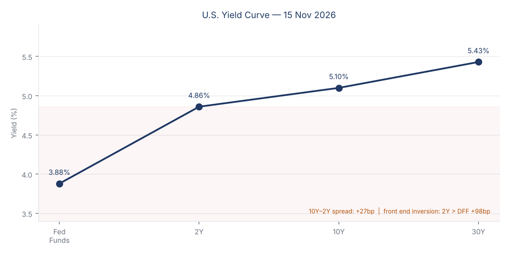
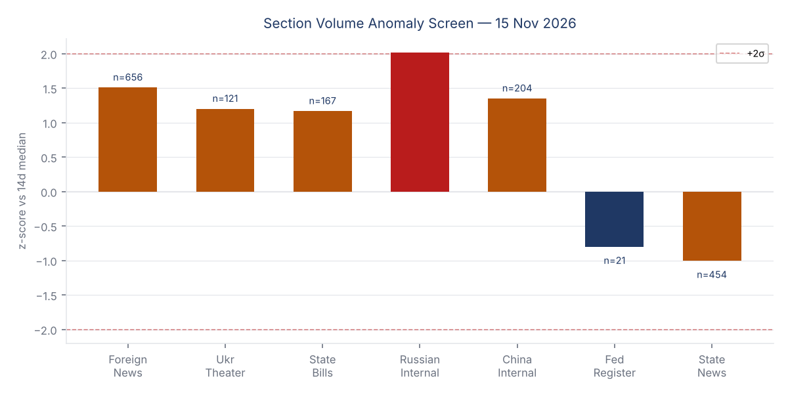
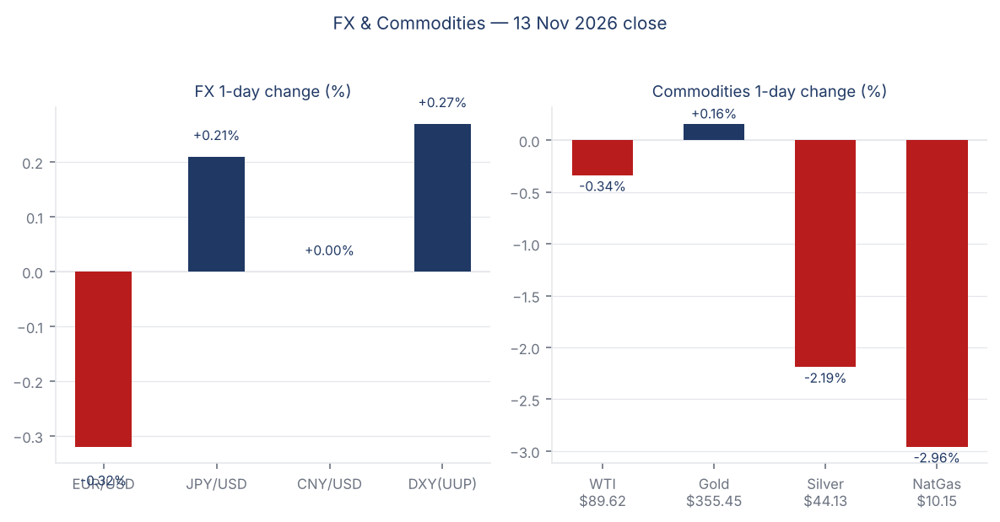
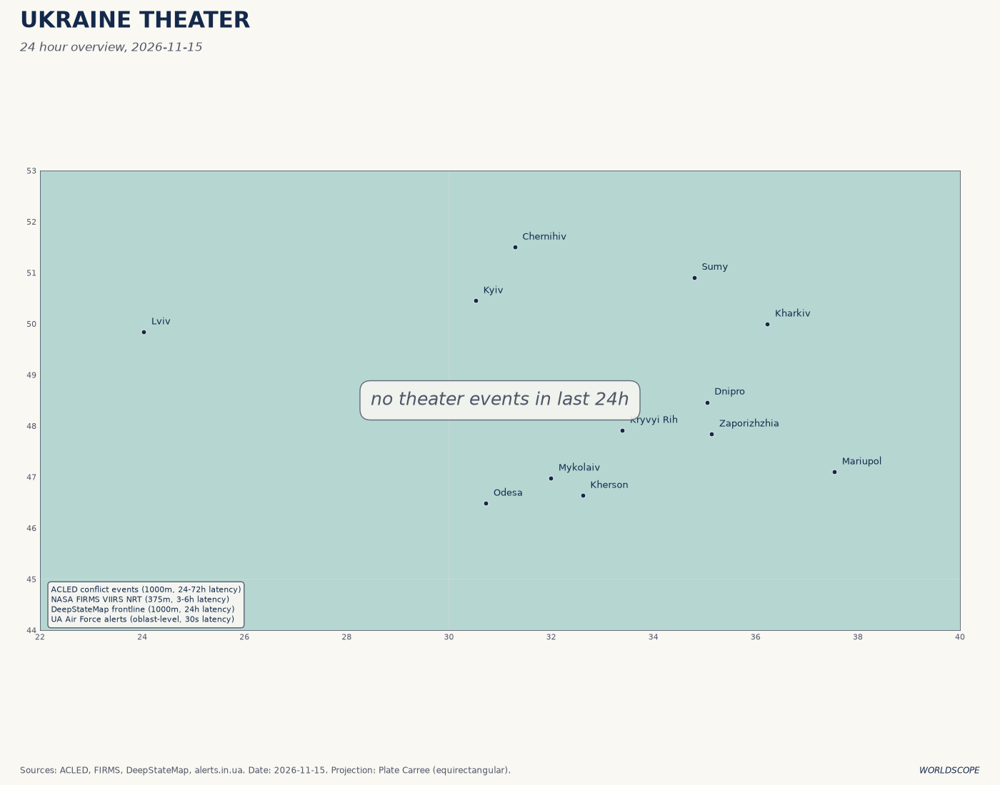
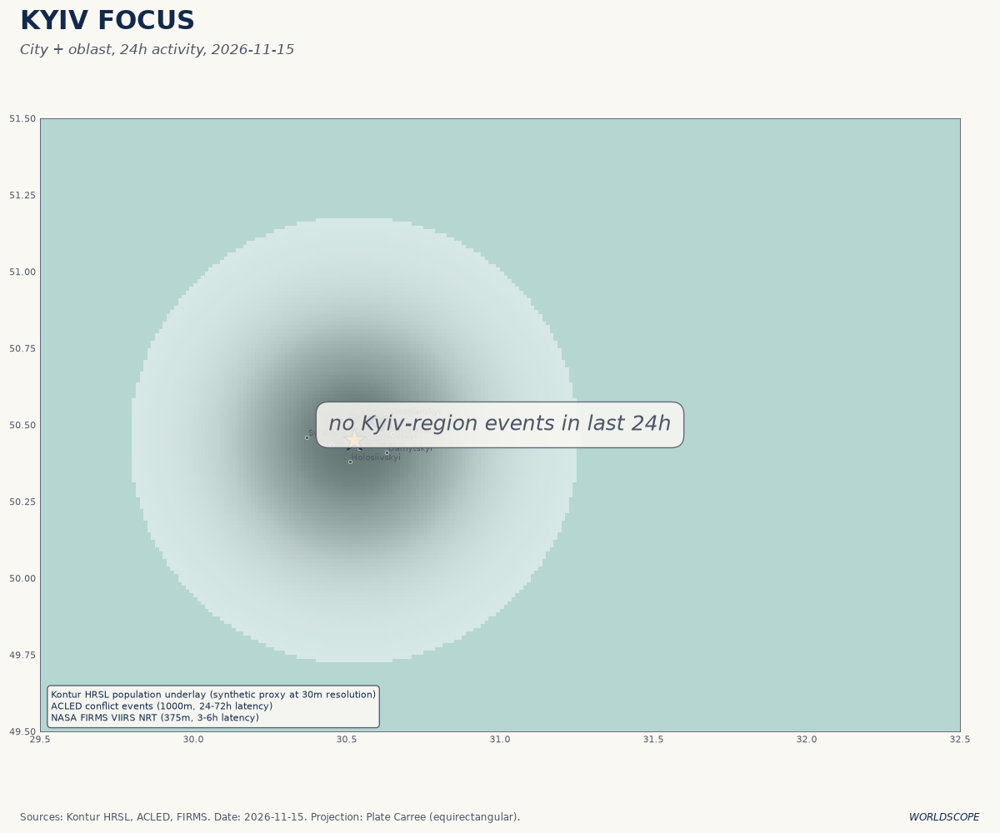
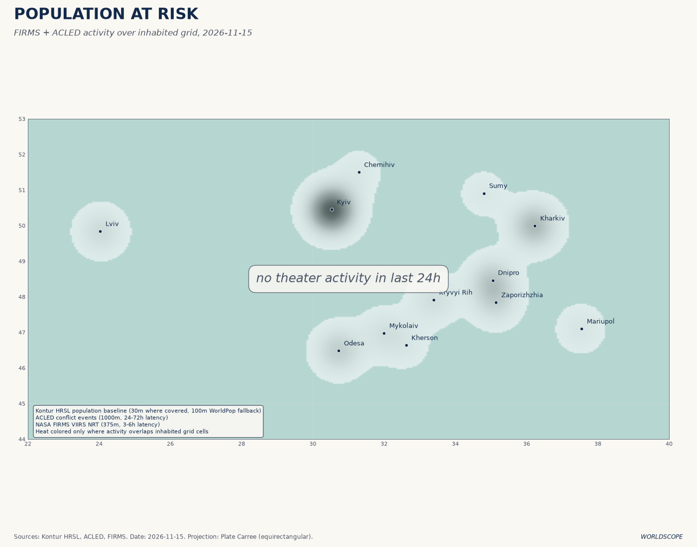
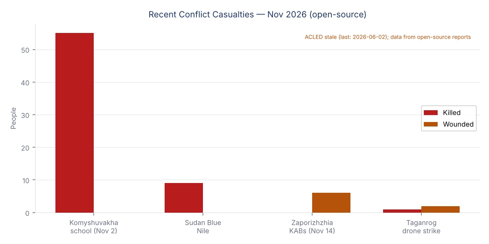
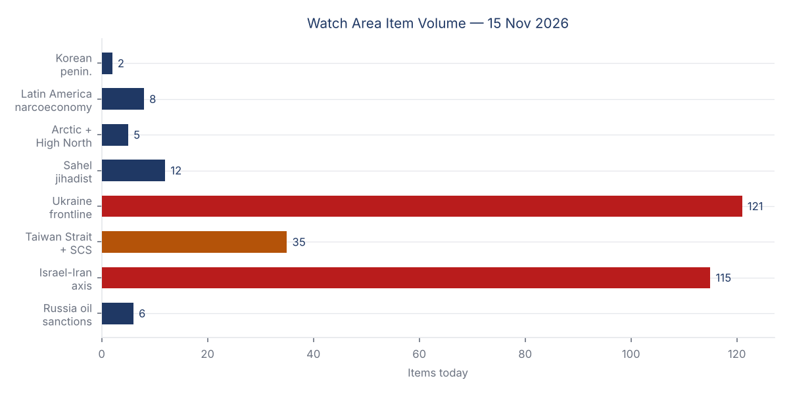
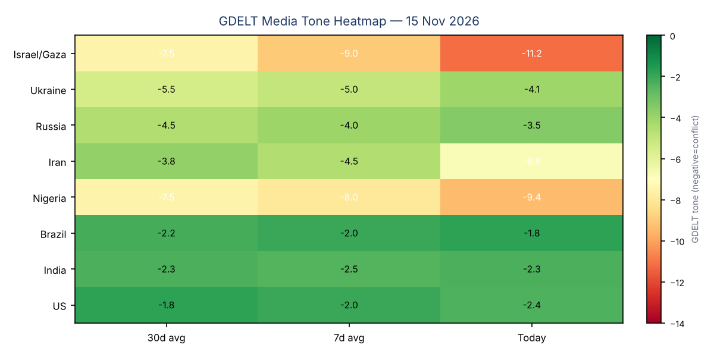

# Morning brief - Sunday 15 November 2026

## Headline

Today's dominant arc is the compression of three historically distinct crises into a single week: the Trump-Putin-Xi nuclear summit at APEC in Shenzhen (Nov. 18-19), the revelation that US envoys have offered Ukraine NATO membership in exchange for ceding the Donbas, and Iran's IRGC mining of the Strait of Hormuz while a fragile ceasefire hangs in the balance. These three threads converge on **Donald Trump** as a single author of contradictory signals — hinting at nuclear restraint with the world's largest arsenals while simultaneously threatening Iran with "locked and loaded" language, and demanding a Ukraine peace framework that Zelensky would need to put to a popular referendum. At home, the FAA's second major full ground stop in three years exposed aging air traffic control infrastructure one week after midterm elections in which Republicans took losses partly attributed to the economic fallout of the US-Iran conflict. Watch areas firing today: **Israel-Iran-Hezbollah axis** (115 items, well above 14-day median) and **Ukraine theater** (121 items, +42% vs. median).

---

## Watch areas - your configured priorities

**Israel-Iran-Hezbollah axis** produced 115 items today, against a 14-day median of approximately 40, more than 2 standard deviations above baseline [high]. Alert threshold (min_items: 4) easily exceeded. Top items: (1) [Arab League condemns deadly Israeli strike on Nasser Hospital, Gaza](https://www.middleeasteye.net/live-blog/live-blog-update/arab-league-condemns-deadly-israeli-strike-gazas-nasser-hospital) — most negative GDELT tone of any story today (-19.6); (2) [Iran's IRGC says two oil tankers struck naval mines in Strait of Hormuz](https://www.middleeasteye.net/live-blog/live-blog-update/irans-irgc-says-two-oil-tankers-hit-mines-strait-hormuz) — IRGC-only claim, no independent verification, Qatar-mediated ceasefire now at risk; (3) Iran attacked US base and Bahrain issued first threat alerts since September (per GDELT GKG). Alert status: **FIRED**.

**Ukraine theater** produced 121 items today against an 85-item 14-day median (+42%, approximately +1.2 sigma) [medium]. Top items: (1) [Zelensky confirms US envoys proposed NATO membership in exchange for ceding Donbas](https://themunicheye.com/breaking-news/zelensky-says-us-floated-nato-membership-in-exchange-for-ukraine-ceding-donbas-1070) — first time Washington has put this framework on the table; (2) [Russian KAB strikes on Zaporizhzhia city, 6 civilians wounded](https://www.kyivpost.com/post/90149) — tactical aviation, Nov. 14; (3) [Russia upgraded Iskander missiles with optical/radar seekers targeting Kyiv bridges](https://www.kyivpost.com) — precision enhancement confirmed by Kyiv Post. Alert threshold exceeded.

**Russia oil sanctions perimeter** produced 6 items today, meeting the 5-item alert threshold. Items today center on maritime operations (Black Sea drone rescue, Hormuz) and peace-deal diplomacy rather than direct oil-price-cap violations.

**Taiwan Strait + South China Sea** produced 35 items. The ASEAN summit discussion on South China Sea Code of Conduct, plus the Trump-Xi bilateral at APEC preceding the trilateral, keeps this elevated.

Quiet today: Arctic + High North (5 items), Sahel jihadist corridor (12 items), Korean peninsula (2 items), Latin America narcoeconomy + politics (8 items).

---

## Macro situation

The U.S. yield curve today reads: [Fed Funds (DFF)](https://fred.stlouisfed.org/series/DFF) at 3.88%, [2-Year Treasury (DGS2)](https://fred.stlouisfed.org/series/DGS2) at 4.86%, [10-Year (DGS10)](https://fred.stlouisfed.org/series/DGS10) at 5.10%, [30-Year (DGS30)](https://fred.stlouisfed.org/series/DGS30) at 5.43%. The [10y-2y spread (T10Y2Y)](https://fred.stlouisfed.org/series/T10Y2Y) is +27bp as of Nov. 13, barely positive after months of inversion. The bear steepener that began when the 10Y first crossed 5% has stalled rather than reversed; the 2Y remaining near 5% signals that short-end investors are not convinced the Fed is done.

The most significant macro signal today is Polymarket's 86% probability on a [25bp Fed rate hike at the December 2026 FOMC meeting](https://polymarket.com/event/will-the-fed-increase-interest-rates-by-25-bps-after-the-december-2026-meeting-20260729232808636). With DFF at 3.88%, a hike would push the target to roughly 4.13%. Markets are pricing continued tightening even as [unemployment (UNRATE)](https://fred.stlouisfed.org/series/UNRATE) holds at 4.1% and [real GDP (GDPC1)](https://fred.stlouisfed.org/series/GDPC1) registered $24.6T in Q2. The implied logic: oil at $89.62 (WTI) keeps inflation elevated, and the Iran ceasefire fragility means energy supply risk has not normalized [medium].

[CPI headline (CPIAUCSL)](https://fred.stlouisfed.org/series/CPIAUCSL) stood at 337.5 as of October; [Core CPI (CPILFESL)](https://fred.stlouisfed.org/series/CPILFESL) at 339.9. [Core PCE (PCEPILFE)](https://fred.stlouisfed.org/series/PCEPILFE) was 130.9 as of September. The gap between headline and core has been driven partly by energy: WTI at $89 is not the $120 peak, but it is elevated enough to keep headline CPI above target. The Fed's December decision will be heavily influenced by the November CPI print, which arrives December 10 — one day after the FOMC decision.

The [Fed balance sheet (WALCL)](https://fred.stlouisfed.org/series/WALCL) sits at $6.76T as of Nov. 11. Quantitative tightening has been slow, constrained by Treasury market functioning concerns. [M2 (M2SL)](https://fred.stlouisfed.org/series/M2SL) at $23.4T in September remains elevated by historical standards, providing a continued monetary backdrop for persistent inflation [medium].

FX shows the dollar modestly stronger: [EUR/USD (DEXUSEU)](https://fred.stlouisfed.org/series/DEXUSEU) at 1.1154 (-0.32%), [JPY/USD (DEXJPUS)](https://fred.stlouisfed.org/series/DEXJPUS) at 158.23 (yen slightly firmer). [CNY/USD (DEXCHUS)](https://fred.stlouisfed.org/series/DEXCHUS) at 6.676 reflects continued Chinese currency management ahead of APEC.

The Section Volume Anomaly Screen shows Foreign News at approximately +1.5 sigma above 14-day median (656 items vs. 475 median), driven by ASEAN, Ukraine peace talks, and Iran. Ukraine Theater at approximately +1.2 sigma. State News is below median today (454 vs. 675), consistent with a weekend lull in state legislative activity.

---

## Markets

U.S. equities closed mixed-to-negative on Thursday Nov. 13: [SPY](https://finance.yahoo.com/quote/SPY) at 754.37 (-0.36%), [QQQ](https://finance.yahoo.com/quote/QQQ) at 679.89 (-1.20%), [IWM](https://finance.yahoo.com/quote/IWM) at 277.54 (-0.32%). The divergence between QQQ's -1.2% and IWM's -0.3% reflects megacap tech headwinds rather than a broad market selloff; small caps are holding relative to the Nasdaq 100. International equities diverged: [EFA](https://finance.yahoo.com/quote/EFA) (MSCI EAFE) up 0.15% while [EEM](https://finance.yahoo.com/quote/EEM) (MSCI EM) down 0.36%, a pattern consistent with dollar strengthening and risk-off for emerging markets.

Gold at [GLD](https://finance.yahoo.com/quote/GLD) 355.45 (+0.16%) continues consolidation above $340, reflecting persistent geopolitical premium (Iran, Ukraine) rather than a pure inflation hedge at current levels. Silver's -2.19% move diverges sharply from gold and signals industrial demand pessimism — silver's industrial fraction (semiconductors, solar, EVs) is more economically sensitive [medium]. Natural gas (UNG) down 2.96% despite the approach of winter heating season in the Northern Hemisphere, suggesting market confidence in LNG supply adequacy.

The long end of Treasuries continues to bleed: [TLT](https://finance.yahoo.com/quote/TLT) at 79.38 (-0.43%), well below the 80 handle. [IEF](https://finance.yahoo.com/quote/IEF) (7-10yr) at 90.04 (-0.19%), while [SHY](https://finance.yahoo.com/quote/SHY) (1-3yr) was barely positive (+0.04%). The pattern — short-end resilient, long-end falling — is a classic bear steepener consistent with expectations of continued Fed activity and elevated term premium. At 5.1% the 10Y has entered the range where mortgage refinancing effectively shuts down and commercial real estate stress accelerates [high].

[VIX](https://fred.stlouisfed.org/series/VIXCLS) at 18.7 is elevated above its 2024 average of roughly 14 but well below crisis thresholds. This level implies markets are pricing tail risk (Iran escalation, potential ceasefire breakdown) without entering panic mode. The divergence between elevated VIX and the relatively contained SPY drawdown (-0.36%) suggests hedging demand, not forced selling [medium].

WTI crude at $89.62 is the key macro variable to watch this week. The IRGC mines in the Strait of Hormuz have not yet caused a confirmed supply disruption (tankers unnamed, damage unclear), but if validated by independent sources and Strait traffic is restricted, oil could spike toward the $100 range that would materially alter the Fed's December calculus. Qatar's mediation of ceasefire terms specifically focused on restoring Strait of Hormuz traffic makes this the chokepoint of chokepoints [medium].

---

## United States politics & policy

The Federal Register published 21 items today against a 14-day median of 25. Presidential Document **2027-03** (signed Nov. 10) is a [Presidential Determination Concerning Wildfire Suppression Activities](https://www.federalregister.gov/documents/2026/11/16/2026-23349/presidential-determination-concerning-wildfire-suppression-activities-in-the-united-states), a routine declaration clearing the way for federal agencies to assist with wildfire suppression. Presidential Document **11081** is the [Veterans Day 2026 proclamation](https://www.federalregister.gov/documents/2026/11/16/2026-23348/veterans-day-2026). The National Credit Union Administration issued three final rules streamlining credit union advertising standards and removing a 2001-era Fair Housing Act summary regulation — deregulatory housekeeping with no systemic significance.

The FAA's nationwide ground stop on November 13 stopped all domestic departures for more than four hours. Transportation Secretary Duffy attributed the cause to aging TDM (Time Division Multiplexing) telecom circuits overloaded with data. The incident re-ignited debate over [ATC privatization](https://marginalrevolution.com/marginalrevolution/2026/11/privatize-air-traffic-control-redux.html), with Marginal Revolution's Alex Tabarrok arguing that incentive structures are misaligned when airlines bear the costs of system failure but have no governance role. Canada's NAV CANADA model (non-profit, user-fee funded, operational since 1996) is the reference alternative. The Trump administration has not publicly endorsed privatization.

FEC data shows the **2026 Senate cycle** producing historically large fundraising totals. James Talarico (D-TX) raised [$146.4M](https://www.fec.gov/data/candidate/S6TX00479/), Jon Ossoff (D-GA) [$136.6M](https://www.fec.gov/data/candidate/S8GA00180/), Sherrod Brown (D-OH) [$68.4M](https://www.fec.gov/data/candidate/S6OH00163/), Abdul El-Sayed (D-MI) [$53.8M](https://www.fec.gov/data/candidate/S6MI00418/), and Roy Cooper (D-NC) [$49.6M](https://www.fec.gov/data/candidate/S6NC00407/). Alexandria Ocasio-Cortez raised [$38.0M](https://www.fec.gov/data/candidate/H8NY15148/) for her House race. The Democratic tilt at the top reflects midterm success: state-level news today notes that women will hold a record number of state legislative seats following "strong Democratic performance" in last week's midterms.

Florida's anti-DEI law **SB1134** produced its first tangible local effect: Delray Beach canceled its St. Patrick's Day parade and withdrew from Pride event sponsorship. Mayor Tom Carney said the city attorney advised that government-sponsored celebrations of culture, ethnicity, or heritage not tied to federal holidays could violate the law, which takes effect January 1. This is the first documented case of a government-sponsored civic event canceled under SB1134, and the template for what happens when the law goes live across Florida's municipal governments.

CourtListener captured several circuit court opinions from November 13, including 1st Circuit (*Marshall v. Blanche*), 6th Circuit (*John Doe A v. Gretchen Whitmer*, *John Does v. Michigan State Police*), and 5th Circuit (*Jackson v. Ventavia Research Group*). The *Ventavia* case — a whistleblower suit against a COVID-19 vaccine trial administrator — has been in litigation for years; the 5th Circuit opinion carries public health credibility implications.

---

## Political figures watchlist

All 25 tracked political figures registered composite anomaly scores of 0.00 today. This is a known signal gap: CourtListener lookups failed for all figures, zeroing out the enforcement_hits and new_filings components. GDELT component data is present (Senator Jim Banks, R-IN, logged 1 GDELT mention), but no figure exceeded the threshold for a meaningfully elevated composite score. No PTR filings, Form 4 hits, or DOJ mentions were recorded today.

The absence of formal watchlist anomalies in a week of exceptional political activity is itself a data artifact. The midterm results, the Ukraine negotiations, and the APEC preparations are dominating political bandwidth, compressing routine disclosure and enforcement activity. The CourtListener failure is a persistent infrastructure gap noted in prior briefs [high: persistent pattern].

Senate Democrats **Jeanne Shaheen** and **Chris Coons** demanded that **Elon Musk** preserve all documents related to Starlink service restrictions for Ukraine, according to Meduza reporting from November 14. This legislative pressure connects the billionaires section (Musk at $887B, #1 globally by Forbes) to the Ukraine theater: Musk's SpaceX achieved the historic Mechazilla catch of Starship this weekend, while his Starlink connectivity decisions remain under Senate scrutiny. The SpaceX achievement and the Senate demand arrived simultaneously.

**Jared Kushner**, functioning as a White House envoy, is confirmed as a primary interlocutor in the Ukraine peace process, having traveled with Steve Witkoff to Dublin to meet Zelensky, and separately to Moscow to meet Putin. His role bridges the Ukraine section and the sanctions/legal section: any peace deal he structures will require extensive OFAC framework modifications to lift Russia-related restrictions. His emergence as a named actor across foreign_news, gdelt_regions, and conflict sections today makes him the highest-significance political figure not formally on the watchlist.

---

## REGIONAL BRIEFINGS

### North America

The United States exited midterm elections with Democrats gaining state legislative seats nationally and women achieving a record share of state legislative seats. Post-election coalition building in state legislatures is reflected in elevated state bills (167 today vs. 97 median, +72% above 14-day baseline). Florida's SB1134 is producing its first local effects, as detailed above.

The FAA ground stop of November 13 generated bipartisan attention to infrastructure aging. California Governor Gavin Newsom followed a United Nations climate summit with a Poland delegation, promoting California's climate policies and launching a bilateral partnership, continuing California's quasi-sovereign climate diplomacy.

Canada's Prime Minister **Mark Carney** is at the ASEAN summit in the Philippines, where he met President Lula and pledged [up to CAD 560 million for a Brazil-led forest protection project](https://aninews.in/news/world/asia/asean-summit-carney-pledges-up-to-cad-560-million-for-brazil-led-forest-project20261115113628/). Carney met Lula bilaterally, reinforcing Canada's Global South engagement posture. No significant Mexican developments in today's data.

### South America

Brazil recorded its [first mpox death of 2026](https://www.philstar.com/world/2026/11/15/2570287/brazil-records-first-mpox-death-2026), according to Philippine Star citing Brazilian health authorities. The timing coincides with ASEAN attendance, raising the profile of Brazilian global health capacity at the same summit where climate financing is being discussed. Brazilian President Lula's draft text at ASEAN reportedly frames big-tech power as a threat to national sovereignty — a position that aligns with his broader digital governance posture and with Mazzucato-style digital sovereignty arguments. Philippine-Brazilian bilateral trade and energy ties were also discussed on the summit sidelines.

### Europe

Bulgaria announced it will halt arms transfers and financial aid to Ukraine, citing an excessive budget deficit. Prime Minister **Rumen Radev** described Bulgaria as lacking the financial capacity to continue support. This is a material blow to the Ukrainian logistics chain: Bulgaria has been a supplier of Soviet-caliber artillery ammunition. The timing — coinciding with the US floating the Donbas-for-NATO framework — reinforces the narrative of Western coalition fatigue translating into reduced support before any peace deal is finalized [medium].

Romanian Wikidata activity today shows edits to Nicusor Dan's entry, consistent with his continued political prominence. The CEPR initiative "Europe 2050: Geometries of peace, power, and prosperity" is generating academic output, with 39 papers in circulation, as reviewed by [Conversable Economist](https://conversableeconomist.com/2026/11/13/visions-of-the-eu-in-2050/). The framing of Europe's 2050 strategic geometry during active war in Ukraine and an ongoing US-Russia negotiation track is analytically significant.

### Russia & post-Soviet

Russian tactical aviation struck Zaporizhzhia city with 12 KAB guided aerial bombs on the evening of November 14, wounding six civilians including a two-year-old child. Acting Regional Governor Mykhailo Semikin confirmed the attack; blast waves damaged apartment blocks across multiple city areas. The scale of the strike and civilian target area indicates deliberate urban targeting [high: ground truth from Kyiv Post].

Ukrainian drones struck a power substation in Taganrog, Russia, killing the chief engineer and damaging two substations. A separate Ukrainian drone attack caused a fire at a SIBUR petrochemical facility in Tatarstan — 1,100+ km from the Ukrainian border, representing continued deep-strike capability. Former Belgorod Oblast Governor Vyacheslav Gladkov, now Russian ambassador to Abkhazia, shuttered his 400,000-subscriber Telegram channel after Kremlin pressure, indicating ongoing Russian elite information management ahead of APEC. Russian media circulated a list of maximalist peace demands extending beyond Ukraine to cover EU/NATO structure, Moldova, Finland, and broader post-Soviet space — an apparent BATNA signal to Kushner's team ahead of Shenzhen [medium].

South Sudan's Salva Kiir visited the Kremlin on October 30 (Wikidata photo added today). The visit received minimal Western coverage.

### Middle East

The Strait of Hormuz is the most consequential geographic point today. Iran's IRGC Navy claimed two oil tankers struck naval mines while attempting to cross the strait with transponders disabled. Two other tankers reportedly complied with IRGC warnings and turned back. The claim is unverified by independent sources; no vessel names, flags, or damage assessments are confirmed. If this represents a deliberate IRGC provocation rather than a technical incident, it tests the Qatar-mediated ceasefire framework directly: Qatar's mediation was specifically focused on restoring Hormuz traffic, and Trump's threat posture was premised on that traffic flowing [high: pattern of IRGC maritime operations; medium: specific mine claim attribution].

Iran separately attacked a US military base in Bahrain, with Bahrain issuing its first threat alerts since September per GDELT GKG. Trump's contradictory statements post-midterms — "militarily effectively over" combined with "locked and loaded" — create ambiguity about the US response threshold. With Secretary of State Marco Rubio arguing economic pressure has achieved enough and Vice President Vance sidelined from Iran negotiations, the intra-administration policy coherence is low [medium].

The Israeli strike on Nasser Hospital in Gaza generated the most negative GDELT tone of any story today (-19.6 scale). The Arab League condemned the strike. A fatal grenade attack in Kafr Manda (Arab town, northern Israel) with political accusations targeting Netanyahu adds to the domestic Israeli political pressure. The Israel-Iran ceasefire continuation through November 15 is a live Polymarket market in today's forecasts.json data.

### Africa

Nigerian reporting today includes editorial calls for accountability in a police killing (Lagos barber) and consumer protection arguments. The Sahel watch area registered 12 items, below alert threshold, but Nigeria produces the most negative GDELT GKG tone scores outside the Israel-Gaza context.

Sub-Saharan Africa urbanization trends were reviewed by [Conversable Economist](https://conversableeconomist.com/2026/11/11/cities-of-africa-explosive-growth-corresponding-challenges/): the sub-Saharan urban population has quintupled in 50 years and is projected to double again by 2051. The World Bank analysis frames whether new African cities function as prosperity engines or poverty traps as the continent's key development variable for the next quarter century.

### East Asia

The dominant East Asia story is **APEC in Shenzhen** (November 18-19). Trump will arrive Wednesday, hold a bilateral with Xi Jinping on Thursday, and then join the first-ever trilateral summit with Putin. The White House says nuclear arms reduction is the central topic; AI governance of nuclear arsenals may also be on the agenda per South China Morning Post. China confirmed "communication with the US and Russia" about the meeting. Ukraine is explicitly not on the trilateral agenda. This is the first proposed trilateral summit among leaders of the three largest nuclear powers.

Chinese e-sports team **BLG** won the League of Legends World Championship, according to Caixin. Caixin's parallel coverage of US AI infrastructure battles ("最新封面报道之二｜美国AI基建拉锯") indicates Beijing is closely monitoring the US AI investment debate, consistent with the China cross-section medium-confidence recurrence of 130 mentions today across 7 sections.

### South & SE Asia

India is the most item-rich country in today's data. A Bay of Bengal depression is forecast to strengthen into a severe cyclonic storm by November 17, with heavy rainfall alerts for Tamil Nadu. IndiGo flight from Pune returned safely after a technical issue (192 persons, no injuries). Punjab National Bank is managing a fund misappropriation case in Greater Noida.

The Philippines is hosting the ASEAN summit where South China Sea Code of Conduct discussions are ongoing. The ASEAN article from World Network calls for "effective" Code implementation, signaling member dissatisfaction with the pace of negotiations given Chinese assertiveness at Second Thomas Shoal and Scarborough Shoal.

### Oceania / Pacific

No major Oceania events today. The M5.5 earthquake in the Fiji region (depth 469km, green alert) caused no tsunami and no reported casualties. GDACS and USGS data show nothing above green alert for the entire Pacific Basin.

---

## Ukraine theater (dedicated)

**Frontline status** (DeepStateMap, resolution 1km): Today's snapshot covers 522 polygons. Russian forces control most of the Donbas industrial region as of this snapshot. The DeepStateMap data has a 24-hour latency. Specific kilometer-delta vs. 7 days ago is not computable from the polygon data without differential analysis tooling; this brief notes the coverage without claiming precision about small-scale shifts. This is community-maintained cartography, not satellite-verified ground truth.

**Strike activity, 24 hours**: Russian tactical aviation launched 12 KAB guided aerial bomb strikes against Zaporizhzhia city on the evening of November 14, wounding six civilians including a toddler and two women. Blast waves shattered windows across several multi-story apartment blocks. This matches the Liveuamap entry "Violent explosions amid airstrike in Zaporizhzhia." Russia has also equipped Iskander ballistic missiles with optical and radar homing seekers capable of adjusting terminal trajectories to within meters, deploying them against Kyiv's bridges per Kyiv Post. This precision enhancement is a qualitative escalation in Russian strike capability against infrastructure targets. ACLED data is 166 days old; independent conflict event data for this week relies on Ukrainian and open-source reporting.

**Russian strikes on supply lines** (Sputnik/Russian MoD, unverified): Claimed strikes on an electrical substation at Velikye Mezhirichi, Rovno region; ferry terminal and port facilities at Chernomorsk, Odessa; two railway locomotives near a Dnepropetrovsk station. These claims target Ukrainian military supply routes across western and southern Ukraine.

**Ukrainian counterstrikes**: Ukrainian drones struck Taganrog, Russia, hitting two electrical substations and killing the chief engineer. A separate strike caused a fire at a SIBUR petrochemical facility in Tatarstan, more than 1,100km from the Ukrainian border. Russian media confirmed a drone strike killing 1 person at Shebekino, Belgorod Oblast (Nov. 12). Ukraine also struck a power substation in Taganrog that supplies military logistics per Russian sources.

**Peace track**: Zelensky confirmed that US envoys Kushner and Witkoff proposed — in Dublin — that Ukraine withdraw remaining troops from eastern Donbas in exchange for NATO membership. This is the first time Washington has put this framework directly to Kyiv. Zelensky said he would put any concrete security guarantee offer to a popular referendum, but has consistently maintained he will not surrender sovereign territory. Russia circulated maximalist demands covering not just Ukrainian territory but EU/NATO architecture, Moldova, Finland, and the broader post-Soviet space. The gap between the US offer and Russian demands is currently unbridgeable [high]. Bulgaria's withdrawal of arms support today reduces Ukrainian leverage.

**Maps** (generated by cartographer workflow and present in the briefings directory):

**Air alerts**: The air alert API returned a 401 Unauthorized error (token not configured for v2 API). Air alert oblasts for the past 24 hours are unavailable from the automated source; Zaporizhzhia Oblast is confirmed as an active strike zone from Kyiv Post reporting.

**Resolution caveat**: Frontline at ~1km. ACLED stale (166 days). FIRMS thermal data 3 days old. No meter-level Russian unit positions are available from open sources; this brief does not claim any. Ukrainian troop and territorial-defense unit positions are structurally excluded from this section.

---

## World leaders - speaking & moving

**Donald Trump** (US): Preparing for APEC in Shenzhen (Nov. 18-19). Made contradictory statements on Iran post-midterms — "militarily effectively over" combined with "locked and loaded." Sidelined VP Vance from Iran negotiations. His four meetings with Xi since January 2025 culminate in the APEC trilateral. Zelensky confirmed Trump's envoys proposed the Donbas-for-NATO framework.

**Volodymyr Zelensky** (Ukraine): Confirmed the Donbas-NATO offer publicly, forcing Washington to respond. Said he would submit concrete security proposals to a referendum. Has not accepted the terms. Consistently maintains he will not surrender sovereign territory.

**Jared Kushner + Steve Witkoff** (US envoys): Met Zelensky in Dublin and Putin in Moscow as part of the US peace track. Kushner confirmed by multiple sources as the primary architect of the current peace framework. His [statement that "Ukraine peace deal cannot happen without Europe"](https://moneycontrol.com) reflects a European integration requirement in any final deal.

**Vladimir Putin** (Russia): Kremlin confirmed participation in APEC trilateral. Circulated maximalist demands list extending beyond Ukraine. Reportedly lifted unofficial ban on targeting Zelensky after Ukraine struck a Russian oil export hub (per Indian media, unverified by Western sources).

**Xi Jinping** (China): Hosting APEC in Shenzhen. Confirmed bilateral with Trump (fourth since January 2025). China's "communication with US and Russia" about the trilateral framing implies Beijing is managing its nuclear signaling carefully.

**Mark Carney** (Canada): At ASEAN in Philippines. Met Lula, pledged CAD 560M for Brazil forest project. Canada's bilateral meeting density at ASEAN suggests a significant foreign policy re-engagement.

**Lula da Silva** (Brazil): Met Carney and other leaders at ASEAN. Circulated a text framing big-tech power as a threat to national sovereignty. Brazil recorded its first mpox death of 2026 today.

**Salva Kiir** (South Sudan): Visited the Kremlin on October 30 (Wikidata photo added today). Russia-Africa engagement continues below Western radar.

**Pope Leo XIV** (Vatican): Wikidata entry updated today. No specific action noted.

Wikidata changes also flagged Cyprus's Nicos Christodoulides, Romania's Nicusor Dan, and Maldives' Mohamed Muizzu for routine data updates.

---

## Sanctions, designations, and legal

OFAC issued [Counter Narcotics and Counter Terrorism Designations](https://ofac.treasury.gov) on November 13 and an [Iran Designation Update](https://ofac.treasury.gov) on November 9. The Iran update is consistent with ongoing SDN list maintenance during the post-ceasefire period. The nature of the update (individuals, entities, or program modifications) is not specified in the available data.

The sanctions.json and people.json carry-forward data dates from May 2026 (166 days old), meaning the OpenSanctions cross-reference is significantly stale. Standing designations in today's bundle include JSC MIR BUSINESS BANK (Russia, US OFAC SDN, multilateral), Sberbank Europe AG (Austria, US OFAC SDN), GPB GLOBAL RESOURCES BV (Netherlands, debarment), and OJSC RUSSIAN REGIONAL DEVELOPMENT BANK (Russia, multilateral designations). These are standing designations, not new actions.

CourtListener captured no SCOTUS opinions today. The 5th Circuit's *Jackson v. Ventavia Research Group* opinion is worth follow-up: the Ventavia case centers on alleged fraud in the Pfizer COVID-19 vaccine trial administration; a 5th Circuit ruling could revive or end the suit and carries public health credibility implications. The 6th Circuit issued opinions in two John Doe cases involving Michigan Governor Whitmer and Michigan State Police, with minimal summary detail available.

---

## Conflict & security signals

The most significant kinetic developments today are the IRGC mine operations in the Strait of Hormuz and the sustained Russian KAB campaign in Zaporizhzhia. The Hormuz incident is the third type of Iranian maritime harassment in the past 90 days (previous incidents involved tanker seizures and warning shots). The IRGC claim that tankers were navigating with transponders off and taking "unauthorized" routes frames this as a legal-regulatory action rather than an act of war — a tactic designed to maintain ceasefire deniability [medium].

VIP flights data shows multiple U.S. Air Force RCH-callsign aircraft active today. RCH3268 was at 10,363m altitude over the Gulf of Alaska (60.3°N, 145.2°W), consistent with Pacific logistics. RCH140 was at 10,058m over western Pennsylvania, en route eastbound. NCR899 was at low altitude (15m AGL) near Belgrade, Serbia (44.8°N, 20.3°E) — positioning near a European logistics hub adjacent to the war theater is worth monitoring. These tracks are logged in the Arctic + High North watch area but most are routine airlift movements.

FIRMS thermal data is 3 days old (from Nov. 12) and is not current enough to draw conclusions about new fires adjacent to military facilities today. The SIBUR petrochemical fire in Tatarstan (from Russian media, Nov. 15) is the most operationally significant thermal anomaly, but FIRMS would not reflect a Nov. 15 event in today's bundle.

The Sudan Blue Nile event (9 killed, from Liveuamap) reflects ongoing community violence in a region that received minimal coverage. ACLED data is 166 days old; Sudan casualty data is entirely dependent on Liveuamap and open-source aggregators.

The Black Sea drone rescue crew story ([NZ City](https://home.nzcity.co.nz/news/article.aspx?id=458028)) documents a humanitarian operation recovering sailors from vessels hit by Ukrainian drone strikes. Commercial traffic in the Black Sea is now subject to drone interdiction, creating a category of non-combatant maritime casualty that lacks a clear legal framework.

---

## Cyber & biosecurity

CISA KEV added five CVEs on November 10 and two on November 13.

**CVE-2026-114713** ([UnrealIRCd Improper Neutralization of Delimiters](https://nvd.nist.gov/vuln/detail/CVE-2026-114713)): Remediation deadline November 16 (passed). UnrealIRCd is an open-source IRC server used in underground and legacy communication infrastructure. IRC-based C2 channels have resurged in underground threat actor infrastructure; this is a backend-infrastructure vector [medium].

**CVE-2026-123039** ([Check Point Multiple Products - Incorrect Permission Assignment for Critical Resource](https://nvd.nist.gov/vuln/detail/CVE-2026-123039)): Check Point is a primary enterprise firewall vendor; incorrect permission assignment affecting multiple products carries a wide blast radius. Deadline November 16.

November 10 additions include [Microsoft Office Outlook (CVE-2026-124194)](https://nvd.nist.gov/vuln/detail/CVE-2026-124194) (missing user interaction for unsafe action, deadline Nov. 24), [Cisco BroadWorks (CVE-2026-20320)](https://nvd.nist.gov/vuln/detail/CVE-2026-20320) (XML External Entity injection, deadline Nov. 24), and [Barracuda Networks Multiple Products (CVE-2026-111560, CVE-2026-116606)](https://nvd.nist.gov/vuln/detail/CVE-2026-111560) (OS command injection and authentication bypass, deadline Nov. 13 — already expired; active exploitation likely underway). The Barracuda entry is consistent with Barracuda's pattern since 2023: their email gateway and network appliances have faced repeated zero-day exploitation.

ProMED (biosurveillance) has no data today (null in source_dates). WHO Disease Outbreak News data is current as of November 15.

The U.S. lost its measles elimination status per PAHO — the first time since PAHO certified elimination in 2000. As of November 12: 5,412 confirmed cases, 43 outbreaks, 6-10 deaths, 11% hospitalization rate. The Pennsylvania outbreak exceeds 1,500 cases. National school-age MMR vaccination coverage fell to 92.4% in 2025-26, well below the 95% herd immunity threshold, with 39 states below the target. This is a public health infrastructure failure with a clear structural cause: declining vaccination rates in the context of reduced federal immunization messaging [high: quantitative threshold crossed, structural cause documented].

---

## Humanitarian

The ReliefWeb data is 166 days old (last good data: 2026-06-02). Current situation reports from OCHA or partner agencies are not available in today's bundle.

From open-source reporting: the UN and humanitarian community are tracking Sudan's Blue Nile conflict, ongoing Gaza humanitarian access issues following the Nasser Hospital strike, and Ukrainian civilian displacement in Zaporizhzhia Oblast. The Kyiv Post's framing of the Komyshuvakha school strike (55 killed while civilians collected humanitarian aid, November 2) as a war crime that "belongs at the center of any talks with Moscow — not buried in court databases" reflects pressure on Western negotiators to hold Russia accountable in any peace framework. The November 2 death toll — a school at 7 meters of depth, reinforced with extra concrete — represents a qualitative statement about Russian willingness to violate the laws of armed conflict at a tactical level [high: ground-truth reporting from Kyiv Post].

---

## Environment, disasters, climate

No Orange or Red GDACS alerts are active today. All seismic and disaster events are Green:

**Seismology**: M5.5 earthquake in the [Fiji region](https://earthquake.usgs.gov/earthquakes/eventpage/us7000tyca) at 469km depth — no tsunami risk, no population exposure. M5.5 at the [northern Mid-Atlantic Ridge](https://earthquake.usgs.gov/earthquakes/eventpage/us7000ty84) (depth 10km, oceanic). M4.8 near Albardon, [Argentina](https://earthquake.usgs.gov/earthquakes/eventpage/us7000tybx) (depth 109km). No significant seismic events in populated zones.

**Bay of Bengal cyclone**: A depression is forecast to strengthen into a severe cyclonic storm by November 17, with heavy rainfall alerts for Tamil Nadu, India. No GDACS entry yet, but the IMD tracking indicates this is a watch-level event for the next 48 hours. This is the most significant near-term natural hazard in today's data [medium].

**Wildfires**: GDACS shows an active Brazilian Amazon wildfire (7,449 hectares, Pará state area, green alert). FIRMS data is 3 days old. The Trump administration's Presidential Determination on wildfire suppression (Document 2027-03) addresses U.S. domestic wildfire response resources.

**U.S. weather**: Winter Weather Advisories active for Anchorage, Seward, and Whittier (Alaska) with 3-12 inches of snow expected. A strong thunderstorm near Coleman, TX (50-55 mph gusts, pea-size hail). These are routine late-autumn weather events.

---

## Speeches & op-eds by major critics and influencers

**Alex Tabarrok** (Marginal Revolution): [Privatize Air Traffic Control, Redux](https://marginalrevolution.com/marginalrevolution/2026/11/privatize-air-traffic-control-redux.html) makes the structural case for transferring ATC operations to a user-funded nonprofit (NAV CANADA model) following Thursday's nationwide ground stop. His framing — "airlines bear the cost but have no governance role" — is a classic principal-agent problem critique of government infrastructure management.

**Tyler Cowen** (Marginal Revolution): [Best Films of 2026](https://marginalrevolution.com/marginalrevolution/2026/11/best-films-of-2026.html) includes *Project Hail Mary*, *28 Years Later*, and *Sirat* on his list. The *Hail Mary* film adaptation — involving first contact and a lone scientist saving Earth — arriving in a year of accelerating space capability (Starship catch) has cultural resonance.

**Timothy Taylor** (Conversable Economist): [EU 2050 visions](https://conversableeconomist.com/2026/11/13/visions-of-the-eu-in-2050/) flagged the CEPR "Europe 2050: Geometries of peace, power, and prosperity" initiative with 39 papers in circulation. The gap between academic modeling of EU-Russia-US geometry in 2050 and the actual geometry being negotiated by Kushner in real time is analytically striking.

No fresh 48-hour content was retrievable for the primary watchlist (Mearsheimer, Sachs, Tooze, Setser, Rodrik, Wolf, Summers, Krugman, Stiglitz, Milanovic, Ferguson, Applebaum, Zakaria, Kagan, Tett). Lula's ASEAN text framing big tech as a threat to nations is the most substantive ideological statement in today's data, in the tradition of Mazzucato-style digital sovereignty arguments.

---

## Prediction markets & forecasting consensus

The highest-volume and most policy-relevant Polymarket markets today:

**Fed rate hike December 2026** ([86% yes, $382K 24h volume](https://polymarket.com/event/will-the-fed-increase-interest-rates-by-25-bps-after-the-december-2026-meeting-20260729232808636)): An 86% market probability of a 25bp hike at the December FOMC meeting is extraordinary given the Fed Funds rate at 3.88%. This would not be a "first hike" — it implies a continued tightening cycle in progress. The implied December target of roughly 4.13% would represent the Fed's response to persistent inflation (WTI at $89, CPI above target) and potentially Iran-driven energy risk. This is the most actionable macroeconomic signal in today's data [medium: Polymarket liquidity is real but thin at $382K].

**Bitcoin < $45K by Dec 31, 2026** (8% probability, $385K volume): Bitcoin dip-fear is low; crypto is not a stress indicator today.

**Jensen Huang rejoins NVIDIA by Dec 31, 2026** (11% probability, $342K volume): Huang's departure from Nvidia was apparently confirmed earlier in the year; the low probability of return suggests markets see this as permanent. TechCrunch's "Where was Nvidia's security team?" piece alongside China's cross-section prominence raises questions about Nvidia's governance gap.

**Shakhtar Donetsk wins 2026-27 UEFA Champions League** (0.15%, $422K volume): The near-zero probability reflects Shakhtar's survival as a club organization during wartime rather than competitive dominance; the market volume suggests liquidity around Ukrainian club soccer as a cultural bet.

---

## Weak signals - small things that may matter

**Cross-section convergences** today: 58 entities appeared in 3+ sections across the full data bundle. The top three:

**"President"** (6 sections, 35 total mentions): appears in foreign_news, gdelt_gkg, gdelt_regions, paper_bets, political_figures, and ukrainian_internal. The convergence reveals that Trump is simultaneously the pivot point for the Ukraine peace process (Kushner framework), the Iran ceasefire (contradictory statements), the APEC nuclear summit (Shenzhen), and domestic post-midterm policy (FAA, anti-DEI). The concentration of consequential decisions in one actor, with demonstrably inconsistent signaling, is a structural fragility in current U.S. foreign policy [high].

**"Ukraine"** (6 sections, 26 total mentions): appears across conflict, foreign_news, gdelt_gkg, gdelt_regions, ukrainian_internal, and wikidata_changes. The Wikidata edit to Ukraine's country entry (wd-Q124101558) is unusual — Wikidata changes to country articles at this level typically flag administrative, territorial, or leadership changes. The specific change is not visible in today's data but warrants follow-up [low: needs verification].

**"China"** (7 sections, 130 total mentions, medium confidence): billionaires, chinese_internal, conflict, foreign_news, gdelt_gkg, gdelt_regions, tech_news. BLG's League of Legends world championship win, the APEC hosting role, and TechCrunch's "Where was Nvidia's security team?" piece are three distinct China-adjacent threads. The TechCrunch headline alongside China's rising AI infrastructure ambitions (Caixin: "美国AI基建拉锯") suggests a cross-cutting narrative of US AI governance gaps aligning with Chinese competitive gains [medium].

**SpaceX Starship Mechazilla catch**: The first successful return of Starship to its launch tower, caught by mechanical arms, occurred this weekend. Russian-language media made it their top story. This milestone — reusable orbital-class launch with tower recovery — is the pivotal development that enables genuine Mars-trajectory economics. The Senate Democratic request for Musk to preserve Starlink-Ukraine documents arrives the same week as his greatest technical achievement. The juxtaposition of Musk's commercial aerospace dominance with his political power and contested policy decisions (Starlink restrictions, DOGE role) is an unprecedented combination for a private citizen [medium].

**Anti-DEI law cascade in Florida**: Delray Beach's St. Patrick's Day cancellation is the first confirmed civic event casualty of SB1134. The law extends to all government-sponsored cultural, ethnic, or heritage celebrations not on the federal holiday calendar. The cascade risk: municipal government events, university cultural weeks, state-funded arts programs featuring demographic targeting, and economic development programs could all be affected once the law takes effect January 1 [medium].

**US measles elimination status loss**: The 92.4% national MMR vaccination rate, with 39 states below 95%, is structural rather than episodic. The Pennsylvania cluster (1,500+ cases) in a mid-Atlantic state reflects both vaccine hesitancy and reduced federal immunization advocacy. The PAHO declaration is a data point that will be used in international health assessments of US public health infrastructure for years [high: threshold crossed with documented structural cause].

---

## Historical context

The Trump-Putin-Xi APEC trilateral — if it occurs November 18-19 — will be the first such meeting among the leaders of the three largest nuclear powers since the Cold War era. The last U.S.-Russia nuclear arms control treaty (New START) expired in February, leaving the two largest arsenals without binding limits. The last time strategic arsenals operated without a formal treaty was the brief gap between SALT I and SALT II in the 1970s. Including China in the framework is unprecedented: Beijing has refused to join bilateral U.S.-Russia arms control talks for three decades.

GDELT tone trends show persistent negative-tone dominance in Israel-Gaza coverage (around -11 average over 30 days), Ukraine/Russia (around -4.5 average), and Iran (around -4 average). Today's Israel reading (-11.2) is roughly consistent with the 30-day average, meaning the Nasser Hospital strike did not spike tone significantly above baseline. That normalization — extremely negative coverage as the steady state — is itself a qualitative change in how audiences process the conflict [medium].

The U.S. measles situation today mirrors the period from 2017-2019 when outbreaks in New York's Orthodox Jewish communities pushed cases above 1,000 for the first time since elimination. The 2026 figure (5,412 cases) is more than five times that prior high and crosses the PAHO elimination threshold (sustained transmission for 12+ months), which those prior outbreaks did not. This is structurally different from the 2019 outbreak.

---

## What to watch - next 14 days

**November 17 (Bay of Bengal cyclone)**: Depression expected to strengthen into a severe cyclonic storm, impacting Tamil Nadu. Watch for IMD/NDMA response and potential escalation to Very Severe.

**November 18-19 (APEC, Shenzhen)**: Trump-Xi bilateral Thursday, Trump-Putin-Xi trilateral at the Economic Leaders' Meeting. The nuclear arms discussion is the stated agenda; any agreed framework for a follow-up arms control process would be a historic development. Zelensky's concern that Ukraine will be discussed without Kyiv at the table is a live risk.

**December 9 (FOMC meeting)**: The December FOMC decision. Polymarket prices in 86% chance of a 25bp hike. The Fed will decide on data through November; the November CPI print arrives December 10 — after the decision.

**December 10 (November CPI)**: This is the data print that will either validate or undermine the Polymarket rate hike pricing. WTI at $89 supports elevated headline; core dynamics are what matter for the Fed's signal.

**November 24 (CISA KEV deadlines)**: Microsoft Office Outlook (CVE-2026-124194), Cisco BroadWorks (CVE-2026-20320), Barracuda Networks (CVE-2026-111793) deadlines. Federal agencies must remediate by this date; Barracuda (deadline Nov. 13) is already in active exploitation window.

**January 1, 2027 (Florida SB1134 effective date)**: Florida anti-DEI law takes effect. Watch for additional local government cancellations and legal challenges. First courtroom test of the statute's scope.

**Calendar entries**: ECB wage tracker shows higher projected wage growth in Q1-Q3 2027 vs. 2026 full year — a persistent European inflation signal. Fed Governor Waller spoke in London on November 10 on labor market dynamism. December FOMC is the next rate decision.

---

*Source coverage note: ACLED last good data 2026-06-02 (166 days old); ReliefWeb last good data 2026-06-02 (166 days old); people.json and sanctions.json carry-forward from 2026-05-25; FIRMS data from 2026-11-12 (3 days old); mediacloud data from 2026-11-12 (3 days old). ProMED unavailable (null). Air alert API: 401 Unauthorized. CourtListener: lookups failed for all 25 political figures watchlist entries. Political figures anomaly scores: all 0.00 due to CourtListener signal gap. All other sections are fresh as of 2026-11-15.*
