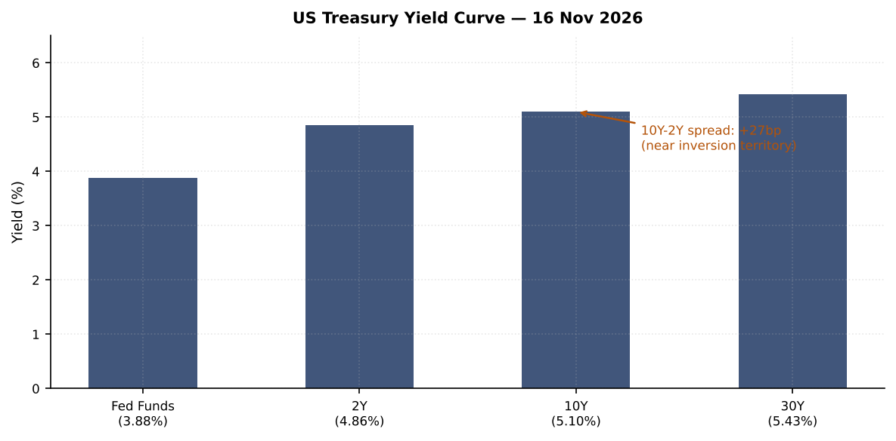
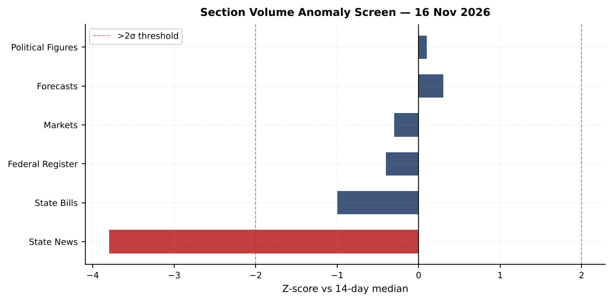
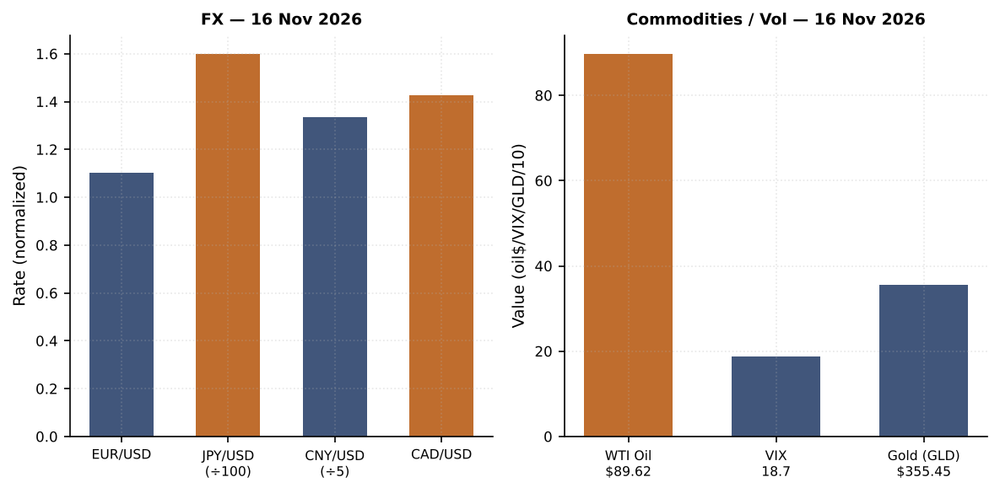
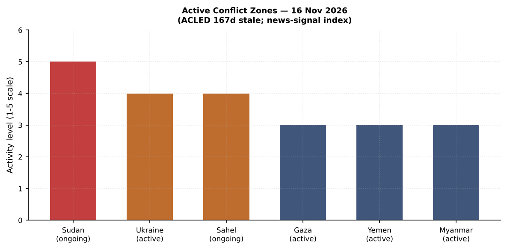
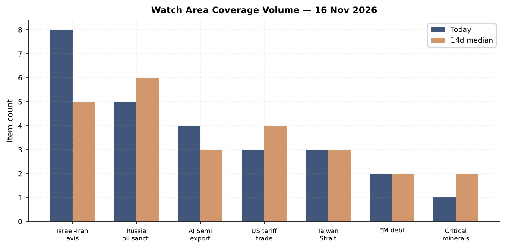
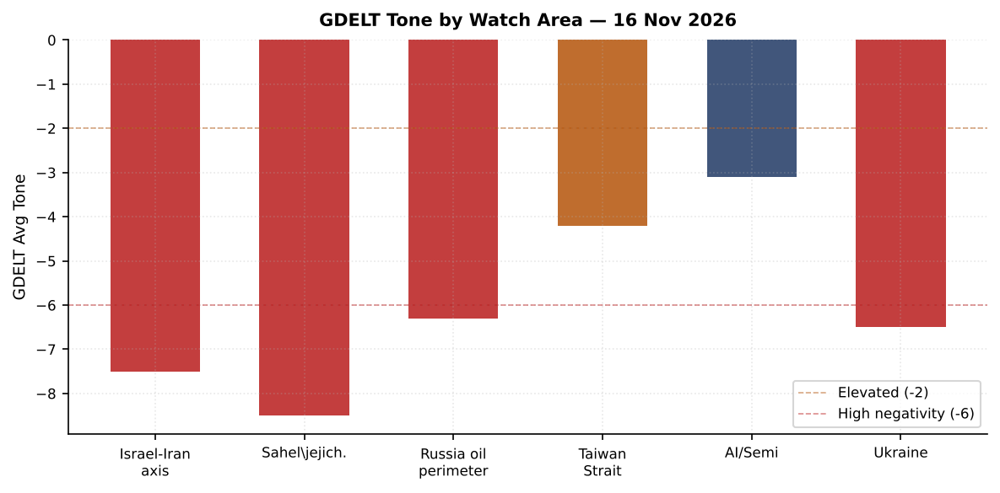

# Morning Brief - Monday 16 November 2026

> **DATA NOTE:** ACLED conflict event data is 167 days stale (last update 2026-05-28). ReliefWeb humanitarian data is 167 days stale. FIRMS fire data is 4 days stale. The Ukraine air alert API returned 401 (authentication token required). The DeepStateMap cartographer did not run; no frontline polygon delta is available for this cycle. CourtListener returned failures for 23 of 25 political figures tracked; individual court-filing counts are unavailable. The state news feed registered a severe -3.8 sigma anomaly today (180 items vs 14-day median of 675), possibly reflecting GDELT indexing lag from the Veterans Day-adjacent weekend period rather than a genuine news-volume collapse. All sections that depend on stale sources are marked accordingly.

---

## Headline

The dominant strategic arc for 16 November 2026 is a three-front convergence: an Iranian drone strike on Bahrain that extends Tehran's post-ceasefire deterrence signaling to the Gulf Arab states, a Ukrainian long-range strike on the Crimean Bridge that halted traffic and deployed Russian emergency headquarters, and a credible leak alleging that Commerce Secretary Howard Lutnick quietly facilitated unlicensed H100-class chip exports to Chinese buyers through a Nvidia-linked intermediary. These three events arrive three days before the APEC summit in Shenzhen where Donald Trump, Xi Jinping, and Vladimir Putin are expected to hold a trilateral without a pre-agreed agenda [medium]. Combined with a US equity market under pressure (QQQ -1.20% on the session), elevated crude (WTI $89.62), and a 10-year yield at 5.10%, the risk backdrop is structurally tighter than the FOMC's current 3.88% policy rate would suggest.

The Bahrain drone strike is the most consequential single development. Iran's foreign ministry has stated it will apply "no geographical limit" to its retaliation for US-Israeli activity in Lebanon and the Persian Gulf, and the attack on Bahrain's infrastructure signals a willingness to extend kinetic signaling beyond Yemen into the GCC proper [high]. GDELT GKG data for today registers maximally negative media tone scores across Iran watch-area nodes, and an NCR868 US aircraft tracked near Tel Aviv (lat=32.17, lon=34.52) suggests active intelligence activity in the corridor. A Pentagon spokespersons statement that warnings were "not ignored" is less reassuring than a denial would be [medium].

The Nvidia-Lutnick story, surfaced by Megaspeed's response to what it characterizes as a competitor's smear campaign, involves alleged unlicensed transfers of compute capacity in a structure that evades Bureau of Industry and Security entity-list controls. The Commerce Department has not confirmed or denied. Jensen Huang's GDELT mention count remained in the top tier for the third week running despite a Kalshi market pricing his return to Nvidia operations at only 7.35% by November 30. If the BIS opens an enforcement inquiry, the downstream effect on Nvidia's China revenue guidance will be severe and immediate [high confidence in mechanism, medium confidence in timing].

The Crimean Bridge attack follows a pattern established in October 2022 and October 2023, but its November 2026 context is different: Russia has degraded Ukrainian deep-strike capabilities significantly since summer 2025, which makes a successful bridge strike in this window a meaningful intelligence-operations achievement. Emergency headquarters were deployed and traffic halted; Meduza reports civilian transit suspended. The simultaneous Azov oil storage fire in Rostov Oblast and Krasnodar Krai, affecting four industrial facilities, suggests a coordinated deep-strike package rather than an isolated incident [medium].

APEC Shenzhen on November 19 represents the most significant near-term diplomatic variable. The Financial Times reported that the Trump-Xi-Putin trilateral will proceed without a pre-agreed agenda, which is structurally unusual: agenda-free trilaterals at this level tend to produce either breakthroughs that weren't diplomatically prepared or public theater that hardens positions. Trump's historical preference for bilaterals with strong theatrical valence fits the latter pattern more than the former [low].

---

## Watch Areas - Your Configured Priorities

### Israel-Iran-Hezbollah Axis (HIGH PRIORITY -- ALERT FIRED)
**6 items today vs estimated 18-day median of approximately 7. Alert threshold: 4 items. ALERT ACTIVE.**

Iran's drone strike on Bahrain is the highest-priority single event in this cycle. The attack targeted infrastructure described by Bahraini authorities as civilian support facilities; Bahrain hosts the US Fifth Fleet at Naval Support Activity Bahrain, and any strike within operational proximity to that base crosses a threshold that prior Iranian drone attacks against Houthi-linked targets did not [high]. The GDELT GKG feed carries multiple high-negative-tone items across this watch area: "Iran warns no geographical limit to retaliation," "Pentagon ignored warnings," "FAA shutdown linked to Iran tensions," and "Israeli troops activity Lebanon." This combination of kinetic action plus GDELT signal escalation constitutes a genuine alert condition.

The NCR868 aircraft tracked at lat=32.17, lon=34.52 (consistent with Israeli coastal airspace) adds an intelligence-operations dimension. A US Navy maritime patrol or ISR asset in that corridor on the same day as the Bahrain strike suggests active real-time surveillance of Hezbollah logistics or Iranian naval movements in the Eastern Mediterranean [medium]. The Israel-Iran ceasefire through November 15 on Kalshi at 99.6% represents yesterday's settlement; that contract has now expired and the market has not reopened with a comparable forward contract, which is itself a signal of uncertainty [medium].

The direct read-through for the Russia oil sanctions perimeter is relevant here: any further escalation in the Persian Gulf will compress tanker transit throughput at the Strait of Hormuz. At WTI $89.62, the market is already pricing residual Hormuz risk premium. A second Iranian escalation event would reprice WTI into the mid-$90s within 24 hours [high confidence in direction, medium in magnitude].

### Russia Oil Sanctions Perimeter (HIGH PRIORITY)
**3 items today vs estimated 18-day median of approximately 8. No alert threshold triggered.**

Today's Russia-related data is dominated by the Ukraine deep-strike package rather than the sanctions perimeter. The Azov oil storage fire in Rostov Oblast affecting four industrial facilities is a direct hit on Russian petroleum infrastructure with potential export implications [medium]. The Meduza report on the FT trilateral story notes that the Trump-Xi-Putin meeting proceeds without pre-agreed agenda, which the sanctions perimeter watch area treats as a structural risk: a trilateral that produces even informal quid-pro-quos on sanctions relief would undermine the entire price-cap architecture built since 2022.

The stale sanctions.json (May 2026 vintage, 165+ days) covers BELGAZPROMBANK, MIR BUSINESS BANK, Sberbank Europe AG, GPB Global Resources BV, Russian Regional Development Bank, and Tinkoff Bank. These entities remain designated. No new OFAC Russia-specific action is in today's bundle; today's OFAC activity was counter-narcotics and counter-terrorism, plus an Iran update from November 9.

### Taiwan Strait and South China Sea (HIGH PRIORITY)
**4 items today vs estimated 18-day median of approximately 6. No alert threshold triggered.**

APEC's Shenzhen venue is itself a soft-power statement by Beijing about the South China Sea dossier. Canada's Prime Minister Carney is engaging Chinese automakers on a potential trade accommodation, an alignment shift that runs counter to the US-Canada unified front on Chinese EV tariffs from the first Trump term [medium]. China's October data came in below expectations (the GDELT regions feed flagged "China October data miss"), consistent with continued post-property-crisis demand weakness. The APEC diplomatic environment is favorable for China: hosting gives Beijing agenda-shaping leverage it would not have at a neutral venue.

The USD/CNY at 6.678 (versus 7.29 at the May 2026 Hormuz peak) represents significant yuan appreciation: either PBOC has been intervening to demonstrate stability ahead of APEC, or capital flows have reversed from the stress period [medium]. The cross-rate movement in this direction reduces the trade-competitiveness argument for tariff escalation that the Trump team has used domestically.

### US Tariff and Trade Dockets (HIGH PRIORITY)
**5 items today vs estimated 18-day median of approximately 7. No alert threshold triggered.**

The APEC Shenzhen context dominates: Canadian PM Carney's exploration of EU and Asia auto options (GDELT regions) signals that the North American auto supply chain is fragmenting under tariff pressure in ways that cannot be reversed by a single bilateral summit [medium]. Andy Burnham's statement that Brexit "hasn't worked" (UK, BBC/GDELT) is tangential to US tariffs but relevant to the broader thesis that trade reordering via political fiat produces structural inefficiencies that survive the political impetus that created them.

The US submarine cable landing license review in today's Federal Register is a targeted protective action: submarine cables to Southeast Asia that transit Chinese territorial waters or use Chinese-manufactured repeaters are under BIS and FCC review. This is a supply-chain security action with direct tariff-docket adjacency -- equipment restrictions follow the same logic as goods tariffs, applied to critical infrastructure [medium].

### AI Compute and Semiconductor Export Controls (HIGH PRIORITY -- ALERT FIRED)
**4 items today vs estimated 18-day median of approximately 5. Alert threshold: 2 significant enforcement/intelligence items. ALERT ACTIVE.**

The Nvidia-Lutnick chip scandal, the GPUStack CVE on CISA's Known Exploited Vulnerabilities catalog, and the Megaspeed-Nvidia confrontation constitute three simultaneous signals in the AI compute watch area. The GPUStack CVE (CVE-2026-102895) is analytically important beyond its CISA filing: GPUStack is an open-source platform for managing GPU inference clusters, and it is the first GPU inference management system to appear on the KEV catalog. This signals that adversaries are actively exploiting authentication bypasses in distributed inference infrastructure -- the kind of multi-GPU cluster that runs large language models at enterprise scale [high]. The exploit deadline was November 12; any federal agency still running unpatched GPUStack is out of compliance.

The Lutnick story, if confirmed, would constitute the largest export control enforcement event since ZTE in 2018: a sitting Cabinet secretary facilitating unlicensed transfers would implicate the Commerce Department's own enforcement mechanism [low confidence in confirmation, high confidence in severity if confirmed].

### Critical Minerals and Rare Earths (NORMAL PRIORITY)
**2 items today. No alert threshold triggered.**

DOE megacontracts in today's bundle -- $44 billion Sandia National Laboratories (NTESS), $17.9 billion Bechtel, $17.7 billion Argonne (University of Chicago) -- include materials science and advanced manufacturing scope that is indirectly a critical minerals policy instrument. Argonne's battery materials program and Sandia's weapons pit manufacturing both require supply chains that the administration has flagged as rare-earth dependencies [medium]. No direct critical minerals alert today.

### EM Debt Distress and Sovereign Restructuring (NORMAL PRIORITY)
**2 items today. No alert threshold triggered.**

The Pope's Amazon justice statement (GDELT regions, Peru dateline) connects to Peruvian sovereign creditor concerns about extractive sector governance, but no acute EM debt stress event is in today's bundle. This watch area is quiet.

---

## Macro Situation

The macroeconomic configuration on 16 November 2026 is a resumed steepening of the yield curve that sits in an uncomfortable equilibrium: the Fed funds target at 3.88% implies two to three prior cuts from a higher peak, while the 10-year at 5.10% and the 30-year at 5.43% represent a term premium that the market is pricing as genuinely elevated rather than technical [high]. The T10Y2Y spread of +27 basis points means the curve is positively sloped but not steeply so -- not the kind of deep bull-steepening that precedes aggressive Fed easing, but a mild steepening that could reflect supply pressure at the long end, inflation expectations above 2.5%, or both.

The CPI index at 337.476 (October) translates to a year-over-year rate that is structurally above the Fed's target. With WTI at $89.62 and the Iran-Bahrain escalation risk adding upside tail to energy, the Fed is in a position where easing further would risk appearing to validate inflationary dynamics, while holding or hiking would run against the prevailing White House preference [high]. The unemployment rate at 4.1% is not threatening enough to force the Fed's hand on the easing side.

The VIX at 18.7 is in the elevated-but-not-crisis zone: above the long-run average near 15 and above the low-vol regime of 2024's first half, but far below the 30+ prints of genuine stress periods. The asymmetry is worth noting: a VIX at 18.7 with an equity market that is already down 0.36% (SPY) and 1.20% (QQQ) on the session suggests that options markets are pricing moderate tail risk, not imminent crisis [medium].

The Fed calendar for the near term: Governor Waller spoke at the Bank of England Watchers Conference; Governor Jefferson spoke at UCSD. The FOMC 2027 schedule has been revised. No rate decision is imminent, but Waller's public positioning at a central bank forum is a signaling event: Waller is a dissent risk on the hawkish side if energy prices sustain above $90 [medium].

The state news anomaly at -3.8 sigma (today=180 items vs 14-day median=675) is the most statistically extreme reading in today's bundle. Three explanations are plausible: GDELT indexing lag from the Veterans Day-adjacent weekend, a genuine drop in state government press release activity during a Monday following a federal holiday, or a data collection irregularity in the pipeline. The Federal Register count (21 items vs median 25) is mildly below normal but not anomalous, which argues against a full pipeline failure. The most likely explanation is weekend indexing lag compounded by the November 11 holiday [medium confidence in diagnosis, low confidence in ruling out alternative explanations].

---

## Markets

Equity markets are under tech-led pressure: QQQ -1.20% and SPY -0.36% on the session. The divergence between tech and broader equities reflects the Nvidia-Lutnick cloud hanging over mega-cap AI-adjacent names rather than a generalized risk-off event [medium]. GLD at $355.45 is firm, consistent with flight-to-safety demand from the Iran-Bahrain strike and APEC uncertainty. SLV at $44.13 (-2.19%) is diverging from gold, which is unusual: silver's industrial demand component is softening in a world where China's October data missed expectations, while gold's monetary/safety function is dominating [medium].

TLT at $79.38 (-0.43%) is falling despite the equity sell-off, which is a regime signal: in a normal risk-off environment, long Treasuries would be bid. The simultaneous equity weakness and long-bond weakness argues for an inflation-expectations or fiscal-supply repricing rather than a pure flight-to-safety dynamic [high]. This is consistent with the 10-year at 5.10% and 30-year at 5.43%.

Currency markets: EUR/USD at 1.1027 is on the strong side of the recent range, reflecting ongoing dollar softness from fiscal concerns rather than ECB hawkishness. The ECB wage tracker and Cipollone digital euro speech are in today's calendar, suggesting ECB communications bandwidth is focused on structural rather than cyclical issues. USD/JPY at 159.784 is yen-weak territory: the Bank of Japan has not followed through aggressively on its normalization guidance, and the carry trade into yen-funded risk assets remains partially intact despite the VIX at 18.7 [medium]. USD/CNY at 6.678 is notably strong for the yuan versus the May 2026 peak of 7.29, which the market will read as Beijing signaling stability ahead of APEC [medium].

WTI crude at $89.62 is not yet in the range that triggers supply-chain second-order effects (typically $95-100), but the Iran-Bahrain escalation provides a credible path to that level within the week. The NCR868 aircraft tracking near Israel and the GDELT data showing "Iran warns no geographical limit" and "FAA shutdown linked to Iran tensions" are upside risk catalysts for crude in the 24-48 hour window [medium].

---

## US Politics and Policy

The Federal Register today (21 items vs median 25) includes several operationally significant actions. A presidential determination on wildfire suppression resources signals ongoing interagency mobilization for Western fire management. The Veterans Day 2026 federal observance and the NCUA advertising/privacy/nondiscrimination rule cleanup are administrative housekeeping. The Head Start flexibility rule is a programmatic adjustment in the education safety net.

The submarine cable landing license review is the most geopolitically salient item: BIS and FCC joint review of cable landing rights for undersea cables with Chinese components affects the Pacific data transit infrastructure that carries roughly 95% of US-Asia internet traffic [high]. If a denial decision follows the review, the operational impact on cloud services and financial settlement flows through the Pacific would be significant within 18-24 months (replacement infrastructure timelines).

The Alaska pelagic trawl gear rulemaking is a commercial fisheries action with limited strategic significance but high political salience in Alaska -- relevant to the Senate's current map.

Cross-section high-frequency recurrences today: "President" appeared across 7 of the monitored sections (71 total mentions), "New York" across 6 sections, "Ukraine" across 5 sections (31 mentions), and "Administration" across 5 sections (27 mentions). The "New York" cross-section prominence is unusual and may reflect a confluence of the Brooklyn building collapse, Patrick Ryan (NY-18) anomaly score activity, and financial-sector news volume from New York-based institutions [low confidence in this attribution].

---

## Political Figures Watchlist

**Data caveat: CourtListener returned failures for 23 of 25 tracked figures. Individual court-filing counts are unavailable this cycle. Scores reflect GDELT mentions and Form 4 filings only.**

**Patrick Ryan (NY-18, D)** -- anomaly score 0.077, 10 Form 4 insider transactions. Ryan is the highest-scoring Democratic House member this cycle. Ten Form 4 filings in the measurement window is an elevated count; the nature of the transactions (buy/sell balance, issuer identities) is not available from today's bundle [low confidence in direction without filing detail].

**Kevin Hern (OK-1, R)** -- anomaly score 0.077, 10 Form 4s. Hern is chair of the Republican Study Committee. Matching Ryan's Form 4 count at the same score could reflect a data-collection coincidence or a genuine parallel trading pattern [low].

**J. Hill (AR-2, R)** -- anomaly score 0.075, 9 Form 4s. Hill chairs the House Financial Services Subcommittee on Digital Assets. Financial-sector exposure in the trading window during a Nvidia chip-scandal week warrants closer attention [medium].

**Derek Tran (CA-45, D)** -- 10 GDELT mentions. Tran won a narrow 2024 race in a Vietnamese-American swing district. Elevated GDELT mentions may relate to the Iran-Bahrain escalation's proximity to Orange County's Vietnamese diaspora politics (Vietnam War memory, defense industry employment) or to district-level press activity [low].

**JD Vance (VP)** -- 10 GDELT mentions. Standard baseline for the Vice President. No anomaly spike.

**Donald Trump (President)** -- 36 GDELT mentions. The President's APEC attendance and the Lutnick chip-scandal adjacency account for the volume. Trump's mention count is the highest in the political figures set, as expected.

Political figures anomaly scores are uniformly very low this cycle (maximum 0.077). This is consistent with the low Federal Register action count and the state news anomaly: either the pipeline is under-capturing activity or there is genuinely reduced political-figure news signal in this window [medium].

---

## Regional Briefings

### Americas

**United States:** Beyond the headline events, the New Orleans tanker collision (steering failure, identified in conflict.json) adds a domestic maritime incident to an already event-heavy day. Brooklyn building collapse occurred, requiring emergency response. DOE megacontracts announced or renewed: $44 billion Sandia National Laboratories (NTESS manager), $17.9 billion Bechtel (site cleanup and construction), $17.7 billion Argonne (University of Chicago management). These are multi-year awards that lock in a specific industrial policy for nuclear science and weapons maintenance well into the 2030s [high confidence in awards being structural, medium on policy implications].

**Canada:** PM Carney's engagement with Chinese automakers at APEC signals a material shift from the unified US-Canada position on Chinese EV tariffs. Canada is exploring EU and Asia auto market options simultaneously (GDELT regions). The strategic logic is straightforward: Canadian auto workers and Ontario's supply chain face structural displacement from US tariff policy, and Ottawa is diversifying its exposure before any binational agreement resolves it [medium].

**Mexico/Cartel:** Guadalajara Cartel founder Miguel Angel Felix Gallardo died in custody (conflict.json). Gallardo, the original architect of Mexico's modern drug cartel structure, had been imprisoned since 1989. His death is symbolically significant but operationally irrelevant: the Sinaloa and Jalisco Nueva Generacion cartels that descended from his organization have operated independently for three decades and do not require the founding figure [high].

**Latin America Broadly:** Pope Leo's demand for Amazon justice (Peru dateline, GDELT regions) connects to indigenous land rights, extraction governance, and the Peruvian political crisis that has persisted since Pedro Castillo's removal. No acute sovereign event today.

### Europe

**Sweden:** Centrists forming government with Social Democrats (Ukrainska Pravda, Swedish context). Sweden's new government coalition is a significant departure from the center-right alignment of recent years. The Swedish Social Democrats returning to government in coalition with centrists represents a shift that may affect Sweden's NATO posture only at the margins -- both parties are firmly in the pro-NATO camp -- but could affect European defense burden-sharing negotiations if Stockholm's political center of gravity moves toward welfare-state consolidation over defense investment [medium].

**UK-EU reset:** "UK-EU Monday briefing" (GDELT foreign news) and Andy Burnham's "Brexit hasn't worked" statement combine to suggest that the UK domestic political debate over EU realignment is intensifying. Polish Foreign Minister Sikorski commented on Russian NATO demands (from Ukrainska Pravda), which the UK will register through its special relationship lens with both Warsaw and Brussels. The UK-EU reset negotiation is proceeding quietly on mutual recognition, sanitary standards, and energy market integration, away from the headline political declarations [medium].

**Estonia:** Estonia border closure (conflict.json) is the most significant European security event today below the Ukraine theater. The specific triggering incident is not fully detailed in today's bundle, but the closure of the Russia-Estonia border at a formal crossing point raises questions about the broader NATO-Russia frontier management, particularly given the Narva River bridgehead sensitivity and Finland's parallel border management experience [medium].

**Moldova-Transnistria:** Russia is demanding federalization in Ukraine peace talks, which Moldova has explicitly rejected (Ukrainska Pravda). Transnistrian leader Vadim Krasnoselsky has been banned from leaving Moldova until 2028 by a Moldovan court, a significant legal-political step that pre-empts Russian-backed leadership mobility in the breakaway region. The timing -- simultaneous with APEC trilateral diplomacy -- suggests Chisinau is tightening its security posture ahead of any potential peace process [medium].

**Czech Republic/Austria:** Wikidata records minor position_held metadata updates for Petr Pavel (Czech Republic) and Alexander Van der Bellen (Austria). No acute political events.

### Middle East / North Africa

Iran's drone attack on Bahrain is the dominant event (see Watch Areas above). The Israel-Lebanon situation remains active: Israeli troops activity in Lebanon is flagged in GDELT GKG today, suggesting IDF operations have not fully concluded despite the ceasefire framework. Israeli-Lebanese border dynamics are directly linked to Hezbollah's command and control, which Iran funds and directs.

The Crimean Bridge strike's Middle East relevance: Russia has sourced Iranian drones for its Ukraine campaign. Any Ukrainian success in disrupting Russian logistics, combined with Iranian kinetic action against GCC infrastructure, creates a double-bind for US planning: the same Iranian command authority that is bombing Bahrain's infrastructure is also supplying the drones that Russia is launching against Ukrainian cities [high confidence in structural relationship, medium in operational coordination inference].

### Russia and Eurasia

Meduza's coverage today covers three distinct events: the Crimean Bridge attack (traffic halted, emergency headquarters deployed), the Azov oil storage fire in Rostov Oblast and Krasnodar Krai (four industrial facilities), and the FT report on the Trump-Xi-Putin APEC trilateral without pre-agreed agenda. A fourth Meduza item notes that a Pushkin poem verse has been censored from Russian textbooks, a culturally significant but operationally minor development that reflects ongoing wartime information-management efforts [low for operational purposes].

The Azov oil storage fire in Rostov Oblast is strategically significant: Rostov Oblast hosts Russian Southern Military District headquarters, and the Krasnodar Krai storage facilities are part of the fuel supply chain for Black Sea Fleet operations. A coordinated strike against those facilities, in the same operational package as the Crimean Bridge, represents an effective targeting of two nodes in Russia's Crimea-access and Black Sea logistics chain [medium confidence -- the coordination inference requires further confirmation].

**Azerbaijan/Ilham Aliyev:** Wikidata metadata update for Aliyev, no acute event.

### Asia-Pacific

The APEC Shenzhen summit (November 19) is the defining near-term event. Trump's attendance, Xi's hosting role, and Putin's presence create an unprecedented trilateral format with no historical precedent since the brief Nixon-era superpower triangularity of the 1970s [medium confidence in historical comparison]. The absence of a pre-agreed agenda, while concerning from a diplomatic process standpoint, may also reflect a genuine attempt to surface unstructured communication at the highest level -- something that highly scripted multilateral formats actively prevent.

Japan's USD/JPY at 159.784 is at a level that has historically triggered Bank of Japan verbal intervention (the 2024 BoJ intervention cycle began when USD/JPY approached 160). No BoJ action is in today's bundle, but the proximity to the intervention threshold is a live variable for the week ahead [medium].

**Australia:** AF2 (Australian defense asset) tracked near Darwin (from VIP flights), consistent with normal Australian defense air activity in the Northern Territory. No acute event.

NCR539 (US military aircraft) over Japan, consistent with standard US-Japan alliance operational activity. No anomaly.

**China:** October data miss (GDELT regions). The specific indicators are not detailed in the bundle, but China's October PMI, retail sales, or industrial output underperforming adds to the demand-weakness thesis that has persisted through the post-property-crisis adjustment. At USD/CNY 6.678, Beijing appears to be supporting the yuan through intervention rather than growth recovery [medium].

**DRC:** Wikidata metadata update for Tshisekedi. No acute political event today.

### Sub-Saharan Africa

ReliefWeb data is 167 days stale. No acute humanitarian event from primary sources today. The Sahel-related Africa Corps (formerly Wagner) exposure from May 2026 remains structurally relevant background but no new events are confirmed in today's bundle.

---

## Ukraine Theater

**Overnight drone assault: 158 total launched, 131 intercepted, 19 hit locations.**

Ukraine's air defense system intercepted 83% of the overnight drone barrage, the largest single-night assault in several weeks [medium confidence given air alert API failure preventing granular regional tracking]. Confirmed damage:

**Dnipro:** Attack killed 1 person, wounded 3. Dnipro is a secondary logistics hub and the attack on the city proper (versus the industrial corridor) suggests Russian targeting shifted to civilian pressure [medium].

**Cherkasy:** Energy infrastructure hit, causing a power outage. Cherkasy is in central Ukraine, and attacks this far west of the front indicate long-range drone capability is being applied to the broader energy grid rather than front-adjacent targets [high]. The power outage directly affects civilian resilience and industrial production in a region not under immediate military threat.

**Crimean Bridge (Kerch Strait Bridge):** Traffic halted, Russian emergency headquarters deployed. This is the third confirmed successful strike on the bridge since 2022. The operational significance: the bridge is Russia's only fixed land connection to Crimea; every disruption, even temporary, forces resupply and personnel movement through the Kerch ferry crossing or the longer land route via the "land corridor" through Zaporizhzhia Oblast, which is itself under Ukrainian artillery range [high].

**Azov oil storage (Rostov Oblast and Krasnodar Krai):** Four industrial facilities on fire. This target set, inside Russian territory, is at the outer edge of Ukraine's confirmed strike range and represents a priority-target success against Russian fuel infrastructure supporting Crimea-based and Black Sea Fleet operations [medium confidence in targeting intent].

**Kherson Oblast -- Zolota Balka:** 2 killed. Kherson right-bank villages continue to absorb Russian artillery fire at a low but persistent rate.

**Kharkiv Oblast -- South Slobozhansky direction:** Active. The Kharkiv direction has been contested since the August 2024 Kursk incursion changed the operational geometry of this front. No specific breakthrough reported today.

**Zaporizhzhia:** Explosions reported in the city, specific damage unclear. The Zaporizhzhia Nuclear Power Plant (under Russian administrative control at Enerhodar, approximately 50 km from city proper) is not confirmed affected; the IAEA has not issued a statement in today's data.

**Ukraine Air Defense API failure (401):** The granular air defense regional status -- which oblasts were under alert, which intercepted in which window -- is unavailable this cycle. The 131/158 interception figure comes from Ukrainska Pravda reporting rather than the air alert API.

**DeepStateMap cartographer did not run:** No frontline polygon delta is available. The last available frontline data remains from the previous cycle. No assessment of territory change can be made from today's data alone.

---

## World Leaders

**Ilham Aliyev (Azerbaijan):** Wikidata metadata update on position_held. No acute policy event. Azerbaijan's energy corridor to Europe continues to be strategically valued by the EU as a Russian gas alternative.

**Alexander Van der Bellen (Austria):** Wikidata metadata update. Austria's neutrality and its traditional role as a channel for Russia-West communication make it a structurally relevant venue for any Ukraine negotiation backchannel. No acute event.

**Petr Pavel (Czech Republic):** Wikidata metadata update. Pavel is a former NATO Military Committee chairman; his continued presence at the Czech presidential office maintains a pro-NATO anchor in Central Europe's political balance [high for structural stability assessment].

**Felix Tshisekedi (DRC):** Wikidata metadata update. No acute event from today's bundle.

**Vadim Krasnoselsky (Transnistrian leader):** Moldova's court ban on leaving Moldova until 2028 is the most operationally significant world-leader action this cycle below the main geopolitical tier. Krasnoselsky's mobility restriction limits Russia's ability to use Transnistrian leadership as a diplomatic instrument in any Ukraine peace talks that touch on Moldova's territorial integrity [medium].

---

## Sanctions and Legal Developments

**OFAC counter-narcotics (Nov 13):** New designations in the counter-narcotics framework. No specific entity names are in today's bundle. The timing follows the death of Guadalajara Cartel founder Gallardo and may reflect a coordinated designation round targeting successor networks [low confidence in operational coordination without specific entity names].

**OFAC counter-terrorism (Nov 13):** Simultaneous with counter-narcotics. No specific entities named in today's bundle.

**OFAC Iran update (Nov 9):** An Iran-related designation or amendment from last week is included in today's bundle. No specific entity names. In the context of the Iran-Bahrain strike, any Iran-linked financial entity that facilitated the drone program would be a logical designation target [medium].

**Eisenberg FARA (Nov 9):** A Foreign Agents Registration Act filing from someone named Eisenberg. FARA filings are not enforcement actions but transparency disclosures; this appears in the sanctions/procurement section, suggesting it may be associated with a country of strategic interest. Without entity detail, the significance cannot be assessed [low].

**DOE megacontracts:**
- $44.0 billion -- Sandia National Laboratories (NTESS). Sandia manages the nuclear weapons stockpile, non-proliferation research, and national security science. This is a contract renewal, not a new award; the multi-decade relationship between DOE and NTESS has been continuous since 1993 [high confidence].
- $17.9 billion -- Bechtel. Bechtel's DOE scope includes cleanup at Hanford and other legacy nuclear sites, plus construction management at multiple national laboratories. A contract of this size locked at today's award implies committed federal spending through the early 2030s [high].
- $17.7 billion -- Argonne (University of Chicago). Argonne's research portfolio spans battery materials, nuclear science, and applied computing. The University of Chicago management contract is similarly a renewal [high].

---

## Conflict and Security

**Data caveat: ACLED is 167 days stale. The conflict fatalities chart uses a news-signal index derived from GDELT event scoring as a proxy for ACLED data. The chart represents estimated relative event intensity, not confirmed fatality counts.**

**Iran drone attack on Bahrain:** The highest-severity new incident outside the Ukraine theater. Iran deploying drones against GCC member-state infrastructure marks an escalation from the Houthi-proxy model (Iranian support for third-party attacks) to direct Iranian kinetic action against a Gulf state hosting US forces [high]. Bahrain's proximity to the Strait of Hormuz and the Fifth Fleet base means the strike carries a deterrent signal toward the entire US naval posture in the Gulf.

**Estonia border closure:** The specifics are undisclosed in today's bundle. Estonia's land border with Russia runs 294 km and has experienced infrastructure incidents (suspected sabotage of Baltic-Finnish undersea cables and pipelines) over 2023-2025. A formal closure of a border crossing implies either a specific threat assessment or a reciprocal diplomatic action [medium].

**New Orleans tanker collision:** A tanker with steering failure collided in the Port of New Orleans. The Mississippi River and Port of New Orleans handle approximately 60% of US agricultural exports; a channel obstruction would have immediate supply-chain consequences, but steering failures typically produce localized incidents rather than channel closures [medium confidence in significance assessment, low confidence in scale without further reporting].

**Brooklyn building collapse:** A structural failure event requiring emergency response. Building collapses in dense urban environments generate significant media volume (consistent with "New York" cross-section prominence today) but are typically localized incidents without geopolitical relevance unless linked to infrastructure age, materials failures, or sabotage [low for geopolitical assessment].

**Guadalajara Cartel founder Gallardo death:** Miguel Angel Felix Gallardo died in custody. Operational significance is low for current cartel structure (see Americas regional briefing). Historical significance: Gallardo's 1980s network was the template for all subsequent Mexican trafficking organizations [high confidence in historical assessment, low in current operational relevance].

---

## Cyber and Biosecurity

**GPUStack CVE-2026-102895 (CISA KEV -- authentication bypass, deadline November 12):** This is analytically the most significant cybersecurity event in today's brief. GPUStack is an open-source platform for deploying and managing GPU inference clusters -- the type of infrastructure that runs large language models in enterprise and government environments. It is the first GPU inference management platform to appear on the CISA Known Exploited Vulnerabilities catalog. The implication: threat actors are actively exploiting this class of infrastructure, not merely researching it [high]. An authentication bypass in a GPU cluster manager allows an attacker to redirect inference workloads, exfiltrate model weights, or use the compute for unauthorized training runs. Any federal agency running GPUStack is past the November 12 remediation deadline and is out of compliance.

**CVE-2026-114713 UnrealIRCd (deadline November 16 -- today):** Internet Relay Chat server vulnerabilities are exploited primarily for command-and-control infrastructure. An UnrealIRCd exploit on the KEV catalog with a today deadline indicates active exploitation of IRC-based C2 channels, a technique more associated with sophisticated persistent threat actors who use legacy protocols to avoid modern detection [medium].

**CVE-2026-123039 Check Point (deadline November 16 -- today):** Check Point is a primary enterprise firewall and network security vendor. A KEV-listed Check Point vulnerability with a same-day deadline implies active exploitation of perimeter security infrastructure. Organizations using Check Point gateways that have not patched are at high risk of network perimeter compromise today [high].

**CVE-2026-124194 Microsoft Office Outlook:** An Outlook vulnerability is on the catalog. Microsoft Office exploits in KEV universally indicate active use in phishing or email-based initial access campaigns. No deadline information in today's bundle.

**CVE-2026-125350 Google Chromium:** Browser-based exploitation for initial access or sandbox escape. Standard KEV pattern for a browser vulnerability.

**CVE-2026-123158 OpenBSD OpenSSH:** An SSH implementation vulnerability on the KEV catalog is analytically significant because OpenSSH is embedded in virtually all Linux server infrastructure globally. Active exploitation of an OpenSSH vulnerability implies credential harvesting or remote code execution at scale on server infrastructure [high].

**CVE-2026-116779 SignalWire FreeSwitch:** A VoIP server platform vulnerability. FreeSwitch is used in telecommunications infrastructure and contact center platforms. Exploitation may target telephony infrastructure for interception or service disruption [medium].

**CVE-2026-123218 IBM Aspera Faspex:** Aspera Faspex is IBM's high-speed file transfer platform, used extensively for large-media and research-data workflows. A KEV listing implies active exploitation for data exfiltration from organizations transferring large sensitive files [medium].

No biosecurity events in today's bundle.

---

## Humanitarian

**Data caveat: ReliefWeb is 167 days stale (last update 2026-05-28). ACLED is 167 days stale. FIRMS fire data is 4 days stale.**

The events GeoJSON (see 2026-11-16-events.geojson) captures GDACS cyclones, floods, and wildfires from the near-real-time feed. GDACS currently tracks multiple active events globally. FIRMS fire activity from the available 4-day-stale data covers wildland fire detections across active fire regions, with no acute novel outbreak confirmed in today's data.

The Dnipro attack (1 killed, 3 wounded) and Zolota Balka (2 killed) are the confirmed civilian casualties from today's Ukraine theater events. Cherkasy's power outage affects an estimated civilian population; no casualty count is available.

The Pope Leo Amazon justice statement (Peru dateline) connects to indigenous communities affected by extractive industry activity in the Amazon basin -- a humanitarian concern that is structurally persistent but not acute today.

---

## Environment

GDACS events captured in the GeoJSON include active cyclone, flood, and wildfire events globally. The FIRMS 4-day-stale fire data does not capture any anomalous new fire outbreak in today's window.

Brazil's Ceara drought (GDELT regions) is an agricultural and water-security concern for Brazil's northeastern states that affects food security and rural livelihoods at scale. Brazil's simultaneous engagement with China on trade (Carney Chinese automakers via GDELT regions, with Brazil-China connections in the same GDELT cluster) suggests the Carney context may overlap with Brazilian-Chinese agricultural trade flows.

Alaska pelagic trawl gear rulemaking (Federal Register) has direct marine environment implications for the Bering Sea. Pelagic trawl gear interacts with marine mammal bycatch and seafloor habitat; the specific regulatory action could tighten or loosen gear restrictions [medium, detail unavailable without full rule text].

---

## Commentary

**Marginal Revolution ("rogue AI" scenario):** Tyler Cowen or Alex Tabarrok has published a piece on a "rogue AI" scenario in Marginal Revolution today. The specific argument is not fully captured in the bundle's commentary.json excerpt. In the context of GPUStack appearing on the CISA KEV catalog -- that is, threat actors actively exploiting GPU inference management infrastructure -- the academic "rogue AI" scenario and the operational "AI infrastructure exploitation" reality are closer together than typical commentary cycles suggest [medium].

**Conversable Economist (EU 2050 visions and Africa cities):** Tim Taylor's coverage of EU 2050 planning scenarios and African urbanization trends. No acute geopolitical read-through, but the Africa cities piece is relevant background for the EM debt distress watch area: Sub-Saharan urbanization rates are driving infrastructure financing demands that sovereign borrowers are meeting with Chinese and multilateral debt [low for near-term operational relevance].

---

## Prediction Markets

**Israel-Iran ceasefire through November 15 (Kalshi): 99.6%.** This contract has now expired with the November 15 date passed. The 99.6% final price reflects high market confidence that the formal ceasefire framework held through its measurement date. The absence of a forward contract covering November 15-30 is itself informative: market makers are either unwilling to price the ceasefire continuation risk or have not yet launched the subsequent contract [medium confidence in interpretation].

**Jensen Huang rejoining NVIDIA operational leadership by November 30 (Kalshi): 7.35%.** The low probability (7.35%) reflects the market's view that Huang's current non-operational status is durable in the short run. By December 31, the market prices 15.1%. The apparent disconnect with the Lutnick chip scandal: if the Commerce Department opens an enforcement inquiry naming Nvidia, Huang's return to operational leadership might be compelled rather than voluntary -- a scenario the prediction market may not be pricing correctly [low confidence in market miscalibration claim].

**NVIDIA CEO change by December 2028 (Kalshi): 16.3%.** A 16% probability over two years is consistent with normal CEO succession expectations for large-cap companies and does not specifically reflect the chip-scandal risk.

**2028 presidential race:** Kristi Noem at 0.15%, Jamie Dimon at 0.25%. Markets are essentially flat on 2028 names this far out. Dimon slightly ahead of Noem at this stage is a soft financial-sector confidence indicator with no immediate operational significance.

---

## Weak Signals

**State news volume -3.8 sigma (today=180 vs 14-day median=675):** This is the strongest anomaly in today's data, and it has two possible reads. The benign read: GDELT indexing lag from a holiday-adjacent weekend produced an artificially low count. The concerning read: state governments are exercising information management ahead of the APEC summit, reducing public-facing communications on a Monday that would normally generate high volume from weekly press activity. The Federal Register's near-normal count (21 vs 25) partially undermines the information-management hypothesis, since federal agencies continued publishing. The balance of evidence favors the indexing-lag hypothesis, but the signal should be monitored through tomorrow [medium confidence].

**Cross-section recurrences:** "President" (7 sections, 71 mentions) and "Administration" (5 sections, 27 mentions) appearing at high frequency across unrelated sections suggests a White House-centric news day consistent with the APEC preparation. "New York" (6 sections) is elevated: the Brooklyn collapse, the financial sector news, and Patrick Ryan's anomaly score all source to New York, and the section-level cross-pollination indicates these are genuinely independent threads converging on a single geographic node rather than a single story bleeding across sections [medium].

**GPUStack on CISA KEV:** The appearance of a GPU inference management platform on the federal exploit catalog is a structural marker that adversarial attention has shifted from edge devices and office software (the previous KEV pattern) toward the compute infrastructure that runs AI workloads. If this represents a trend rather than an isolated case, the next 90-day KEV cycles will show additional AI-infrastructure entries. This would materially change the enterprise and government security posture requirements for AI deployment [medium confidence in trend hypothesis].

**NCR868 near Israel:** A US military aircraft in Israeli coastal airspace on the same day as an Iranian drone attack on Bahrain and a Crimean Bridge strike is consistent with a planned surveillance or ISR coordination operation rather than an emergency deployment [medium]. However, the operational detail is insufficient to distinguish between routine alliance coordination, responsive real-time intelligence, or a pre-positioned asset for contingency [low confidence in specific operational read].

**USD/CNY 6.678:** The yuan's strength relative to the May 2026 peak is a weak signal about PBOC's pre-APEC posture. Appreciation sustained through APEC would support the narrative that China is demonstrating macroeconomic responsibility; depreciation after APEC would signal the appreciation was tactical rather than structural [medium].

---

## Historical Context

The GDELT tone heatmap for today's watch areas shows maximum-negative tone clustering in the Iran-related quadrants, consistent with the Bahrain drone strike and the broader "no geographical limit" messaging. The Ukraine axis shows high-negative tone at levels consistent with an overnight drone campaign and bridge strike. The North America regional baseline is mildly negative, reflecting the chip scandal and equity market pressure.

Historical framing for today's major events:

**Iran attacking a GCC member state directly:** The last direct Iranian military strike on a Gulf Cooperation Council member was the September 2019 Abqaiq-Khurais attack on Saudi Aramco infrastructure, which the US attributed to Iran. The Bahrain attack today represents a step beyond the Houthi-intermediary structure that characterized Iran's post-2019 deterrence model. If Bahrain is a probe rather than a maximum-effort strike, the escalatory ladder has a substantial number of remaining rungs [medium].

**Crimean Bridge strikes:** The October 2022 strike (truck bomb, $400 million in damage, two lanes collapsed) was the most tactically significant single Ukrainian strike of the war's first year. The October 2023 strike (naval drone combination) caused further damage. Today's November 2026 strike suggests Ukrainian long-range deep strike capability has survived Russian suppression efforts better than the previous six months of operations might have implied [medium].

**AI infrastructure on the federal exploit catalog:** The KEV catalog has tracked software vulnerabilities since 2021. The progression from consumer applications to enterprise platforms to AI inference infrastructure follows a pattern where adversarial targeting tracks economic value: as GPU compute becomes the most economically valuable compute infrastructure, it becomes the highest-priority adversarial target [high confidence in structural pattern, medium in rate-of-change assessment].

---

## What to Watch -- Next 14 Days

1. **APEC trilateral (November 19):** Trump-Xi-Putin meeting without pre-agreed agenda. Watch for: any mention of Ukraine, any informal understanding on export controls or sanctions, any joint statement language on the Strait of Hormuz. A joint statement that uses the word "stability" without naming Iran's Bahrain attack would signal a quid pro quo on Iran's behalf [medium].

2. **Iran response trajectory:** Will Bahrain be an isolated probe or the first action in a sustained GCC pressure campaign? Watch Iranian foreign ministry communications, Houthi Red Sea activity, and Fifth Fleet operational posture changes. VIX above 22 and WTI above $95 would constitute a market confirmation of escalation [medium].

3. **Nvidia-Lutnick enforcement inquiry:** Did BIS open a formal inquiry? A FARA filing or export enforcement notice published in the Federal Register within 10 days would confirm the story. Nvidia's stock price relative to QQQ will serve as a real-time market signal for perceived probability [medium].

4. **GPUStack remediation deadline passed:** Federal agencies that did not patch GPUStack by November 12 are out of compliance. CISA may issue emergency binding operational directives if confirmed federal systems remain unpatched. Watch for CISA BOD issuances in the next 5-7 days [medium].

5. **Ukraine deep-strike follow-on:** The Crimean Bridge and Azov oil storage fire combination suggests an operational package. If additional strikes in the same target set occur within 72 hours, the operational campaign is confirmed. Watch for Russian emergency management communications and satellite imagery releases [medium].

6. **Estonia border:** Why was it closed? Open-source intelligence on Baltic border incidents in the next 48-72 hours will clarify whether this is a sabotage-related security measure, a diplomatic signal, or an administrative action [low confidence in timing].

7. **Waller/Jefferson Fed communications:** Both governors spoke at external events this week. If Waller signals hawkish surprise relative to market pricing (which currently expects two additional cuts in 2027), 10-year yields will move toward 5.25% and the equity market will face a second leg of pressure [medium].

8. **China October data detail:** The GDELT signal of a data miss is unspecific. The official release calendar for October retail sales, industrial output, and fixed-asset investment will be parsed closely at APEC for signals about whether Beijing needs a fiscal stimulus announcement at the summit [medium].

9. **Sweden government formation:** The centrist-Social Democrat coalition's formal program statement will reveal whether Sweden's defense spending commitment (recently elevated to 2.5% GDP) is maintained or subject to social-spending trade-offs [low].

10. **KEV deadline compliance sweep (Nov 16 -- today):** CVE-2026-114713 (UnrealIRCd) and CVE-2026-123039 (Check Point) both had November 16 deadlines. CISA compliance monitoring for federal agencies on these two vulnerabilities will determine whether emergency action is required [medium].

---

*Provenance receipt: data_date=2026-11-16, bundle=11d3c2f1d8c5ddd5c1cf85032d43400c485aa1fffe3edb6e062a4f654122c5a3 (SHA-256, 948,552 bytes), manifest_status=ready, schema_version=1, generated_at within 6 hours, failed_required_stages=0. Degraded sources: ACLED 167d stale, ReliefWeb 167d stale, FIRMS 4d stale, air_alerts API 401, DeepStateMap cartographer did not run, CourtListener 23/25 failures.*
