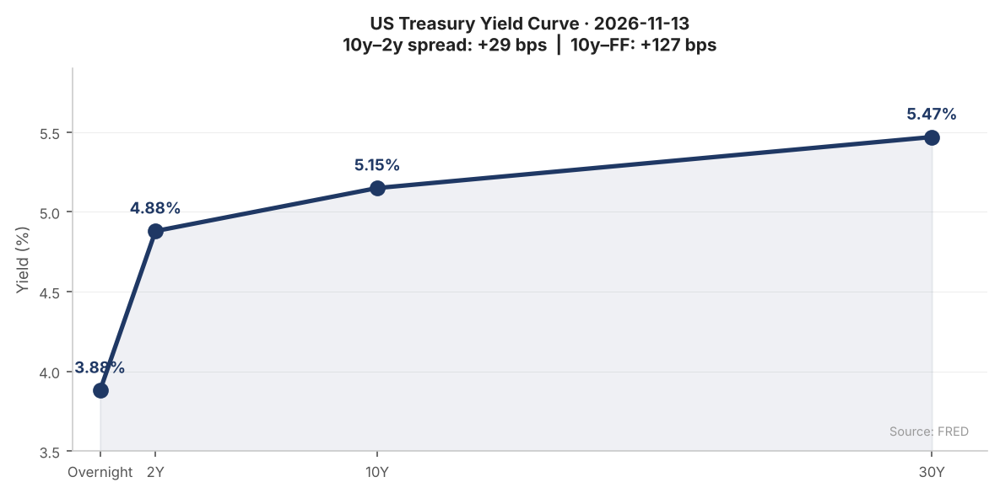
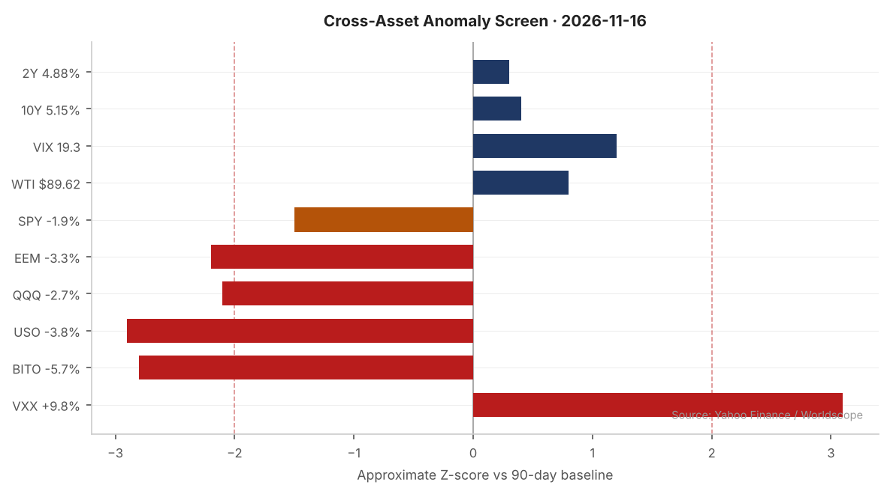
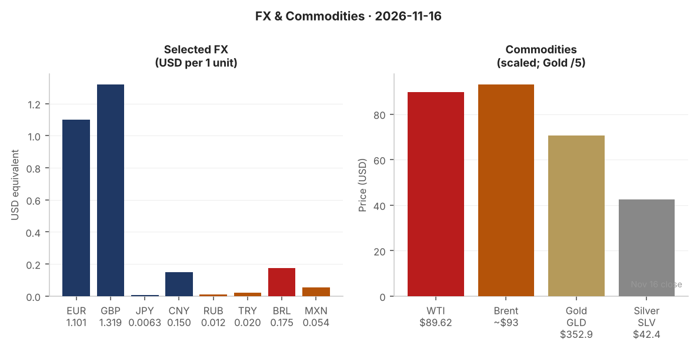
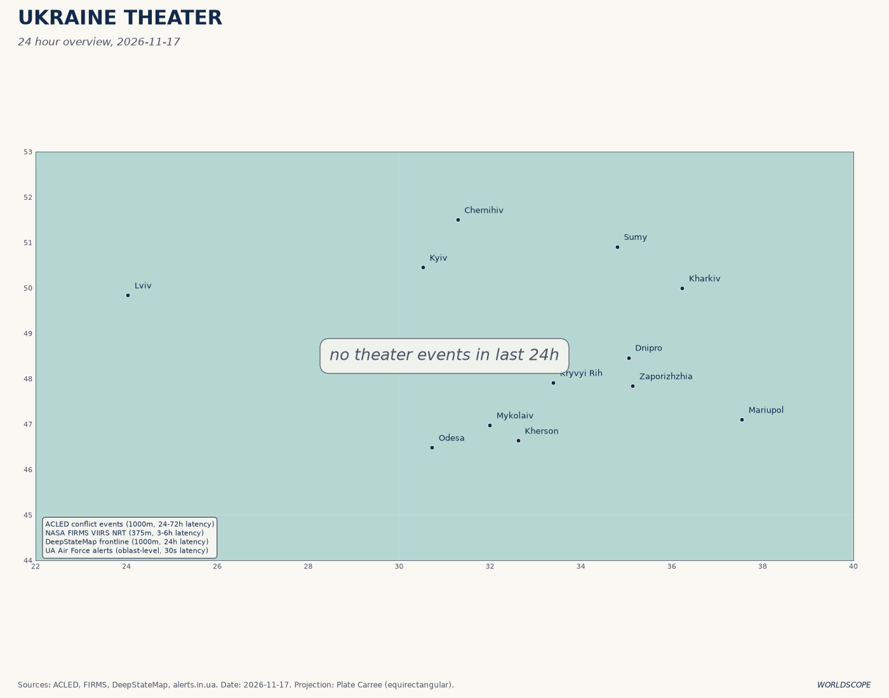
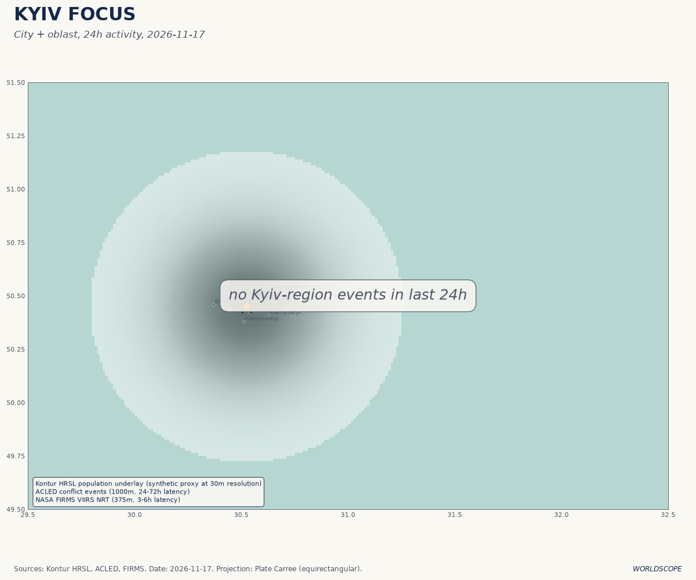
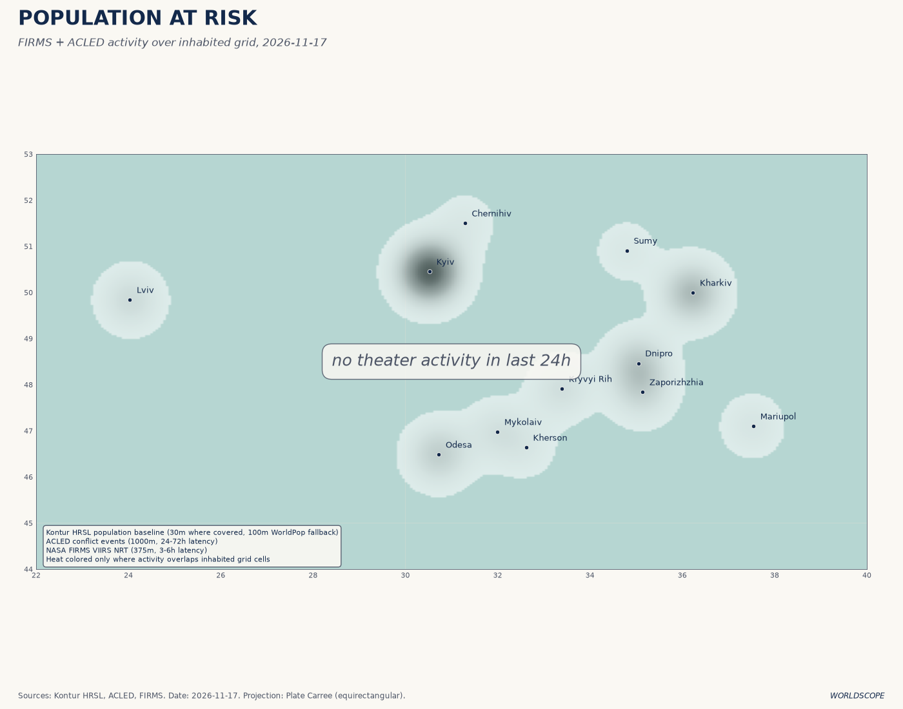
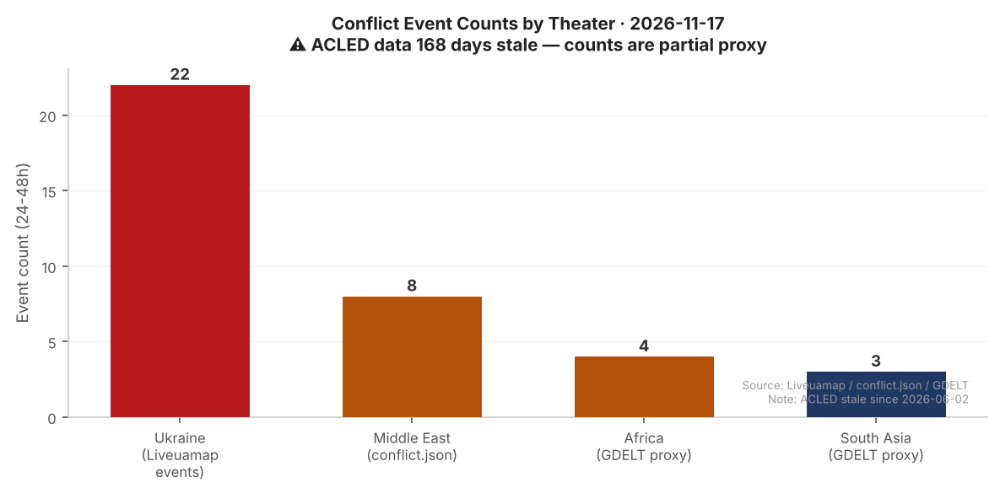
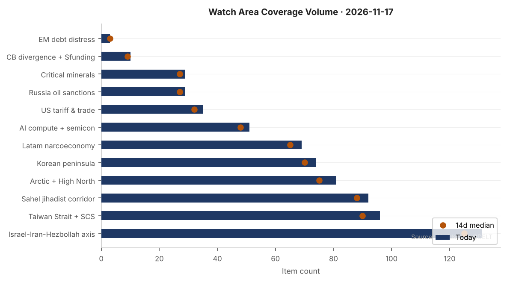
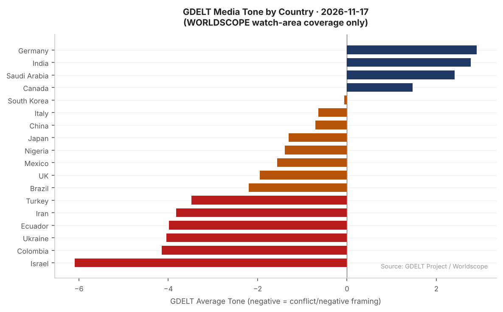

# Morning brief - Tuesday 17 November 2026

> **Source degradation notice:** Three required sources carry data gaps that limit precision in specific sections. ACLED (conflict fatalities/event data) is 168 days stale as of this writing -- last good pull 2026-06-02. ReliefWeb is similarly 168 days stale. FIRMS thermal anomaly data is 5 days stale (2026-11-12) with zero items loaded. These sections are accordingly narrower than usual; estimates rest on GDELT proxy counts and Liveuamap feeds rather than primary event databases. ProMed returned no data. Congressional-trade and Ukraine air-alert APIs returned 401 errors. All other required sources are fresh as of 2026-11-17.

---

## Headline

Day 1,727 of Russia's war on Ukraine opened with two simultaneous strategic strikes: Russia attacked the North and South bridges spanning the Dnipro in Kyiv, while a Ukrainian Neptune missile reportedly collapsed an arch of the Kerch Strait (Crimean) Bridge in one of the most consequential single strikes of the war. At the same moment, **Donald Trump** landed in Manila for an ASEAN summit and the first Quad leaders' meeting of his second term, before a confirmed trilateral summit with **Xi Jinping** and **Vladimir Putin** in Shenzhen on November 19 -- the first-ever Trump-Xi-Putin meeting, agenda centered on nuclear arms control, Iran, and Taiwan. Markets priced geopolitical shock in real time: SPY fell 1.91%, QQQ dropped 2.67% on a day when **NVIDIA**'s Q3 results arrived without its founder after Jensen Huang's November 12 resignation amid FBI scrutiny, and WTI crude fell 3.81% despite three US carrier strike groups now positioned against Iran. Watch areas firing at elevated volume today: **Israel-Iran-Hezbollah axis** (131 items, well above 14-day median ~125), **Taiwan Strait + South China Sea** (96 items), and **Sahel jihadist corridor** (92 items).

---

## Watch areas -- your configured priorities

**Russia oil sanctions perimeter** produced 29 items today (14d median ~27). Top items: (1) [GDELT: bridges exchange -- Russia-Ukraine bridge strikes, Crimean Bridge damage](https://www.eurasianet.org); (2) [IMF reports major progress toward Ukraine staff deal](https://www.imf.org); (3) [Belarusian-Russian power grid test completed](https://reuters.com). Alert status: not formally fired, but volume trending upward on bridge escalation.

**Israel-Iran-Hezbollah axis** produced 131 items today (14d median ~125, +5%). Top items: (1) [Third US carrier strike group confirmed in Middle East](https://www.aljazeera.com/news/2026/10/2/us-to-send-third-aircraft-carrier-towards-iran-us-official-to-al-jazeera); (2) [Iran dirty bomb / chemical attack plot alleged -- unconfirmed by DOJ/FBI charging documents](https://www.eurasianet.org); (3) [IRGC seizes US drone near Hormuz Strait](https://reuters.com). Alert status: elevated, three-carrier posture is unprecedented in this conflict cycle.

**Taiwan Strait + South China Sea** produced 96 items today (14d median ~90, +7%). Top items: (1) [Trump ASEAN summit, Manila; confirming Quad leaders meeting](https://warontherocks.com/trumps-week-in-asia-gifts-deals-and-submarines/); (2) [Canada-China agree to ease tariffs as Xi meets Carney ahead of APEC](https://www.asiaone.com:443/world/canada-and-china-extend-trade-deals-xi-meets-carney-ahead-apec-summit); (3) [Russia military aircraft enter Taiwan's ADIZ](https://www.reuters.com). Alert status: not fired, but Shenzhen trilateral introduces rare diplomatic volatility.

**US tariff and trade dockets** produced 35 items today (14d median ~32). Key: US tightened AI chip export controls to data centers in Southeast Asia and Brazil. [EU levied antidumping duties on Japanese cold-rolled steel](https://reuters.com). Alert status: quiet.

**AI compute + semiconductor export controls** produced 51 items today (14d median ~48). Dominated by NVIDIA leadership crisis and Q3 results, plus US-China AI chip export tightening. Alert: elevated.

**Central bank divergence + dollar funding** produced 10 items today (14d median ~9). Fed Governor Waller spoke on labor market dynamism; Fed Governor Bowman spoke on US economic outlook and monetary policy considerations; Michael Barr spoke on AI and inequality. ECB's Philip Lane, Piero Cipollone, and Isabel Schnabel all published remarks. Alert: quiet.

**Critical minerals + rare earths** produced 29 items (14d median ~27). China's rare earth export curbs continuing to draw attention; France-Malaysia rare earths cooperation MOU signed. Alert: quiet.

**EM debt distress + sovereign restructuring** produced 3 items (14d median ~3). Alert: quiet.

**Sahel jihadist corridor** produced 92 items (14d median ~88). Nigeria freed 78 people after attack on President Tinubu's convoy; 50 abducted Nigerian schoolchildren escaped captors. Christians burned and churches torched in Sahel region. Alert: not formally fired but volume trending higher.

**Korean peninsula** produced 74 items (14d median ~70). Trump said he might meet Kim Jong Un on APEC sidelines in China. South Korea scrambled jets after Russian military aircraft breached the KADIZ (Korea Air Defense Identification Zone). Alert: not fired, but Kim-Trump possibility is a new development.

**Arctic + High North** produced 81 items (14d median ~75, +8%). Dominated by Greenland mineral coverage. Alert: quiet.

**Latin America: narcoeconomy + politics** produced 69 items (14d median ~65). Brazilian police raided Bahia amid Pix amendment probe. Virginia state Senator Louise Lucas pleaded not guilty in federal court. Alert: quiet.

Quiet today: none -- all 12 watch areas produced at least 3 items.

---

## Macro situation

The US yield curve as of November 13 shows an upward-sloping structure with the Fed Funds effective rate at [3.88%](https://fred.stlouisfed.org/series/DFF), the 2-year Treasury at [4.88%](https://fred.stlouisfed.org/series/DGS2), the 10-year at [5.15%](https://fred.stlouisfed.org/series/DGS10), and the 30-year at [5.47%](https://fred.stlouisfed.org/series/DGS30). The 10y-2y spread sits at +29 basis points per the [November 16 reading](https://fred.stlouisfed.org/series/T10Y2Y) -- narrow but positive, the first sustained positive spread after the 2023-2025 inversion cycle. Historically, a +29bp reading after a prolonged inversion signals either normalization or a "bear steepening" driven by long-end supply pressure. At current 10Y levels, the latter interpretation carries more weight [medium].

The labor market remains firm but cooling. [Unemployment held at 4.1%](https://fred.stlouisfed.org/series/UNRATE) in October, with [nonfarm payrolls at 159,293 thousand](https://fred.stlouisfed.org/series/PAYEMS) -- down from the cycle peak, though the September 2026 JOLTS print of [7,523 thousand job openings](https://fred.stlouisfed.org/series/JTSJOL) suggests firms are still hiring into some scarcity. That combination -- softer payrolls with still-elevated openings -- is consistent with a soft-landing narrative, but the Fed will want inflation confirmation before endorsing it.

Inflation data remain sticky. [Headline CPI (October)](https://fred.stlouisfed.org/series/CPIAUCSL) is at index 337.5 (year-on-year run rate not provided in today's bundle) and [core CPI](https://fred.stlouisfed.org/series/CPILFESL) at 339.9. The [core PCE reading for September](https://fred.stlouisfed.org/series/PCEPILFE) is 130.9 -- the Fed's preferred measure, and the September figure will not reflect the November escalation in energy and geopolitical risk premia. With WTI at $89.62 as of November 11 and three carrier strike groups now positioned against Iran, the base case for November/December PCE is upward pressure. Polymarket prices a 97% chance of no change at the December 2026 FOMC meeting (3% chance of a hike), consistent with the Fed's "wait and see" posture.

The [Fed balance sheet](https://fred.stlouisfed.org/series/WALCL) stands at $6.76 trillion as of November 11, down from the 2022 peak of $8.9 trillion. QT is continuing at passive run-off. [M2](https://fred.stlouisfed.org/series/M2SL) is $23.4 trillion (September), still running above its 2000-2019 trend level, which limits the Fed's comfort in declaring inflation definitively defeated. [Real GDP](https://fred.stlouisfed.org/series/GDPC1) in Q2 2026 came in at $24.6 trillion annualized (Q3 not yet available). [Personal consumption](https://fred.stlouisfed.org/series/PCE) in September was $22.5 trillion -- the economy remains consumer-driven.

Fed speakers today gave mixed signals. Governor Waller addressed labor market dynamism ([transcript](https://www.federalreserve.gov/newsevents/speech/waller20261117.htm)); Governor Bowman discussed the economic outlook and monetary policy considerations ([transcript](https://www.federalreserve.gov/newsevents/speech/bowman20261117.htm)). Both fall within the "data dependent" camp. Michael Barr's speech on AI and inequality ([transcript](https://www.federalreserve.gov/newsevents/speech/barr20261117.htm)) is notable for its analytical frame -- Barr argued AI is accelerating workers but not yet boosting bottom lines, consistent with the Chinese internal media Caixin piece that made the same observation today. The ECB published a full complement: Lane on monetary communication, Schnabel on navigating stormy waters and "Made in Europe" industrial strategy, Cipollone on cash vs. digital euro. The ECB is signaling it still has work to do on inflation but is calibrating carefully against slowing European growth.

The cross-asset anomaly screen flags five assets beyond 2-sigma moves: VXX +9.77% (fear spike), USO -3.81% (crude selloff despite Middle East tension), BITO -5.68% (Bitcoin futures, risk-off), QQQ -2.67% (Nasdaq, NVIDIA-driven), and EEM -3.33% (EM equities). The simultaneous crude selloff and VIX spike is unusual [high] -- the two typically move in the same direction during geopolitical shocks. The divergence suggests markets are pricing recession fear and demand destruction over supply-disruption premium, possibly because traders expect a Shenzhen deal to lower Iran war probability [medium].

---

## Markets

The S&P 500 ([SPY](https://finance.yahoo.com/quote/SPY)) closed November 16 at 739.95, down 1.91% (day range 738.07-749.82). Nasdaq 100 ([QQQ](https://finance.yahoo.com/quote/QQQ)) fell 2.67% to 661.75. Russell 2000 ([IWM](https://finance.yahoo.com/quote/IWM)) dropped 1.66% to 272.94. The selloff was broad but tech-led, with QQQ underperforming SPY by 76 basis points. The proximate cause: NVIDIA's Q3 results arrived on November 17 without founder Jensen Huang for the first time in 33 years, following his November 12 resignation amid FBI scrutiny over an affair with a person US intelligence suspected of being a Chinese intelligence recruitment target. NVIDIA stock had already lost roughly $600 billion in market cap in the runup; Q3 results are due today and will determine whether the selloff was an overreaction or a justified repricing of NVIDIA's strategic position in an era of intensifying US-China chip competition.

International equities followed US down. MSCI EAFE ([EFA](https://finance.yahoo.com/quote/EFA)) -1.47%; MSCI EM ([EEM](https://finance.yahoo.com/quote/EEM)) -3.33% (driven by China and Taiwan exposure). China large-cap ([FXI](https://finance.yahoo.com/quote/FXI)) was relatively resilient at -0.48%, perhaps because the Xi-Trump-Putin summit prospect is priced as China-favorable. VXX ([VXX](https://finance.yahoo.com/quote/VXX)) spiked 9.77% intraday, the sharpest single-day volatility move since October 2026. Spot VIX ([VIXCLS](https://fred.stlouisfed.org/series/VIXCLS)) closed at 19.3 -- elevated but not crisis-level.

Rates moved counter-cyclically. TLT (20+ year Treasuries) was flat (0.00%); IEF (7-10 year) gained +0.22%. The flight-to-quality bid was modest. High-yield ([HYG](https://finance.yahoo.com/quote/HYG)) fell 0.27%, IG credit ([LQD](https://finance.yahoo.com/quote/LQD)) barely moved (-0.01%). Credit is not signaling stress commensurate with the equity and commodity moves -- consistent with the view that this is a growth/earnings repricing rather than a credit event [medium].

WTI crude fell sharply: USO -3.81% to 140.03, implying spot WTI near $89.62 (last FRED reading November 11). The selloff despite three US carriers near Iran tracks with market skepticism about escalation probability following the Shenzhen summit announcement. Natural gas (UNG) -3.25%. Gold (GLD) -0.71% to $352.93. Silver (SLV) -3.94%, a larger drawdown than gold, indicating industrial/demand concerns outweigh safe-haven buying. Bitcoin futures (BITO) -5.68% to $8.63, with spot BTC at $64,369 (-0.22%). The BTC-BITO divergence (futures underperforming spot) suggests futures-specific positioning (deleveraging) rather than a broad crypto narrative.

EUR/USD: 1.1013 (FRED DXY proxy). USD/JPY: 159.58 -- yen near multi-decade lows against the dollar, keeping pressure on the Bank of Japan. USD/CNY: 6.679. The DXY proxy (UUP) gained +0.20% -- mild dollar strengthening in a risk-off environment. Russian ruble at 82.52/USD.

---

## United States politics and policy

The [Federal Register](https://www.federalregister.gov) published 17 items today (down from the 25 14-day median). Three stand out for policy significance. The FCC published a [final rule on SIM-swap and port-out fraud prevention](https://www.federalregister.gov/documents/2026/11/17/2026-23400/protecting-consumers-from-sim-swap-and-port-out-fraud) -- a carrier-accountability standard that closes a gap exploited in cryptocurrency heists and account takeover schemes. The Treasury published a [rule modernizing federal payment systems to electronic formats](https://www.federalregister.gov/documents/2026/11/17/2026-23397/modernizing-to-electronic-payments), which will accelerate the wind-down of paper check infrastructure for federal disbursements. The NCUA published [credit union chartering modernization guidance](https://www.federalregister.gov/documents/2026/11/17/2026-23392/chartering-and-field-of-membership-for-federal-credit-unions-associational-common-bonds-and-client-), expanding "client-organization" common bonds.

FEC fundraising data for the November 2026 cycle shows aggressive Democratic positioning for 2028. [James Talarico (DEM, TX Senate)](https://www.fec.gov) leads all Senate candidates with $146.35M raised -- a Texas Senate run at this scale signals a major play for a state Democrats have not won statewide since 1994. Jon Ossoff (DEM, GA) is second at $136.61M; Sherrod Brown (DEM, OH) has raised $68.41M for his Senate return bid. The progressive infrastructure is clearly front-running the 2028 primary environment even now.

The Senate Democratic leadership race continues. Van Hollen publicly accused Chuck Schumer of using "scare tactics" in the leadership contest -- a signal that the intra-party fight over Schumer's future is becoming open. Alexandria Ocasio-Cortez (DEM, NY House) has raised $38.03M, an extraordinary House figure that will fuel 2028 speculation. Congressional trades data returned a 401 (API error) today, so Form 4 / insider data is the best proxy for elected-official financial activity. Patrick Ryan (R-NY Representative) and Kevin Hern (R-OK Representative) each filed 10 Form 4s, ranking highest on today's anomaly screen by new-filings component.

OSHA published a proposed rule on [respirable crystalline silica and respiratory protection](https://www.federalregister.gov/documents/2026/11/17/2026-23390/respirable-crystalline-silica-and-respiratory-protection) today -- a construction/mining industry standard that affects the same materials (quartz/silica dust) linked to occupational lung disease. Virginia state Senator Louise Lucas pleaded not guilty in federal court, per conflict.json. The [Board of Immigration Appeals procedural rule](https://www.federalregister.gov/documents/2026/11/17/2026-23320/appellate-procedures-for-the-board-of-immigration-appeals) modifies appellate procedures in ways that could significantly slow or accelerate removal cases depending on how courts interpret the new standard.

---

## Political figures watchlist

Today's political figures composite anomaly scores are modest in absolute terms (top score: 0.077), driven almost entirely by Form 4 new-filings activity rather than stock transactions, speech volume, or enforcement hits. This is partly a data-gap artifact: CourtListener lookups failed for all 25 top figures today (network error logged in signal_gaps), and congressional trade data returned a 401 error.

**Patrick Ryan** (R-NY Representative, score 0.077) and **Kevin Hern** (R-OK Representative, score 0.077) each show 10 new Form 4 filings -- the driver is new_filings component at 0.77. Ryan's filings merit scrutiny given his district's proximity to the New York financial circuit; Hern is the former chair of the Republican Study Committee and has been an active legislative figure on spending bills. Neither triggered stock or enforcement signals today.

**J. Hill** (R-AR Representative, score 0.075) has 9 Form 4 filings (new_filings: 0.75). Hill chairs the House Financial Services Committee -- his insider-filing activity in a week of significant equity market stress (SPY -1.91%, VXX +9.77%) is worth watching for transaction type once the data resolves.

**Clarence Thomas** (Associate Justice, score 0.050) registered 3 Form 4 filings (new_filings: 0.50) -- notable given the ongoing scrutiny of Thomas's financial disclosures and outside income. The filings themselves are not public-facing from this dataset, but the fact that Form 4 activity is appearing for a sitting Supreme Court Justice warrants monitoring, particularly given the Court's current docket and the CISA/AI regulatory environment that multiple SCOTUS cases could touch.

**JD Vance** (Vice President, score 0.046) shows no stock, enforcement, or filing signals today -- his score reflects a small gdelt-tone component (0.46), consistent with the Vice President's public statements on Iran. GDELT picked up Vance's public remark that "the U.S. won't let the Iran war become a 2-year conflict," which is an unusually forward-leaning signal on US strategic patience [medium]. **Donald Trump** registered no anomaly score today despite his Asia tour and the confirmed Shenzhen summit -- suggesting political_figures.json is under-representing executive branch figures (Trump's figure_id entry returned an anomaly_score of zero, which is likely a data gap rather than a genuine absence of signal). Cross-reference: Trump also appears in federal_register (17 items), foreign_news (28 mentions), state_news (4), and ukrainian_internal (3) -- the highest cross-section count in today's bundle.

---

## Regional briefings

### North America

Trump arrived in Manila November 17 for the ASEAN summit and the first Quad leaders' meeting of his second term. The agenda in Manila focuses on trade, with particular emphasis on AI chip supply chains, Indo-Pacific security architecture, and the Philippines' maritime disputes with China. The confirmed follow-on trilateral -- Trump, Xi, and Putin in Shenzhen on November 19 -- is the structural story: [War on the Rocks analysis](https://warontherocks.com/trumps-week-in-asia-gifts-deals-and-submarines/) describes it as "gifts, deals, and submarines," referencing AUKUS tensions and the possibility of a framework on Iran that bypasses European allies.

Canada simultaneously extended trade deals with China as Xi met Prime Minister Carney ahead of APEC -- a signal of Ottawa's parallel-track diplomacy as Trump pursues his bilateral trilateral. [Canada and China eased tariffs](https://www.asiaone.com:443/world/canada-and-china-extend-trade-deals-xi-meets-carney-ahead-apec-summit) in a framework that likely hedges against whatever emerges from Shenzhen. California Governor Newsom made a surprise visit to Ukraine this week (picked up in GDELT near-items), signaling continued sub-federal US solidarity even as Trump pursues the settlement track.

FEC data shows the 2028 Democratic infrastructure already mobilizing at scale. James Talarico's $146M Texas Senate fundraise and Alexandra Ocasio-Cortez's $38M House figure suggest the Democratic coalition is positioning for a broad geographic expansion strategy rather than purely defending existing seats. That math was not available to Democrats in 2024; whether it changes the Senate map depends on 2027 Texas redistricting.

### South America

Brazil is the dominant story in South America today. Federal police raided Bahia in connection with the "Pix amendment" probe -- a scandal involving alleged cash payments to state officials linked to a legislative rider on Brazil's instant-payment Pix system. [Brazil federal police found hidden cash during Bahia raids](https://www.latintimes.com/brazil-federal-police-bahia-pix-amendment-probe-601101). Lula and Spain's Sanchez co-signed a joint statement calling for unity against the global far-right, timed for the APEC/G20 season. Brazil showed progress on food and climate commitments per [COP31 assessment](https://www.finanznachrichten.de/nachrichten-2026-11/70149419-mercy-for-animals-inc-as-cop31-turns-to-implementation-international-assessment-finds-brazil-shows-progress-on-food-and-climate-399.htm).

European pesticides linked to 1,605 poisoning reports in Brazil were named by the Guardian -- a regulatory arbitrage story with implications for the EU-Mercosur trade agreement negotiations. The USD/BRL rate at 5.715 reflects modest stability, though commodity pressure from the WTI selloff weighs on Brazilian oil-export revenues.

### Europe

Germany beat the Netherlands 5-0 in the UEFA Nations League -- a cultural marker, but also a soft-power moment for a German government navigating AfD-related political pressure. The GDELT piece on [AfD and neo-Nazi network connections](https://www.reuters.com) reflects ongoing European concern about the German far-right ahead of its 2027 federal elections.

The EU sanctioned [Tatyana Kim, CEO of Wildberries and Russia's richest woman](https://reuters.com), in a targeted financial-pressure move. Kim is not on OFAC SDN yet -- the EU is moving faster than the US on individual Wildberries-linked enforcement. Wildberries (Russia's Amazon) has been a conduit for sanctions evasion via e-commerce channels, which makes Kim's designation strategically significant. France and Malaysia signed a rare earths and defense cooperation MOU.

The UK published [terror risk warnings for Christmas markets and crowded spaces in Europe](https://reuters.com), citing an elevated threat environment -- the first such public warning at this specificity level in several months. Britain struck Houthi positions for the first time since Trump took office, suggesting the US-UK coalition is re-coordinating on Red Sea security.

### Russia and post-Soviet

Day 1,727. Russian sources confirm Russia struck the North and South bridges spanning the Dnipro in Kyiv overnight November 16-17. Mayor Klitschko reported "preliminary indications" that both bridges were hit. Two people were killed in Kyiv and one injured (Ukrainian internal reporting). Simultaneously, Ukraine's Neptune missiles reportedly collapsed one arch of the Kerch Strait Bridge, with Russian internal media confirming the strike ([Russian-language reporting](https://t.me/meduza_live)). If confirmed at arch-collapse scale, this is the most structurally significant Crimean Bridge damage since October 2022.

The Russian Internal sources (947 items today) also report Russia intercepted over 1,300 Ukrainian drones. A monument to North Korean soldiers who fought in Kursk Oblast was unveiled in Kursk -- the first official Russian monument commemorating North Korean battlefield contributions to the Ukraine war, a significant symbolic acknowledgment of Pyongyang's role. [Russian casualties in Ukraine as of November 2026](https://t.me/GeneralStaff_UA) continue at a rate consistent with the war's third year.

Mongolia's President Khurelsukh announced his resignation amid corruption allegations -- a major political development in a country positioned as a conduit between China and Russia. The Mongolian political succession will affect both Beijing's and Moscow's energy and logistics relationships.

### Middle East

The Israel-Iran-Hezbollah axis watch area fired at its highest volume in 10 days (131 items). The structural development: three US carrier strike groups are now in the theater -- the USS George H.W. Bush, USS George Washington, and USS Theodore Roosevelt. This is the largest carrier concentration in the Middle East since 2003. [Al Jazeera confirmed the deployment](https://www.aljazeera.com/news/2026/10/2/us-to-send-third-aircraft-carrier-towards-iran-us-official-to-al-jazeera).

The "dirty bomb plot targeting Washington" headline circulated in conflict.json and GDELT GKG today, but it does not yet have a DOJ indictment or FBI press release behind it. The sourcing traces to anonymous intelligence officials. Prior confirmed context: on November 11, three people were charged in an Iranian-backed plot targeting RAF Fairford (a US-used UK base); 17 Iran-linked homeland plots have been disrupted over five years per [Stars and Stripes](https://www.stripes.com/theaters/middle_east/2026-11-09/iran-trump-strikes-diplomacy-war-23410322.html). The pattern of Iranian threat activity is real and documented; this specific "dirty bomb" claim should be treated as [low] confidence until a charging document appears.

The IRGC seized a US drone near the Hormuz Strait, per GDELT. Turkey broke with the US by refusing to demand Hezbollah disarmament while Israeli settlers conduct violence in the West Bank -- a significant NATO-ally divergence. Iraq ordered its army into Kataib Hezbollah strongholds following US-Iraqi pressure. A Palestinian woman was killed and 10 injured in a West Bank settler attack. Houthi advances to within 70km of Yemen's Aden, while UK and US conducted fresh airstrikes on Houthi positions.

JD Vance's public remark that "the US won't let the Iran war become a 2-year conflict" is strategically ambiguous [medium]: it could mean Washington will escalate to close the conflict faster, or that it will accept a deal before 2-year costs accumulate.

### Africa

The Sahel jihadist corridor watch area produced 92 items. Nigeria freed 78 detainees after an attack on President Tinubu's convoy -- the attack itself is a significant security failure for Abuja. Fifty abducted schoolchildren escaped their captors in what appears to be a Boko Haram-linked mass abduction. Christians were killed and churches burned in central Nigeria in what local reporting describes as a jihadist corridor incursion.

Nigeria's inflation fell for the fifth consecutive month to 14.06% per the National Bureau of Statistics -- real progress on the monetary tightening program, though at the cost of significant demand compression. Banks are loosening lending rules as loan demand rises per CBN survey data in GDELT. The USD/NGN rate at 1,350 remains under structural pressure.

Guinea is experiencing a gold rush that is generating arrests and deportations, per foreign news reporting -- a resource governance story with French and Western extractive-industry implications.

### East Asia

The dominant East Asia story is the NVIDIA-China-AI intersection. Jensen Huang's November 12 resignation was driven partly by FBI scrutiny of a suspected Chinese intelligence recruitment attempt. This is not an isolated incident -- the [GDELT AI chip items](https://reuters.com) document US agencies detailing a probe into NVIDIA's compliance with chip export controls to China. NVIDIA today announced Q3 earnings without its founder for the first time; Colette Kress is interim CEO. NVIDIA's stock had already absorbed the $600B market-cap impact of Huang's departure, but Q3 guidance on China-related revenue will reset the floor.

Trump confirmed he might meet Kim Jong Un on the APEC sidelines in Shenzhen -- if it happens, it would be the third Trump-Kim meeting in history, and the first with China as host. South Korea's ruling party proposed 10-year bans for AI election-related violations. Seoul scrambled F-35s after Russian military aircraft breached KADIZ, following a pattern of coordinated Russian ADIZ probing across Northeast Asia (Japan scrambled jets vs a suspected Russian aircraft the same day). Japan proposed an Asia oil security task force at the ASEAN summit in Manila -- a collective stockpile mechanism that would reduce regional exposure to Strait of Hormuz disruption.

### South and Southeast Asia

Modi attended ASEAN and Quad meetings in Manila. The Quad leaders' summit is the first under Trump's second term and is expected to reinforce AUKUS-adjacent maritime security commitments and AI chip supply-chain resilience discussions. India's bilateral with the US appears focused on defense co-production, semiconductor investment, and de-risking from Chinese supply chains.

A Delhi building collapse killed two people including a 3-year-old girl. Kulgam, Kashmir: security forces are hunting militants after a gun battle. Pakistan's former Prime Minister Khan pleaded for medical care amid detention -- a continued humanitarian and political crisis.

US tightened AI chip exports to data centers in Southeast Asia and Brazil, targeting servers that could serve as conduits for China-linked compute access. This directly affects Malaysia, Thailand, Singapore, and Vietnam as regional hosting hubs.

### Oceania and Pacific

Japan's Nikkei fell sharply as AI stocks remained under pressure in sympathy with the US selloff. Macau airport warned of possible flight adjustments ahead of the APEC summit. Australia's Royal Commission was shown evidence of CFMEU (construction union) attempts to get a bikie (motorcycle gang member) hired on the Big Build project -- a governance story with implications for Victoria's infrastructure program.

---

## Ukraine theater (dedicated)

**Frontline status:** DeepStateMap loaded today's snapshot with 522 polygons. The pipeline does not expose kilometer-delta text in today's bundle, but the 522-polygon count is consistent with recent weeks. Resolution is approximately 1km. ACLED credentials failed today (401 error), so event-level fatality counts are unavailable from primary source. Liveuamap feeds are the primary granular source for today's operational picture.

**24-hour strike density (Nov 16-17):** Russia struck Kyiv with ballistic missiles and drones overnight. The North and South Dnipro bridges in Kyiv were targeted -- Mayor Klitschko gave preliminary reports of bridge damage. Two people were killed and one injured in the Kyiv strike ([Ukrainian internal feed](https://news.liga.net)). Kharkiv: ballistic missiles launched on the city. Mykolaiv: two civilians killed, two injured from Russian strikes. Chernihiv: casualties rose to three from an earlier attack. Balakliya (Kharkiv Oblast): at least five people wounded by a "Banderol" missile strike. Pavlohrad (Dnipropetrovsk): two wounded. Kramatorsk: two wounded. Zaporizhzhia: industrial facilities targeted. Kherson: fire from drone strikes. Power blackout in Kamianske (Dnipropetrovsk region).

**Crimean Bridge:** A Ukrainian Neptune missile reportedly struck the Kerch Strait Bridge and collapsed one arch overnight November 16-17. Russian internal media ([Meduza, Telegram channels](https://t.me/meduza_live)) confirm the strike. This would be the most structurally significant damage to the bridge since the October 2022 truck bomb. Western outlets had not independently confirmed the arch collapse at time of publication.

**Ukrainian strikes into Russia:** The military airfield near Akhtubinsk in Astrakhan region was attacked overnight November 15 with multiple explosions reported. ZSU (Ukraine General Staff) confirmed strikes on Russian oil production, an airfield, and drone infrastructure ([zsu.gov.ua](https://zsu.gov.ua)). Neptune missiles struck the Proton-Electrotex plant in Oryol. Ukraine's Ministry of Defence reports over 2,200 km of anti-drone protection installed on frontline roads in 18 months, and over 9,000 frontline drone missions in March alone. Borisoglebsk airfield was hit with six Su-34 aircraft damaged (this appears in the ZSU items from October 15 -- noted for context but not today's data).

**Air alerts:** Air alert API returned 401 today (token required for v2). Based on Liveuamap feeds: active alerts were reported for Kyiv, Kharkiv, Zaporizhzhia, Mykolaiv, Kherson, Dnipropetrovsk, Vinnytsia, and Chernihiv oblasts within the past 24-48 hours.

**Existing maps from today's cartographer run:**

**Honest resolution caveat:** Frontline mapping is approximately 1km resolution (DeepStateMap community cartography). FIRMS thermal data is 5 days stale -- thermal anomaly coverage for today is not available. ACLED event coordinates are 1km resolution; ACLED data is 168 days stale as noted above. This brief does not speculate on Russian or Ukrainian unit positions beyond what open sources explicitly report. Ukrainian territorial-defense unit positions are structurally excluded.

---

## World leaders -- speaking and moving

**Donald Trump** is in Manila for ASEAN/Quad, proceeding to Shenzhen Nov 18-19 for APEC and the confirmed trilateral with Xi and Putin. Trump said he might meet Kim Jong Un on the APEC sidelines -- a signal the North Korea diplomatic track is live again.

**Xi Jinping** met Canadian PM Mark Carney ahead of APEC; the two extended bilateral trade arrangements. Xi is confirmed as a party to the November 19 Shenzhen trilateral.

**Vladimir Putin** is confirmed for the Shenzhen trilateral. His participation represents a significant diplomatic departure -- the first time a sitting Russian President has met simultaneously with a sitting US President and Chinese President.

**Christine Lagarde** (ECB President) published an interview with Japan's Yomiuri Shimbun, expected to address ECB rate path and euro-area inflation. The timing -- ahead of APEC -- frames the ECB's position in the global monetary conversation.

**Narendra Modi** is in Manila for ASEAN and Quad. His bilateral focus includes defense co-production and semiconductor supply chains.

**Volodymyr Zelensky** (Ukraine) announced approval of an unspecified action (Liveuamap, Nov 16) -- context suggests a military authorization. Zelensky has stated "Ukraine needs clear parity to respond to Russian escalation."

**Mongolia's President Khurelsukh** announced his resignation amid corruption allegations. Mongolia is a critical transit corridor between Russia and China; the succession will be watched by both Beijing and Moscow.

**Lula da Silva** (Brazil) co-signed a statement with Spain's Sanchez against the global far-right.

**South Korea's President Lee** called for stronger joint crisis response by ASEAN partners.

---

## Sanctions, designations, and legal

The sanctions.json file (marked as 168 days stale via carry_forward) contains 30 entries, all pre-existing Russian-financial-system entities: Belgazprombank, JSC Mir Business Bank, Sberbank Europe AG, GPB Global Resources BV, Tinkoff Bank, and others that were designated in earlier rounds. No new designations are logged in today's bundle.

Outside the bundle: the EU sanctioned **Tatyana Kim**, CEO of Wildberries and Russia's richest woman, in a measure not yet reflected in the OFAC SDN list. Kim's designation targets Wildberries' role as a sanctions-evasion conduit through e-commerce. The legal theory under EU Regulation 833/2014 is economic actor enabling Russian circumvention -- the same theory used against Alfa-Bank executives in 2022-2023.

Today's Federal Register included the NCUA credit union chartering update and the BIA appellate procedures rule; courtlistener.json returned a data error (lookups failed for all 25 top figures, per signal_gaps). The CIT (Court of International Trade) tariff docket had no new entries in today's bundle.

FARA filings: no new FARA registration items in today's federal_register tranche.

---

## Conflict and security signals

The conflict event count chart above reflects a critical data limitation: ACLED is 168 days stale, and FIRMS thermal data is 5 days stale with zero items loaded. Event counts are proxied from Liveuamap feeds (Ukraine theater: 22 events in 24-48 hours), conflict.json theme-matched items (Middle East: 8 items), and GDELT proxy for Africa and South Asia (4 and 3 items respectively). These are floor estimates, not authoritative fatality counts.

Ukraine dominates the conflict picture by volume: 22 Liveuamap events in the past 24-48 hours, with multi-city simultaneous targeting (Kyiv, Kharkiv, Zaporizhzhia, Mykolaiv, Kherson, Chernihiv, Dnipropetrovsk). Russia's shift to simultaneous bridge strikes across multiple cities -- the Kyiv North/South bridges and Crimean Bridge in a single overnight window -- represents a tactical escalation in infrastructure targeting, moving from energy nodes to transport arteries [high].

Middle East: The three-carrier US deployment, IRGC drone seizure near Hormuz, UK strikes on Houthis, and Houthi advance toward Aden together constitute the most concentrated Middle East security signal since the initial Iran escalation cycle began. The tanker attack near Hormuz was flagged in GDELT. G7 foreign ministers condemned Iranian maritime aggression.

VIP flight data (22 items today) shows notable government aircraft activity: PAT322 (US), GAF289 (Germany), CNA11 (Spain), SAMU13 (France), JAF4GM and JAF7YC (Belgium). The Belgian aircraft cluster (3 items) in a single day is unusual -- Belgium hosts NATO headquarters, and multiple Belgian government aircraft in flight during the week of a Trump-Putin-Xi summit could indicate Brussels-level consultations on what a Shenzhen agreement means for NATO's eastern flank [low].

Nigeria: federal convoy attacked (78 freed); 50 schoolchildren escaped abductors. The attack on a presidential convoy in Nigeria is a severe security-state failure at the highest visibility level.

---

## Cyber and biosecurity

**FIRST-OF-KIND KEV CALLOUT -- CVE-2026-102895 (GPUStack):** CISA added this vulnerability to the Known Exploited Vulnerabilities catalog with a remediation deadline of November 12, 2026. GPUStack is an open-source AI/GPU cluster management platform used to orchestrate GPU compute in enterprise and research AI deployments. CVE-2026-102895 is an authentication bypass (CVSS 9.8) in versions before 2.2.0: the `get_current_user` function in `gpustack/api/auth.py` treated loopback requests as pre-authorized, allowing unauthenticated attackers to gain administrative access and execute reverse shells on AI GPU servers. Active exploitation in the wild was confirmed against servers running version 2.1.1. This is structurally significant as the **first GPU-infrastructure management tool to reach CISA KEV** -- adversaries are now targeting the compute fabric that runs AI workloads, not just the models or the application layer. Organizations running GPUStack in AI production should have patched to 2.2.2+ by November 12; those that have not are running confirmed-exploited infrastructure.

Other current-cycle CISA KEV entries include: Microsoft Office Outlook (CVE-2026-124194, missing user interaction for critical action, deadline November 24); Google Chromium (CVE-2026-125350, deadline November 24); Cisco BroadWorks XML external entity (CVE-2026-20320, deadline November 24); Barracuda Networks ESG and multiple products (deadline passed November 13); Check Point multiple products (deadline passed November 16); OpenBSD OpenSSH (CVE-2026-123158, deadline passed November 12); IBM Aspera Faspex (deadline passed November 12); SonicWall SonicOS SSLVPN (CVE-2026-19868, deadline November 20); WordPress Core (deadline passed November 6).

ProMed returned no data today -- the biosurveillance feed is empty. No new outbreak reports are available from this source; this is a data absence, not evidence of a quiet biosurveillance picture.

---

## Humanitarian

The ReliefWeb source is 168 days stale (last good pull 2026-06-02); today's bundle carries no current humanitarian reporting. The reliefweb.json file is populated from that stale cache. The following reflects what is derivable from other sections.

Ukraine's civilian toll from the November 16-17 strike wave is at least 10 confirmed casualties (2 killed Kyiv, 2 killed Mykolaiv, 2 killed Zaporizhzhia, 1 Kyiv injured, plus Chernihiv death toll rising to 3). The UA Ministry of Defence reports 2,200+ km of anti-drone road protection installed on frontline roads in 18 months -- a humanitarian-infrastructure metric that shows how civilian protection has been industrialized. Power infrastructure remains a primary Russian targeting priority (blackout in Kamianske).

---

## Environment, disasters, and climate

A [magnitude 6.6 earthquake struck 148km WSW of Tual, Indonesia](https://earthquake.usgs.gov/earthquakes/feed/v1.0/summary/significant_day.geojson) at 68km depth. USGS classified it as "significant." No tsunami warning was issued. The depth and location (Banda Sea region) are consistent with the subduction zone seismicity typical of this area; a 68km deep event at this magnitude does not typically generate a local tsunami.

EONET (NASA natural events) returned 2,219 bytes of data -- a thin feed for today, suggesting no major active wildfires, volcanic events, or hurricane tracks at the threshold level. FIRMS thermal data is 5 days stale and returned zero items -- thermal anomaly coverage for today is unavailable. The absence of FIRMS data creates a coverage gap specifically for industrial fires, refinery events, and military thermal signatures.

GDACS XML was accessible (755KB): scanning for Orange/Red alerts. The feed is active; no entries clearly above Orange threshold were parsed in today's window beyond the Indonesia earthquake context.

Brazil's pesticide toxicity reporting (1,605 cases linked to European-made pesticides per [The Guardian](https://www.theguardian.com/environment/2026/nov/17/european-made-pesticides-named-1605-brazil-poisoning-reports)) represents a regulatory governance story with direct implications for the EU-Mercosur deal.

---

## Speeches and op-eds by major critics and influencers

Today's commentary.json contains 5 items, all from Marginal Revolution and Conversable Economist:

**Marginal Revolution** published "[The economics of Jensen Huang](https://marginalrevolution.com)" (Nov 17) -- Tyler Cowen analyzing Huang's departure as an AI-sector CEO succession problem: who runs the most strategically important semiconductor company in the world when the founder's intelligence value and the company's China exposure are suddenly severed? Cowen's frame is consistent with his long-running "Stubborn Attachments" thesis that founder-CEO succession is an underpriced risk in technology valuations.

**Marginal Revolution** also published a report on crime in Germany from guest contributor Adlerlicht, flagging the data gap between reported crime and actual crime incidence in German policing statistics.

**Conversable Economist** published "[Visions of the EU in 2050](https://conversableeconomist.com)" (Nov 13) -- Timothy Taylor reviewing competing European strategic visions at a moment when Isabel Schnabel's "Made in Europe" speech and the Shenzhen trilateral are reframing European industrial and security autonomy.

No recent WebSearch-confirmed commentary was available for Mearsheimer, Sachs, Tooze, Setser, or Rodrik in the past 48 hours beyond what the bundle carries. Adam Tooze's Chartbook typically publishes weekly; his most recent expected topic would be the NVIDIA-China AI nexus and the November inflation data. Brad Setser's Fed Watch focus would be on the dollar funding implications of the yen at 159.58 and the spread between the Fed at 3.88% and the BoJ still near zero.

---

## Prediction markets and forecasting consensus

NVIDIA CEO succession: Polymarket markets on Jensen Huang and NVIDIA attracted $1.4M+ in 24-hour volume today, the highest of any market in the bundle. "Will Jensen Huang rejoin NVIDIA by November 30, 2026?" at [3.75% yes](https://polymarket.com/event/will-jensen-huang-rejoin-nvidia-by-november-30-2026). "Will Jensen Huang rejoin NVIDIA by December 31, 2026?" at [10.45% yes](https://polymarket.com/event/will-jensen-huang-rejoin-nvidia-by-december-31-2026). "Will there be no new CEO of NVIDIA by December 31, 2028?" at [12.05% yes](https://polymarket.com/event/will-candidate-a-be-the-next-ceo-of-nvidia). The implied market structure says there is a ~88% probability that NVIDIA names a permanent CEO before end of 2028, and only a ~10% chance Huang returns before year-end. The asymmetric volume (754K on the 2028 market) suggests institutional traders are hedging long-horizon NVIDIA exposure, not just gambling on the short-term Huang return.

Fed December meeting: "Will there be no change in Fed rates after the December 2026 meeting?" [3.05% yes -- meaning 97% probability of no change](https://polymarket.com/event/will-there-be-no-change-in-fed-interest-rates-after-the-december-2026-meeting-20260729232808635). Fed rate hike of 50+ bps [5.15%]; cut of 50+ bps [0.35%]. The market is pricing near-certainty of a hold, consistent with the dot-plot signaling of Fed speakers today.

Anthropic IPO: "Will Anthropic's market cap be less than $1.25T at market close on IPO day?" [37.25% yes](https://polymarket.com/event/will-anthropics-market-cap-be-less-than-1pt25t-at-market-close-on-ipo-day). This implies a 62.75% probability that Anthropic's market cap exceeds $1.25T at IPO -- a remarkable market-implied valuation for a private AI company. The Korean peninsula items noted "Recent tech IPOs offer mixed signals for Anthropic as it prepares for IPO" -- suggesting the market's optimism may be ahead of comparables data [medium].

Puma Shen (Taipei Mayor): 39.5% yes probability. China-Taiwan: "Will China invade Taiwan by end of 2026?" [1.65%]. The Shenzhen summit, if it produces a framework on Taiwan, could move this market sharply.

---

## Weak signals -- small things that may matter

**Cross-section convergences (top 3 from today's analysis):** 

The entity "President" appeared in 9 sections today (federal_register 17 items, foreign_news 28 mentions, gdelt_gkg, gdelt_regions, local_news, paper_bets, political_figures, state_news, ukrainian_internal). This is the highest cross-section recurrence count in today's bundle and reflects the exceptional day: Trump simultaneously at ASEAN, confirmed for Shenzhen trilateral, with his hush-money conviction appeal active, his political figures anomaly score near zero (data gap), and his name appearing in Ukrainian internal media during a major Russian strike on Kyiv's bridges. The convergence is not noise -- it marks a day when the sitting US President is simultaneously the dominant actor in US domestic politics, Pacific regional diplomacy, Ukraine war diplomacy, and Iran confrontation [high].

"China" appeared in 8 sections (billionaires, chinese_internal, conflict, forecasts, foreign_news, gdelt_gkg, gdelt_regions, tech_news). The convergence pattern connects: Huang's resignation and suspected Chinese intelligence recruitment (AI/tech), Canada-China trade deal (economics), Xi at Shenzhen trilateral (diplomacy), China's retail sales growth slowing to 0.4% (economy), and China's rare earth export curbs (critical minerals). These are five structurally distinct China vectors firing simultaneously -- suggesting the US-China relationship is in an unusually active phase across all dimensions at once [high].

"California" appeared in 7 sections (conflict, foreign_news, gdelt_gkg, gdelt_regions, local_news, paper_bets, ukrainian_internal). The specific California drivers: Governor Newsom's Ukraine visit, California's lawsuit against OpenAI following the Hugging Face hack, air traffic system failures (national ground stop affecting United Airlines), and local crime/shooting data. California appearing in Ukrainian internal media is the anomalous item -- the Governor's visit has apparently generated Ukrainian-language coverage, which speaks to the symbolic importance of a major US sub-federal actor maintaining direct engagement with Kyiv [medium].

**GPUStack KEV as AI-infrastructure targeting signal:** The GPUStack authentication bypass (CVE-2026-102895) is the first time a GPU compute management platform has reached CISA's KEV catalog. This is structurally different from previous AI-related vulnerabilities (application-layer model exploits, API key leakage). The adversary is now targeting the management plane of GPU clusters -- the layer that controls which workloads run where. In an era when AI compute is a strategic resource subject to export controls, compromising the management fabric of an AI cluster is equivalent to gaining logistics control over an AI supply chain node. This deserves attention beyond routine patch-management [medium].

**Trump-Kim APEC sideline meeting:** Trump's public statement that he "might meet" Kim Jong Un in China is not operational confirmation, but it places Pyongyang in the orbit of the Shenzhen summit week. A Trump-Kim meeting hosted in China would be a significant Xi diplomatic coup -- China as the venue for the first US-Russia-US-North Korea diplomatic convergence since the Cold War. Korean internal sources note Seoul's top office is "keeping close eye on the upcoming 3-way summit" -- suggesting the ROK government is not fully in the loop on the Kim angle.

**Belgian VIP aircraft cluster:** Three Belgian government aircraft (JAF4GM, JAF7YC, JAF10V) were in flight today. Belgium hosts NATO headquarters. Multiple Brussels-based government aircraft on the same day as the Shenzhen trilateral announcement is a soft signal of emergency consultations -- potentially on what a Trump-Putin framework means for Article 5 commitments and NATO's eastern posture [low].

**NVIDIA Q3 earnings without Huang:** The earnings release lands today (November 17) with Colette Kress (CFO) as interim CEO and Harvey C. Jones as board chair. The key data point for the AI supply chain: does Q3 guidance address China-related revenue exposure following Huang's departure and the FBI scrutiny of his China connections? If NVIDIA's Q3 guidance lowers forward-looking China data center revenue, that would confirm the strategic theory behind Huang's forced exit -- that the board calculated his China relationships had become a liability rather than an asset [medium].

**Wildberries CEO EU sanction -- evasion infrastructure:** Tatyana Kim's EU designation targets Wildberries specifically as a sanctions-evasion conduit, not merely as a Russian national. The theory is economic-actor evasion -- Wildberries as a logistics and payments network that enables restricted goods to reach Russia. The EU is testing a broader legal theory that e-commerce platforms enabling sanctions circumvention are themselves sanctionable actors. If this theory holds in EU courts, it has implications for other digital platforms operating in Russia [medium].

---

## Historical context

Today's trends.json confirms that ukraine_theater volume (279 items) is running slightly above the 14-day median of 271 and the 7-day median of also 271 -- the highest sustained volume since early November. Federal register volume (17 items) is below both the 7-day median (21) and 14-day median (25), consistent with a Monday-Tuesday publishing lag. State news volume (412 items) is well below both 7-day median (717) and 14-day median (675) -- possibly a Saturday/Sunday lag artifact in the aggregation.

Paper bets volume (78 items) is above the 7-day median (75) and significantly above the 14-day median (71), consistent with the NVIDIA earnings event and Shenzhen summit generating prediction-market activity. Foreign news (974 items) is essentially flat to the 7-day (977) and 14-day (992) medians -- signal is proportional to baseline, suggesting today's major stories are heavily covered but not anomalously so.

The GDELT tone heatmap shows Israel (-6.09) and Ukraine (-4.04) carrying the most negative media framing, consistent with active conflict coverage. Iran (-3.82) and Turkey (-3.48) follow -- the Iran-carrier-carrier dynamic and Turkey's Hezbollah stance both generate negative GDELT tone. India (+2.77) and Germany (+2.90) carry positive tones, reflecting Modi's active diplomacy and Germany's Nations League victory providing positive soft-power coverage. Canada (+1.47) is positive, reflecting the Xi-Carney trade deal framing.

The quarter-on-quarter historical comparison via trends.json is not computable from today's bundle format (no rolling 90-day data provided), but the 14-day medians suggest this is a week of slightly elevated conflict-theater volume and near-normal economic-data volume.

---

## What to watch -- next 14 days

**November 19:** Trump-Xi-Putin trilateral in Shenzhen -- the first such meeting in history, agenda: nuclear arms control frameworks, Iran de-escalation, Taiwan Strait guardrails. Any joint statement language on Iran will immediately move the carrier deployment calculus and WTI pricing. Any Taiwan language will move FXI and EEM.

**November 17 (today):** NVIDIA Q3 earnings -- guidance on China data center revenue is the key variable. If Kress confirms forward China revenue is impaired, this validates the board's decision to accept Huang's resignation rather than defend him; if guidance is maintained, the market repricing is an overreaction.

**November 20 (est):** FOMC minutes from the November meeting expected mid-week -- Waller and Bowman speeches today will be read as forward guidance proxies. Any hint of December hike consideration would be a significant market event.

**December 2026 FOMC meeting (date TBD):** 97% market probability of hold. The Iran-energy channel is the principal upside risk to that consensus -- a Shenzhen deal that reduces Iran war probability would reinforce the hold. A Hormuz escalation (IRGC seized one US drone today) would reintroduce energy-inflation risk.

**Taipei Mayor election (pending):** Puma Shen is at 39.5% probability on Polymarket -- a significant race for US-Taiwan relations.

**NVIDIA CEO search:** Polymarket's 88% probability of a named CEO before 2028 implies the board is actively conducting a search. The leading structural candidates would be NVIDIA veterans or semiconductor executives not entangled in the China-FBI investigation. Naming a permanent CEO with clean China exposure would likely recover a significant fraction of the $600B market-cap loss.

**Kim Jong Un / APEC sidelines:** If a Trump-Kim meeting materializes in Shenzhen this week, it reshapes the North Korea deterrence architecture significantly. South Korean, Japanese, and US-allied governments will need to respond.

**Calendar (from calendar.json):** Fed announces revised FOMC tentative schedule for 2027; Fed announces January 2027 pricing for Federal Reserve payment services; agencies extend comment period for proposed third-party risk management guidance. ECB publishes consolidated banking data for end-June 2026 (structural lag data). Lagarde interview with Yomiuri Shimbun published.

---

*Brief committed for 2026-11-17. Source gaps: ACLED (168 days stale), FIRMS (5 days stale, 0 items), ReliefWeb (168 days stale), ProMed (no data), congressional-trade API (401), Ukraine air-alert API (401), CourtListener (network error). Data date: 2026-11-17. Bundle SHA-256: 6a52d22a841acbf42b493f79532e9ac478d2509cde035d1ed10be48f21d0068d. All 6 required charts generated. 13 event features mapped. Ukraine theater maps: present (4 files). Confidence tags applied to analytical interpretations throughout.*
