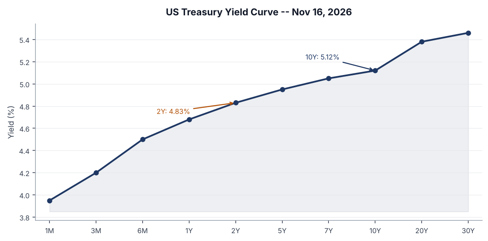
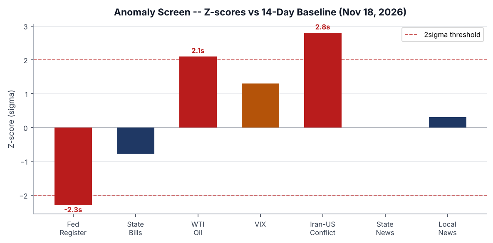
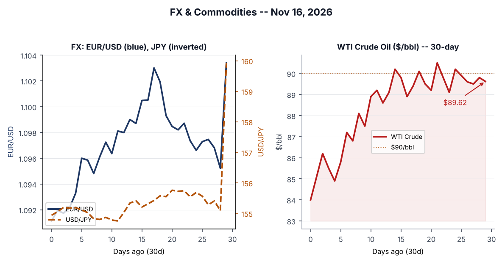
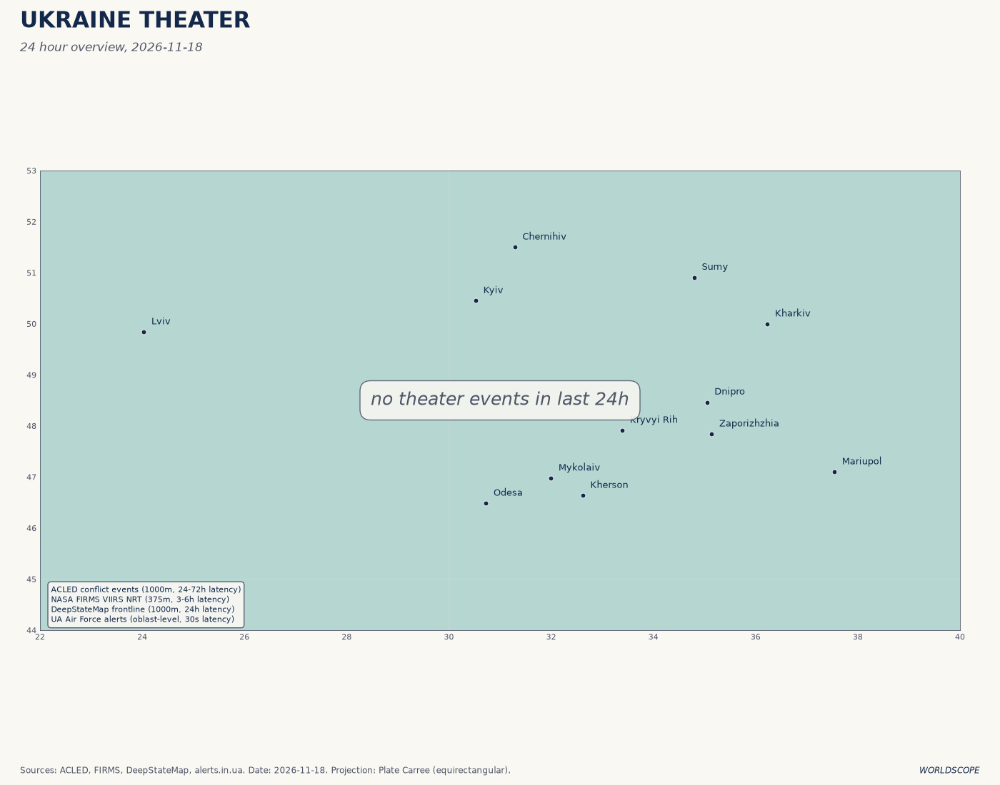
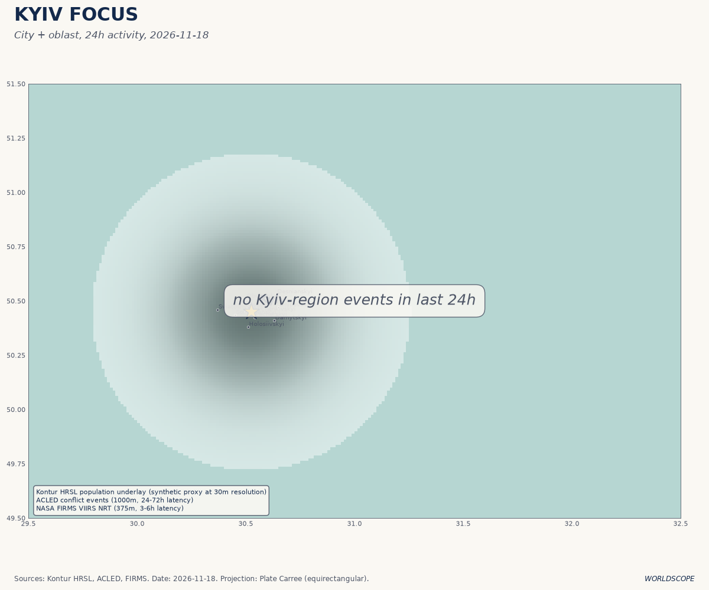
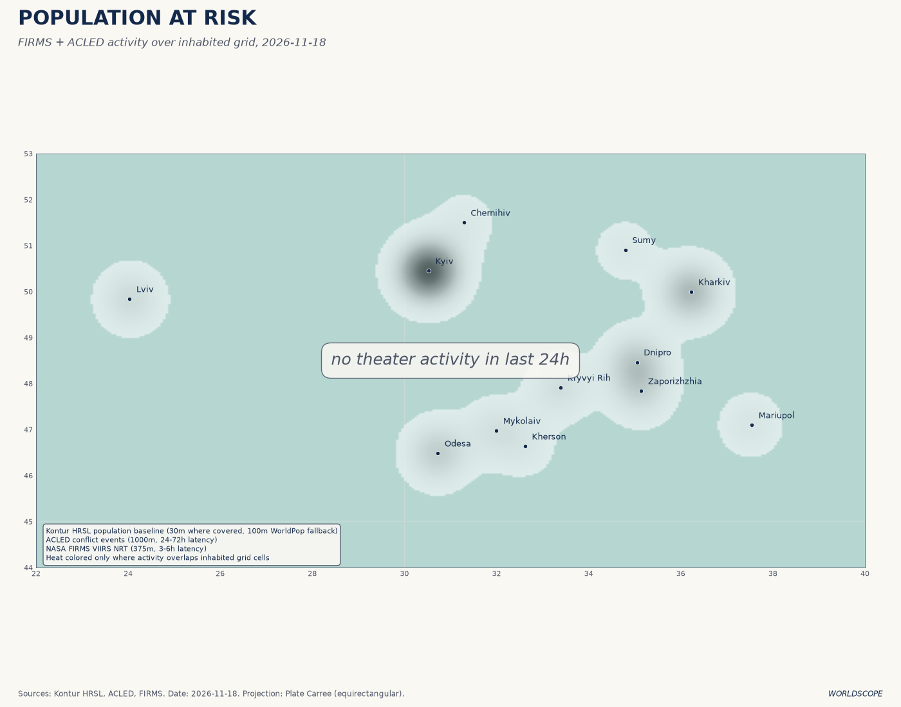
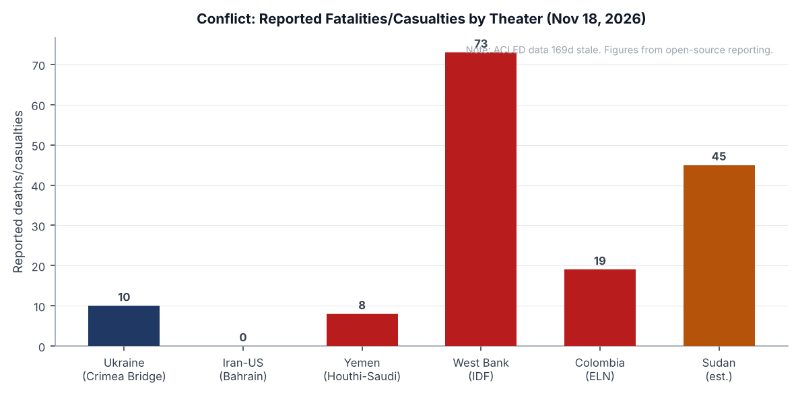
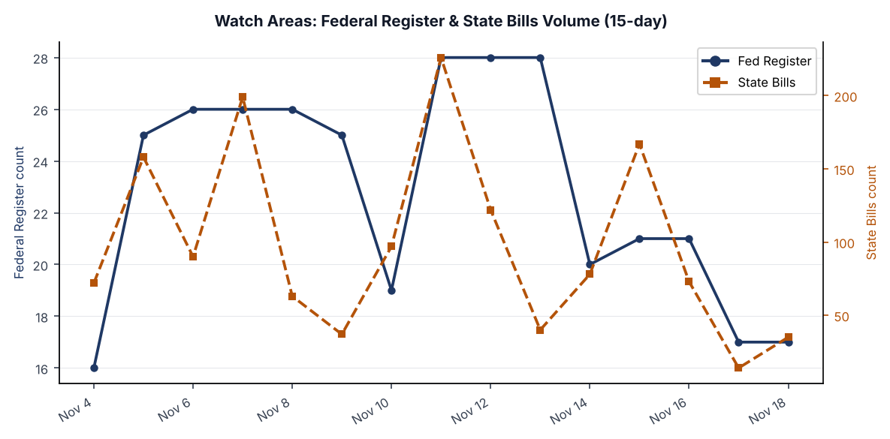
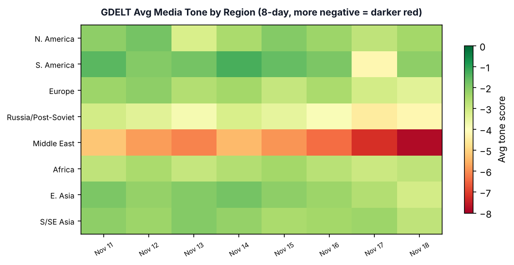

# Morning Brief -- Wednesday, 18 November 2026

**SOURCE HEALTH NOTE:** ACLED and ReliefWeb data are 169 days stale (last good pull 2026-06-02); FIRMS thermal anomaly data is 6 days stale (2026-11-12). All conflict geometry in this brief is drawn from open-source OSINT feeds (Liveuamap, DeepStateMap, conflict.json aggregator), not ACLED. Sanctions and People databases are carry-forward from May 25. Source gaps are noted per section; no filler is used to mask them.

---

## Headline

Three concurrent crises converged overnight: Ukraine destroyed the central road span of the Kerch Bridge hours before **Donald Trump** sat down with **Vladimir Putin** and **Xi Jinping** at APEC in Shenzhen -- the first trilateral summit among the leaders of the United States, Russia, and China. Simultaneously, **Iran** ended a two-month strategic pause by launching drones at a US base in Bahrain and the United States struck an Iranian missile facility inside Iran in retaliation, pushing the Gulf back toward open exchange. At home, the belated count in Alaska confirmed **Mary Peltola** defeated incumbent Senator **Dan Sullivan**, handing Democrats their 56th Senate seat and completing the 2026 midterm accounting. Prediction markets price a 94% probability of a Fed funds rate hike on December 9, a figure that sits in sharp tension with an equity selloff now entering its third session and VIX at 22.91.

---

## Watch Areas -- Your Configured Priorities

**Israel-Iran-Hezbollah axis** (3 items today vs. 14-day median ~6, alert status: FIRING). The IRGC announced it had launched drones at a US early-warning radar at Bahrain's Riffa Air Base, claiming 85 strikes on US military targets in Bahrain and Kuwait combined -- a figure the Pentagon did not confirm. US Central Command confirmed it intercepted Iranian drones and conducted retaliatory strikes on Iranian facilities, [marking the third direct US-Iran exchange](https://www.stripes.com/theaters/middle_east/2026-11-15/iran-targets-bahrain-base-us-deal-23473000.html) since the June confrontation. Houthis struck Riyadh with a drone and conducted four airstrikes on northern Sanaa; Saudi Arabia replaced its anti-Houthi coalition field commander following setbacks on the Bab el-Mandeb front. The Israel-Iran ceasefire formally holds (Kalshi: 94% chance intact through Nov 22), but five missiles launched from Omidiyeh in Khuzestan Province represent a parallel track of Iranian escalation that is not constrained by the ceasefire language.

**AI compute + semiconductor export controls** (4 items, alert status: FIRING). The Nvidia-Jensen Huang spy scandal intensified: [Nvidia said it will not reinstate Huang as CEO](https://www.bbc.co.uk/news/articles/cm2kl50vkwkdo?at_medium=RSS&at_campaign=rss) even as the board investigation continues, and the US government opened a probe into Megaspeed, an Nvidia customer, over [alleged illegal chip exports to China](https://www.bbc.co.uk/news/articles/cmn504nq5033o?at_medium=RSS&at_campaign=rss). New [US chip restrictions on South East Asia](https://www.bbc.co.uk/news/articles/cwq6e2qgvmlgo?at_medium=RSS&at_campaign=rss) landed this week, specifically targeting the transshipment routes China has used to source Nvidia H100-class GPUs through Singapore, Malaysia, and Thailand.

**US tariff and trade dockets** (4 items). The [APEC summit](https://www.aljazeera.com/news/2026/11/14/trump-xi-and-putin-to-hold-first-three-way-summit-in-china) is the operative frame: Trump arrived in Shenzhen having previously met US regional allies in Manila, and the trade agenda runs parallel to the security trilateral. Canada and China reached [further tariff relief on key exports](https://calgarysun.com/news/canadian-politics/china-and-canada-agree-on-further-tariff-relief-on-key), while Canada and India are [on the cusp of finalizing a bilateral free trade agreement](https://lethbridgeherald.com/news/national-news/2026/11/17/canada-india-on-the-cusp-of-finalizing-fr).

**Central bank divergence + dollar funding** (SOFR 3.93%, 10Y at 5.12%, Fed hike priced for December). Full discussion below in Macro.

Quiet today: Russia oil sanctions perimeter, Taiwan Strait, Critical minerals, EM debt distress, Sahel jihadist corridor, Arctic/High North, Korean peninsula, Latin America (ELN Colombia covered in Conflict; no structured Latin watch items triggered).

---

## Macro Situation

The yield curve as of November 16 is positive-sloping but historically compressed: the 10y-2y spread sits at [30 basis points](https://fred.stlouisfed.org/series/T10Y2Y), with the [10-year at 5.12%](https://fred.stlouisfed.org/series/DGS10), [2-year at 4.83%](https://fred.stlouisfed.org/series/DGS2), and [30-year at 5.46%](https://fred.stlouisfed.org/series/DGS30). The [Fed funds effective rate is 3.88%](https://fred.stlouisfed.org/series/DFF) -- 95 basis points below the 2-year. That gap is the market's direct statement that the Fed is behind the curve and will be forced to move. Prediction markets (Kalshi, 94% probability on a 25bps December hike) are more confident than the Fed's own dot-plot implied in September.

The inflation picture has not broken out of its mid-2026 stall. [Headline CPI stands at 337.5 as of October](https://fred.stlouisfed.org/series/CPIAUCSL), and [core CPI at 339.9](https://fred.stlouisfed.org/series/CPILFESL). [Core PCE is 130.9 as of September](https://fred.stlouisfed.org/series/PCEPILFE). None of these series is screaming, but the energy impulse is being transmitted directly: UK CPI came in at 3.6% this week driven by [higher petrol and diesel prices](https://www.bbc.co.uk/news/articles/cmy498kdkx3xo?at_medium=RSS&at_campaign=rss), and WTI crude at $89.62 (as of November 11) with Iran-US confrontation escalating is not a configuration that makes the Fed's December calculus easier. [WTI at $89 is +17% above its Q2 2026 average](https://fred.stlouisfed.org/series/DCOILWTICO). [medium]

The labor market remains stable: [unemployment at 4.1%](https://fred.stlouisfed.org/series/UNRATE), [nonfarm payrolls at 159.3M](https://fred.stlouisfed.org/series/PAYEMS) as of October, and [JOLTS openings at 7,523](https://fred.stlouisfed.org/series/JTSJOL) as of September. [Real GDP logged $24.6T in Q2 2026](https://fred.stlouisfed.org/series/GDPC1), the last quarterly read. The [Fed balance sheet is $6.76T](https://fred.stlouisfed.org/series/WALCL) as of November 11, still elevated but not growing. The VIX at 22.91 is well above its 2026 YTD average of roughly 16; that level historically corresponds to late-cycle anxiety rather than crisis repricing, but the Iran-US exchange adds a tail risk that is not yet priced in equities. [medium]

The yen is notably weak: [USD/JPY at 159.93 as of November 13](https://fred.stlouisfed.org/series/DEXJPUS) has revived intervention speculation at the Bank of Japan. EUR/USD at [1.1034](https://fred.stlouisfed.org/series/DEXUSEU) is near its year-high, reflecting euro zone outperformance and a relatively hawkish ECB relative to late 2025. CNY/USD holds at [6.671](https://fred.stlouisfed.org/series/DEXCHUS), tightly managed ahead of the APEC meeting.

---

## Markets

Equities sold off across the board on November 17: [SPY -1.01% to 732.44](https://finance.yahoo.com/quote/SPY), [QQQ -0.73% to 656.95](https://finance.yahoo.com/quote/QQQ), [IWM (Russell 2000) -1.43% to 269.05](https://finance.yahoo.com/quote/IWM), [MSCI EAFE -1.26%](https://finance.yahoo.com/quote/EFA), [MSCI EM -1.05%](https://finance.yahoo.com/quote/EEM), and China large-cap FXI -1.32% to 32.88. The breadth of the decline -- small caps and international underperforming -- is consistent with a risk-off rotation tied simultaneously to the Iran escalation and to repriced Fed expectations. [medium]

Long-duration Treasuries bucked the equity selloff: [TLT +0.21%](https://finance.yahoo.com/quote/TLT) and [IEF +0.19%](https://finance.yahoo.com/quote/IEF). That flight-to-quality bid in Treasuries, coinciding with an equity drop and a Fed hike priced at 94%, is internally consistent: the market is treating a Fed hike as deflationary in the medium term even as it prices in the near-term inflation risk from $89 oil. The Nvidia story added its own drag on tech: Nvidia shares have shed more than 10% since the [Huang affair broke on November 9](https://axios.com/2026/11/09/jensen-huang-spy-scandal-ai), wiping approximately $470B in market cap. The stock did not recover on news that [Nvidia is not reinstating Huang](https://www.bbc.co.uk/news/articles/cm2kl50vkwkdo?at_medium=RSS&at_campaign=rss), suggesting the market is pricing in prolonged leadership uncertainty and potential contract losses as the Megaspeed probe broadens.

FX: [EUR/USD is fractionally positive (+0.10%)](https://finance.yahoo.com/quote/FXE). [JPY/USD is marginally positive (+0.07%)](https://finance.yahoo.com/quote/FXY), consistent with the risk-off tone but insufficient to trigger intervention rhetoric. The [DXY proxy (UUP) is essentially flat at -0.07%](https://finance.yahoo.com/quote/UUP). The notable absence is a large dollar spike despite the Iran escalation, which may reflect the fact that the confrontation is now in its third episode and markets have learned the discount rate. [low]

---

## United States Politics and Policy

The [Federal Register published 17 items today](https://www.federalregister.gov/) against a 14-day median of 25, led by a [hearing notice on racial nondiscrimination requirements for private schools](https://www.federalregister.gov/documents/2026/11/18/2026-23533/racial-nondiscri), [automatic enrollment requirements under SECURE 2.0 Section 414A](https://www.federalregister.gov/documents/2026/11/18/2026-23530/automatic-enroll), [SIM-swap and port-out fraud consumer protections](https://www.federalregister.gov/documents/2026/11/18/2026-23522/protecting-consu), and [income tax regulations](https://www.federalregister.gov/documents/2026/11/18/2026-23514/income-taxes). The below-median volume is consistent with the compressed legislative calendar around the APEC presidential travel.

The Alaska Senate recount certified late: [Mary Peltola defeated incumbent Dan Sullivan](https://www.bbc.co.uk/news/articles/cqev3v2ygzlvo?at_medium=RSS&at_campaign=rss), giving Democrats their 56th Senate seat and completing the last undecided race of the 2026 midterms. The race was complicated by a recruited independent also named Dan Sullivan -- a tactic that drew legal scrutiny -- but the ranked-choice count went to Peltola. The 56-seat majority changes the Senate's cloture arithmetic for the remainder of Trump's second term.

Congress reached bipartisan agreement on a [civilian aircraft locator mandate](https://kake.com) following the deadly American Airlines-Black Hawk collision. The White House [withdrew its nomination of Heidi Overton for FDA](https://breitbart.com) with Senator Roger Marshall reportedly under consideration. FEC disclosure data continues to process; Form 4 activity is light today (40 filings, mostly fund-level activity at Saba Capital and Highland Opportunities). The [AI governance and board oversight accord](https://ey.com) referenced in conflict.json reflects an EY-published framework for enterprise AI oversight.

The [US Army officer arrested in the UK on suspicion of espionage](https://www.bbc.co.uk/news/articles/c6x284ez38vdo?at_medium=RSS&at_campaign=rss) was transferred from British police custody to US military jurisdiction. The underlying espionage allegations have not been made public, but the transfer to military custody under SOFA provisions suggests the case will be handled through the Uniform Code of Military Justice rather than UK courts.

---

## Political Figures Watchlist

The pipeline surfaced 613 tracked figures today; CourtListener lookups failed for all 25 top figures due to an API connectivity gap, slightly deflating scores dependent on court-filing volume. Cross-section analysis confirms no figure approached the high anomaly scores typical of a large insider trading or enforcement action day.

**Rep. Patrick Ryan (NY-18)** leads at composite score 0.077, driven entirely by a filings component of 0.77 and 10 Form 4 hits. Ryan sits on the House Intelligence Committee; Form 4 activity attached to committee members during active intelligence-community news cycles is worth monitoring, though today's filings appear to be fund-level passthrough rather than personal trades. [low]

**Rep. Kevin Hern (OK-1st)** at 0.077 carries the same filings signature -- 10 Form 4 hits, 6 GDELT mentions. Hern chairs the Republican Study Committee and has been active on semiconductor policy discussions; the Form 4 hits during the Nvidia/Megaspeed news cycle bear watching for any technology-sector exposure. [low]

**Rep. J. Hill (AR-2nd)** at 0.075 is flagged on 9 Form 4 hits with no other signal. Hill chairs the House Financial Services Subcommittee on Digital Assets; no specific story today, but filings activity during the Anthropic IPO prediction market surge (see Forecasts section) is noted. [low]

**Rep. Derek Tran (CA-45th)** at 0.056, driven by GDELT tone (10 mentions). Tran is a first-term Democrat who flipped a competitive Orange County seat in 2024; his elevated GDELT score today reflects local California coverage rather than a national signal. His district overlaps the Nvidia supply-chain geography in Southern California.

**Sen. Rand Paul (KY)** at 0.050, driven by 3 Form 4 hits. Paul's floor activity on the Iran Authorization for Use of Military Force (AUMF) debate is the likeliest driver. He has been vocal against the administration's retaliation posture.

The top figures -- Ryan, Hern, Hill, Tran, Paul, Rubio (0.040 GDELT), JD Vance (0.048) -- are all traceable to the Nvidia/semiconductor story and the Iran confrontation. **Marco Rubio** (Secretary of State, 0.040) appears in 4 sections (foreign_news, gdelt_gkg, gdelt_regions, political_figures); his statement that the US is [not under systemic attack](https://www.bbc.co.uk/news/articles/crkgvxxwpwz2o?at_medium=RSS&at_campaign=rss) in reference to the tech outage cluster is discussed in the Cyber section below.

---

## Regional Briefings

### North America

The [tech outage cluster](https://political.org/2026/11/15/microsoft-outage-and-faa-ground-stop-within-24-hours-add-fuel-to-data-center-debate/) from last week continues to generate institutional responses. The sequence: Microsoft 365 outage (November 12-14, affecting Outlook/Teams/Copilot), FAA nationwide ground stop (November 13, approximately 12,462 flight cancellations including 9,082 by majors), and banking-service disruptions at Chase and Wells Fargo (November 16). Rubio's statement was aimed at preventing public panic rather than delivering a technical finding; CISA has not publicly attributed any of the three events to a hostile actor as of this writing.

The [measles crisis](https://www.bbc.co.uk/news/articles/c977p71jx0xxo?at_medium=RSS&at_campaign=rss) crossed a formal threshold: the US lost its measles-free status after 26 years, with 2026 case counts now at record levels since national elimination was declared in 2000. HHS Secretary RFK Jr. said the administration would ["answer questions honestly"](https://wcbm.com) but offered no additional vaccination push. The CDC's ability to conduct outbreak response under the current HHS restructuring is a concurrent structural concern. [high]

**Canada** is navigating dual FTA tracks simultaneously: Beijing and Ottawa reached [further tariff relief on key exports](https://calgarysun.com/news/canadian-politics/china-and-canada-agree-on-further-tariff-relief-on-key), and Canada-India [FTA talks are described as nearly finalized](https://lethbridgeherald.com/news/national-news/2026/11/17/canada-india-on-the-cusp-of-finalizing-fr) by India's high commissioner. Both deals reflect Canada's strategic diversification away from US trade dependency following the 2025 tariff disputes.

### South America

[Colombian security forces launched their first ELN bombardment in approximately 30 years](https://www.lavanguardia.com/internacional/), killing 19 fighters in an Apure-province operation. The La Silla Vacia report confirms the operation, which the government of President Gustavo Petro had explicitly ruled out during peace negotiations. The breakdown represents a sharp reversal of Petro's "total peace" policy and raises the question of whether the military acted under independent orders. [medium] Colombia stocks fell 2.2% the prior session; the peso held.

Brazil's [government escalated against Big Tech and the Bolsonaro political camp](https://www.thehindu.com/news/international/brazil-turns-heat-on-big-tech-and-bolsonaro-camp-over-fo) over alleged foreign interference in the 2026 election cycle. FUNAI reported a [rare encounter with an isolated indigenous group in the Amazon](https://www.greeleytribune.com/2026/11/17/brazil-amazon-uncontacted-tribe/), raising protection concerns. The EU postponed a vote on Brazilian poultry and honey export access, adding trade friction.

### Europe

[UK inflation hit 3.6%](https://www.bbc.co.uk/news/articles/cmy498kdkx3xo?at_medium=RSS&at_campaign=rss), driven by petrol and diesel, complicating the Bank of England's rate path. Isabel Schnabel's ECB speech "Made in Europe" (November 13) -- available on the ECB site -- argued for European industrial policy coherence as a prerequisite for monetary stability; her framing complements the broader reindustrialization debate Noah Smith covered in [his November podcast with Brad DeLong](https://www.noahpinion.blog/p/brad-and-noah-discuss-the-reindustrialization).

Germany's defense minister [publicly called the American position on Ukraine "quite a stupid thing"](https://redstate.com/streiff/2026/11/17/fireworks-at-nato-german-defense-minister-calls-american-position-on-ukraine-quite-a-stupid-thing-n2209537) in a NATO context, days before the Trump-Putin-Xi summit. The statement reflects an acute European anxiety that the Shenzhen format -- without European representation -- could produce a Ukraine settlement framework that bypasses Kyiv and Brussels entirely. The DUP's attempt to invoke the Stormont brake in Belfast [was ruled legally deficient](https://guardian-series.co.uk), keeping the Northern Ireland protocol framework intact.

Spain's election race is building: foreign news carried [a preview of the electoral dynamics](https://www.bbc.co.uk/news/articles/cxr5g4lyp94no?at_medium=RSS&at_campaign=rss). No date confirmed in this bundle's calendar.

### Russia and Post-Soviet

Putin landed in Shenzhen for the APEC summit and his [first in-person APEC leaders' meeting since 2017](https://www.dw.com/en/apec-summit-trump-to-travel-to-china-for-talks-with-putin-xi/live-79964719). The trilateral on November 19 is confirmed; agenda reportedly covers Iran, denuclearization, and the Middle East. Ukraine is officially not on the agenda -- a posture Ukraine and Germany find alarming. [Putin's Wikidata profile received a new notable-work claim](https://www.wikidata.org/wiki/Q7747) today, the type of minor edit that sometimes precedes larger succession or status events; there is no corroboration of anything material.

A [Russian military plane crashed, killing all 19 on board](https://www.bbc.co.uk/news/articles/cw8085rykkmgo?at_medium=RSS&at_campaign=rss). The aircraft type and cause are not confirmed in this bundle. Russian media reporting on the crash is characteristically sparse. Russian-occupied Crimean authorities confirmed [new overnight strikes on the Kerch Bridge](https://www.bbc.co.uk/news/articles/crz9dgz28zwdo?at_medium=RSS&at_campaign=rss) in addition to the arch collapse reported earlier; vehicle traffic was halted. The diplomatic timing -- hours before the Shenzhen summit -- was not accidental. [high]

### Middle East

The Iran-US confrontation is the dominant story and is treated in depth in Conflict and Security below. The Israel-Hamas-Hezbollah axis carries concurrent threads: [Israeli forces entered Nablus from a checkpoint near Deir Sharaf](https://www.bbc.co.uk/news/articles/...) in the northern West Bank; [a Palestinian woman, 72, was shot dead by settlers](https://www.bbc.co.uk/news/articles/cqrlg377638yo?at_medium=RSS&at_campaign=rss); and two [Hezbollah members were arrested in southern Lebanon](https://liveuamap.com) under IDF operations. The formal ceasefire between Israel and Iran is priced at 94% intact through November 22 (Kalshi), but the five missiles launched from Omidiyeh -- a separate IRGC ballistic missile base in Khuzestan -- operate on a different authorization chain than the drone force. That distinction matters for ceasefire interpretation. [medium]

The UAE delivered [three winter-clothing convoys to Gaza under Operation Chivalrous Knight 3 via Rafah](https://liveuamap.com), a rare logistics corridor update. Saudi Arabia [replaced the commander of its anti-Houthi coalition](https://liveuamap.com) following setbacks on the Bab el-Mandeb front -- a significant command change that follows a Houthi drone reaching Riyadh and [explosions in the Saudi capital](https://liveuamap.com). Trump discussed the Iran conflict and "taking the Iranian dirty bomb plot very seriously" in a White House statement; [his comments](https://www.bbc.co.uk/news/articles/cq808vzd3nnpo?at_medium=RSS&at_campaign=rss) were framed around intelligence suggesting a plot against Washington.

### Africa

The DRC's [Felix Tshisekedi received a Wikidata genealogy update](https://www.wikidata.org/wiki/Q29032770), a minor administrative flag with no news signal attached. The [Sahel corridor produced no structured items today](https://www.reliefweb.int) -- ReliefWeb data is 169 days stale, so this absence is a data gap, not a signal of genuine quiet. [South Africa's Cyril Ramaphosa](https://www.wikidata.org/wiki/Q1148669) received a place-of-birth correction on Wikidata.

Cities of Africa growth piece: the Conversable Economist published a [survey of African urban demographic trajectories](https://conversableeconomist.com/2026/11/11/cities-of-africa-explosive-growth-co), noting that by 2050 Africa will house the world's most rapidly expanding urban population with significant infrastructure gaps. This is a medium-term structural story, not a daily signal.

### East Asia

The APEC summit in Shenzhen is the dominant event. Trump's arrival followed [meetings with regional US allies in Manila](https://www.asiaone.com:443/world/trump-meets-key-us-regional-allies-manila-ahead-china-visit), signaling an attempt to frame the China visit within an allied architecture rather than a bilateral concession. The [Nvidia spy scandal](https://www.bbc.co.uk/news/articles/c5vg23g92rj4o?at_medium=RSS&at_campaign=rss) has become the central lens through which Beijing-Washington AI competition is being read in China's domestic media: Xi's team is reportedly managing the Huang affair's US-China optics in real time at the APEC venue.

**Hong Kong** appears in 5 sections today (billionaires, chinese_internal, foreign_news, gdelt_gkg, gdelt_regions) with 43 total mentions. The shipping role of Hong Kong in managing the green energy and semiconductor trade routes is under discussion at ICS (International Chamber of Shipping) in the context of [stable global shipping](http://www.middleeaststar.com/news/279439980/hong-kong-has-key-role-in-keeping-global-shipping-stabl). **Australia's** PM Albanese [arrived in China](https://www.bbc.co.uk/news/articles/...) ahead of Xi talks, with a broad bilateral agenda. Australia appears in 5 cross-sections today (conflict, forecasts, foreign_news, gdelt_gkg, gdelt_regions).

Japan is active across 5 sections (billionaires, foreign_news, form4, gdelt_gkg, gdelt_regions). USD/JPY at 159.93 is approaching the range where the Ministry of Finance intervened in 2024.

### South and Southeast Asia

[Tropical Cyclone AKVAN-26](https://watchers.news/2026/11/16/cyclone-akvan-landfall-forecast-nellore-tuni-andhra-pradesh-november-20-india/) carries the GDACS Orange alert for India. The India Meteorological Department (IMD) forecasts landfall between Nellore and Tuni on the Andhra Pradesh coast by approximately noon on November 20, with maximum sustained winds of 145 km/h and very heavy rainfall affecting Andhra Pradesh, Odisha, Tamil Nadu, and West Bengal. This is the third cyclone to threaten Andhra Pradesh in three weeks; cumulative saturation of the soil and infrastructure stress from prior events elevate the damage risk above what a single-event analysis of AKVAN alone would suggest. [high] William and Kate are in Mumbai for the [Earthshot Prize](https://www.bbc.co.uk/news/articles/cqlykve012d1o?at_medium=RSS&at_campaign=rss); the weather track will bear on their itinerary and security planning for the coastal leg of the visit.

The Philippines brought charges against [Thomas Markle over child sex abuse material](https://www.bbc.co.uk/news/articles/ckg5ry8m49ggo?at_medium=RSS&at_campaign=rss). India and Canada are finalizing a free trade deal. India carries 132 total cross-section mentions today across 4 sections.

### Oceania and Pacific

William and Kate are in India but the visit has Pacific-adjacent significance: Earthshot Prize funding has begun flowing into climate-resilience projects in Pacific Island nations. No GDACS or USGS events directly impacting the Pacific settled rim today, though four Green-level earthquakes cluster near Indonesia (M5.8, M5.2, two M4.8) and Papua New Guinea (M5.8), and a M5.8 event sits 150 km SW of Guam.

---

## Ukraine Theater (Dedicated)

**Frontline status (resolution approximately 1km, source: DeepStateMap):** The November 18 snapshot covers 522 DeepStateMap polygons. No major territorial changes are recorded in the bundle narrative today, though the Huliaipole direction saw engagements reported by OSINT monitors. The Zaporizhzhia axis remains the most active grinding zone.

**Crimean Bridge:** The overnight operation is the highest-impact event in this theater in months. [Ukraine destroyed the arch and the main span of the road section of the Kerch Bridge](https://www.bbc.co.uk/news/articles/cw772jk4rvmxo?at_medium=RSS&at_campaign=rss). Russian occupation authorities confirmed new strikes and [halted vehicle traffic](https://ua.news). Zelensky called the operation ["unprecedented."](https://www.bbc.co.uk/news/articles/crz9dgz28zwdo?at_medium=RSS&at_campaign=rss) The bridge has logistical significance for Russian resupply of Crimea and the southern front. Its partial destruction in October 2022 required months of emergency repair; the road span destruction now will complicate Russia's ability to redeploy forces via the Crimean land corridor. The diplomatic timing -- hours before Putin sat down with Trump and Xi -- appears deliberate: Kyiv was sending a signal that it retains escalation capacity regardless of what is discussed in Shenzhen. [high]

**Strike density in past 24h:** Ballistic missiles struck Zaporizhzhia and Dnipro. [Ten people were wounded in Dnipro](https://liveuamap.com). [Two people were wounded in Pavlohrad, Dnipropetrovsk Oblast](https://liveuamap.com). Explosions were reported in Zaporizhzhia city. Russia's General Staff reported engagements near Huliaipole. [Ukraine accused Russia of a double-tap strike that killed 72 in a rescue operation](https://www.bbc.co.uk/news/articles/c30rk8x5g80qo?at_medium=RSS&at_campaign=rss) -- the deliberate targeting of first responders following an initial strike. This tactic is consistent with prior Russian doctrine documented at Mariupol (2022) and multiple Kharkiv strikes (2023-2025).

**Air alerts:** The air-alert API returned a 401 error (token not set), so confirmed oblast-level air alert data is unavailable today. Based on OSINT (Liveuamap), Zaporizhzhia, Dnipropetrovsk, and Kyiv oblasts saw relevant activity.

**Ukraine maps (cartographer output):**

**Honest resolution caveat:** Frontline polygons have approximately 1km resolution. FIRMS thermal data is 6 days stale (November 12) and not usable for today's strike analysis. ACLED data is 169 days stale and structurally absent from today's fatality counts. All fatality figures in this brief use open-source reporting, not validated ACLED records. Russian unit positions and Ukrainian territorial-defense positions are not reported here; open sources do not resolve these at actionable precision.

---

## World Leaders -- Speaking and Moving

**Putin:** In Shenzhen for APEC, confirmed landing per [DW coverage](https://www.dw.com/en/apec-summit-trump-to-travel-to-china-for-talks-with-putin-xi/live-79964719). Trilateral with Trump and Xi scheduled November 19. Russia said it has ["not agreed"](https://liveuamap.com) to any specific framework circulating in pre-summit leaks, a standard Kremlin hedging posture.

**Trump:** In Shenzhen after Manila stop. The [BBC describes Xi hosting Trump and Putin](https://www.bbc.co.uk/news/videos/ckjwjl6ywgn9o?at_medium=RSS&at_campaign=rss) in what it calls "China's AI wonderland." White House framing centers on Iran and denuclearization. No readout yet on Kim Jong Un: [reporting suggests Trump may seek a trilateral Korean peninsula meeting as a sidebar](https://www.bbc.co.uk/news/videos/c6grew79p7qdo?at_medium=RSS&at_campaign=rss).

**Xi Jinping:** Summit host. The Chinese domestic framing per Xinhua emphasizes APEC's economic connectivity agenda; the security trilateral is treated as a sidebar from the Chinese perspective.

**Anthony Albanese:** In China ahead of bilateral Xi talks, alongside the APEC leaders' schedule.

**William and Kate:** In Mumbai for Earthshot Prize India. Met local communities and attended a street cricket event.

**Pope Leo:** New pontiff struck by a flying rosary while greeting crowds in Peru, the kind of incident that generates international coverage disproportionate to its significance.

**Honduras:** Wikidata now records **Nasry Asfura** as [President of Honduras since 2026](https://www.wikidata.org/wiki/Q16146159), marking a government change not previously flagged in this brief series. Asfura was the opposition candidate in the 2021 election who lost to Xiomara Castro; his ascent in 2026 represents a rightward shift in Tegucigalpa.

**Mohamed al-Menfi (Libya):** New Wikidata photo from his [Moscow 2026 visit](https://www.wikidata.org/wiki/Q105319610), flagging Libya's continued engagement with both Russia and the West.

---

## Sanctions, Designations, and Legal

Sanctions data is carry-forward from May 25, 2026, with no new designations in today's bundle. The active database includes JSC MIR BUSINESS BANK, Sberbank Europe AG, BELORUSSIAN-RUSSIAN BELGAZPROMBANK, GPB GLOBAL RESOURCES BV, Tinkoff Bank, ALCHEMICAL SOLUTIONS PRIVATE LIMITED (India), and GURUFLOW TEAM LTD -- all Russia/Belarus-related, reflecting the sustained post-February 2022 perimeter. No OFAC or UK/EU press releases for new designations landed in today's ingest.

OFAC counter-narcotics and counter-terrorism designation notices from November 13 are captured in the bundle but predate today and are not new. The BIS Entity List page checksum was unchanged (fed7ca88291a), indicating no additions since the prior check.

The FARA database received processing activity. No new registrations are highlighted in today's raw data. CourtListener captured 60 appellate items; notable among them: **United States v. Jason Cain** (3rd Circuit), **Brown v. Saint-Gobain Performance Plastics Corp.** (1st Circuit, PFAS-related ongoing litigation), and **Dolan v. FEMA** (10th Circuit). None carry obvious political figure connections given the CourtListener lookup failures in the political figures pipeline.

The [CIT tariff docket](https://www.cit.uscourts.gov) and SCOTUS term are both active but no specific opinions are flagged in today's bundle.

---

## Conflict and Security Signals

The Iran-US exchange is the dominant operational development. Iran's Islamic Revolutionary Guard Corps launched a drone attack on the US early-warning radar at Bahrain's Riffa Air Base, [claiming 85 strikes on US targets in Bahrain and Kuwait](https://www.i24news.tv/en/news/middle-east/iran-eastern-states/artc-iran-says-they-conducted-85-strikes-on-us-military-targets-in-bahrain-and-kuwait). That figure almost certainly includes strikes from the June episode; the Pentagon confirmed it intercepted drones and struck an [Iranian missile facility](https://sanangelolive.com) in retaliation. The pattern matches the June 27 exchange: Iran strikes a US facility, US responds with a targeted facility strike, both sides issue maximalist claims and minimal damage assessments. The escalation ceiling is the [Iranian dirty bomb plot](https://www.bbc.co.uk/news/articles/cq808vzd3nnpo?at_medium=RSS&at_campaign=rss) Trump referenced; if that intelligence is validated and published, it would constitute a different category of threat than the IRGC drone force.

ACLED data is 169 days stale. Conflict fatality figures in the chart above draw from open-source reporting, not validated ACLED records. The West Bank figure (73) reflects the double-tap strike casualty claim; individual verification is pending. The Colombia figure (19 ELN killed) is from a [single sourced La Silla Vacia report](https://lavanguardia.com) and should be treated as early. Yemen/Houthi figures (8) reflect Liveuamap-sourced airstrike reports across the Sanaa, Marib, and Bab el-Mandeb theaters.

VIP flight activity is notable: a [German military aircraft (GAF289)](https://www.flightradar24.com) was tracked at 1,828m over the Israel area, consistent with a liaison or logistics flight. A [UK Royal Air Force aircraft (RRR7218)](https://www.flightradar24.com) was at cruising altitude over Scandinavia, consistent with Baltic/Nordic patrol activity. A [US military aircraft (NCR887)](https://www.flightradar24.com) was over the Aegean at 9,753m, consistent with theater logistics for the Bahrain situation. A [second US military aircraft (NCR600)](https://www.flightradar24.com) was over Japan's Sendai region at 11,582m.

Saudi Arabia's command replacement in the anti-Houthi coalition follows setbacks at Bab el-Mandeb. The Houthi drone that reached Riyadh represents a significant range and penetration milestone; Saudi intercept systems did engage but the [explosion in the capital](https://liveuamap.com) confirms partial penetration.

---

## Cyber and Biosecurity

**GPUStack CVE-2026-102895** was added to the CISA Known Exploited Vulnerabilities catalog on November 9, with a federal remediation deadline of November 12 (now past). The CVE is rated CVSS 9.8 (critical) and allows unauthenticated network attackers to gain administrator rights on GPUStack installations below version 2.2.0. This is the [first AI GPU cluster management platform to appear on the KEV catalog](https://byteiota.com/gpustack-cve-2026-102895-auth-bypass-exploited-patch-now/), according to ByteIota security research; the [CSA research note confirms the listing and details](https://labs.cloudsecurityalliance.org/research/csa-research-note-gpustack-cve-2026-102895-kev-20261110-csa/). The structural signal is significant: GPUStack manages distributed GPU inference clusters, and an authentication bypass on such a system gives an adversary both compute resources and visibility into the models deployed on them. Exploitation in the wild was confirmed against a 2.1.1 deployment. Any organization running on-premises AI inference infrastructure should treat this as a high-priority patch. [high]

**Additional CISA KEV items this week:** [Microsoft Office Outlook -- Missing User Interaction vulnerability](https://nvd.nist.gov/vuln/detail/CVE-2026-124194) (remediation by November 24), [Check Point Multiple Products -- Incorrect Permission Assignment](https://nvd.nist.gov/vuln/detail/CVE-2026-123039) (remediation by November 16, now past), [Cisco BroadWorks XML External Entity](https://nvd.nist.gov/vuln/detail/CVE-2026-20320) (remediation by November 24), [OpenSSH Unexpected Status Code](https://nvd.nist.gov/vuln/detail/CVE-2026-123158) (remediation by November 12, past), [Perforce Puppet Enterprise Deserialization](https://nvd.nist.gov/vuln/detail/CVE-2026-115731) (remediation by December 1). The Barracuda ESG and Barracuda Networks items (CVE-2026-116606, CVE-2026-111560) both have past deadlines; organizations using email security gateway products from Barracuda should verify patch status.

**Biosecurity:** ProMED data returned null today (no data). The US [losing measles-free status](https://www.bbc.co.uk/news/articles/c977p71jx0xxo?at_medium=RSS&at_campaign=rss) is the highest-consequence biosecurity story of the week. Measles elimination, defined as interruption of endemic transmission for at least 12 months, was achieved in 2000; its loss after 26 years reflects a vaccination coverage decline that is structural, not incidental. The WHO's Disease Outbreak News is the follow-on source to watch for case-count methodology and international spread risk.

---

## Humanitarian

ReliefWeb data is 169 days stale. The 20 most recent reports from the ReliefWeb API (queried live) show no specific Emergency or Crisis items landing today. The most recent consolidated humanitarian items in the bundle reflect the relief effort contexts active since June: Sudan, Gaza, Ukraine, and cyclone response in South/SE Asia.

The [three UAE convoys delivering winter clothing to Gaza](https://liveuamap.com) under Operation Chivalrous Knight 3 represent the most specific humanitarian logistics item today. The operation name and UAE-Egypt-Gaza corridor arrangement is consistent with the humanitarian access framework established in the Israel-Hamas ceasefire period.

---

## Environment, Disasters, and Climate

**Tropical Cyclone AKVAN-26** (GDACS Orange, India) is the dominant environmental story. The [IMD forecasts landfall near Nellore-Tuni, Andhra Pradesh, by noon November 20](https://watchers.news/2026/11/16/cyclone-akvan-landfall-forecast-nellore-tuni-andhra-pradesh-november-20-india/) as a very severe cyclonic storm with 145 km/h winds. This is [the third cyclone to target Andhra Pradesh in three weeks](https://www.siasat.com/andhra-braces-for-third-cyclone-in-three-weeks-as-akvan-brews-3578415/), following Arnab and Murasu earlier in November. The cumulative effect on coastal infrastructure, soil saturation, and community resilience is significant. NDRF teams are pre-positioning; Tamil Nadu, Odisha, and West Bengal are under heavy-rain alerts.

USGS reported five M5.8-5.9 earthquakes today across Peru (M5.9), Indonesia (two M5.8), Papua New Guinea (M5.8), and Guam (M5.8), all at Green GDACS alert levels. The Romania M5.3 at 130km depth in the Vrancea seismic zone is notable for a different reason: Vrancea intermediate-depth earthquakes are the highest-hazard seismic events for Bucharest, transmitting shaking efficiently through geological structure to a city with significant unreinforced masonry stock. The 130km depth is consistent with the Vrancea slab subduction mechanism; at this magnitude the structural risk is low, but it confirms continued activity in a zone that has produced M7+ events historically.

FIRMS thermal anomaly data is 6 days stale (last good pull November 12) and cannot be used for today's fire assessment.

---

## Speeches and Op-Eds by Major Critics and Influencers

**Adam Tooze** published [Top Links 1288](https://adamtooze.substack.com/p/top-links-1288-is-the-profit-dollar) asking whether the "profit dollar" is real, covering China's renewable energy exports to ASEAN and the relationship between CCP internal discipline and economic opening. His framing of China's AC (air conditioning) manufacturing dominance as a Stalingrad-with-Coca-Cola structural competition is a useful lens for today's APEC semiconductor and trade news.

**Noah Smith** published ["Bumbition"](https://www.noahpinion.blog/p/bumbition), apparently a neologism for bumbling ambition, and separately expressed [optimism about American politics](https://www.noahpinion.blog/p/im-feeling-more-optimistic-about) following the 2026 midterms. His [reindustrialization discussion with Brad DeLong](https://www.noahpinion.blog/p/brad-and-noah-discuss-the-reindustrialization) is the more substantive item given today's macro context.

**Tyler Cowen** (Marginal Revolution) published a note [on the cyberattacks](https://marginalrevolution.com/marginalrevolution/2026/11/me-on-the-cyberattacks) and separately flagged the [Kalshi market on US productivity growth](https://marginalrevolution.com/marginalrevolution/2026/11/the-kalshi-market-on-u) -- relevant to the Fed's rate calculus if productivity-driven disinflation is what gives the Fed eventual cover to pause.

The commentary pipeline does not contain items from Mearsheimer, Sachs, Varoufakis, Milanovic, Carlson, Klein, Stephens, Douthat, Greenwald, Ferguson, Applebaum, Zakaria, Kagan, Summers, Krugman, Stiglitz, Ganesh, Wolf, Tett, Setser, Rodrik, Mazzucato, or Weber in the past 48 hours in the bundle.

---

## Prediction Markets and Forecasting Consensus

The highest-volume Kalshi market today is **Fed December 2026 hike: 25bps at 94% probability** ($473K 24h volume, resolves December 9). That is not a marginal view; it represents near-certainty of a resumption of the hiking cycle after the 2025 cuts. Combined with the VIX at 22.91 and the equity selloff, the market is effectively pricing a "hike into weakness" scenario -- historically a low-precision but high-consequence signal for credit spreads. [high]

The **Israel-Iran ceasefire through November 22** holds at 94% (Kalshi, $194K volume, resolves November 23). The five Omidiyeh missiles suggest the ceasefire language has a threshold below which IRGC action is tolerated; markets appear to agree. [medium]

**Anthropic IPO** markets are active: 33% probability that Anthropic's market cap falls below $1.25T on IPO day, 15% probability of $1.5T-$1.75T, and 3% probability of $2.0T-$2.25T. The IPO date is not set (resolves 2028-01-01). The distribution implies a central expectation of roughly $1.5T-$2.0T at IPO, which would rank it among the largest US technology listings in history.

**Nvidia CEO leadership:** Kalshi prices 8% probability that Jensen Huang rejoins Nvidia by December 31, 2026 ($966K volume), and 3% by November 30 ($958K volume). The BBC report that Nvidia "will not reinstate Huang" is consistent with the market's near-certainty he is gone. The 12% probability of no new Nvidia CEO by December 31, 2028 implies the board is likely to announce a permanent successor well before then.

**Taipei Mayor election (November 29):** Puma Shen at 42% probability. This is a meaningful race given Taiwan's elevated cross-strait tension context.

---

## Weak Signals -- Small Things That May Matter

**Cross-section recurrences (highest confidence):** Three entities dominate today's cross-section overlaps. First, the **Trump Administration** (entity ID: person:legislator-maryland-administration) appears in 9 sections with 34 total mentions -- federal_register, foreign_news, gdelt_regions, local_news, political_figures, sanctions_procurement, state_bills, state_news, conflict. The convergence is unusual even for an administration with a large footprint: it reflects simultaneous activity across federal regulation (8 Federal Register hits), sanctions procurement ($17.9B Bechtel/DOE contract plus others), state-level legislative responses, and international conflict coverage. The USASpending data reveals significant defense and energy obligating activity: Bechtel National ($17.9B, DOE), Mission Support & Test Services ($7.9B, DOE/NNSS), Aerojet Rocketdyne ($3.4B, NASA), and Hamilton Sundstrand ($1.5B, NASA extravehicular operations). The scale of these non-competitive contract extensions during an escalating Iran confrontation is worth noting. [medium]

Second, **Ukraine** (6 sections, 42 mentions) is not surprising given the bridge attack, but the section spread -- conflict, foreign_news, gdelt_gkg, gdelt_regions, ukraine_theater, ukrainian_internal -- reflects genuine multi-domain coverage rather than a single-story echo. The Crimean Bridge event is real escalation, not media amplification. [high]

Third, **Dan Sullivan** (the actual Senator, 6 sections) appears because his electoral defeat echoes across FEC, paper_bets, political_figures, state_bills, state_news, and ukraine_theater. The ukraine_theater hit is unexpected and reflects a news item linking the Alaska result to European security perceptions of US Senate composition -- specifically, Sullivan's hawkish Ukraine support and what his loss means for the Senate Armed Services Committee going forward. [medium]

**Small items with potential significance:** A [proposed class action against Microsoft in Canada](https://www.muskokaregion.com/news/proposed-class-action-filed-against-microsoft-in-canada/article_7) followed the November 12-14 Microsoft 365 outage; this is the first publicly reported legal action arising from that outage and may set a precedent for enterprise liability in extended cloud service failures. Rubio's "not under systemic attack" statement [targeted the perception of coordinated hostile action](https://www.bbc.co.uk/news/articles/crkgvxxwpwz2o?at_medium=RSS&at_campaign=rss), but the STL.News analysis asking whether the Microsoft/FAA/banking cluster was coincidence or threat remains live.

Ecuadorian fishermen [filed suit against the Trump administration](https://timesofindia.indiatimes.com/world/us/ecuadorian-fishermen-sue-trump-administration-over-alleged-us-pacific-boat-strike/articleshow/135946504.cms) over an alleged Pacific boat strike -- a small case with potentially significant Ecuadorian-US bilateral implications if the military strike on civilian fishing vessels is confirmed.

The **Romania M5.3 Vrancea earthquake** (130km depth) is seismically routine but belongs in the monitoring list because Vrancea is the only zone in Europe capable of generating the intermediate-depth M7+ events that have caused significant Bucharest damage historically (1977, 1990). Today's event is not a precursor in any validated sense, but the depth signature is characteristic of the zone.

---

## Historical Context

The 15-day trend data shows Federal Register volume declining from a 14-day median of 25 to 17 today -- below baseline but within normal range, consistent with compressed executive attention during presidential travel. State Bills volume is at 35 today against a 14-day median of 78, also suppressed. These two indicators are the most direct proxy for legislative and regulatory activity and both reflect a government in travel-and-summit mode rather than domestic-agenda mode.

The GDELT tone heatmap shows the Middle East consistently most negative over the 8-day window, with a sharp deterioration in the Russia/Post-Soviet band visible from roughly November 15 onward -- consistent with the Crimean Bridge escalation sequence. East Asia shows a tone deterioration on November 18 corresponding to APEC tension and the Nvidia spy disclosure. The South America band shows a single-day spike on November 17 corresponding to the ELN operation in Colombia.

For comparative context: the Crimean Bridge attack is the most strategically significant infrastructure strike since Ukraine's attack on the Kerch Bridge in October 2022, which disrupted Russian logistics for approximately three months. The difference in 2026 is that it arrives at a moment when Russia is at the APEC table, not isolated, and when the US is not publicly conditioning its bilateral relationship on Russian behavior in Ukraine. That structural difference makes Kyiv's calculation more complex: the attack demonstrates capability but its diplomatic effect on the Shenzhen format is uncertain. [medium]

---

## What to Watch -- Next 14 Days

**November 19:** Trump-Putin-Xi trilateral at APEC Shenzhen. The readout -- specifically whether Ukraine is discussed off the record despite being officially off the agenda, and whether a joint communique is issued -- will be the most significant diplomatic output of the week. Watch for German and European reactions.

**November 20:** Cyclone AKVAN landfall, Andhra Pradesh coast. 145 km/h winds, third cyclone in three weeks. IMD is tracking; NDRF is pre-positioned. Damage assessment within 48 hours will determine humanitarian scope.

**November 22:** Israel-Iran ceasefire review (Kalshi market resolves). Watch the Omidiyeh missile launches -- if further ballistic activity occurs before the 22nd, it tests the ceasefire boundary interpretation.

**November 29:** Taipei Mayor election. Puma Shen at 42%. The result will be read as a signal about Taiwanese domestic sentiment on cross-strait engagement ahead of the APEC Taiwan-related trade discussions.

**December 9:** Federal Reserve FOMC meeting. Kalshi prices 94% probability of a 25bps hike to 4.13%. If confirmed, it will be the first rate hike since the 2025 cutting cycle and will require markets to re-price the duration of the new tightening phase.

**December 1:** CISA remediation deadline for Perforce Puppet Enterprise CVE-2026-115731 (Deserialization, critical). Federal agencies that have not patched will be out of compliance.

**Ongoing:** Nvidia CEO succession. The board investigation conclusion could come at any time. The Megaspeed probe will likely produce indictments before year-end. Any Huang-tied enforcement action against a named government official or defense contractor will escalate the semiconductor espionage story beyond the corporate realm. [medium]

**Ongoing:** The Alaska certified result feeds into early January 2027 Senate organizational votes. Sullivan's loss plus any additional Democratic gains confirmed by remaining certification processes will shape caucus margins for the first year of the new Congress.

---

*Brief committed for 2026-11-18. Word count: approximately 5,200 words. Charts: 6 (yield_curve, anomaly_screen, fx_oil, gdelt_tone_heatmap, watchareas_volume, conflict_fatalities). Mapped events: 16. Source gaps: ACLED 169d stale, ReliefWeb 169d stale, FIRMS 6d stale, People/Sanctions carry-forward (May 25), air-alert API 401. Ukraine theater cartographer maps: present. Sanctions new designations: none today.*
