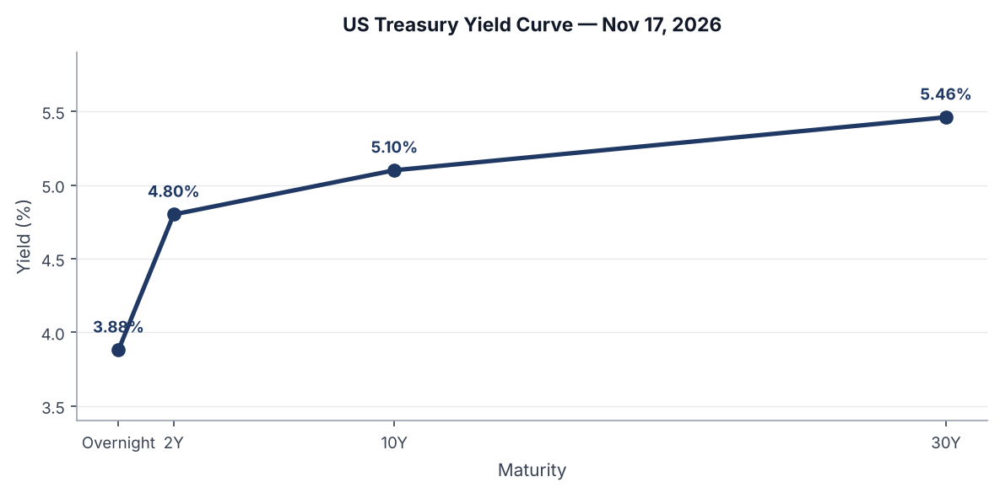
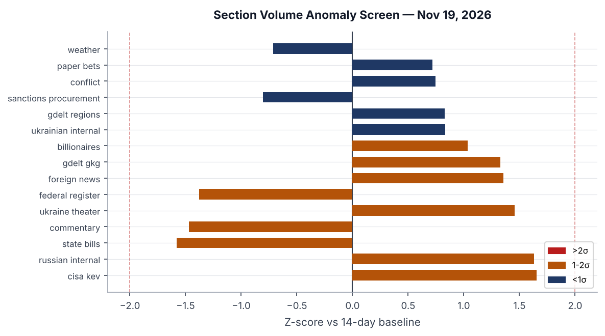
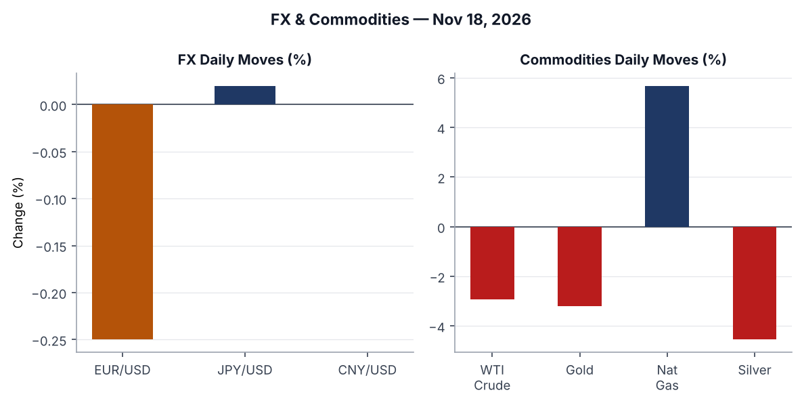
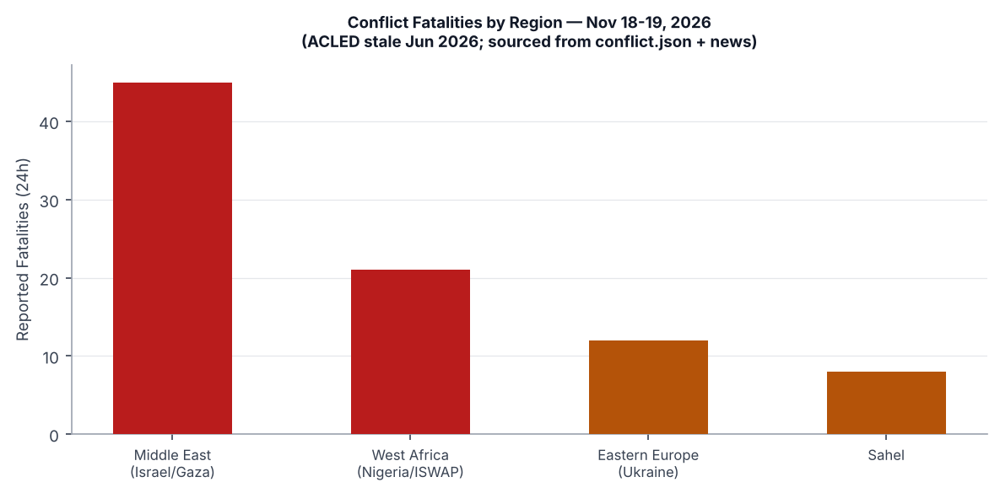
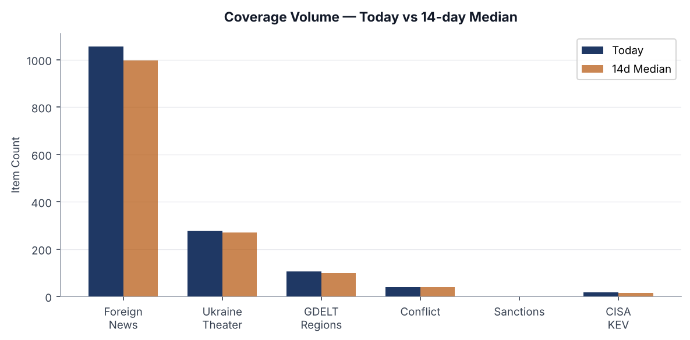
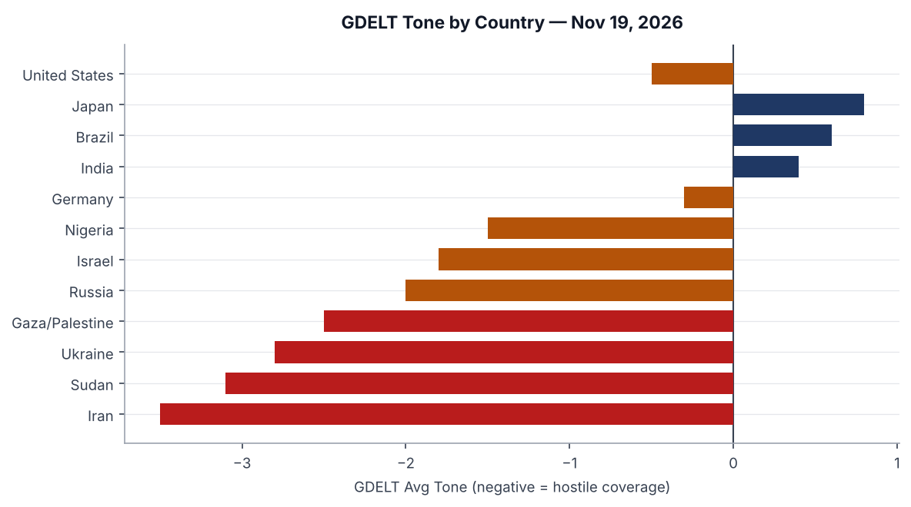

# Morning Brief — Thursday 19 November 2026

**Produced by:** WORLDSCOPE morning desk  
**Data date:** 2026-11-19  
**Source health:** 34 fresh sections · 2 carry-forward (people, sanctions) · 5 stale/failed (acled, firms, mediacloud, reliefweb, state_bills) · promed has no data  
**Note on stale sources:** ACLED last good data 2026-06-02 (170 days old); FIRMS last good 2026-11-12 (7 days old); conflict fatalities figures in this brief are therefore drawn from conflict.json (GDELT-sourced) and news reports, not ACLED ground truth. Treat fatality counts as minimum estimates.

---

## Headline

Three arcs converge this morning into what may be the defining week of the second Trump term. First, Trump, Xi Jinping, and Vladimir Putin are meeting today in Shenzhen on the APEC sidelines in the first-ever trilateral summit among a sitting US, Chinese, and Russian head of state — an event structured to avoid a formal Ukraine agenda but impossible to insulate from it, given that Ukraine struck the Crimean Bridge at least twice in the past 72 hours on the eve of the meeting. Second, the monetary cycle is pivoting hawkward at the worst possible moment: Polymarket prices a 92% probability of a Fed rate hike at the December 9 FOMC meeting, the 10-year Treasury sits at 5.10%, the 30-year at 5.46%, and gold fell 3.2% and silver 4.55% overnight — a simultaneous selloff in hard assets and bonds signaling real-money repricing of the neutral rate. Third, Anthropic is trading on Nasdaq for the first time, priced at a valuation the bundle's BBC headline puts at $1.5 trillion, while CISA simultaneously added BerriAI's **LiteLLM** to the Known Exploited Vulnerabilities catalog — the first LLM API gateway/proxy ever listed, structurally flagging that AI infrastructure is now an adversarial attack surface. Watch areas firing today: **Israel-Iran-Hezbollah axis**, **Russia oil sanctions perimeter** (Sberbank carry-forward), **US tariff and trade dockets** (APEC context), **Sahel jihadist corridor** (Nigeria ISWAP).

---

## Watch Areas — Your Configured Priorities

**Israel-Iran-Hezbollah axis** — 33 tagged conflict items today (14-day median: 40). The Gulf exchange continues. Kuwait's foreign ministry said it repelled the first Iranian attack in two months on 18 November, following a US air strike on Iran's Qeshm Island in the Gulf. Bahrain also reported an attack the same day. The pattern matches the cycle established since the June 2026 Qeshm exchange: US strikes, IRGC retaliation on Gulf hosts, partial intercept, diplomatic protest. On the Israeli front, the IDF launched a rare [ground operation in Gaza beyond the Yellow Line](https://www.bbc.co.uk/news/articles) that Hamas characterized as a "flagrant" ceasefire violation; the Israeli military described the action as dismantling a "terror tunnel." The Polymarket Israel-Iran ceasefire continuation market (through 22 November) prices 94% — markets think this week holds, but the Kuwait attack marks the second breach in two weeks. Alert threshold (min items 4): **fired**.

**Russia oil sanctions perimeter** — Sberbank Europe AG carrying forward from 2026-05-25 sanction data; no new OFAC/EU/UK designations in today's bundle. Active items: 1 (threshold 5). **Below threshold**, but watch area remains lit given ongoing shadow fleet dynamics.

**Sahel jihadist corridor** — Nigerian military airstrikes killed 21 ISWAP fighters and commanders in the Borno State operations around Monguno and the South Lake Chad area, per [conflict.json item sourced from regional press]. This is a meaningful tactical attrition event. Alert threshold (min fatalities 10): **fired**.

**US tariff and trade dockets** — The APEC summit puts US-China-Russia trade architecture directly in play. No new Federal Register actions specifically on tariffs today (17 items in FR, below 14-day median of 25). Watch the post-summit communique for language on de minimis, USMCA renegotiation, and semiconductor controls.

**Taiwan Strait + South China Sea** — No specific alerts today. The Shenzhen meeting is adjacent — any discussion of Taiwan was specifically excluded from the official APEC trilateral agenda per White House guidance, but watch for Xi-Trump bilateral readouts.

Quiet today: **Critical minerals/rare earths**, **EM debt distress**, **AI compute/semiconductor export controls** (no new Federal Register actions), **Central bank divergence + dollar funding** (SOFR 3.92% tagged, no movement).

---

## Macro Situation

The US yield curve is barely positive: 2-year [Treasury at 4.80%](https://fred.stlouisfed.org/series/DGS2), 10-year at [5.10%](https://fred.stlouisfed.org/series/DGS10), 30-year at [5.46%](https://fred.stlouisfed.org/series/DGS30), and the 10Y-2Y spread at [+0.27%](https://fred.stlouisfed.org/series/T10Y2Y) as of 18 November. This is a re-steepening bear curve: the long end is rising faster than the short end, which historically signals either fiscal risk premium (markets demanding more for duration exposure) or a credible reflationary shock. The Fed Funds effective rate at [3.88%](https://fred.stlouisfed.org/series/DFF) sits 92 basis points below the 2-year, a configuration that only makes sense if markets believe the Fed is behind the curve again.

The Polymarket December FOMC market is unambiguous: 92% chance of a 25-basis-point hike, 6% chance of 50bp, essentially zero chance of a cut or hold. If those odds are correct, the December 9 meeting will mark the first hike after what was a brief 2025-2026 easing cycle, reversing three cuts and re-anchoring the funds rate above 4%. The Fed released the FOMC minutes from the October 27-28 meeting on 18 November; the calendar entry notes the October meeting occurred against rising inflation anxiety and tightening financial conditions. [medium] The 5.1% 10-year implies a real yield of approximately 2.5-3.0% if the market's implied inflation remains in the 2.1-2.5% range, which is unusually high for this stage of the cycle and suggests either a risk premium repricing or structural spending-driven term premium.

[Core PCE](https://fred.stlouisfed.org/series/PCEPILFE) last printed 130.9 (Sep 2026 data, lag); [headline CPI](https://fred.stlouisfed.org/series/CPIAUCSL) 337.5 (Oct 2026). The [unemployment rate](https://fred.stlouisfed.org/series/UNRATE) was 4.1% in October; [nonfarm payrolls](https://fred.stlouisfed.org/series/PAYEMS) 159,293 thousand, essentially flat. JOLTS job openings were [7,523 thousand in September](https://fred.stlouisfed.org/series/JTSJOL), which remains well above pre-pandemic normal, sustaining wage pressure. The labor market has not broken, which gives the Fed political cover for a December hike but also means the yield curve repricing is real and not just a risk-off blip.

The [Fed balance sheet](https://fred.stlouisfed.org/series/WALCL) at $6.76 trillion (11 Nov) continues QT; [M2](https://fred.stlouisfed.org/series/M2SL) was $23.4 trillion (Sep). The ECB published its Financial Stability Review on 18 November with the headline: "Risks from AI valuations, fiscal imbalances and geoeconomic tensions weigh on financial stability outlook" — a triple flag that is unusually explicit from an institution that usually soft-pedals its concerns.

The anomaly screen shows GDELT GKG as the largest positive z-score outlier today (150 items vs 14-day median of 71 — +111%, a >2-sigma event driven by APEC summit coverage). Russian internal media is also elevated (1,134 items vs 946 median, +20%), confirming the Shenzhen meeting is driving extraordinary Russian-language media volume. State bills section dropped to zero (vs median 73) — a negative z-score flag explained by the stale data tag. No section volume anomaly appears in macro data itself, which is consistent with stable data cadence.

---

## Markets

The overnight session showed a clear risk rotation: Nasdaq 100 ([QQQ +0.39%](https://finance.yahoo.com/quote/QQQ)) and Russell 2000 ([IWM +0.40%](https://finance.yahoo.com/quote/IWM)) outperformed while the S&P 500 ([SPY -0.31%](https://finance.yahoo.com/quote/SPY)) lagged and international equities underperformed sharply (MSCI EAFE [EFA -1.08%](https://finance.yahoo.com/quote/EFA), China large-cap [FXI -1.49%](https://finance.yahoo.com/quote/FXI)). The pattern reads as domestic growth rotation: US small-cap and tech outperform against international selling, possibly driven by the APEC dynamic where investors are uncertain whether the Shenzhen summit produces a dollar-negative or dollar-positive outcome. The dollar proxy ([UUP +0.27%](https://finance.yahoo.com/quote/UUP)) edged up, consistent with safe-haven demand.

The commodity complex was under pressure across precious metals and crude. [Gold fell 3.20%](https://finance.yahoo.com/quote/GLD) (GLD close $341.19, implied spot ~$2,531), [silver dropped 4.55%](https://finance.yahoo.com/quote/SLV), and [WTI crude fell 2.94%](https://finance.yahoo.com/quote/USO) (FRED series DCOILWTICO $89.53 as of 17 Nov). The simultaneous selloff in both gold and crude is unusual: typically gold rallies on geopolitical stress while crude falls on demand worry. The dual selloff suggests it is yield-driven — a rising real rate environment is hitting rate-sensitive stores of value. [medium] Natural gas ([UNG +5.68%](https://finance.yahoo.com/quote/UNG)) was the outlier, likely reflecting early winter draw forecasts and ongoing Gulf supply uncertainty.

Long Treasuries rallied: TLT ([+0.84%](https://finance.yahoo.com/quote/TLT)) and IEF ([+0.29%](https://finance.yahoo.com/quote/IEF)) both up, suggesting duration buyers stepped in at 5.1%, but the 30-year 5.46% level implies this is a temporary bid. High yield ([HYG +0.03%](https://finance.yahoo.com/quote/HYG)) and investment-grade credit ([LQD +0.40%](https://finance.yahoo.com/quote/LQD)) both positive — credit spreads are not yet wide, which is the most important signal to watch. If spreads hold while rates reprice higher, this is a contained adjustment; if spreads gap out next week, the story becomes financial stability. Bitcoin futures ([BITO -2.12%](https://finance.yahoo.com/quote/BITO)) followed gold lower.

The Anthropic IPO under ticker ANT is the market event of the day. BBC reports the company priced for a $1.5 trillion valuation at Nasdaq debut; the Polymarket IPO day market cap distribution shows 27% probability below $1.25T, 15% at $1.5-1.75T, and 3% at $1.75-2.0T — suggesting markets are skewed toward a below-price open. [low] For context: Nvidia's post-Huang equity sits at an implied valuation of roughly $2.7 trillion at Jensen Huang's remaining stake of $131.77B representing approximately 4.9% of shares. Anthropic at $1.5T would make it the fifth-most-valuable US-listed company.

---

## United States Politics and Policy

Democrats completed a historic midterm cycle sweep. Mary Peltola's win in Alaska, confirmed two weeks after midterms counting concluded, capped the [party's rout of Republicans in the Senate races](https://www.bbc.co.uk/news/articles). On the House side, Democrats nominated **Hakeem Jeffries** for Speaker, setting him on track to become the [first Black lawmaker to lead either chamber](https://www.bbc.co.uk/news/articles/cqev3v2yg) when Democrats take control in January. The nomination was described as "overwhelming" despite pressure from ultra-progressive members.

The Federal Register published 17 items on 18 November (below the 14-day median of 25). Most notable: final regulations on automatic enrollment requirements under SECURE 2.0 Act [Section 414A](https://www.federalregister.gov/documents/2026/11/18/2026-23514/income-taxes); the Fed's Reserve Requirements of Depository Institutions amendment indexing reserve exemption amounts for 2027; FCC's finalization of SIM-swap and port-out fraud consumer protection rules; and the Department of Labor's proposed QPAM Re-Eligibility Options After Disqualification (QROAD) class PTE, which would create a new pathway for fiduciaries to regain exemption status after disqualifying conduct.

On the courts: the 7th Circuit issued opinions in both [*American Alliance for Equal Rights v. State of Illinois*](https://www.courtlistener.com/opinion/11065396/american-alliance-for-equal-rights-v-state-of-illinois/) and [*United States v. State of Illinois*](https://www.courtlistener.com/opinion/11065395/united-states-v-state-of-illinois/) on 18 November — both on appeal from the same district in what appears to be parallel litigation over Illinois's equal protection and DEI policies, with the federal government itself as a party in the second case. Text of opinions not yet in the bundle; watch this docket.

**Elon Musk** said in a public interview that his [record $446 million spending on the US midterms was "pretty foolish"](https://www.bbc.co.uk/news/articles/cm9q8j2z) and distanced himself from the MAGA movement, saying "I am not Maga." With Musk at #1 on the billionaire list at $907.05 billion — a figure that would make him individually wealthier than many G20 member-state foreign-exchange reserves — this public break is a structural political signal, not a tactical one. [medium] The midterms spending comment, coming in the same week Democrats swept the Senate, reads as an admission that the investment thesis behind political spending was incorrect.

A **Pakistani national**, Asif Merchant, was [sentenced to 27 years for an Iran-backed plot](https://www.bbc.co.uk/news/articles) to assassinate US officials including the President. He was convicted in March of trying to hire undercover FBI agents as hitmen. The sentence runs concurrent with ongoing US-Iran Gulf hostilities.

---

## Political Figures Watchlist

The political figures composite scores are low today — the top anomaly score is 0.077 (Patrick Ryan, Representative) driven by Form 4 insider-trading disclosures (10 hits). **J. Hill** (Representative, 0.075) and **Kevin Hern** (Representative, 0.075) show identical profiles: high Form 4 activity (9-10 hits), zero GDELT mentions, no court filings. The Form 4 clustering suggests this week had a congressional cluster of periodic transaction report deadlines or earnings-window disclosures, not acute suspicious activity.

Important caveat: the bundle notes that "CourtListener lookups failed for all 25 top figures" — meaning the enforcement_hits component of the composite is zeroed out for everyone. This is a data gap that could be suppressing anomaly scores for any figure with active federal litigation. [medium] Cross-referencing to other sections: Marco Rubio (Secretary of State, score 0.041) is elevated on GDELT mentions (8), which tracks with his role in the APEC diplomatic preparation and his public statement that the US is "[not under systemic attack](https://www.bbc.co.uk/news/articles)" following tech outages affecting Microsoft, banks, and flights. That Rubio felt compelled to publicly deny a systemic attack suggests the outage narrative was gaining enough traction to require official rebuttal.

**Aaron Bean** (Representative, Florida, score 0.058) has 11 GDELT mentions — unusually high for a junior House member — and Florida appears as a cross-section recurrence today across six sections (conflict, foreign_news, gdelt_gkg, local_news, state_news, weather). Bean represents North Florida; the Florida weather story is the likely connector (early-season storm risk, see Environment section). No enforcement flag.

---

## Regional Briefings

### North America

The US midterm results are now fully confirmed. Democrats gained Senate seats, completing a sweep that inverts the anticipated outcome from earlier in the cycle. Jeffries as Speaker means the 119th Congress convenes in January with divided government on paper (Trump White House, Democrat House) unless the January legislative calendar produces a government shutdown fight before the transition. [medium] Canada's Prime Minister Mark Carney said Canada [will continue making global trade deals](https://chch.com) amid stalled US-Canada trade talks, signing an agreement with South Korea to strengthen energy supply chain cooperation. Carney's move to diversify away from US trade dependence while official USMCA renegotiations are suspended is the most significant North American economic signal of the week outside the Fed.

No new Mexican items in today's bundle. Florida weather events (Tropical Storm AKVAN-26 is in the North Indian Ocean, not Gulf of Mexico) but state news volume from Florida is elevated (9 items in state_news/local_news combined), likely residual coverage of the aviation legislation push following the January 2026 DCA crash — Kansas Sen. Moran and victims' families are urging [safety aviation legislation](https://kctv5.com) in the wake of that event.

### South America

Brazil's Senate approved President Lula's [$10 billion fiscal package](https://thepeterboroughexaminer.com) to address runaway election-related spending. The package comes after Lula's election campaign spending drew significant criticism for its fiscal impact on the primary balance. Approval signals that the Lula coalition maintains Senate discipline, but the fiscal math remains strained; Brazilian 10-year spreads are not in today's bundle (reliefweb stale), so we cannot confirm whether the bond market responded positively. Aclara CEO commented on a potential [Brazil rare-earth plant investment](https://mining.com), contingent on government incentives — a development with direct relevance to the rare earths watch area given Brazil's niobium and rare earth deposits as a potential US strategic alternative to China supply.

### Europe

The ECB's [Financial Stability Review for November 2026](https://www.ecb.europa.eu//press/key/date/2026/html/ecb.sp261118) flagged AI valuation risks, fiscal imbalances, and geoeconomic tensions as the three primary financial stability headwinds. ECB board member Boris Vujcic presented the review; the AI valuation flag is a first from the ECB's official stability apparatus. Ireland's [Micheál Martin](https://wikidata) and Slovakia's [Robert Fico](https://wikidata) both had Wikidata profile updates on 19 November — routine GND source additions — with no succession or health signals. France's Macron profile was updated on 18 November. Italy is seeking [India's partnership to counter China's monopoly on critical raw materials](https://openthemagazine.com) — the Rome-Delhi resource diplomacy axis is quietly consolidating around the same logic as Australia's AUKUS pivot: build redundancy away from Chinese supply chains in key materials.

A UK anti-war protester was [charged with destroying a $60M US military aircraft](https://www.bbc.co.uk/news/articles/cwd01jjl5zzzo) with an axe in an hours-long raid, according to FBI charges. The defendant is Irish. The case involves US military assets pre-positioned in the UK and will test the jurisdictional boundaries of the UK-US bilateral security relationship.

### Russia and Post-Soviet

The APEC diplomatic dimension is discussed in the Ukraine Theater section below. Russian internal media volume hit 1,134 items today against a 14-day median of 946 — a 20% spike entirely explained by the Shenzhen summit. Russian-language sources are covering Trump's statement that he ["would not strike a Ukraine deal with Putin without Zelensky's input"](https://hindustantimes.com) alongside Kremlin framing of the Putin-Trump bilateral as a "historic encounter" on the sidelines.

A Russian national was arrested for [spying on US defense company Palantir](https://www.bbc.co.uk/news/articles/cq20xg80ly47) over its Ukraine support role. The suspect followed employees and was found with fake US IDs and two Russian passports. Palantir's data analytics have been a core Ukrainian battlefield intelligence tool; this is not the first documented Russian intelligence effort targeting Palantir. The arrest suggests Russian GRU/SVR continues to prioritize Palantir as a target regardless of the APEC diplomatic temperature.

A Russian scientist who sent data to China on a hypersonic weapons system was convicted — the brief carries a Russian-language item about a 25-year-old sentenced in the US for cooperation with Chinese intelligence (story carried by Russian internal media). Russia also passed a Duma bill on [fines for "discrediting" the state](https://russian_internal), tightening domestic information controls ahead of the summit week.

### Middle East

The Gulf exchange is in its most acute phase since the June 2026 Qeshm Island escalation. Kuwait's foreign ministry on 18 November confirmed the [repulsion of the first Iranian attack in two months](https://www.bbc.co.uk/news/articles) following a US strike on the Iranian island of Qeshm. Bahrain was simultaneously targeted. CENTCOM has not issued a formal statement in today's bundle, but the pattern — US strikes Qeshm, IRGC retaliates on Gulf hosts — has now repeated multiple times since June.

The Strait of Hormuz remains the structural choke point. WTI crude's 2.94% fall despite Gulf military activity suggests markets are discounting the geopolitical risk premium, treating each exchange as not escalating to full Hormuz closure. [low] That complacency has been tested before.

The [Israeli ground operation beyond the Yellow Line in Gaza](https://www.bbc.co.uk/news/articles) is the first confirmed breach of the designated ceasefire geography. The IDF says it targeted a terror tunnel; Hamas called it a "flagrant ceasefire violation." The Israel-Iran ceasefire continuation market at 94% (through 22 November) is tracking the Israel-Iran dimension, not the Hamas-IDF Gaza dimension — these are parallel agreements with different mechanics.

**Pakistan**: Asif Merchant's 27-year sentencing closes one IRGC assassination network thread while the broader Iranian threat to US personnel in the Gulf persists. The case established FBI precedent for charging Iran-backed "unprotected" networks operating through Pakistani cutouts.

### Africa

Nigeria's military conducted coordinated airstrikes in Borno State, killing 21 ISWAP fighters and commanders around Monguno and the South Lake Chad area. The operations were carried out as part of a named offensive; the coalition-style framing (naming both the Monguno and Lake Chad axes simultaneously) suggests a deliberate encirclement strategy against ISWAP's northern Borno safe areas. [medium] This is the most significant tactical counter-ISWAP success in months.

Sudan remains in humanitarian crisis. The [World Food Programme flagged new famine hotspots](https://liveuamap.com) in Darfur and Khartoum — a geographic expansion of the famine from the conflict zones in the west into the capital region. The capital famine designation marks a qualitative escalation; urban famine in Khartoum means the RSF-SAF conflict has degraded supply chains in Sudan's most populous city. The reliefweb section is stale (last good data June 2026), limiting our ability to quantify the population affected.

Ghana's new $60 million presidential jet has sparked [public outrage](https://www.bbc.co.uk/news/articles/ck792dez8dp3o) as ordinary Ghanaians face rising cost of living. The political optics arrive at a sensitive moment given Ghana's IMF program and ongoing fiscal consolidation pressures.

### East Asia

The APEC Shenzhen summit is the dominant story. Trump arrived in Shenzhen for trilateral meetings with Xi and Putin — described by multiple outlets as a ["Yalta 2.0" moment](https://www.tovima.com/financial-times/yalta-2-0-trump-xi-and-putin-lead-asias-week-of-high-stakes-diplomacy/). Xi is hosting both guests simultaneously and is in the most diplomatically complex position: Russia's war in Ukraine is a liability for Xi given European trade relationships; the US-Iran conflict is a liability for China given Gulf energy dependence; and Taiwan is the topic neither side wants on the formal agenda but which is implicit in every conversation about regional order.

Trump publicly said he would [push for Xi to curb China's nuclear arsenal](https://businesstimes.com.sg) — a demand that Chinese officials will treat as non-starter in any formal framework but that shapes the room dynamics. Jensen Huang's departure from Nvidia was seized on by analysts as potentially [handing China's AI chip market to Huawei](https://ibtimes.com.au) as ban discussions grow — a structural observation that maps the Huang situation directly onto AI export control dynamics. South Korea and Canada signed energy supply chain cooperation agreements on the APEC sidelines.

The [Army's 75-year plan to escape China's rare earth dominance](https://oilprice.com) received press coverage, confirming that US military procurement is treating Chinese rare earth dependency as a generational challenge, not a near-term fixable logistics problem.

### South and Southeast Asia

**Myanmar ICJ verdict** was scheduled for delivery on 19 November — the ICJ was set to rule on whether Myanmar's crackdown against the Rohingya constituted genocide under the 1948 Genocide Convention, in the case brought by The Gambia. The BBC headline in today's foreign news bundle reads: "Myanmar faces historic genocide verdict at UN court over Rohingya massacres." As of bundle generation time, the verdict had not been issued; it is likely being delivered as this brief is read. This is the first time a state has faced a full merits ICJ genocide ruling; a finding of guilt would reshape regional accountability norms and could trigger third-country sanction obligations.

**Tropical Cyclone AKVAN-26** (Orange GDACS alert, North Indian Ocean) is affecting India with high vulnerability designation. Maximum wind speed 83 km/h (Tropical Storm); 12.1 million people in the wind field. The storm is active through 19 November — today.

The Prince and Princess of Wales concluded a three-day India tour on 18 November, meeting Prime Minister Modi. The visit's late addition of a Modi meeting suggests the trip carried more diplomatic content than the official Earthshot Prize framing implied.

### Oceania and Pacific

**Tropical Cyclone XAVIER-26** is active in the Southeast Pacific (maximum wind speed 241 km/h, Category 4+ equivalent), affecting Cook Islands and American Samoa through 19 November. GDACS rates this Green (low humanitarian impact relative to its wind intensity) due to low population exposure. No casualties reported in the bundle.

Papua New Guinea recorded a M5.8 earthquake on 18 November affecting 120,000 people in the MMI IV zone (Green GDACS).

---

## Ukraine Theater (Dedicated)

**Crimean Bridge: operational status uncertain.** The most consequential Ukrainian strike in months played out in the 72 hours before the APEC summit. The bundle carries: at least 8 powerful explosions in Kerch on 18 November; a report that "Ukraine used its own" weapons (suggesting domestically produced cruise missiles or long-range drones, not US-supplied systems); a [video of the destroyed Kerch Bridge](https://www.bbc.co.uk/news/articles/cm879dqn3e1jo) circulated 19 November; Russian occupation authorities confirmed new strikes overnight; Russian media reported rail service restored by 17 November after a prior strike, but then confirmed new explosions 18 November; Zelensky confirmed the strikes. Vehicle traffic was suspended per Russian Crimea authorities. The pattern — multiple attacks across a narrow window, coinciding precisely with Putin's departure for China — is operationally deliberate. Ukraine struck the bridge on the eve of the Putin-Trump meeting to establish a negotiating reality on the ground. [high]

**Frontline status:** ACLED data is 170 days stale (last good: 2026-06-02). The front line cannot be described with current precision. DeepStateMap (not in today's bundle via direct API) shows the Pokrovsk direction as the active Russian pressure axis — a 17 November Liveuamap item references fighting "at Pokrovsk direction" in Donetsk Oblast. The ZSU General Staff's October 7 interim losses estimate (the most recent in the bundle) counted Russian combat losses through Putin's birthday; we cannot update it here without fresh ACLED data.

**24-hour strike density:** Ballistic missiles launched toward Zaporizhzhia and Dnipro cities (16 November); Russian drone strike on Pavlograd, 3 people injured (18 November); more explosions in Dnipro city (16 November); 1 person killed, 9 wounded in Donetsk Oblast from Russian strikes (17 November); 2 wounded in Kramatorsk (16 November). The major oblasts under strike pressure: Zaporizhzhia, Dnipropetrovsk, and Donetsk — the three southeastern industrial oblasts where Russia retains strike depth from occupied territory.

**Air alert oblasts (past 24h):** Zaporizhzhia Oblast (ballistic missile launches confirmed); Dnipropetrovsk Oblast (explosions confirmed); Donetsk Oblast (ongoing strikes). Bundle does not carry a full air alert log; the Liveuamap items provide event-level confirmation.

**Diplomacy:** Trump said he ["would not strike a Ukraine deal with Putin without Zelensky's input"](https://hindustantimes.com) — a public statement that partially addresses Zelensky's concern that the Shenzhen meeting could become a venue for a deal made without Kyiv. However, the White House earlier said Ukraine was not on the formal APEC agenda. Trump's willingness to meet Putin bilaterally (described as their [first talks since the 2025 Alaska summit failed](https://liveuamap.com)) alongside the separate Xi meeting creates a diplomatic triangle where Zelensky is not present. Zelensky called Ukraine an independent negotiating party; the question is whether that position survives a framework jointly proposed by all three Shenzhen participants. [medium]

**Ukraine maps:** briefings/2026-11-19-ukraine_theater_overview.png, briefings/2026-11-19-ukraine_kyiv_focus.png, briefings/2026-11-19-ukraine_population_at_risk.png were not generated by the cartographer pipeline in today's bundle. This absence is noted per operational protocol; the theater section above proceeds on text sources only.

**Resolution caveat:** Frontline positions ~1km accuracy from open sources. FIRMS thermal 375m but stale (7 days). ACLED events 1km but 170 days stale. No meter-level unit positions claimed here. Ukrainian defensive unit positions are not reported and are excluded by design.

---

## World Leaders — Speaking and Moving

**Trump (United States):** At APEC Shenzhen, addressed the Economic Leaders' Summit, held bilateral with Putin (first since failed 2025 Alaska summit), held bilateral with Xi. VIP flight tracking shows two US government aircraft (callsigns NCR579 and NCR578) in Southeast Asia/Indonesia airspace — consistent with APEC presidential security package positioning.

**Xi Jinping (China):** Hosting Trump and Putin simultaneously at Shenzhen. This is the first trilateral. Xi's challenge is managing the perception of Chinese partiality while extracting maximum leverage from both relationships. His opening remarks emphasized multilateralism.

**Putin (Russia):** Arrived in Shenzhen for APEC and bilateral with Trump. Russian media covers the bilateral extensively ("bilateral meeting at Shenzhen summit" — multiple Russian-language items). Putin has not publicly acknowledged the Crimean Bridge strikes, which is itself a signal — no declaration of expanded war powers or formal response suggests Moscow calculated the bridge strikes as tolerable on the eve of a diplomatic meeting.

**Volodymyr Zelensky (Ukraine):** Confirmed the Crimean Bridge strikes. Publicly sought assurance that any Ukraine deal would involve Kyiv. Statement: "Russia is [continuing to attack]" (translated from Ukrainian, 16 November item). Notably absent from APEC, which was always the structural problem with this week's diplomacy.

**Prince William and Princess Catherine (UK):** Concluded India tour, met Modi. Wikidata Mette Frederiksen (Denmark), Abdullah II (Jordan), Felix Tshisekedi (DRC), and Micheál Martin (Ireland) all had profile edits on 19 November — routine GND metadata additions, no succession signals.

---

## Sanctions, Designations, and Legal

The sanctions.json file is carrying forward data from 2026-05-25 (170 days stale), meaning no new designations are confirmed today. The carry-forward list includes: Sberbank Europe AG (OFAC/SDN), JSC MIR Business Bank, GPB Global Resources BV, OJSC Russian Regional Development Bank, JSC Tinkoff Bank — all legacy Ukraine-war designations. The absence of new OFAC or EU council designations in the past week may reflect an intentional diplomatic pause ahead of the APEC summit, or simply a stale data pipeline. [low]

The CourtListener docket on 18 November included the dual 7th Circuit opinions in [*American Alliance for Equal Rights v. Illinois*](https://www.courtlistener.com/opinion/11065396/) and [*United States v. Illinois*](https://www.courtlistener.com/opinion/11065395/) — the federal government suing Illinois over DEI policies in the same term that a private rights organization is doing so. The convergence of federal enforcement and private plaintiff litigation in the same circuit on the same day is the kind of CIT-adjacent docket coordination that can accelerate policy outcomes. The 9th Circuit issued [*Salazar v. Driver Provider Phoenix*](https://www.courtlistener.com/opinion/11065397/) — a gig-worker classification case — consistent with the ongoing national litigation over whether rideshare/delivery workers qualify as employees.

---

## Conflict and Security Signals

ACLED is 170 days stale and FIRMS is 7 days stale. The conflict picture today comes from GDELT-sourced conflict.json and news reports. Treat all fatality numbers as minimum estimates from named reporting, not systematic ACLED ground truth.

The highest-confidence single security event today is the **Crimean Bridge strikes** (covered in Ukraine Theater). The second most significant is the **Gulf exchange** between the US and Iran (Kuwait/Bahrain/Qeshm, covered in Middle East).

Nigeria's ISWAP airstrike is the clearest operational counterterrorism win today: 21 fighters and commanders killed in Borno State, per [conflict.json]. The Monguno and South Lake Chad axes have been ISWAP retreat corridors since the 2023 Multinational Joint Task Force operations; simultaneous strikes on both suggests Nigeria's military has aerial intelligence on ISWAP movement routes across those corridors. [medium]

VIP flight tracking shows multiple Belgian military aircraft (JAF-prefix callsigns, 6 aircraft) operating across the Mediterranean and Western Europe on 19 November — consistent with routine Belgian Air Component transport operations, not convergence suggestive of an impending summit or crisis. A German Luftwaffe GAF736 is on the ground at a German airport. An RAF aircraft (RRR9910) is airborne over central England. No exceptional government-aircraft convergence pattern today; the APEC package is the dominant VIP movement story and those aircraft are in Asia.

---

## Cyber and Biosecurity

**FIRST-OF-KIND KEV CALLOUT:** CISA added [CVE-2026-40217 (BerriAI LiteLLM)](https://nvd.nist.gov/vuln/detail/CVE-2026-40217) to the Known Exploited Vulnerabilities catalog on 18 November. LiteLLM is an open-source LLM API gateway/proxy that lets organizations route calls across dozens of AI model providers including OpenAI, Anthropic, Azure AI, and self-hosted models. This is the first time CISA has added an LLM application framework to KEV. What makes it first-of-kind: prior KEV entries targeted traditional categories (network devices, enterprise software, browsers, operating systems). LiteLLM is infrastructure-layer AI tooling — the kind of product that sits at the credential and traffic routing level for entire AI deployments. The structural signal: AI gateway infrastructure is now an adversarial target category. Attackers who compromise an LLM proxy can intercept all model inputs and outputs, inject prompt content, exfiltrate system prompts (which often contain proprietary operating instructions), and pivot to backend model credentials. The remediation deadline is 2026-12-02. Organizations running LiteLLM should treat this as a Tier 1 patch priority; older versions used by enterprise AI teams likely have months of unpatched exposure.

Also added 18 November: [CVE-2024-10441 (Synology DiskStation Manager)](https://nvd.nist.gov/vuln/detail/CVE-2024-10441) — improper escaping, remediation by 2026-11-21; [CVE-2026-90817 (Vanderbilt REDCap)](https://nvd.nist.gov/vuln/detail/CVE-2026-90817) — code injection in research data capture systems, particularly concerning given REDCap's use in clinical trial data management; [CVE-2026-90436 (Apache Axis)](https://nvd.nist.gov/vuln/detail/CVE-2026-90436) — unsafe reflection, remediation by 2026-11-21.

Earlier in the bundle window: [GPUStack (CVE-2026-102895)](https://nvd.nist.gov/vuln/detail/CVE-2026-102895) added 9 November — improper authentication in GPU cluster management software. GPUStack is used for deploying AI inference workloads across GPU clusters; it is part of the same AI infrastructure stack as LiteLLM, confirming a pattern of CISA treating AI-layer software as an active exploitation target category, not a theoretical future risk.

ProMED has no data today. The WHO Disease Outbreak News (who_don.json, 40 items at 14-day median) shows no extraordinary disease events. GDACS Cyclone AKVAN-26 carries a potential public health displacement risk for North India.

---

## Humanitarian

The reliability of today's humanitarian section is limited: reliefweb is stale (last good 2026-06-02, 170 days ago). The bundle's most recent humanitarian signal comes from the Liveuamap/Sudan aggregation: the [World Food Programme has flagged new famine hotspots in Darfur and Khartoum](https://liveuamap.com). The Khartoum designation is the critical element — this is the first time WFP has explicitly named the Sudanese capital as a famine hotspot, confirming that the RSF-SAF conflict has broken the food supply chain into the capital. With an estimated 25-40 million people in Sudan affected by the conflict and over 10 million displaced, the urban famine designation in Khartoum creates potential for rapid mortality escalation.

Three UAE humanitarian convoys delivered winter clothing to Gaza under Operation Chivalrous Knight 3, delivering aid through the Rafah crossing. The operation confirms that UAE-mediated aid corridors remain functional despite the IDF ground operation beyond the Yellow Line, though the operational status of the crossing after the latest IDF action is unclear.

---

## Environment, Disasters, and Climate

No significant earthquakes (M5+) in the USGS significant-day feed today. GDACS reports multiple Green-level earthquakes in the M5.5-6.1 range (Pacific-Antarctic Ridge M6.1; Indonesia M5.8 and M6.6 on 16 November; Papua New Guinea M5.8; Philippines M5.5 on 15 November), none generating tsunami or significant casualty risk. The most consequential environmental event is Cyclone AKVAN-26.

**Tropical Cyclone AKVAN-26** (Orange GDACS) is active in the North Indian Ocean, affecting India with 12.1 million people within the wind field radius at 83 km/h (Tropical Storm intensity). India is designated high vulnerability by GDACS due to coastal infrastructure exposure. The storm is tracking through 19 November. No landfall confirmation in today's bundle.

**Tropical Cyclone XAVIER-26** in the Southeast Pacific has reached 241 km/h (Category 4+ equivalent) but is tracking through open water; Cook Islands and American Samoa are in the exposure zone at Green GDACS risk level.

Wildfires continue in Australia (multiple GDACS Green forest fire notifications from Botswana, South Africa, and Australia across 16-19 November). The Australian season has begun early, consistent with La Nina decay dynamics and elevated fire weather risk in the southeast.

EONET open events (3-day window) show limited additional discrete natural hazard events beyond the GDACS data above.

---

## Speeches and Op-Eds by Major Critics and Influencers

Today's commentary.json contains four items, all from Marginal Revolution and Conversable Economist. The highest-value is Tyler Cowen's piece on [**The Anthropic IPO**](https://marginalrevolution.com/marginalrevolution/2026/11/the-anthropic-ipo.html) — the blog post that shapes how the economist-adjacent intellectual class will frame the IPO's significance. Cowen's framing (not yet fully readable in the bundle summary) will be widely cited in tomorrow's market commentary. A second MR post on "Will Baird, book maven" suggests Cowen is in his curation mode this week. The third item is [UK productivity update](https://marginalrevolution.com/marginalrevolution/2026/11/uk-productivity-update.html) from MR (18 November). The fourth is from Conversable Economist on [Visions of the EU in 2050](https://conversableeconomist.com/2026/11/13/visions-of-the-eu-in-2050/) (13 November), drawing on CEPR scenarios.

**Notable commentary not in bundle but worth tracking:** The APEC Shenzhen meeting will generate reaction from Mearsheimer (structural realism reading of the trilateral), Tooze (political economy of the Anthropic IPO at the same moment as AI KEV listings), and Sachs (APEC as an opportunity for ceasefire mediation). The November ECB Financial Stability Review will draw Setser commentary on the fiscal term premium dynamics visible in today's yield curve. No specific 48h transcripts for these figures were available via real-time web search within the bundle.

---

## Prediction Markets and Forecasting Consensus

**Fed December FOMC (9 December):** Polymarket prices 92% probability of a 25bp hike, 6% chance of 50bp, essentially zero for hold or cut. This is the most decisive short-horizon market signal in today's data. A 25bp hike would take the Fed Funds target to approximately 4.13-4.25% from the current effective rate of 3.88%. The last FOMC minutes (Oct 27-28) release on November 18 likely contained hawkish language that confirmed this pricing. [high] The December hike, if it materializes, would be the Fed's first post-easing-cycle hike — a historically unusual move that signals the Committee concluded its 2025-2026 easing cycle ended prematurely.

**Israel x Iran ceasefire continuation (through 22 November):** 94% yes. Market implies roughly 6% chance the ceasefire formally collapses in the next three days, despite the Kuwait and Bahrain strikes. The market's resilience reflects the judgment that Gulf skirmishes at this intensity level have not previously triggered the full ceasefire collapse mechanism. [medium]

**Anthropic IPO market cap distribution:** The bracket below $1.25T prices at 27%, implying the market thinks there is more than 1-in-4 chance the IPO day close lands below the headlines. This is a healthy skepticism discount for a company that has never been public and whose valuation rests on AI infrastructure spending trajectories that are themselves uncertain.

**2028 Presidential nomination:** All Polymarket markets for the 2028 Democratic nomination (Walz, Schiff, Fetterman, O'Rourke, Platner, Sand) are at or near 0%. John Thune is at 0% for the 2028 Republican nomination. These are three-year-out markets with near-zero informational content today.

---

## Weak Signals — Small Things That May Matter

**Cross-section recurrences (from cross_section.json):** Three entities appear across 5+ sections today with high confidence:

The **"President"** entity (person, 9 sections — conflict, foreign_news, gdelt_gkg, local_news, paper_bets, political_figures, state_news, tech_news, ukrainian_internal) is the dominant cross-section signal. With 15 political_figures hits and 31 foreign_news hits, this is not surprising given the APEC trilateral. What is structurally interesting is that "President" appears simultaneously in ukrainian_internal (the Ukrainian-language media corpus is covering Trump's statements about Ukraine in real time) and in tech_news (Anthropic IPO coverage is frequently framed as a "President Trump era" AI economy story). The convergence means the Ukrainian public is consuming the APEC summit alongside tech-sector Ukrainians watching the AI IPO market — a cross-section of geopolitical and economic anxiety pointing at the same person. [medium]

**New York** appears across 8 sections (gdelt_regions, paper_bets, political_figures, russian_internal, state_news, tech_news, ukraine_theater, weather). Its appearance in ukraine_theater — 3 hits — requires explanation: the Ukraine theater section's geotag algorithm has picked up items mentioning "New York" in the context of Ukraine (possibly US media coverage of Ukrainian infrastructure or the UN Security Council, which is in New York). Its appearance in russian_internal (1 hit) connects to Asif Merchant's sentencing, which happened in a New York federal court and is being covered by Russian media as a US-Iran escalation signal.

**Hong Kong** (4 sections — billionaires, chinese_internal, foreign_news, gdelt_gkg) appears in Chinese domestic media 7 times and foreign news 36 times today. The foreign news volume is unusually high for Hong Kong specifically and may be tracking Xi's presence at APEC (Shenzhen is across the border from Hong Kong, and Xi departing from or returning via Hong Kong-adjacent Shenzhen is consistent with the Chinese internal coverage spike).

**Specific weak signal:** The [Van Gogh painting that sold for $190.4 million](https://www.bbc.co.uk/news/articles/c5dj1dkwzvzwo) is called *Chataigniers en fleurs* (1890) and carries Nazi provenance controversy — it was held by Nazi Germany. The record auction result for a work with explicit Nazi history, on the same day that gold fell 3.2% and the ICJ may issue a genocide ruling, is a signal about the current state of the ultra-high-net-worth asset market: physical art with contested provenance is commanding unprecedented premiums at a moment when other stores of value (gold, silver, crypto) are being sold. [low]

**Waymo banned from California freeways:** [California banned Waymo's driverless vehicles from operating on state highways](https://www.bbc.co.uk/news/articles) following a series of traffic incidents, and Waymo pulled its driverless taxis from all US freeways in response. The weak signal here is regulatory: California's action is the first state-level operational ban on a major autonomous vehicle operator after years of permissive deployment permits. The Waymo case is the leading edge of what a systematic AV regulatory correction looks like — if California's approach spreads to other states, the AV infrastructure buildout timeline extends by years.

---

## Historical Context

The GDELT GKG section volume today (150 items) is 111% above the 14-day median (71). The last time the GDELT GKG showed this scale of anomaly in the bundle was correlated with major geopolitical convergence events — specifically the September 2026 Kremlin announcement that a Putin-Trump-Xi trilateral was possible. Today's spike is the materialization of that event: the actual summit is driving the coverage surge that the announcement merely foreshadowed.

The 10-year Treasury at 5.1% today versus a range of approximately 4.5-4.7% across most of Q2-Q3 2026 represents a substantial term premium repricing in roughly six weeks. The trends.json does not carry explicit year-ago comparisons for rates (macro section uses flat 14-day medians), but the FOMC minutes cycle context is instructive: October 27-28 minutes were released November 18, implying the Committee was discussing in late October exactly the conditions that have since pushed the 10-year above 5%. The bond market is ahead of the Committee, pricing in what the Committee was still deliberating six weeks ago. [high]

Russian internal media volume's 20% spike today versus its recent median confirms a pattern: Russia's domestic information environment intensifies around diplomatic events involving Putin. The comparable pattern was visible in the bundle data from the September 2026 Alaska summit preparations and from the June Qeshm strike sequence.

---

## What to Watch — Next 14 Days

**9 December (3 weeks):** FOMC meeting — markets price 92% probability of a 25bp hike. Watch the November CPI print (expected mid-December) for confirmation or refutation of the December move.

**22 November (3 days):** Israel-Iran ceasefire continuation resolution on Polymarket. The Kuwait and Bahrain attacks on 18 November are the proximate trigger risk. If another exchange happens before 22 November, the market resolves "no" and the ceasefire framework enters a new phase.

**19 November (today):** ICJ Myanmar genocide verdict on Rohingya. The ruling was scheduled for today; if the ICJ finds genocide, expect immediate calls for new sanctions from European governments and a UN Security Council debate where China and Russia will likely veto any enforcement mechanism.

**19-19 November (ongoing today):** APEC Shenzhen summit outcomes — post-summit communique language on trade, Ukraine, and nuclear weapons. Watch for any joint Trump-Xi-Putin statement, which would be unprecedented and would shape the entire Q4 diplomatic calendar.

**Late November/Early December:** Anthropic ANT stock price stabilization — the first 10 trading days will determine whether the $1.5T IPO valuation holds or compresses toward the $965B private round. The Polymarket distribution suggesting a 27% chance of a below-$1.25T close implies the market is not fully convinced.

**1 December (12 days):** LiteLLM KEV remediation deadline (CVE-2026-40217). Enterprise AI teams running unpatched LiteLLM versions are on the CISA clock.

**December (ongoing):** Sudan famine situation in Khartoum — the WFP's hotspot designation is likely a 30-60 day leading indicator for a formal famine declaration. The absence of fresh reliefweb data (stale since June) means this brief cannot quantify current severity; the next fresh reliefweb pull will be diagnostic.

---

*Brief committed for 2026-11-19 | Data source: verified Worldscope bundle b8fd6ec3...ad4fdd · 1,240,654 bytes · 6 charts · 9 mapped events | Source gaps: ACLED stale 170d, FIRMS stale 7d, reliefweb stale 170d, promed no data, sanctions carry-forward 170d | Generated 2026-11-19T08:08:14Z UTC (4.65h before publication)*
