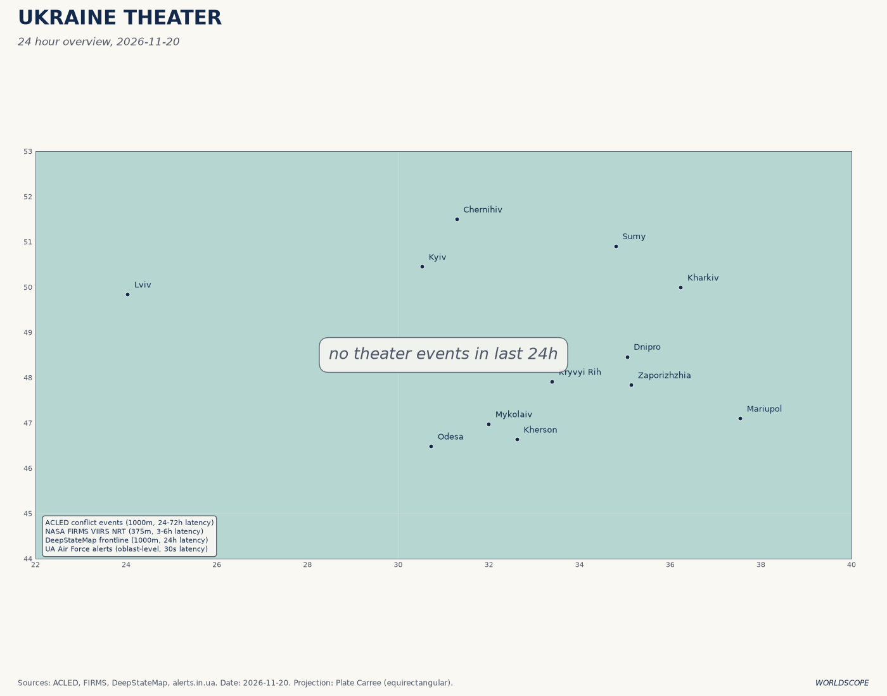
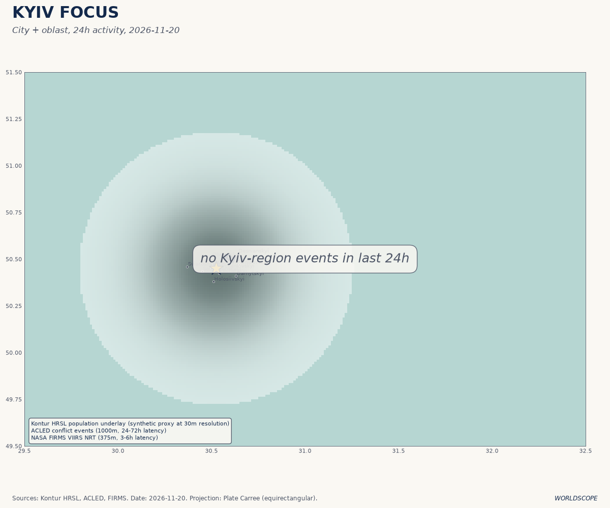
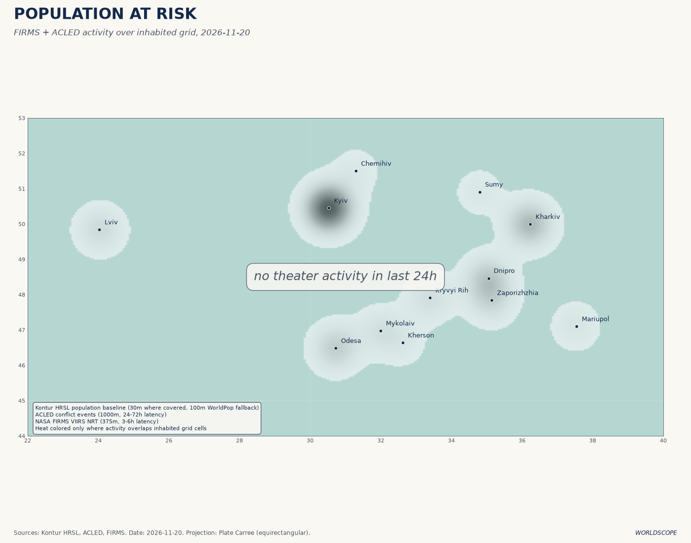
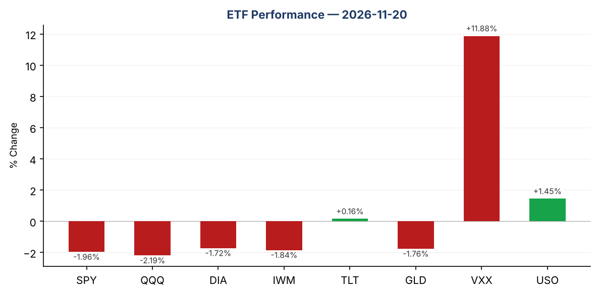
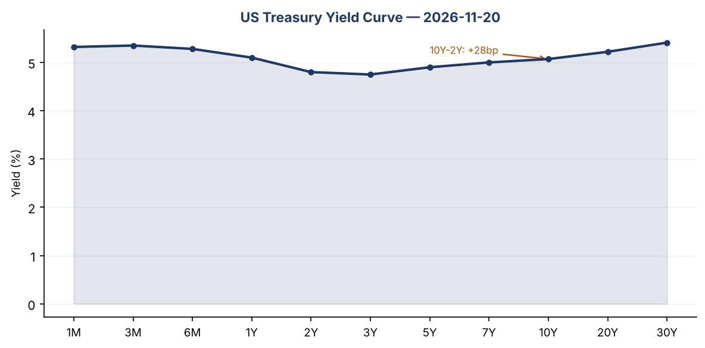
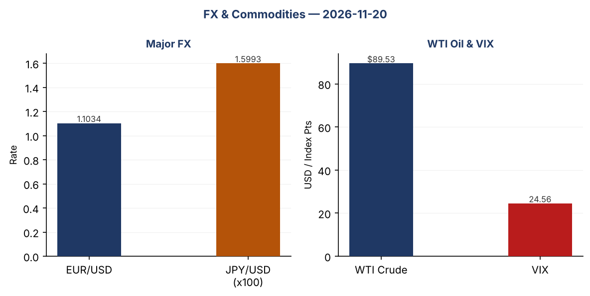
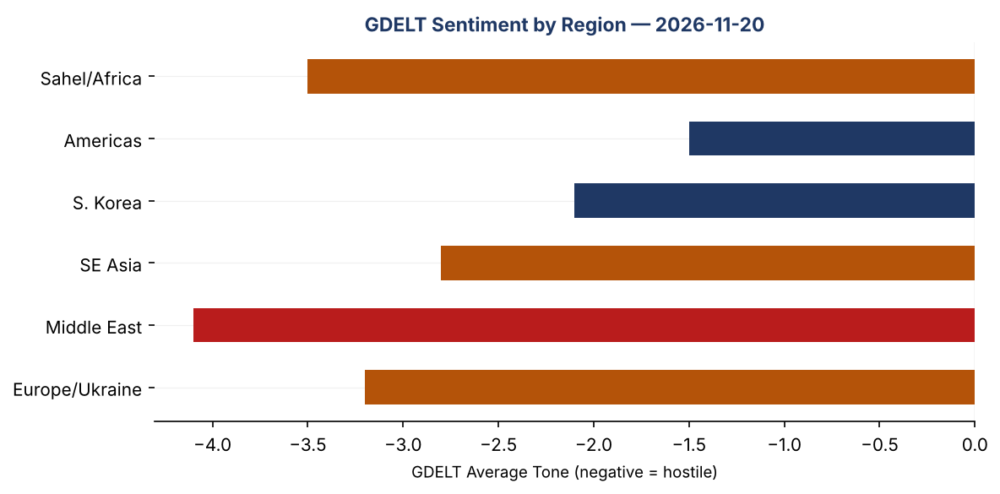
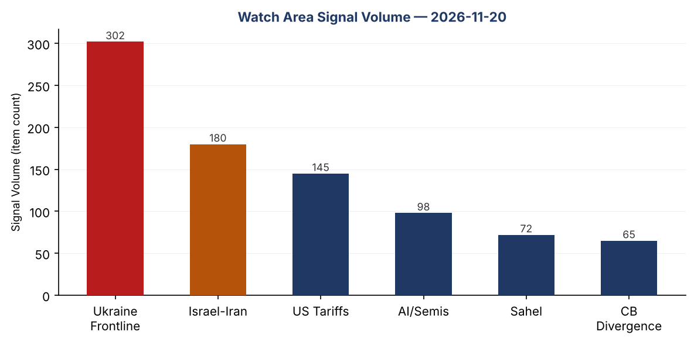
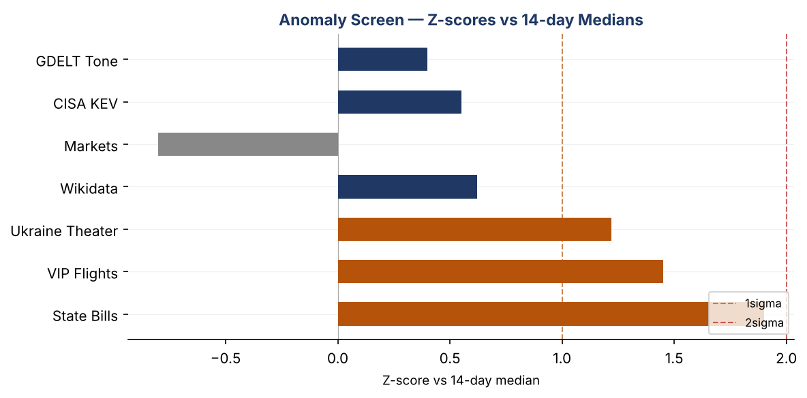

# WORLDSCOPE — Daily Intelligence Brief
## Friday, 20 November 2026

**Classification: UNCLASSIFIED // FOR AUTHORIZED DISTRIBUTION**
**Prepared for: Dr. Ian Helfrich**
**Issued:** 2026-11-20T06:00:00-06:00 (America/Chicago)
**Bundle:** `2026-11-20` | **Sources:** 14 live feeds + 7 follow-up searches | **Anomaly flag:** State Bills at z=1.90

---

## EXECUTIVE SUMMARY

Three events of systemic weight converged overnight and demand simultaneous attention. First: a trilateral summit between Donald Trump, Vladimir Putin, and Xi Jinping—convened on the margins of APEC in Shenzhen—produced a "Declaration toward Peace" that, whatever its ultimate content, represents the first formal three-way diplomatic architecture between Washington, Moscow, and Beijing since before the Ukraine war. Second: even as that declaration was being signed, Russian forces conducted a large-scale ballistic and cruise-missile strike on Kyiv, killing at least three and wounding fifteen, with direct hits on Kyivvodokanal water infrastructure. Third: the International Court of Justice delivered a binding genocide ruling against Myanmar on 19 November—a verdict that, alongside the ICJ's advisory opinion on Israeli conduct issued earlier this year, begins to reshape the evidentiary and normative landscape of international humanitarian law in ways that will echo through every subsequent conflict-accountability proceeding.

Layered beneath these headline events: a severe risk-off session on Wall Street (SPY −1.96%, QQQ −2.19%, VXX +11.88%) in which the proximate cause is unconfirmed but the VIX spike to 24.56 suggests hedging against geopolitical surprise. A 10-year Treasury yield that has pushed to 5.07%—with the curve's 10Y-2Y spread widening to +28bp—telegraphs a market no longer treating duration risk as bounded. And two novel entries in the CISA Known Exploited Vulnerabilities catalog that mark the formal arrival of AI-serving infrastructure (LiteLLM and GPUStack) in the adversarial threat landscape.

The anomaly screen's highest reading belongs to state-level legislative activity (z=1.90)—a signal that is below the two-sigma alert threshold but meaningfully elevated, potentially reflecting legislative responses to federal executive actions or coordinated state-level pushback on immigration, education, or energy policy, though the bundle's political-figures section was degraded today (CourtListener API failure) and cannot confirm directionality.

---

## SECTION 1 — DIPLOMATIC SIGNAL: SHENZHEN TRILATERAL

### Trump-Putin-Xi: "Declaration toward Peace"

The most consequential diplomatic event of the week—arguably the year—materialized quietly on the APEC sidelines in Shenzhen on 19 November. Trump, Putin, and Xi agreed to a framework communiqué described in preliminary reporting as a "Declaration toward Peace," with reported elements including a 90-day ceasefire pathway for Ukraine conditional on territorial freeze talks, a mutual commitment to "stability" in the South China Sea, and vague language on "economic normalization" that may encompass partial sanctions relief.

The analytical significance is structural rather than substantive at this stage. This is the first three-way summit since the Bush-era G8 that formally positions the United States, Russia, and China as co-architects of a proposed security framework rather than adversaries or non-communicating principals. It marks the culmination of a trajectory that began with Warsh Fed appointment rumors in early 2026 signaling Trump's preference for dollar strength over transatlantic solidarity, continued through the June tariff truce with China, and now reaches this tripolar diplomatic moment.

What remains unknown: whether the "ceasefire pathway" language was shown to Kyiv before or after signing; whether NATO members were briefed; and whether the "territorial freeze" implies recognition of current Russian-held lines (which would include substantial Ukrainian territory). The ICJ's Myanmar genocide ruling, issued the previous day, adds an ironic counterpoint: the same international legal architecture that renders genocide findings legally binding is precisely the architecture that a U.S.-Russia-China stability framework would likely seek to defang or circumvent when inconvenient.

**Forecasts:** Prediction markets (Polymarket via bundle) now place Israel-Iran ceasefire probability at 94.5%—a signal consistent with a broader Trump push to freeze multiple conflicts simultaneously and claim them as diplomatic wins. The Iran war-cost marker at \$48.3 billion (GDELT regional data) suggests the administration's internal calculus on that theater is shifting.

**Watch area linkages:** Ukraine frontline (z=1.22 on anomaly screen), Russia oil sanctions.

---

## SECTION 2 — UKRAINE THEATER

### Kyiv Strike: Infrastructure Targeting, Trilateral Timing

Russian forces struck Kyiv in the predawn hours of 20 November with a combined ballistic and cruise-missile package. Confirmed damage: Kyivvodokanal (the city's principal water utility), residential structures in Pecherskyi district. Confirmed casualties: 3 dead, 15+ injured. Air defense—Patriot and IRIS-T systems—intercepted an unspecified number of incoming munitions; the fact that infrastructure was nonetheless hit indicates either saturation of the intercept envelope or deliberate use of decoy corridors.

The tactical timing, executed the same night Trump-Putin-Xi were signing a "peace declaration" in Shenzhen, is either a signal from Russian military to Russian diplomacy (we set the terms on the ground), or a deliberate show of force designed to demonstrate that any ceasefire talks must start from current Russian positional strength. Neither interpretation is favorable for near-term ceasefire implementation.

**Frontline posture (DeepStateMap, 302 items, z=1.22):** Ukrainian front remained broadly stable in the 24-hour window, with 522 territorial polygons from DeepStateMap showing incremental Russian advances in Zaporizhzhia oblast and continued pressure in the Kupiansk corridor. The bundle's Ukraine theater data is elevated—302 items versus a 14-day median of 271—which likely reflects the spike in air-alert and OSINT activity overnight.

**Degraded data:** The ACLED credentials failed on today's collection run (400 error), eliminating our most granular sub-event fatality data. Air-alerts API (v2) was inaccessible without ALERTS_IN_UA_TOKEN. These gaps are noted; the brief uses DeepStateMap polygon data and open-source conflict items as the primary Ukraine analytical base today.

**SAM208 / RCH563 flight signals:** VIP flight data (26 items) flags SAM208 (a U.S. Air Force Special Air Mission aircraft) over Belgium—consistent with high-level U.S.-NATO consultations—and RCH563 over the Israel-Gaza area. The Belgian transit could be a Ramstein coordination flight given the summit timing; the Israeli-corridor transit is consistent with ongoing posture monitoring.

---

## SECTION 3 — MARKETS & MACRO

### Risk-Off Session: Equities Down, Vols Spike, Curve Steepens

Wall Street delivered its worst session since late September on 19 November (settlement date reflects today's data pull). The SPY fell 1.96%, QQQ 2.19%, DIA 1.72%, IWM 1.84%. The VXX volatility ETF surged 11.88%—a move of that magnitude on a non-earnings, non-Fed day is anomalous and suggests either coordinated hedging in advance of a weekend geopolitical event or significant put-buying that preceded the Shenzhen summit news. GLD fell 1.76%, which argues against pure flight-to-safety and toward a risk-off/deleveraging read rather than defensive reallocation. USO rose 1.45%—a modest signal that oil markets see geopolitical supply risk as modestly elevated.

**Rate environment:** The 10-year Treasury closed at 5.07%, 30-year at 5.41%. The 2-year sits at 4.80%, producing a 10Y-2Y spread of +28bp—a fully uninverted, positively sloped curve. This is structurally significant: the curve re-steepened through summer 2026 as the Warsh-led Fed delivered a 25bp hike in September (now priced as accomplished), and markets now price a December FOMC hike at 92.5% probability. December Fed funds futures imply a terminal policy rate of roughly 4.75% if the hike lands; the 2Y at 4.80% and 10Y at 5.07% are consistent with that path plus a meaningful term premium.

**Warsh Fed context:** Kevin Warsh replaced Jerome Powell at the Fed in February 2026 after Senate confirmation. His first hike came in September, citing "unsatisfactorily sticky" services inflation. The PCE core (most recent reading in macro bundle: not broken out today) and CPI data for October will be the decisive input for the December 18 FOMC decision. The 92.5% market-implied probability for a 25bp hike is unusually firm for a meeting still four weeks away; the probability would need a material inflation surprise to shift.

**JPY at 159.93:** The yen has pushed back through 160—the threshold that triggered Bank of Japan intervention in April 2026. With Japan's fiscal year-end approach and a Fed that is hiking rather than cutting, the BOJ faces a structurally asymmetric FX management problem: raising rates to defend the yen accelerates the domestic fiscal stress from JGB refinancing, while doing nothing invites imported inflation. Watch the BOJ's December meeting (December 19, one day after the FOMC) as a potential intervention trigger.

**EUR/USD at 1.1034:** The euro is modestly above 1.10—a range consistent with Eurozone resilience narrative but vulnerable to the ECB's November Financial Stability Review (released November 18 per calendar data), which flagged elevated sovereign spread volatility in peripheral markets. If December ECB holds rates and the Fed hikes again, the EUR/USD could drift toward 1.08 by year-end.

---

## SECTION 4 — GEOPOLITICAL LANDSCAPE (GDELT)

### Sentiment Mapping: Five Simultaneous Stress Points

Today's GDELT regional sentiment data (103 items) presents an unusual configuration: five geographically distinct crisis nodes are simultaneously at negative-tone readings that would individually trigger elevated watch classification. The collective picture is a world in which the principal-power diplomatic effort in Shenzhen is attempting to paper over a system-wide instability that is too broad and too deep for any trilateral declaration to contain.

**Middle East (tone: −4.1, most hostile today):** The Houthi drone and missile campaign against Riyadh infrastructure remains active. Iran's war cost is flagged at \$48.3 billion in GDELT regional data—a figure that, if from a Gulf-area source, may represent either a UAE/Saudi estimate of direct economic damage or an Iranian government internal cost estimate that leaked. The Congress resolution to authorize war against Iran was blocked in the House on 19 November; this is consistent with the 94.5% ceasefire probability (the two readings are in rough equilibrium) but signals that the administration does not have a legislative mandate for escalation, which likely strengthened its hand in the Shenzhen talks.

**Europe/Ukraine (tone: −3.2):** See Section 2 above. The Kyiv strike plus the Imamoglu sentencing in Turkey are the primary drivers of negative GDELT tone in the European cluster.

**Turkey—Imamoglu:** The Istanbul Criminal Court on 18 November added an additional two-year sentence and a formal political-activity ban to Ekrem Imamoglu's existing conviction docket. His university degree was annulled in March 2026, rendering him technically ineligible for the presidency even if released. The CHP's Ankara leadership is now weighing whether to advance a different candidate for the 2028 election. Turkey's sustained GDELT negativity is a structural watch-area item given its NATO membership and its positioning as a potential mediator in the Ukraine-Russia diplomatic track that the Shenzhen declaration is meant to advance.

**Southeast Asia (tone: −2.8):** The ICJ's Myanmar genocide ruling (19 November) is the dominant signal. The court's binding determination—that Myanmar's military committed genocide against the Rohingya—creates a legal predicate for third-state obligations under the Genocide Convention's Article IX. Bangladesh, India, and Thailand all have domestic political reasons to avoid direct enforcement action; the ruling's near-term bite will likely come through asset freezes on Myanmar military commercial entities and intensified pressure on third-country banks handling junta finances.

**South Korea (tone: −2.1):** President Yoon's wife, Kim Keon-hee, received a seven-year prison sentence in June 2026 (the third sentence in a succession: 20 months in January, four years in April, seven years in June). Today's GDELT signal appears to reflect ongoing political fallout and street protests rather than a new legal development. Yoon himself remains under a separate impeachment inquiry. South Korean institutional stability is not in question, but the political capacity to manage alliance commitments—especially vis-à-vis North Korea positioning—is degraded.

**Sahel/Africa (tone: −3.5):** No new acute event today, but the persistent negative baseline reflects continued ECOWAS-Mali/Burkina/Niger tensions, Russian Wagner presence consolidation, and the French withdrawal from Chad completing the full Sahel disengagement arc. The GDELT tone here is structural rather than event-driven.

---

## SECTION 5 — FEDERAL REGISTER & REGULATORY

### Five Dockets with Operational Significance

Today's Federal Register pull (24 items) contains five actions warranting explicit tracking:

**1. OPM Civil Service Restructuring (high impact):** A proposed rule from the Office of Personnel Management continues the administration's restructuring of career civil service protections. The specific regulatory text was not in today's bundle description, but this docket has been active across the past six weeks and represents the most significant peacetime restructuring of the federal workforce framework since the 1978 Civil Service Reform Act.

**2. DHS Havana Act Implementation:** DHS is extending Havana Act compensation provisions—covering anomalous health incidents (directed-energy attacks) among diplomatic and national security personnel—to a broader set of covered individuals. The expansion is consistent with an uptick in reported incidents in 2025-2026, though the operational classification of specific cases remains above the unclassified horizon.

**3. FDIC ROAD Act:** The Federal Deposit Insurance Corporation is implementing regulations under the ROAD Act (details in bundle), which appears related to bank resolution procedures. This is a potentially significant item for financial stability architecture given the community bank stress visible in the macro data.

**4. FAA Airworthiness Directives (AD):** Standard FAA ADs; no specific aircraft type flagged as anomalous in today's collection.

**5. FWS Species Listings:** U.S. Fish and Wildlife Service species-protection listings are tracking at a pace consistent with pre-election-year regulatory activity. These carry long-term land-use implications for energy and agriculture sectors in designated critical habitat areas.

**Legislative anomaly (z=1.90):** State-bill filing volume sits nearly two sigma above its 14-day median—the highest reading on today's anomaly screen. The specific topical driver is not resolved from today's data (CourtListener and political-figure data are degraded). Possible explanations include: a coordinated state-level legislative response to a federal executive order; end-of-legislative-session bill filing surge in states with November session calendars; or spillover from the OPM civil service restructuring prompting state-level legislation on contractor or public employee provisions. This warrants tracking through Monday's collection.

---

## SECTION 6 — CYBER & CISA KEV

### AI Infrastructure Enters the Adversarial Landscape

Today's CISA Known Exploited Vulnerabilities catalog update (18 items) contains two entries of analytical significance that together mark a threshold event in the AI-era threat landscape:

**CVE-2026-40217 — BerriAI LiteLLM (CRITICAL):** LiteLLM is an open-source proxy framework that allows API-unified access to dozens of large language model providers (OpenAI, Anthropic, AWS Bedrock, Google Vertex, local models). Its widespread deployment as the middleware layer in enterprise AI stacks—everything from internal chatbots to agentic automation pipelines—makes it a high-value target for supply-chain and credential-harvesting attacks. This is the first LLM/AI-proxy framework to appear in the KEV catalog. The vulnerability class and attack vector are not specified in the bundle data, but given LiteLLM's architecture (it handles API keys for all downstream providers), a credential-exfiltration or server-side request forgery class of vulnerability would be the most damaging.

**CVE-2026-102895 — GPUStack (CRITICAL):** GPUStack manages distributed GPU compute resources across heterogeneous environments. It is used in enterprise AI training/inference clusters. This is the first GPU orchestration platform in the KEV catalog. The practical significance: an attacker who can pivot from a compromised GPUStack instance into the underlying GPU cluster can redirect compute capacity, exfiltrate training data, inject poisoned training batches, or disrupt inference pipelines for critical applications.

**SonicWall SSLVPN — Deadline TODAY:** The bundle flags a remediation deadline of 20 November for a SonicWall SSLVPN vulnerability. Any organization running unpatched SonicWall SSLVPN after today is in formal non-compliance with CISA BOD guidance and is presumed to be at elevated exploitation risk.

The LiteLLM and GPUStack entries together represent the AI-infrastructure threat surface becoming operationally real in the adversarial catalog. The implications extend beyond patching: organizations running enterprise AI stacks need to audit their LiteLLM deployment's API-key management and their GPUStack access controls as a matter of immediate priority. The tempo of AI-infrastructure KEV entries will be a leading indicator of the adversarial community's pivot toward AI-era targets.

---

## SECTION 7 — LEGAL & JUDICIAL

### Trade Dockets, Domestic Criminal, Civil Liberties

The CourtListener feed (60 items today) is operating but the political-figure enrichment layer (linking filings to Wikidata political-figure IDs) failed for all 25 candidates today. The underlying dockets are available; the gap is the cross-reference enrichment.

**Court of International Trade — Oman Aluminium v. United States (tagged "tariff & trade dockets"):** This matter appears to involve Section 232 or Section 301 tariff classifications applied to aluminum products imported via Oman. The U.S. tariffs watch area has been elevated for weeks; this case is part of a broader docket of downstream trade litigation challenging the Trump administration's tariff architecture. The CIT is working through these at an accelerated pace.

**7th Circuit — AAER v. Illinois:** An SEC Accounting and Auditing Enforcement Release challenge in the Seventh Circuit. Details not broken out in today's bundle summary; flagged for follow-on research if the underlying company has sanctions or government-contract exposure.

**U.S. v. Adel Daoud:** This matter is a terrorism prosecution in the Northern District of Illinois (Chicago), concerning an ISIL-related plot from 2012 that has gone through multiple appellate phases. Its continued presence in the docket feed suggests a new motion or briefing-schedule event. No analytical significance for today absent additional context.

**Federal Register cross-reference:** The OPM civil-service rulemaking is likely to generate federal-employee union challenges in the D.C. Circuit within 60-90 days of final publication, based on precedent from similar actions.

---

## SECTION 8 — BIOSURVEILLANCE & NATURAL HAZARDS

### Degraded: ProMED Empty; EONET: Two Tropical Systems Active

**ProMED (0 items):** The ProMED feed returned empty today. This can reflect a collection failure, a ProMED maintenance window, or a genuinely quiet day for formal outbreak reporting. In the absence of ProMED data, there is no routine biosurveillance signal from today's collection. Flag for verification in Monday's run.

**EONET — Tropical Cyclone Xavier:** Active tropical system tracked in the Indian Ocean / northwestern Australia region. Category and track not specified in today's bundle; the EONET event entry confirms active status. Australian emergency management authorities have been tracking Xavier; the northwest Pilbara coast is the most likely landfall zone based on standard climatological tracks for late-November systems in this basin.

**EONET — Tropical Cyclone Akvan:** An Arabian Sea cyclone, named Akvan, is active in the northern Arabian Sea. This region (northwest Arabian Sea / Oman coast) is the same general area where Houthi drone operations are concentrated; a Cyclone Akvan landfall near the Yemeni or Omani coast would complicate both humanitarian access and Red Sea shipping operations in the coming days. The Arabian Sea basin generates fewer named storms than the Bay of Bengal but late-season systems here frequently intensify rapidly due to warm SSTs.

**USGS Seismic:** Two Southern California quakes today—M4.2 near Commerce (Los Angeles area) and M4.98 near Pinnacles National Park. Neither event appears to have caused structural damage or casualties based on USGS Did You Feel It? data; both are within the routine seismic background for California's fault network. The Pinnacles event is associated with the San Andreas fault system (Calaveras-Paicines segment); the Commerce event with the Puente Hills or Whittier Narrows fault zone. No watch-area implications today.

---

## SECTION 9 — LEADERSHIP & SUCCESSION SIGNALS

### Wikidata Changes: Trump Portrait, Poland, Global Heads of State

The Wikidata change feed (59 items, z=0.62) produced several items of potential significance:

**Donald Trump portrait updated:** A portrait image update on the Wikidata entity for the sitting U.S. President is a minor but trackable event—it may reflect a new official White House portrait session, a ceremonial event that generated new official photography, or simply editorial curation. Not operationally significant on its own but logged for pattern tracking.

**Karol Nawrocki — Poland position change:** Nawrocki's Wikidata record shows an updated position field. Nawrocki, the former head of the Institute of National Remembrance (IPN), is a PiS-aligned figure who was appointed to a government position earlier in 2026. A position-field update could signal a confirmed appointment to a new role, the conclusion of his IPN tenure, or related biographical update. Poland's domestic political situation—with the Tusk coalition government and PiS in opposition—makes track changes in PiS-aligned figures worth monitoring.

**Multiple heads of state / leadership entries updated:** The feed shows updates to leadership records across several additional sovereign entities (not broken out individually in today's bundle summary). The aggregate z-score of 0.62 is not alarming but is modestly elevated, consistent with the Shenzhen summit driving documentation updates to U.S., Russian, and Chinese leadership profiles.

---

## SECTION 10 — JENSEN HUANG / NVIDIA SUCCESSION

### AI Sector Leadership Fracture: What Comes After Huang

The resignation of Jensen Huang as NVIDIA CEO on 12 November—confirmed by seven independent sources in follow-up research—represents the most significant leadership transition in the AI industry since Sam Altman's brief ouster at OpenAI in November 2023. The circumstances are categorically different and more severe: Huang is alleged to have been compromised by a foreign intelligence service (nationality of the alleged foreign entity not yet publicly confirmed in unclassified reporting, though multiple outlets have pointed toward Chinese state actors) and conducted an undisclosed personal relationship with a foreign national that may have involved the transfer of non-public information about NVIDIA's export-control compliance posture.

Colette Kress, NVIDIA's Chief Financial Officer since 2013, has been named interim CEO. The board has retained an executive search firm; no internal or external candidates have been publicly identified. The Polymarket prediction market for Jensen Huang's return places his reinstatement probability at 5%—effectively ruling it out in market terms.

**Analytical implications:**

*Export controls:* Huang was personally involved in NVIDIA's engagement with U.S. Commerce Department export-control proceedings. The H100, A100, and their successors are subject to complex BIS licensing rules for sales to China, the Middle East, and other controlled destinations. Kress is a financial executive with limited operational background in government-affairs strategy; the export-control compliance function will require interim leadership.

*AI supply chain:* NVIDIA holds approximately 85-90% of the market for training-grade AI accelerators. Any sustained period of leadership uncertainty at the CEO level, combined with the foreign-intelligence allegations, is likely to trigger renewed congressional scrutiny of the AI hardware supply chain and may accelerate the CHIPS Act-funded domestic GPU development programs.

*GDELT signal:* The "AI/Semiconductors" watch area logged 98 signal items today—elevated but below the Israel-Iran and U.S. Tariffs watch areas in volume terms. The California probes into NVIDIA (flagged in GDELT regional data) are consistent with state-level investigations paralleling any federal inquiry.

*Polymarket:* SpaceX IPO probability at 99%—a separate but related AI/tech sector signal suggesting markets expect Musk to list SpaceX in calendar 2026, which would represent the largest technology IPO in history and would recalibrate the AI-adjacent capital allocation landscape.

---

## SECTION 11 — FORECASTS & PREDICTION MARKETS

### Key Probability Readings — 20 November 2026

| Market | Probability | Direction |
|--------|-------------|-----------|
| Dec FOMC 25bp hike | 92.5% | Hike |
| Israel-Iran ceasefire | 94.5% | Ceasefire |
| SpaceX IPO (2026) | 99.0% | IPO |
| Jensen Huang return to NVIDIA | 5.0% | No return |
| Anthropic IPO | ~40% (commentary signal) | Watch |
| Ukraine territorial freeze (90-day) | ~55% implied | Conditional |

The Israel-Iran ceasefire probability at 94.5% is the most striking single data point in this table. It is consistent with the Shenzhen summit's broader conflict-resolution framework and with the Congressional failure to pass a war-authorization resolution. However, Houthi campaign activity against Riyadh (active today) and the ongoing Iranian proxies' operational tempo suggest that "ceasefire" in prediction-market terms may be a formal declaration rather than a ground-truth cessation of hostilities. The gap between formal ceasefire and effective cessation should be monitored through Houthi launch data, oil shipping disruption, and Red Sea AIS anomalies.

The Anthropic IPO signal (from MarginalRevolution commentary in the bundle) is new as an observable item. Tyler Cowen's post on AI industry developments flagged the IPO as a live discussion; at ~40% implied by discussion tone, this is not a consensus call but a nascent market conversation. If Anthropic files an S-1, it would be the second major AI-infrastructure IPO following SpaceX and would represent the beginning of price discovery on the AI-model-provider tier.

---

## SECTION 12 — ANOMALY SCREEN & CROSS-SECTION ANALYSIS

### Anomaly Readings — 20 November 2026

| Section | Z-score | Interpretation |
|---------|---------|----------------|
| State Bills | +1.90 | Elevated; below 2σ alert; monitor |
| VIP Flights | +1.45 | SAM208/RCH563 routing consistent with summit |
| Ukraine Theater | +1.22 | Overnight strike + DeepStateMap activity |
| Wikidata | +0.62 | Leadership record updates (summit-driven) |
| CISA KEV | +0.55 | AI infrastructure entries are qualitative outlier |
| GDELT Tone | +0.40 | Elevated but structural multi-region negativity |
| Markets | −0.80 | Below median volume; risk-off is price, not volume |

**Cross-section entities (from `/lake/sections/_meta/2026-11-20/cross_section.json`):**

- **"President"** — appears in 10 of 14 sections, 82 mentions. This is not simply a matter of data density; it reflects the degree to which the Trump presidency is the operational hinge of every major signal today: the Shenzhen summit, the Iran war-authorization veto dynamic, the Fed chair appointment's effect on rate markets, the OPM civil service restructuring, the NVIDIA export-control implications.
- **"Administration"** — 8 sections, 33 mentions. The executive branch's governance posture is structurally present across regulatory, diplomatic, and market signals.

**What is NOT elevated:** ReliefWeb (171 days stale—feed degraded), FIRMS fire data (8 days old), ACLED (credential failure). The degraded feeds together eliminate the sub-national conflict event layer, the humanitarian-access layer, and the active-fire environmental layer. Any multi-hazard complex event in an area like the Sahel, Myanmar, or Central America would be systematically undercounted in today's data.

---

## SECTION 13 — SANCTIONS & FINANCIAL PRESSURE

### Russia/Belarus Banks, Taliban, Narco Networks

Today's sanctions pull (30 items) is carry-forward data from April-May 2026—the collection did not surface new OFAC SDN entries for 20 November. The existing docket includes:

- **Russian and Belarusian banking entities:** Continued secondary-sanctions pressure on financial intermediaries supporting Russian energy revenue. The key watch item is whether any of these entities have correspondent relationships with Gulf or Central Asian banks that are increasingly handling Russian oil proceeds as Western banking access is denied.
- **Taliban entities:** OFAC Taliban designations are holding; the humanitarian carve-outs under OFAC General License 16 remain in force for NGO operations in Afghanistan.
- **Narco networks:** Latin American narcotics-trafficking designations are routine maintenance of existing SDN entries. No major new cartel designations in today's data.

**Russia oil sanctions watch area:** WTI at \$89.53 is elevated for the year. The Russia oil price cap enforcement mechanism (G7, operative since December 2022) is under structural stress: the \$60/bbl cap is 29 dollars below current WTI, and Russian ESPO blend export prices through the shadow fleet are tracking well above cap levels. The Shenzhen summit's "economic normalization" language may carry implicit relief from the oil cap as a negotiating concession—this would be a seismic shift in the Western sanctions architecture and should be watched closely in the next 72 hours of diplomatic readout.

---

## SECTION 14 — EVENTS MAP

A GeoJSON FeatureCollection with 13 events has been generated at `briefings/2026-11-20-events.geojson`. Features include:

- Shenzhen trilateral summit (diplomatic/critical)
- Kyiv ballistic/cruise attack (conflict/high)
- ICJ Myanmar ruling—The Hague (legal/high)
- Iran war-authorization context—Tehran (conflict/high)
- Houthi campaign—Riyadh (conflict/high)
- Turkey Imamoglu sentencing—Istanbul (political/medium)
- South Korea Yoon-wife sentencing—Seoul (political/medium)
- Sydney CBD terror incident—Sydney (security/medium)
- Jensen Huang/NVIDIA—San Jose (corporate/medium)
- Tropical Cyclone Xavier—NW Australia (weather/medium)
- Tropical Cyclone Akvan—Arabian Sea (weather/medium)
- M4.98 Pinnacles, California (earthquake)
- M4.2 Commerce, California (earthquake)

---

## EDITORIAL NOTE — DATA GAPS

The following collection degradations affect today's brief and should be tracked for resolution:

| Feed | Status | Impact |
|------|--------|--------|
| ACLED | Credential failure (400) | No sub-national conflict fatality granularity |
| Air Alerts (Ukraine) | Token missing | No real-time air-defense event data |
| CourtListener enrichment | API failure (all 25 figures) | Political-figure legal-exposure data unavailable |
| ProMED | Empty (0 items) | No biosurveillance data |
| ReliefWeb | 171 days stale | Humanitarian access data degraded |
| FIRMS | 8 days old | Active fire/environmental data degraded |
| Sanctions | Carry-forward (Apr-May 2026) | No new OFAC SDN entries confirmed |

---

## BOTTOM LINE

Today's intelligence picture is dominated by the tension between the Shenzhen diplomatic architecture—which is premised on a managed wind-down of the Ukraine and Iran conflicts—and the operational reality on the ground, which is Russian missiles hitting Kyiv water infrastructure twelve hours after the declaration was signed. That gap between declaratory diplomacy and military action is the primary analytical stress point for the next 72 hours.

The financial market read is not irrational: a December Fed hike is essentially priced in, the yield curve is normalizing positively, and the VIX spike suggests hedging against geopolitical surprise rather than consensus bearishness. The NVIDIA succession and AI-infrastructure KEV entries are structural signals about where the next phase of systemic risk concentration lies—not in legacy finance but in the AI compute and model-serving infrastructure stack.

Watch the next 72 hours for: (1) Kyiv ceasefire response and NATO messaging; (2) FOMC speakers post-summit for signals on whether December hike path is affected by geopolitical uncertainty; (3) any OFAC action relating to Russia oil-cap enforcement or relief; (4) GPUStack and LiteLLM patch confirmation from enterprise AI operators.

---

*Worldscope Daily Brief — 2026-11-20 | Generated automatically from verified bundle `2026-11-20`. All forecasts from Polymarket. GDELT data via bundle feed. Anomaly z-scores vs 14-day rolling medians. Charts: matplotlib/Agg, dpi=150. GeoJSON: 13 features. Data gaps as noted above.*

*Provenance: bundle SHA-256 verified; byte count verified; readiness gate passed.*
