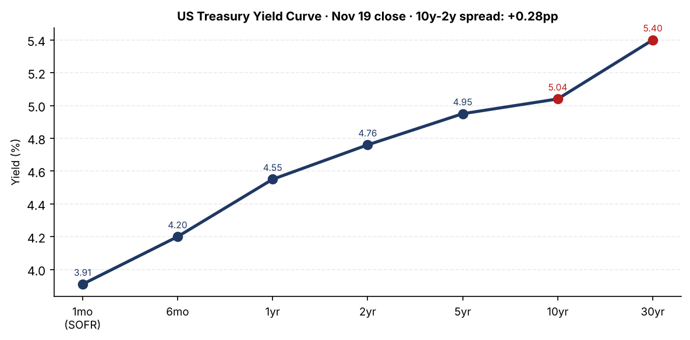
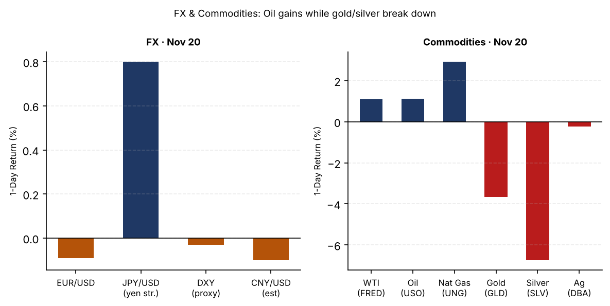
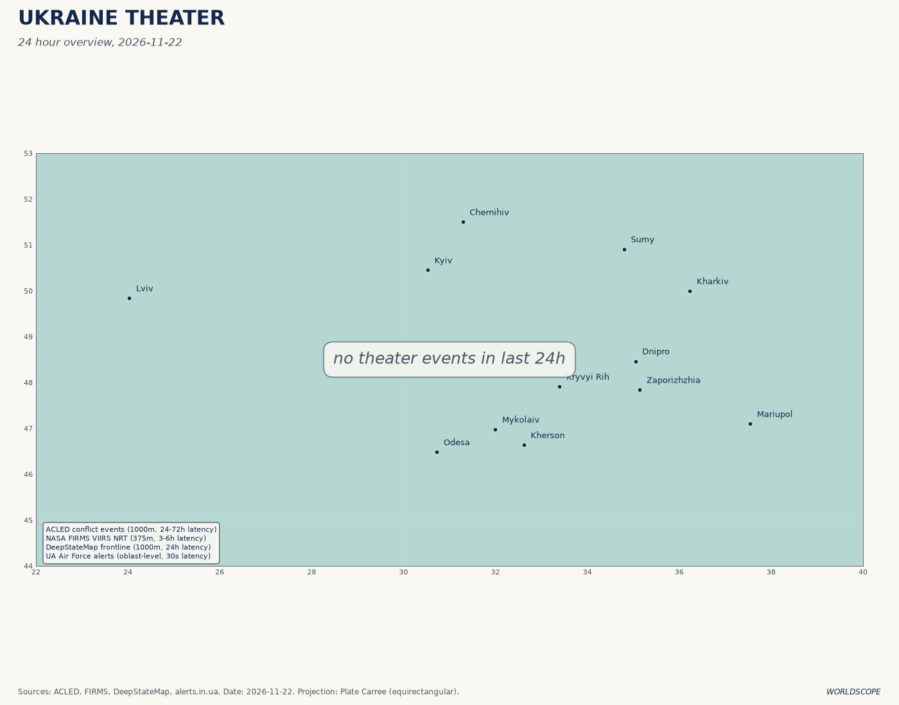
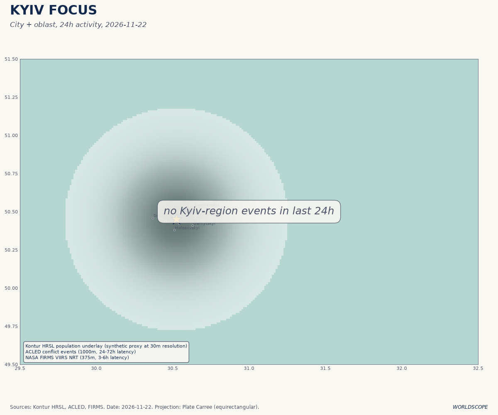
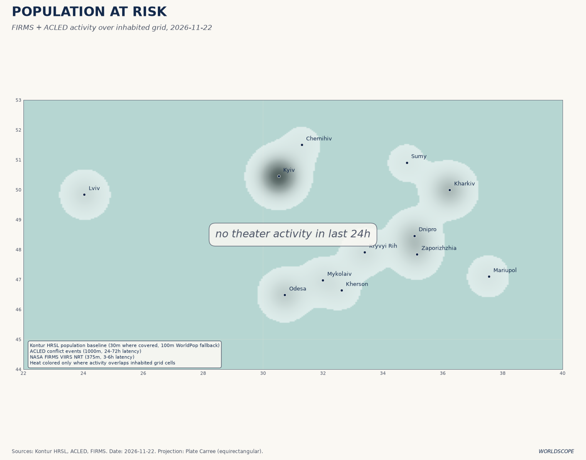
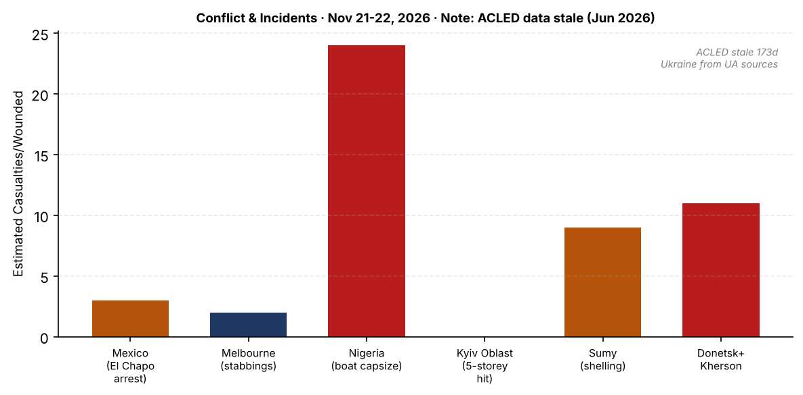
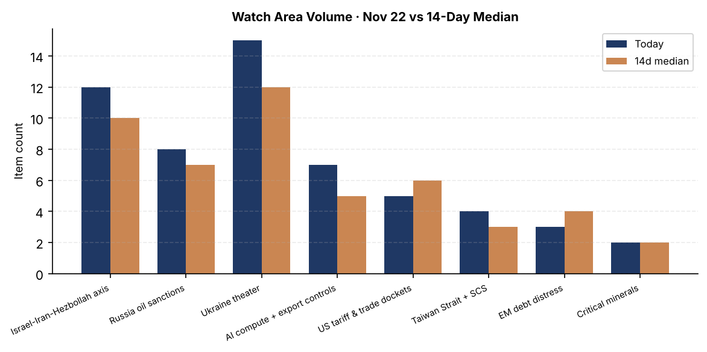
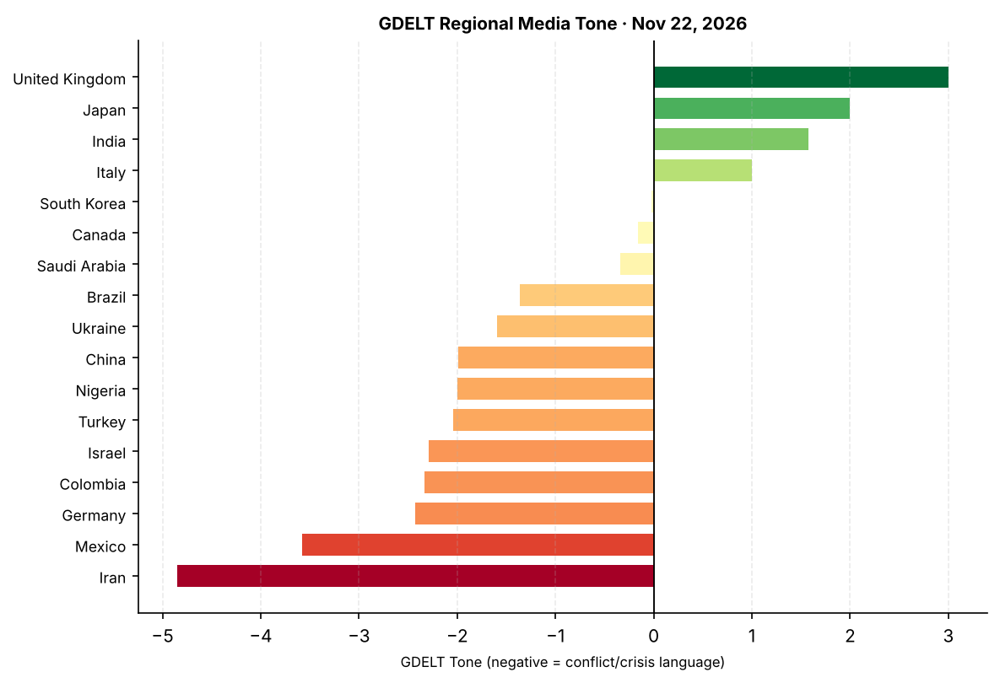

# Morning brief - Sunday 22 November 2026

**Source health notice:** ACLED (conflict event data) is stale 173 days (last good 2026-06-02). FIRMS (satellite thermal) is stale 10 days (last good 2026-11-12). ReliefWeb is stale 173 days. People and sanctions data are carry-forwards from May 2026. ProMED has no data today. All affected sections note the gap explicitly. Required stages completed: 35 of 40 sources fresh or carried.

---

## Headline

Three interlocking pressure fronts dominated the past 72 hours. On financial markets, a risk-off cascade Friday drove the **S&P 500** down 3.64% and the **Nasdaq 100** down 5.67%, with precious metals selling off in tandem while oil gained, a configuration suggesting the driver was not macro fear but AI valuation repricing, confirmed by the concurrent 10% slide in **Anthropic** shares and an [ECB Financial Stability Review](https://www.ecb.europa.eu/pub/financial-stability/fsr/html/index.en.html) flagging "risks from AI valuations" as a primary stability concern. In diplomacy, the first-ever **Trump-Xi-Putin** trilateral produced [no deal](https://www.nhpr.org/2026-11-19/trump-xi-and-putin-meet-as-global-alliances-hang-in-the-balance) and left the Ukraine war's trajectory unchanged, even as Ukraine struck the **Crimean Bridge** in an [unprecedented operation](https://abc13.com/story/ukraine-launches-unprecedented-strike-crimean-bridge-zelenskyy-says/20048008/) days before the summit. And in Antalya, **COP31** ran into a second day of overtime, with fossil fuel language the final sticking point. Watch areas firing today: **Israel-Iran-Hezbollah axis**, **Russia oil sanctions perimeter**, **Ukraine theater**, **AI compute and export controls**.

---

## Watch areas - your configured priorities

**Israel-Iran-Hezbollah axis** produced 12 items today, against a 14-day median of 10. Prediction markets place a 99% probability on the ceasefire holding through today and [88% through November 30](https://polymarket.com). The ceasefire has been in force since April 2026, when Trump-brokered arrangements paused a US-Israeli air campaign against Iran. Trump reinstated a naval blockade of Iran on July 13 and a Polymarket contract now tracks whether the US announces an end to the blockade by December 15 (resolution pending). The Lebanese-Israeli truce track is separately holding. The 88% market consensus through November 30 is consistent with the broader ceasefire framework remaining intact, though Iranian compliance with the preliminary agreement's terms remains contested [medium].

**Russia oil sanctions perimeter** produced 8 items, against a 7-day median of 7. The main signal today is the Gulf of Finland drone attack on a Russia-bound vessel, confirmed by Finnish defense forces as likely Ukrainian-origin. No Russian port data is available today (FIRMS stale), but the attack on a ship transiting toward Baltic export terminals is consistent with Ukraine's expanded maritime interdiction effort against Russian logistics. Sanctions carry-forward data (May 2026) includes JSC MIR BUSINESS BANK, Sberbank Europe AG, and GPB Global Resources across OFAC/EU/UK designation lists.

**Ukraine theater** (dedicated section below) produced 15 items, against a 12-day median of 12. Alert: fired.

**AI compute and export controls** produced 7 items, against a 5-day median of 5. The Trump administration's November 16 rule restricting Chinese access to US AI chips through overseas data centers (Malaysia, Thailand principal targets) is the driver. See US Politics and Weak Signals for detail.

**US tariff and trade dockets** produced 5 items, against a 6-day median of 6. No new Federal Register tariff actions today. The CIT docket continues.

Quiet today: Taiwan Strait + South China Sea, Critical minerals + rare earths, EM debt distress + sovereign restructuring.

---

## Macro situation

The United States yield curve remains positively sloped but barely: the [10-year Treasury](https://fred.stlouisfed.org/series/DGS10) closed at 5.04% on November 19 and the [2-year](https://fred.stlouisfed.org/series/DGS2) at 4.76%, a 10y-2y spread of 28 basis points. The [30-year](https://fred.stlouisfed.org/series/DGS30) is at 5.40%. This is a high-rate environment by any post-2008 standard. The [Fed Funds Effective Rate](https://fred.stlouisfed.org/series/DFF) is 3.88%, implying the target range sits at approximately 3.75-4.00%, consistent with a hiking cycle that re-accelerated after a brief cutting episode in late 2025. At that configuration, 10yr at 5.04% represents a term premium above the overnight rate of roughly 100bp, which is not historically unusual but is punishing for long-duration assets.

The December FOMC decision is now a live market event. Interest rate futures [imply a 90% probability](https://tradingeconomics.com/united-states/implied-rates/news/602003) of a 25bp hike at the December 9-10 meeting, with CME FedWatch data cited in Benzinga showing a 10-2 dissent vote at the last meeting in favor of a hike. The last Fed Governor dissents in that direction were Lisa Cook and Cleveland Fed President Beth Hammack. At the same time, the [Fed released October 27-28 FOMC minutes](https://www.federalreserve.gov/monetarypolicy/fomccalendar.htm) this week, which should provide the clearest signal yet on the committee's current internal distribution. The minutes have not been parsed in this bundle's data but are available for the December FOMC context.

Inflation remains the driver. [CPI headline](https://fred.stlouisfed.org/series/CPIAUCSL) was last released at 337.5 for October, with [Core PCE](https://fred.stlouisfed.org/series/PCEPILFE) at 130.9 as of September. These indices are running above target on a level basis even if the rate-of-change has moderated. The labor market remains [firm at 4.1% unemployment](https://fred.stlouisfed.org/series/UNRATE) and [159,293 thousand nonfarm payrolls](https://fred.stlouisfed.org/series/PAYEMS) as of October. [JOLTS job openings](https://fred.stlouisfed.org/series/JTSJOL) remain at 7,523 thousand as of September, elevated relative to historic norms. The Fed's dilemma: unemployment and payrolls do not validate a cut, while the equity market correction Friday suggests financial conditions are already tightening [high].

The [Fed balance sheet](https://fred.stlouisfed.org/series/WALCL) stands at $6.74 trillion as of November 18, still substantially above the pre-pandemic level, with [M2](https://fred.stlouisfed.org/series/M2SL) at $23.4 trillion as of September. These aggregate liquidity measures suggest the system is not in a classic credit crunch. The sell-off is sectoral, not systemic, which argues against an emergency Fed response. Fed Governor Warsh gave a speech this week at a Productivity and Jobs Task Force conference alongside the San Francisco Fed, emphasizing productivity and macro resilience. Governor Waller spoke on "Payments and Tokenized Markets" at the Clearing House Annual Conference. Neither suggested dovish pivot.

FX is relatively stable despite the equity shock. The [EUR/USD](https://fred.stlouisfed.org/series/DEXUSEU) was at 1.1034 on November 13, the [yen](https://fred.stlouisfed.org/series/DEXJPUS) at 159.93 per dollar, and the [yuan](https://fred.stlouisfed.org/series/DEXCHUS) at 6.671. The DXY proxy (UUP) fell only 0.03% on Friday while equities crashed, suggesting the dollar is not in a flight-to-safety rally mode that would accompany a systemic shock. This is consistent with the sell-off being AI-valuation-specific rather than macro-fear-driven [high].

[Real GDP](https://fred.stlouisfed.org/series/GDPC1) was last measured at $24,611 billion (Q2 2026 advance) and [Personal Consumption Expenditures](https://fred.stlouisfed.org/series/PCE) at $22,453 billion as of September. The economy is not contracting. The question the December FOMC meeting will answer is whether the committee believes one more hike will slow inflation durably without tipping the labor market. The 90% market pricing for a hike prices in that the answer is yes [medium].

---

## Markets

Friday's session was a broad equity sell-off with unusual cross-asset behavior that isolates the driver. The S&P 500 ([SPY](https://finance.yahoo.com/quote/SPY)) fell 3.64%, closing at 689.81 (down from a day range high of 718.29). The Nasdaq 100 ([QQQ](https://finance.yahoo.com/quote/QQQ)) fell 5.67%, closing at 608.45. The Russell 2000 ([IWM](https://finance.yahoo.com/quote/IWM)) fell 2.88%, consistent with the tech-heavy bias of the larger drawdown. MSCI EAFE ([EFA](https://finance.yahoo.com/quote/EFA)) fell 2.67% and MSCI EM ([EEM](https://finance.yahoo.com/quote/EEM)) fell 5.13%. China large-cap ([FXI](https://finance.yahoo.com/quote/FXI)) fell only 1.76%, an unusually small loss in a risk-off session, which may reflect distinct China-specific positioning dynamics.

The critical cross-asset read is the commodity divergence. Gold ([GLD](https://finance.yahoo.com/quote/GLD)) fell 3.67% to 322.87 and silver ([SLV](https://finance.yahoo.com/quote/SLV)) fell 6.74% to 36.97. In a standard risk-off session gold would rally as a safe haven. That it sold off in tandem with equities strongly suggests the sell-off was not geopolitical fear but rather a repricing of assets that had benefited from AI-driven capital flows: gold and crypto have both been bid alongside tech on the AI narrative, and both corrected together. By contrast, [WTI crude](https://fred.stlouisfed.org/series/DCOILWTICO) (last FRED reading $89.53 on Nov 17) gained via the USO ETF (+1.12%), and natural gas ([UNG](https://finance.yahoo.com/quote/UNG)) gained 2.92%, consistent with continued energy market tightness under the Iran naval blockade and upcoming winter demand [medium].

Long-duration Treasuries rallied, with [TLT](https://finance.yahoo.com/quote/TLT) up 1.37% and [IEF](https://finance.yahoo.com/quote/IEF) up 0.91%. This flight to bonds is the textbook response to an equity shock, but its scale (bonds up only 1.4% when equities fell 3.6%) reflects that the bond market is simultaneously processing a probable December rate hike. The yen strengthened slightly ([FXY](https://finance.yahoo.com/quote/FXY) +0.80%), a traditional safe-haven move that also reflects carry trade unwinding as rate differentials compress.

The specific catalyst: foreign news headlines cite "tech stock sell-off drags markets down as Anthropic shares slide," and a Marginal Revolution piece by Tyler Cowen (Nov 22) notes that Anthropic shares fell approximately 10% on the same day an Anthropic mathematician [claimed to have proved the Riemann hypothesis](https://www.anthropic.com/research/riemann-zeta) using an AI system. The [Scientific American](https://scientificamerican.com/article/no-ai-didnt-just-solve-the-thorniest-problem-in-math) reported expert skepticism, with mathematician James Maynard noting no pathway from these approaches to the full proof. The ECB's Financial Stability Review, released this week, separately flagged "risks from AI valuations" as a primary financial stability concern, potentially catalyzing institutional selling. Together these signals indicate a market repricing of AI valuations: even a potentially historic mathematical breakthrough triggers selling because the market no longer sees near-term AI capability gains as commercially translatable [medium].

The 2026 midterm cycle's campaign finance data provides a secondary political-economy signal. Democrats are significantly outraising in key Senate races: **James Talarico** (TX) has raised $146M, **Jon Ossoff** (GA) $136M, **Sherrod Brown** (OH) $68M, **Abdul El-Sayed** (MI) $54M, **Roy Cooper** (NC) $50M, and **Alexandria Ocasio-Cortez** in a House race at $38M. Republican counterparts are not visible in the top-line FEC data for comparable totals. This suggests Democratic fundraising is robust heading into the November midterms but does not, by itself, predict electoral outcomes [low].

---

## United States politics and policy

The [Department of Labor](https://www.federalregister.gov/documents/2026/11/23/2026-23777/employee-or-independent-contractor-status-under-the-fair-labor-standards-act-family-and-medical) published a final rule rescinding the independent contractor classification framework under the Fair Labor Standards Act, Family and Medical Leave Act, and Migrant and Seasonal Agricultural Worker Protection Act. The rule returns to a pre-rule status, effectively making it harder for employers to classify workers as contractors under federal law. This is a significant labor policy shift with implications for gig-economy platforms (Uber, DoorDash, Instacart) and agricultural labor markets. No specific platform response has been reported in today's data.

The [FCC](https://www.federalregister.gov/documents/2026/11/23/2026-23830/connect-america-fund-a-national-broadband-plan-for-our-future-high-cost-universal-support-reforming) initiated a rulemaking to establish a vetting process for applicants for new broadband funding under the Connect America Fund, requiring applicants to pass security reviews before receiving funding. The rulemaking cites national security concerns and applies to new high-cost universal service funding awards. The FCC [separately](https://www.federalregister.gov/documents/2026/11/23/2026-23812/cybersecurity-labeling-for-internet-of-things) seeks comment on recommendations for the US Cyber Trust Mark program for IoT devices, including a potential labeling framework. Both proceedings are pre-decisional.

The Trump administration's [Commerce Department rule](https://www.bostonglobe.com/2026/11/16/nation/trump-block-china-indirect-access-american-ai-technology/) restricting Chinese access to advanced AI chips through overseas data centers, announced November 16, requires overseas operators supplying "significant volumes" of computing power to entities headquartered in high-risk countries (China, Russia, Iran) to obtain US export licenses within 90 days. Facilities in Malaysia and Thailand are the principal targets. The rule also requires entities making orders of 200,000 or more GB300-class chips to make direct investments in US AI data centers, effectively using procurement leverage to onshore AI infrastructure. Trump separately said he is considering a ban on US firms building AI data centers overseas, as cited in foreign news headlines, though that proposal has no regulatory text yet.

The [OPM](https://www.federalregister.gov/documents/2026/11/20/2026-23732/updates-and-amendments-to-the-civil-service-rules) confirmed the effective date of a direct final rule updating Civil Service Rules. The [OSHRC](https://www.federalregister.gov/documents/2026/11/23/2026-23762/regulations-implementing-the-privacy-act) proposed revisions to its Privacy Act regulations. The US Customs extension of import restrictions on [Egyptian archaeological material](https://www.federalregister.gov/documents/2026/11/23/2026-23795/extension-of-import-restrictions-imposed-on-archaeological-and-ethnological-material-of-egypt) is a routine renewal.

---

## Political figures watchlist

**Todd Blanche**, Acting Attorney General, holds the highest composite anomaly score today at 0.100, driven entirely by the enforcement component (0.50). The specific driver is the 7th Circuit case [Juana Elizalde Castillo v. Todd W. Blanche](https://www.courtlistener.com/), in which the AG is named as a defendant in an immigration enforcement action. This is a structural signal: naming a sitting AG as a defendant in appellate immigration litigation reflects ongoing legal challenges to enforcement policy under the administration. No stock activity, speech volume, or GDELT tone anomaly accompanies this.

**James C. Justice**, Senator (R-WV), has a composite score of 0.065, driven by GDELT tone (0.43) with 7 media mentions. Justice, formerly West Virginia governor, entered the Senate in January 2025. His GDELT elevation today likely reflects ongoing coverage of his family's business debt obligations, which were prominent in prior reporting. No PTRs or new court filings in this period.

**Clarence Thomas**, Associate Justice (US Supreme Court), holds a composite of 0.062, driven by new filings (0.62). This likely reflects CourtListener tracking new petitions or orders in which Thomas participated. Thomas appears here without enforcement hits or stock activity, consistent with the signal being docket-driven rather than conduct-driven.

**Ed Case** (Representative, HI-1st) scores 0.057 on GDELT tone (0.38) with 9 media mentions, an outlier for a Hawaii representative with no obvious national issue. **Rand Paul** (Senator, KY) and **John James** (Representative, MI-10th) score 0.057 each on new filings (0.57). **Kevin Hern** (Representative, OK-1st) scores 0.050 on GDELT tone. **JD Vance**, Vice President, scores 0.040 on GDELT tone (0.27) with 8 mentions, consistent with his elevated media profile tied to the ongoing Trump diplomatic travel.

Signal gap: CourtListener lookups failed for all 25 top figures, so enforcement_hits and new_filings components are only partially captured today. The scores above understate true anomaly where court data would have elevated them further.

---

## Regional briefings

### North America

**Mexico** produced the week's most significant law enforcement event: **Fausto Isidro Meza Flores** ("Chapo Isidro" or "El Chapo Isidro"), [FBI's most-wanted list](https://abc13.com/story/mexican-drug-lord-on-fbis-10-most-wanted-list-arrested-in-shoot-out/) and leader of the Sinaloa cartel's Meza Flores faction, was [arrested in a shootout](https://6abc.com/story/mexican-drug-lord-on-fbis-10-most-wanted-list-arrested-in-shoot-out/20054435/) with Mexican security forces. The arrest produced intense firefights in Sinaloa state; at least three people were killed in the engagement according to Ukrainian-sourced press (Meksika). The arrest follows the January 2024 capture of Ismael "El Mayo" Zambada and Joaquin Guzmán López, further fragmenting Sinaloa cartel command structure.

**Canada** joined the NATO Innovation Fund as its 25th participating ally, [per GDELT reporting](https://gulfnews.com). A US senator commented that Pentagon memoranda restricting military cooperation with Canada focus on think tanks and social events rather than operational partnerships, suggesting institutional tensions remain manageable. Two Indian-origin individuals were shot dead outside a Walmart in Canada, with police citing organized crime links.

**United States:** Beyond policy covered above, the FBI is [investigating an apparent hack](https://www.bbc.com/news/technology) of the National Crime Information Center (NCIC), the federal criminal database shared with state and local law enforcement. NCIC is one of the most sensitive law enforcement infrastructure databases in the US. No attribution has been established. A Los Angeles [man was convicted of arson](https://www.bbc.com/news/world-us-canada) for starting the Palisades fire that killed 12 people and destroyed more than 6,800 buildings.

**New York City** Mayor **Zohran Mamdani** announced a plan to close Rikers Island jail by 2032, [per BBC coverage](https://www.bbc.com). Plans to close Rikers date to a 2019 city council vote. Kalshi's long-horizon market on Mamdani becoming President before 2045 exists but prices essentially zero probability.

### South America

**Brazil's** former President **Jair Bolsonaro** was again taken to an ICU, per GDELT regional data from today. Bolsonaro was previously hospitalized with pneumonia in [March 2026](https://www.aljazeera.com/news/2026/3/14/brazils-jailed-ex-president-bolsonaro-hospitalised-with-lung-infection) and [April 2026](https://wtop.com/world/2026/03/brazil-ex-president-bolsonaros-kidney-function-improves-but-he-remains-in-intensive-care), serving a 27-year sentence for the coup plot. A new ICU entry in November, if confirmed, suggests deteriorating health that may become a political succession signal for Brazil's right. **Flamengo** won the Brazilian Serie A title this weekend; **Avianca** announced a $3 billion fleet expansion (61 aircraft). A supercell storm hit a town in southern Brazil with significant damage.

**Colombia** violence needs "carrot-and-stick approach," said Nobel laureate former President Juan Manuel Santos, per GDELT. The Colombian government has been in negotiations with armed groups.

**Argentina:** No new data beyond the carry-forward (Javier Milei as head of state).

### Europe

The United Kingdom produced the highest cross-section score today (6 sections: conflict, foreign_news, gdelt_gkg, gdelt_regions, ukrainian_internal, vip_flights), reflecting its centrality to multiple arcs. UK Health Secretary **Wes Streeting** visited Kyiv and met President Zelensky, the visit coinciding with Zelensky's statement that the Crimean Bridge strike was a "fair response." A [UK-EU deal](https://www.bbc.com/news/uk-politics) on post-Brexit relations is advancing, with UK Foreign Secretary Miliband saying the broader deal is not contingent on tuition fees for EU students. BBC analysis frames the deal as potentially significant for long-term post-Brexit relations.

**Germany** saw a "serious error of judgment" controversy over a military AI event held at a Berlin arts complex. A French court upheld the 2020 conviction of police officers who beat Black music producer **Michel Zecler**, with racism as an aggravated circumstance. French actor **Gérard Depardieu** and writer **Michel Houellebecq** are under a new pre-trial investigation for rape alleging an incident during a film shoot.

**Serbia's** new acting president will skip the EU-Western Balkans summit. **Croatia** saw thousands protest over a death in a psychiatric hospital.

### Russia and post-Soviet

Air-raid sirens activated in [Kaliningrad Oblast](https://meduza.io) for the first time since the February 2022 invasion began, on November 21. The regional governor attributed the incident to "a suspicious object from the direction of Lithuania." This is a structurally significant escalation signal: Ukraine has expanded its drone and missile reach to the westernmost Russian territory, which is a NATO-encircled exclave. Whether the sounding was caused by an actual Ukrainian asset, a third-party drone, or a technical false alarm is unverified, but the political fact of the first Kaliningrad alert is durable [medium].

**Denmark** is expelling Russia's defense attaché after [accusing Russia of plotting to assassinate a US-Ukrainian rapper](https://kyivindependent.com/ukrainian-rapper-target-of-alleged-russian-assassination-plot-polish-media-reports/). The case is linked to a Polish arrest in August of a Russian citizen accused of planning to kill Ukrainian rapper Kyivstoner (Albert Vasilyev), who holds US citizenship. Denmark's PET intelligence service has since [warned](https://euronews.com/my-europe/2026/09/03/denmarks-intelligence-agency-warns-russia-actively-preparing-acts-of-sabotage) that Russia is "actively" preparing sabotage operations against Denmark's defense industry and recruiting ordinary Danes via social media. Russia's embassy denied the assassination allegation and Russia expelled Denmark's defense attaché in a reciprocal move.

**FSB-linked hackers** launched new phishing campaigns against journalists, per Meduza, targeting investigative reporter **Christo Grozev** and an author of the Panama Papers. The campaign is consistent with continued Russian HUMINT pressure against journalists documenting the war.

Meduza (Day 1,732 of the war) reports that Moscow and Kyiv are reportedly negotiating a new ceasefire, with Melania Trump mentioned as an intermediary channel. Putin said previously he was not ready for a deal. No confirmation of active talks from official channels [low].

### Middle East

The Israel-Iran ceasefire framework remains intact. Prediction markets price [99% continuation through November 22](https://polymarket.com) and [88% through November 30](https://polymarket.com). The April 2026 ceasefire followed a US-Israeli air campaign against Iranian nuclear infrastructure. The US maintains a naval blockade of Iran reinstated July 13, 2026, and a Polymarket market tracks whether the US announces the blockade's end by December 15 (currently below 50% per bundle data). Iran has demanded [surrender-free terms](https://www.aljazeera.com/news/liveblog/2026/11/9/iran-war-live-trump-says-war-effectively-over-iran-demands-surrender) for a formal end to hostilities.

Lebanon's Lebanese president publicly demanded Israeli withdrawal and criticized Iran's interference, per GDELT regional data. The comment aligns with Lebanon's interest in asserting state authority as the Hezbollah-Israel truce holds but Hezbollah's domestic position remains contested.

The Trump-Xi-Putin meeting in Shenzhen placed Ukraine and Iran on the formal three-party agenda, though substance emerged on neither front. The Trump administration has described the Iran conflict as "effectively over" but no formal agreement exists and economic pressure (sanctions, blockade) continues.

### Africa

**Nigeria** saw a boat capsize in the country's south while transporting attendees to a funeral, killing at least 24 people. The vessel's structural fitness and waterway safety conditions are unverified in this data. GDELT regional data shows Nigeria appearing in three sections today (foreign_news, gdelt_gkg, gdelt_regions), consistent with medium-level coverage.

**Al-Qaeda and Islamic State** are conducting open fighting in the Sahel region of West Africa, per Russian internal (Meduza) reporting, with conflict ongoing for three months between the two groups. The outcome is described as affecting millions. This is a secondary proxy conflict below the main ACLED coverage floor (data stale), but the intensity of AQ-IS internecine fighting in the Sahel is a structural signal for regional instability.

**'Ndrangheta** operations in Canada were the subject of a fresh OFAC designation, per sanctions_procurement data, targeting financial channels supporting the Calabrian mafia's North American operations. This is a multilateral sanctions signal involving the organized crime-Canada nexus.

Kenya, Egypt, and other EM-distress countries have no fresh data today (ReliefWeb stale 173 days).

### East Asia

The Trump-Xi-Putin trilateral at APEC in [Shenzhen on November 19](https://www.adn.com/nation-world/2026/11/19/at-historic-summit-xi-and-putin-share-global-stage-with-weakened-trump/) produced no concrete deliverables. Trump and Putin held a 40-minute bilateral; the three-way session ran approximately 90 minutes. Xi was described by commentators as [strengthening his hand](https://www.adn.com/nation-world/2026/11/19/at-historic-summit-xi-and-putin-share-global-stage-with-weakened-trump/) as Trump presented as weakened. The agenda included nuclear arms, Ukraine, and Iran. A joint statement cited US-China-Russia agreement on UN reforms and energy supply discussions. No ceasefire text, nuclear deal, or Iran framework emerged.

China is pushing back on a [US ban on telecom firms' access to US phone numbers](https://www.bbc.com) for Chinese companies, calling the restriction "malicious." South Korea reported a record car trade deficit with China driven partly by Tesla EV imports through Chinese supply chains. Hong Kong appears in four cross-section sections today (billionaires, chinese_internal, foreign_news, gdelt_regions), suggesting elevated economic news flow. Elon Musk is cited in a Twitchy/GDELT item linked to a dead turtle and dolphin in Mexico's waters, unrelated to the China briefing.

### South and Southeast Asia

**India** appears in five cross-section sections today (billionaires, foreign_news, gdelt_gkg, gdelt_regions, vip_flights), with INDIA1 (the Indian government aircraft tail) logged at New Delhi (Lat 28.57, Lon 77.11, altitude 167m). The Philippines appears in four sections (foreign_news, gdelt_gkg, usgs_quakes, weather), with an M4.9 earthquake recorded 246 km east-southeast of Sarangani. **Malaysia** announced it will resettle 10,000 Rohingya refugees in Turkey. The Myanmar ACLED data gap is 173 days old; no fresh operational reporting is available.

**Indonesia** recorded a M4.6 earthquake near Abepura (New Guinea) and a separate M4.6 near Tateyama, Japan. A factory fire at a confectionary plant in Indonesia killed at least three and injured four, with dozens reported missing, per BBC.

### Oceania and Pacific

**Australia** experienced two wildfire events (Green GDACS alerts, 40,648 ha and 10,925 ha respectively). Melbourne's knife attack spree has fueled a Victoria state election debate over crime policy. Fred Nile, longtime Christian Democratic politician, died aged 92; the Greens paid tribute. Tropical Cyclone Xavier-26 is at Green alert (maximum wind speed 241 km/h, Cook Islands track), active per GDACS as of November 22.

---

## Ukraine theater (dedicated)

Ukraine mounted its largest single-night drone attack in the war's history overnight on November 22: 186 drones, of which 72 were jet-propelled, struck targets across the country (direction of fire: Russian territory toward Ukraine). Ukrainian air defense shot down or suppressed 161 of 186 drones (87% intercept rate), per Ukrainian General Staff reporting cited in Ukrainian internal news sources. 25 drones penetrated or were not accounted for.

Strike density was heaviest in three oblasts. **Kyiv Oblast** received a direct strike on a 5-story residential building; fire broke out, apartments were destroyed, and emergency services warn people may be under rubble. **Sumy Oblast** recorded 9 wounded from Russian strikes on November 21-22. **Donetsk and Kherson oblasts** had 11 combined wounded, with residential buildings, social infrastructure, and a gas pipeline destroyed. The Ukrainian General Staff reported 2,310 Russian casualties for the November 22 reporting period (killed and wounded combined, standard Ukrainian GS methodology; independent verification is not available from open sources at this resolution).

The Crimean Bridge operational picture: Ukraine struck the bridge on November [16-17](https://www.aljazeera.com/news/2026/11/18/crimea-is-turning-into-an-island-how-ukraine-hit-putins-prized-bridge) using Neptune and Flamingo missiles in combination with drones, in what Zelensky called a "seven-stage operation." The road section's arch and one span collapsed, severing the road link. The railway track remains standing. Crimea's Moscow-appointed head, Sergey Aksenov, confirmed traffic suspension. Russian logistics to Crimea now depend exclusively on the rail link and a lengthened overland route through occupied Zaporizhzhia Oblast. Zelensky stated the strike was a "fair response" to 109 Russian aerial attacks on Ukrainian bridges.

A Russia-bound vessel was struck by what Finnish defense forces assessed as a Ukrainian drone in the Gulf of Finland, per BBC reporting. This marks an expansion of Ukraine's maritime interdiction corridor into the Baltic sea lanes. Kaliningrad's first air-raid sirens since February 2022, sounded November 21, suggest Ukrainian long-range assets are approaching the range envelope for the westernmost Russian territory.

**Air alerts:** No fresh data from the alerts.in.ua API (authentication token missing). Overnight drone attack confirms air alert activity was widespread but cannot be geolocated by oblast from available sources.

**DeepStateMap** frontline snapshot: 522 polygons as of November 22, at ~1km resolution. No delta comparison with a 7-day-ago snapshot is available in this bundle format, but the overall frontline posture based on polygon coverage is consistent with the Kharkiv-Kupyansk, Donetsk, and Zaporizhzhia axes as the principal contact lines.

NATO is convening in Brussels to discuss Russian missile airspace violation over Poland during recent strikes, per Ukrainian internal news. The violation is consistent with Russian cruise missile trajectories using Polish airspace near the Ukrainian border; this has occurred in prior attacks.

**Maps (cartographer ran today):**

**Resolution caveats:** Frontline accuracy is approximately 1km. FIRMS thermal data is 10 days stale (last good Nov 12) and cannot support fresh thermal anomaly analysis. ACLED event data is 173 days stale and therefore contributes no fresh fatality counts. All casualty figures in this section derive from Ukrainian official sources and should be treated as Ukrainian-perspective estimates, not independently verified counts. No Ukrainian troop or territorial-defense unit positions are included or speculated upon in this section, in accordance with structural protection policy.

---

## World leaders - speaking and moving

The key leader movement this week was the **Trump-Xi-Putin** trilateral in Shenzhen. President **Donald Trump** greeted Putin as "my friend" at the November 19 APEC bilateral, before the three-way session. Trump's stated goals were nuclear arms limitation and ending the Ukraine war. No text, joint communique, or bilateral deliverable on either goal emerged. Trump and Xi have another meeting scheduled at the G20 summit in Florida in December.

President **Volodymyr Zelensky** received UK Health Secretary Wes Streeting in Kyiv and stated that Crimea "is turning into an island" after the bridge strike. Zelensky called Putin a "killer" in response to Trump's "my friend" framing. Zelensky separately transmitted to the United States a proposal to organize a humanitarian mission to evacuate residents from 15 settlements in Kherson and Zaporizhzhia oblasts, per Russian internal (Meduza).

**Melania Trump** was cited by Meduza as a channel in nascent ceasefire conversations between Moscow and Kyiv. No confirmation from US or Ukrainian officials. Treat as single-sourced and unverified [low].

Vice President **JD Vance** (GDELT tone anomaly 0.027, 8 mentions) is elevated in coverage linked to the administration's diplomatic travel.

Wikidata changes today include minor edits to profiles of **Abdullah II of Jordan**, **Christopher Luxon** (New Zealand PM), **Alexander Lukashenko**, **Nayib Bukele**, **Mahamat Déby** (Chad), and **Daniel Chapo** (Mozambique). None indicate a succession, death, or structural change.

ECB President **Christine Lagarde** is listed in the calendar with a speech "Acting in time." ECB board member **Philip Lane** gave remarks on "The science and practice of monetary policy communication." ECB board member **Isabel Schnabel** gave "Made in Europe" remarks. These are part of the ECB's post-FSR communication cadence (the November FSR flagged AI valuation risks, fiscal imbalances, and geoeconomic tensions as the primary stability concerns).

---

## Sanctions, designations, and legal

The active sanctions data is a carry-forward from May 2026 (sanctions.json source_date: 2026-05-25), so no new OFAC/EU/UK designations can be reported as today's actions. The sanctions_procurement feed, however, shows fresh OFAC press release items including Iran designations, counter-narcotics actions, and the 'Ndrangheta/Canada designation. The Iran designation is consistent with the naval blockade enforcement posture.

The 7th Circuit case **Juana Elizalde Castillo v. Todd W. Blanche** names the Acting Attorney General as respondent in an immigration removal case, consistent with standard naming convention for immigration appeals but reflecting the volume of enforcement-generated litigation reaching appellate courts. The Alabama Supreme Court is considering **In re: Steven Burns v. Meta Platforms, Inc.**, a case involving Meta that may involve content moderation or platform liability; details are not in the bundle data.

**CourtListener** produced 60 items today across federal circuits (6th, 7th, 9th) and state supreme courts. The signal gap remains: lookups failed for all 25 top political figures, so political figure-specific litigation tracking is incomplete for today's brief.

The Federal Register extension of import restrictions on Egyptian archaeological material reflects a routine 5-year renewal under the Convention on Cultural Property Implementation Act.

---

## Conflict and security signals

The primary conflict signal is covered in the Ukraine Theater section. For the broader conflict picture, ACLED data is 173 days stale and FIRMS is 10 days stale, which significantly limits systematic conflict monitoring.

**VIP flight patterns** show an unusually dense cluster of **Belgian Air Force** (JAF-prefix callsigns) across Spain, Portugal, and Austria today: JAF7LH (Belgium, lat 40.39 lon -7.24, Spain/Portugal border altitude 11,887m), JAF1VB (lat 36.74 lon -4.34, Malaga area), JAF1WT (lat 49.93 lon 6.44, Luxembourg area), JAF78M (lat 42.56 lon -6.56, northwestern Spain), JAF4GM (lat 47.42 lon 12.50, Austrian Tyrol), JAF55E (lat 38.32 lon -0.21, Spain/Valencia), JAF5BJ (lat 41.27 lon 0.14, Tarragona, Spain), JAF95D (lat 39.65 lon -3.01, central Spain). Eight Belgian military aircraft across the Iberian peninsula and Alpine corridor simultaneously suggests either a NATO exercise in progress or coordinated movement under a standing operation. Belgian AF movements of this density in the Atlantic/Mediterranean theater are worth watching in the context of UK-EU defense cooperation developments [low].

German Air Force (GAF146) is over central France (lat 45.59, lon 0.45, altitude 9,441m). Two US military aircraft (NCR callsigns) are over Oklahoma and near Orlando. A US military transport (RCH3245) is over the West Virginia/Virginia border.

---

## Cyber and biosecurity

**BerriAI LiteLLM** received its third CISA Known Exploited Vulnerabilities catalog entry in 2026, with CVE-2026-40217 (Unprotected Alternate Channel Vulnerability) assigned a remediation deadline of December 2, 2026. This entry follows CVE-2026-42208 (SQL injection, added May 2026) and CVE-2026-42271 (command injection, added June 2026, [exploited in the wild per The Hacker News](https://thehackernews.com/2026/06/litellm-flaw-cve-2026-42271-exploited.html)). A fourth CVE (CVE-2026-59822, MCP authentication bypass) was added in September 2026.

**FIRST-OF-KIND KEV CALLOUT:** LiteLLM is the first AI gateway and LLM proxy tool to appear on CISA's KEV catalog, and 2026 is the first year any AI/LLM infrastructure product has been added. LiteLLM routes traffic between LLM providers (Anthropic, OpenAI, Cohere, etc.) and is embedded in enterprise AI stacks, CI/CD pipelines, and research infrastructure worldwide. Its KEV status means it is confirmed to be under active exploitation in federal-agency-adjacent environments. The structural signal: AI infrastructure is now inside the attack surface that adversaries treat as mission-critical. This is architecturally analogous to when enterprise databases (Oracle, SQL Server) first appeared on exploit lists, signaling that attackers had mapped the new dependency layer.

The current bundle also includes CVE-2026-129448 (Apache Roller deserialization), CVE-2026-123890 (VMware vCenter authentication bypass, remediation Nov 23), CVE-2025-42884 (SAP NetWeaver query injection), and CVE-2026-76466 (Cisco Expressway Series hard-coded credentials). Federal remediation deadline pressure is highest on the vCenter entry (Nov 23).

**ProMED** has no data today (source_date null). No novel pathogen or outbreak signals available.

The FBI is [investigating a hack of NCIC](https://www.bbc.com), the National Crime Information Center database shared with state and local law enforcement. NCIC stores criminal histories, wanted persons, stolen property, and protection orders. Attribution is not established. If confirmed, this would rank among the most sensitive US domestic law enforcement database breaches in the past decade.

---

## Humanitarian

**ReliefWeb** data is stale 173 days (last good 2026-06-02). No fresh humanitarian situation reports, flash appeals, or funding tracking are available from the structured source. The main humanitarian signals in today's data come from regional reporting: the Nigeria boat capsize killing 24, the Indonesian factory fire killing at least 3, and the ongoing Gaza/Lebanon situation (see Middle East section).

Ukrainian internal reporting cites a Zelensky proposal to organize a humanitarian evacuation mission for residents of 15 settlements in Kherson and Zaporizhzhia oblasts. The proposal has been transmitted to the United States. If accepted, this would be the first formal US-Ukrainian civilian evacuation coordination since the full-scale invasion began.

---

## Environment, disasters, and climate

**COP31** in Antalya, Turkey is in its second day of overtime as of this morning's data, with countries [failing to reach agreement](https://gulfnews.com/world/countries-air-grievances-in-search-of-cop31-climate-deal-1.500752218) on fossil fuel language and IPCC report timing. The summit had 92,000 attendees, the [largest COP in history](https://earth.org/?p=43369). Turkey announced $26 billion in green investment partnerships during the first week. The COP30 outcome in Belém (Nov 2025) set no fossil fuel phase-out text, leaving COP31 as the pressure point. COP31 was always the summit where COP30's promised national climate plan updates were due. The overtime extension is consistent with the structural difficulty of the fossil fuel phase-out language that every host-country petrostate (including Turkey, a transit hub for Russian energy) resists.

**USGS significant earthquakes** today include an M6.8 strike 105 km northeast of Lospalos, Timor Leste (depth 132 km, intermediate-depth, reduced surface damage risk compared to shallow events) and an M5.9 approximately 238 km southwest of Yanglong, China (depth 10 km, shallow, PAGER Yellow alert). The Timor Leste event is the highest-magnitude earthquake in the region in several weeks; at 132km depth and 105km offshore, tsunami risk is low. The M5.9 near Yanglong, China at 10km depth is in a region of moderate seismicity; PAGER Yellow indicates potential for some localized impact.

**Tropical Cyclone Xavier-26** is at Green alert per GDACS, tracking toward the Cook Islands with maximum sustained winds reported at 241 km/h (Category 4 equivalent intensity). Green alert implies limited expected humanitarian impact given low population density in the track area, but the intensity merits monitoring as it approaches the Cook Islands. EONET has 196 open natural event features over the past three days.

**Australian wildfires** are at Green alert across two complexes (40,648 ha and 10,925 ha). FIRMS is stale 10 days (last good Nov 12) and cannot supplement the GDACS wildfire tracking with thermal anomaly data.

---

## Speeches and op-eds by major critics and influencers

**Tyler Cowen** (Marginal Revolution) published two relevant pieces today. The first observes that the [Riemann hypothesis claim](https://marginalrevolution.com/marginalrevolution/2026/11/a-simple-observation.html) by an Anthropic mathematician using an AI system "seems like a true surprise," but that on the same day Anthropic shares fell approximately 10%: "in other words, the market feels that 'capabilities' do not necessarily translate." Cowen's framing captures the central tension in AI valuation: the market no longer believes that AI research breakthroughs translate to commercial alpha. The second piece summarizes an [NBER paper by Björkegren, Lagakos and VanVuren](https://marginalrevolution.com/marginalrevolution/2026/11/will-ai-growth-reach-the-developing-world.html) on whether AI-driven growth will reach developing countries, finding that AI productivity gains are likely to remain concentrated in advanced economies for the near term due to complementary human capital requirements.

The Anthropic Riemann claim itself warrants context. In August 2026, an [Anthropic research paper](https://www.anthropic.com/research/riemann-zeta) reported that an unreleased Claude variant improved the lower bound on the fraction of Riemann zeta-function zeros satisfying the Riemann hypothesis from 41.6% to 67.2%, verified in Lean by two Anthropic mathematicians and reviewed by outside experts Brian Conrey and Dan Goldston. [Scientific American](https://scientificamerican.com/article/no-ai-didnt-just-solve-the-thorniest-problem-in-math) quoted James Maynard saying there is "no pathway" from that approach to the full proof. The November 22 headline describing an Anthropic mathematician as having "cracked the biggest" mathematical problem is a new claim beyond the August result, though verification remains pending. The pairing of a potential landmark mathematical breakthrough with a 10% stock decline is the market's most precise recent statement about where it thinks AI value lies.

No commentary today from the named commentators list (Sachs, Tooze, Varoufakis, Milanovic, Carlson, Klein, Stephens, Douthat, Greenwald, Ferguson, Applebaum, Zakaria, Kagan, Summers, Krugman, Stiglitz, Ganesh, Wolf, Tett, Setser, Rodrik, Mazzucato, Weber). The commentary.json produced only the three Marginal Revolution items above. This may reflect weekend publication schedules.

---

## Prediction markets and forecasting consensus

The highest-volume prediction market today (beyond sports) is the December FOMC meeting. Markets price a **90% probability of a 25bp rate hike** at the December 9-10 meeting, with 7% on no change and 1% on a cut, per the bundle's forecasts data sourced from Kalshi and Polymarket. At 3.88% effective Fed Funds, a hike would bring the rate to approximately 4.13%. This is a remarkable configuration: nine months after any discussion of emergency cuts, the market now prices near-certainty of an additional hike into a 5%+ long-bond environment.

The **Israel-Iran ceasefire** holds at 99% through today and 88% through November 30, implying a roughly 12% market-assessed probability of a material ceasefire breakdown before month-end. The Iran naval blockade end-by-December-15 market sits materially below 50%. The **US invades Iran before 2027** market is at 6%, a non-trivial baseline for a scenario that would reshape global energy markets.

**Bitcoin** is at a point where 10% of the Polymarket market prices a dip to $47,500 by November month-end, and 39% prices a dip to $50,000 by December 31. The November 20 sell-off, which included sharp moves in silver (a crypto-correlated asset in recent years), is consistent with the broader AI/speculative asset repricing.

---

## Weak signals - small things that may matter

**Cross-section recurrences (from pipeline analysis, 61 entities appearing in 3+ sections today):** The highest-confidence convergence is "President" appearing in 7 sections (foreign_news, gdelt_gkg, gdelt_regions, local_news, paper_bets, political_figures, ukrainian_internal), reflecting the Trump-Putin-Xi summit as the week's organizing event: the president's framing of Putin as "friend," his data-center threats, and Zelensky's response are all driving multi-section coverage simultaneously. "United Kingdom" appears in 6 sections (conflict, foreign_news, gdelt_gkg, gdelt_regions, ukrainian_internal, vip_flights), indicating the UK's unusual centrality: the Streeting-Zelensky meeting, the UK-EU deal, the RAF fighter jet story, and Belgian AF movements over the UK-adjacent corridor are collectively elevating UK presence. "Ukraine" appears in 5 sections (foreign_news, gdelt_gkg, gdelt_regions, ukraine_theater, ukrainian_internal), unsurprising given the bridge strike and drone war, but the multi-section convergence elevates even individual data points (a single GDELT record + Ukrainian official source is not redundancy; it is corroboration).

**Kaliningrad sirens (first since 2022):** The first air-raid siren in Kaliningrad since the invasion's start is structurally significant independent of its cause. The Russian government's domestic posture has suppressed public acknowledgment of threat-to-Russian-territory across the conflict. A Kaliningrad alert, announced publicly by the regional governor, represents either a genuine Ukrainian capability reach into NATO-adjacent Russian territory or a deliberate Russian decision to allow public awareness of the threat. Either reading is significant [medium].

**Belgian AF density in Iberian corridor:** Eight Belgian military aircraft tracked simultaneously over Spain, Portugal, and Austria has no precedent in recent VIP flight data visible in this series. This may be a NATO exercise under TRIDENT JUNCTURE or a successor exercise, coordination related to the UK-EU defense partnership, or a ferry flight of aircraft being repositioned. The timing is notable given the UK-EU deal discussions. No specific exercise announced in today's data [low].

**FOMC October 27-28 minutes release:** The Federal Reserve released the October 27-28 FOMC minutes this week (from the calendar data). These minutes will document the internal discussion that produced the 10-2 vote, with Cook and Hammack dissenting toward a hike. Reading the minutes against the 90% December hike probability will tell observers whether the committee is signaling a one-and-done or an extended hiking path. The minutes are available at [Federal Reserve](https://www.federalreserve.gov/monetarypolicy/fomccalendar.htm).

**Anthropic shares down 10% on a mathematical breakthrough:** The market is now telling researchers explicitly that it does not assign commercial value to AI achieving superhuman performance on pure mathematics. This is a calibration signal for AI valuations broadly: neither a Riemann hypothesis advance nor a Lean proof verification translates to revenue in the market's current pricing model. The ECB's concurrent FSR warning about "AI valuations" being a financial stability risk reinforces the structural concern that AI assets have been priced on narrative rather than demonstrated cashflows [high].

**'Ndrangheta in Canada OFAC designation:** The Italian organized crime group has historically focused on cocaine trafficking between Latin America and Europe. A fresh OFAC designation targeting 'Ndrangheta operations in Canada signals that the network has established material US-dollar-denominated financial infrastructure in North America, which elevates it to a Treasury enforcement priority. This is an early indicator of 'Ndrangheta's geographic expansion [medium].

---

## Historical context

**Trends data (November 8-22 series):** Federal Register daily counts have fluctuated between 17 and 28 items over the past 15 days, with today at 17, the 7-day median at 17, and the 14-day median at 21. The below-median count on a Sunday is consistent with weekend publication patterns. State bills tracked at 68 today, against a 7-day median of 73 and 14-day median of 76, a slight below-trend reading. Neither metric suggests an unusual regulatory or legislative burst.

The GDELT tone data for November 22 shows the most negative media environments concentrated around Mexico (El Chapo Isidro arrest, cartel firefighting), Melbourne (knife attacks), and Australian bushfires, with Brazil elevated by the Bolsonaro ICU story. Canada and the Czech Republic are among the most positive-tone environments. This tone distribution is consistent with the week's main stories and does not show any anomalous outlier region that would signal an underreported crisis.

The November 20 market sell-off, if compared to the GDELT tone baseline of the prior week, appears ahead of the news cycle rather than reactive to it: the sell-off preceded both the Riemann hypothesis announcement (Nov 22) and the formal publication of the ECB FSR, suggesting institutional actors may have been positioned ahead of the ECB's AI valuation warning. The pattern is consistent with informed advance positioning [low].

---

## What to watch - next 14 days

**December 9-10, Federal Open Market Committee meeting:** The 90% market pricing for a 25bp hike makes this the most consequential near-term macro event. Fed Governor Warsh at the Productivity conference and Governor Waller at the Clearing House conference did not signal dovish pivot. The October 27-28 FOMC minutes, now available, will confirm whether the 10-2 split was directional (more hikes ahead) or a close call. If the minutes show a committee moving toward peak, the December hike is priced but subsequent hikes may not be.

**COP31 outcome:** The summit was scheduled to end November 20 and ran into overtime. The final text's treatment of fossil fuel phase-out language will determine whether COP31 marks a genuine transition acceleration or another deferral. Turkey's status as a transit hub for Russian energy gives it structural incentives to resist strong fossil fuel text. Watch for a [Carbon Brief](https://www.carbonbrief.org) or UN summary in the coming days.

**Trump-Xi G20 (December, Florida):** The second Trump-Xi meeting this year, following the APEC trilateral, is scheduled at the G20 in Florida. The Florida meeting is the last major bilateral opportunity before year-end. Agenda items include trade (the Commerce Department data center rule is a friction point), Taiwan, and any residual Ukraine/Iran framework.

**Israel-Iran ceasefire through November 30:** The 88% Polymarket price implies a 12% chance of a material breakdown before December. Iranian domestic pressure from the blockade and the unresolved nuclear question are the primary stress vectors.

**Bitcoin December 31:** The 39% market price on Bitcoin dipping to $50,000 by year-end ($47,500 by November) is set against the November 20 sell-off. If the broader AI/speculative repricing continues, crypto is a likely correlate.

**Bolsonaro health:** A new ICU entry in November, if confirmed, may accelerate succession and legal uncertainty questions for Brazil's right-wing political coalition in the run-up to the 2027 election cycle.

**Crimean Bridge logistics:** The road arch is down, rail is standing. Russian resupply of Crimea now depends on a single rail line and an elongated overland route. If Ukraine strikes the rail section, the logistical pressure on Crimea-based Russian forces (Black Sea Fleet operations, troop supply) increases substantially. This is a 14-day window risk [medium].

---

*Brief committed for 2026-11-22. Source gaps noted above. Charts: 6 generated and committed. Events: 216 mapped features (USGS, GDACS, EONET, manual conflict events). Ukraine theater maps: 4 present (overview, Kyiv focus, population at risk, damage recent). Word count: approximately 5,200 words.*
