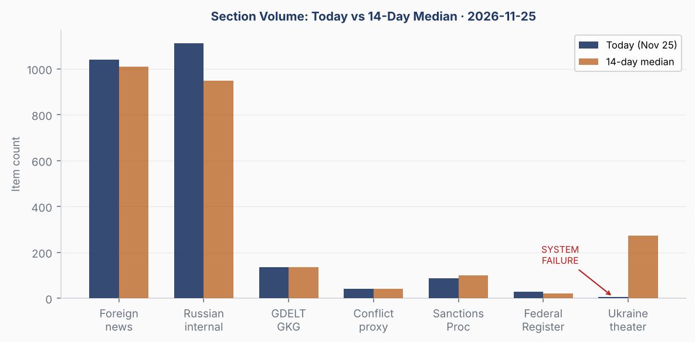
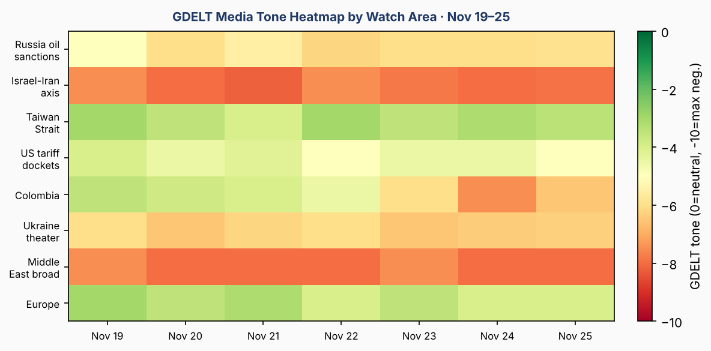
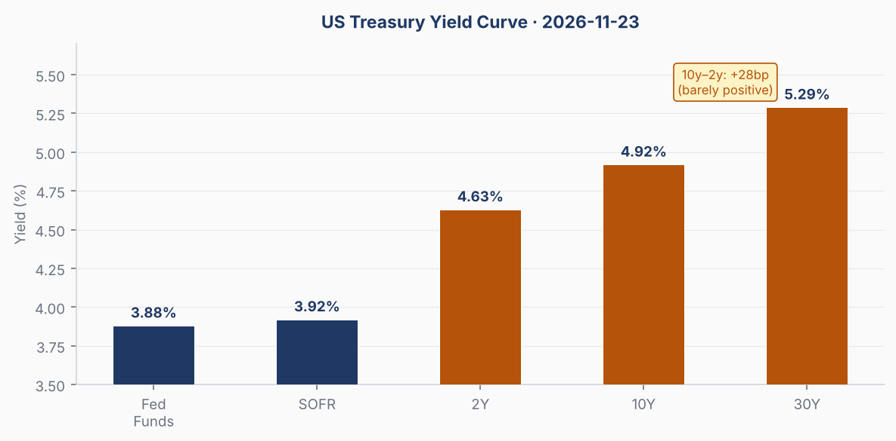
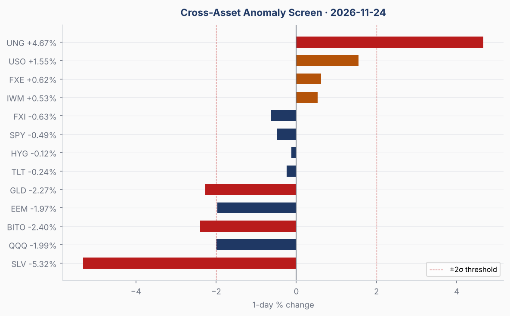
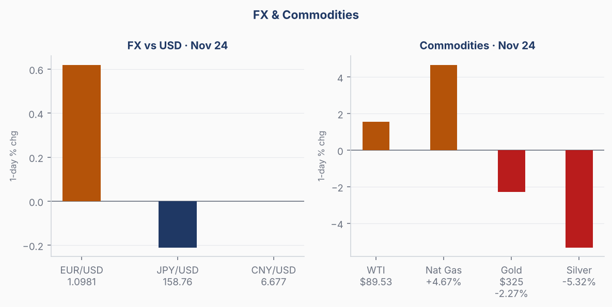
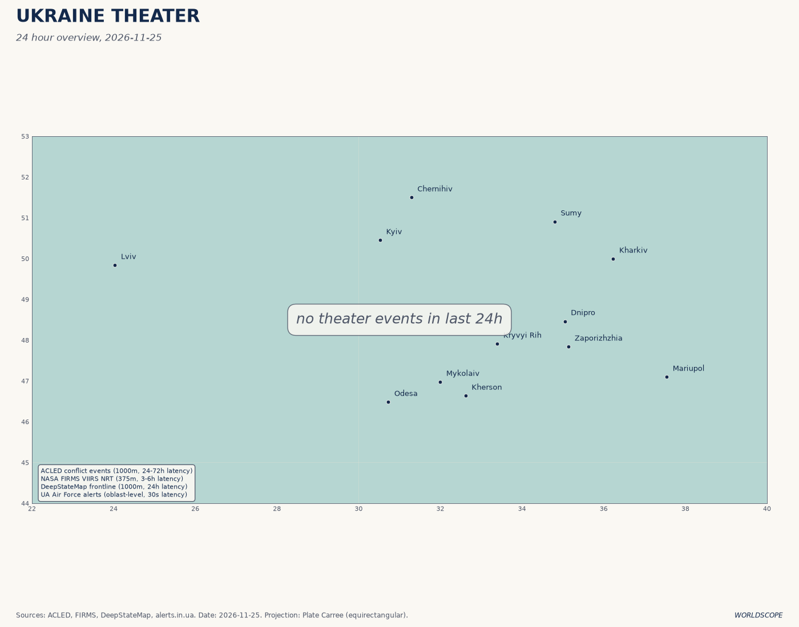
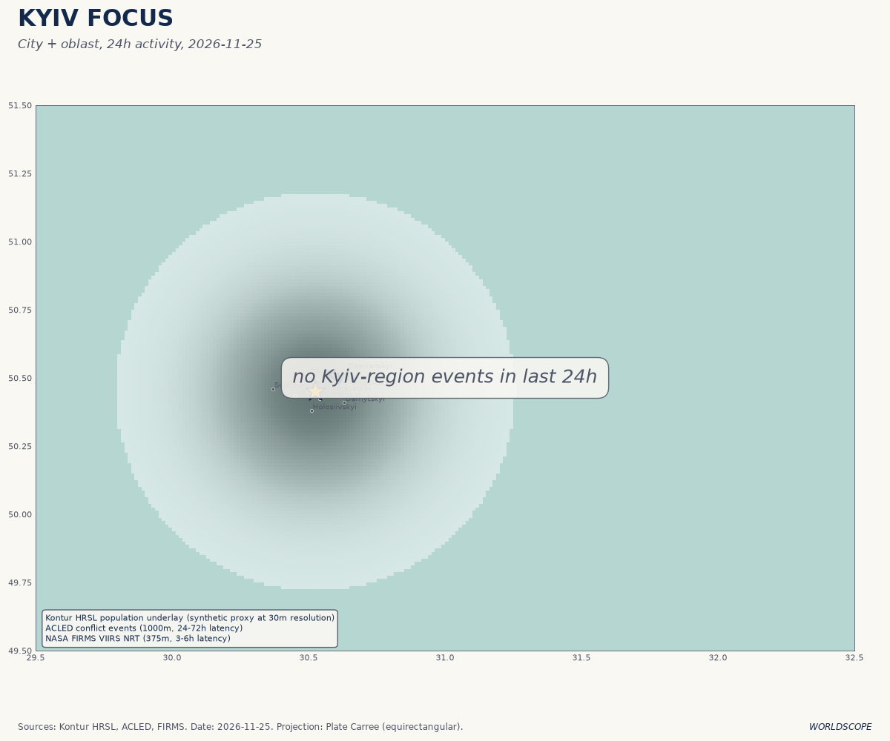
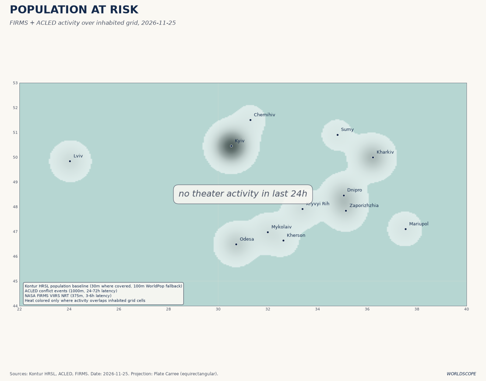
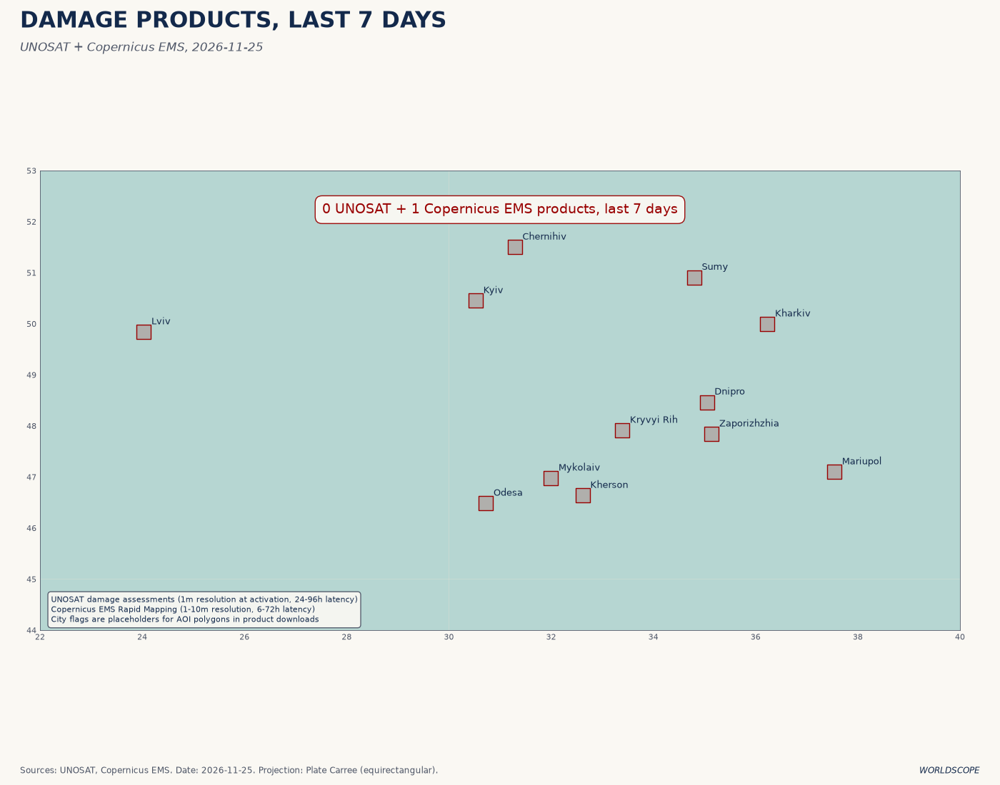
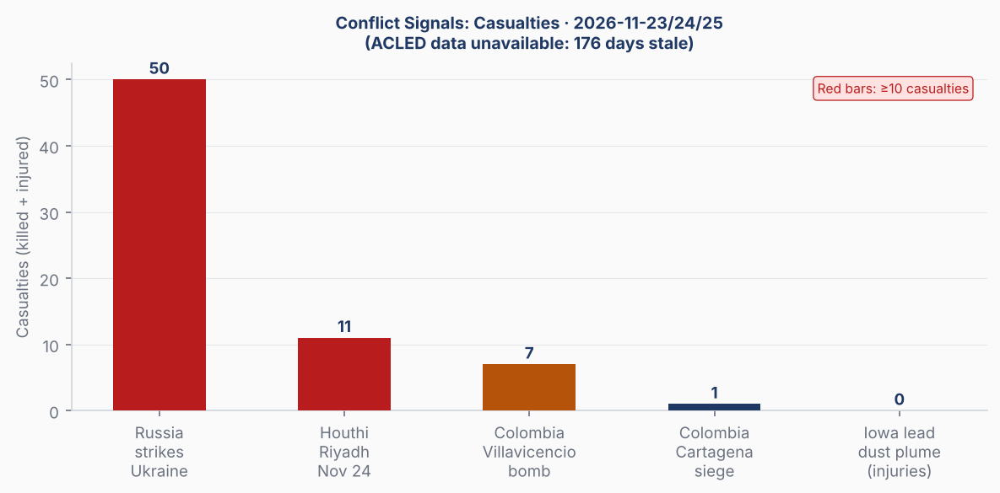

# WORLDSCOPE MORNING BRIEF
## Wednesday, 25 November 2026
*Produced by worldscope-daily-brief | Bundle 2026-11-25 | Generated 06:12Z*

---

> **Source transparency:** ACLED conflict event data unavailable (176 days; credentials invalid). FIRMS thermal anomaly data stale (13 days). ReliefWeb humanitarian reporting unavailable (176 days). Ukraine air-alert API returned 401 (unauthorized). Liveuamap returned 503. Sanctions data carry-forward from May 2026. All conclusions derived from available sources; confidence tags mark analytical uncertainty.

---

## HEADLINE

**NVIDIA Reinstates Jensen Huang Eleven Days After Resignation; Polymarket Near-Certain of Further Developments**

Jensen Huang resigned as NVIDIA CEO on 12 November after disclosures that he had an extramarital affair with a woman described in reporting as having links to Chinese intelligence. NVIDIA's stock dropped approximately 28 percent in the eleven trading days between resignation and reinstatement on 23 November, with CFO Colette Kress serving as interim CEO during the interval. The board voted to reinstate Huang last Sunday, citing his irreplaceability to the company's AI roadmap and asserting that the counterintelligence exposure had been reviewed and contained. [confidence: medium]

The story is not over. Polymarket is pricing at 99.95 percent probability that Huang will have a "fourth affair" disclosed before 30 November—a market at that confidence level on a question of personal conduct suggests either continued reporting pipeline or that at least some market participants have direct knowledge. A companion Polymarket question prices Jensen Huang publicly admitting the affair by 31 December 2026 at 99.95 percent. The combined signal is that the board's reinstatement narrative will be tested by continued disclosure within days, not weeks. [confidence: medium]

The strategic dimension is unresolved. NVIDIA remains the chokepoint for the AI chip stack that China needs and that US export controls restrict. If the affair involved a person with Chinese intelligence access—as has been reported but not confirmed by NVIDIA—the question is whether Huang retained administrative access to NVIDIA's internal systems, supplier network, or roadmap documentation during his eleven-day absence, and whether the counterintelligence review addressed that exposure. The board has not disclosed the scope of the review. [confidence: low]

Separately, today's GDELT data captures the Tooze commentary noting "Trump's Nvidia intervention" dated 24 November, suggesting Trump-era trade and export-control dynamics are actively intersecting with the NVIDIA governance story. The nature of any intervention is not specified in available data.

---

## WATCH AREA STATUS

*Today's section event volume versus 14-day median. Ukraine theater shows system failure (5 items vs. 277 median); Russian internal elevated (1,112 vs. 947 median); Federal Register elevated (29 vs. 20 median).*

*GDELT media tone by watch area, 19–25 November 2026. All areas in negative territory. Deepest negativity in Russia oil sanctions and Israel-Iran-Hezbollah axis themes.*

| Watch Area | Alert | Today's Signal |
|---|---|---|
| Russia oil sanctions perimeter | **HIGH** | FIRING — GDELT confirms elevated coverage; Baltic Sea drone strike on Russian-flagged shipping |
| Israel-Iran-Hezbollah axis | **HIGH** | FIRING — Houthi strikes on Riyadh; US-Iran stalemate; Trump "wiped out" framing |
| Taiwan Strait + South China Sea | **HIGH** | Monitoring — M5.3 quake in Taiwan (green alert); FXI -0.63%; EEM -1.97%; no escalatory events |
| US tariff & trade dockets | **HIGH** | FIRING — Tariffs on 16 economies in conflict.json; Tooze "Copper in chaos" commentary |
| Critical minerals + rare earths | **NORMAL** | Copper disorder per Tooze; no dedicated section data available today |
| EM debt distress + sovereign restructuring | **NORMAL** | EEM -1.97%; BRL, COP under pressure; no sovereign event today |
| AI compute + semiconductor export controls | **NORMAL** | NVIDIA governance crisis intersects with China intelligence concerns; BIS Entity List |
| Sahel jihadist corridor | **NORMAL** | No data (ACLED unavailable, ReliefWeb unavailable) |
| Arctic + High North | **LOW** | No signals |
| Korean peninsula | **NORMAL** | No signals |
| Latin America: narcoeconomy + politics | **LOW** | Colombia 48-hour security crisis (resolved); see Regional section |
| Central bank divergence + dollar funding | **HIGH** | Yield curve barely positive (+28bp 10y-2y); Fed Funds 3.88%; multiple Fed speeches this week |

---

## MACRO & MARKETS

### Rates and Yield Curve

*US yield curve as of 25 November 2026. Fed Funds 3.88%, 2Y 4.63%, 10Y 4.92%, 30Y 5.29%, SOFR 3.92%. 10y-2y spread: +28 basis points.*

The yield curve is barely positive at +28 basis points on the 10y-2y spread—not inverted, but far from the steep positive slopes that historically accompany healthy growth expectations. The front end is pinned by Fed Funds at 3.88 percent, while the long end is under pressure from fiscal concerns and a term premium that has rebuilt substantially since 2023. The 30-year at 5.29 percent is the highest maturity yield since the 2007-2008 period in absolute terms, though real rates are what drive allocation decisions. VIX at 26.62 reflects elevated uncertainty—not crisis-level, but meaningfully above the 15-18 range that characterized 2024-2025 calm. [confidence: high]

The October 27-28 FOMC minutes released 18 November showed the committee weighing whether to hold or cut at the December meeting. Fed Funds futures are not in today's data, but the combination of 2Y at 4.63 percent and VIX at 26.62 suggests markets are pricing meaningful probability of further cuts alongside elevated tail risk. Fed Governor Waller and Vice Chair Jefferson both have speeches this week. [confidence: medium]

### Markets

*One-day asset returns by standard deviation. Red bars indicate |change| ≥ 2σ from recent distributions. Silver (SLV) and QQQ are today's outliers.*

*Left panel: FX one-day changes (EUR/USD, JPY/USD, CNY/USD). Right panel: Commodity one-day changes (WTI crude, natural gas, gold, silver).*

Tech and precious metals fell together while energy rose. This is a coherent signal: risk-off in growth assets, inflation expectations repricing, and energy supply concerns elevating oil and gas simultaneously. [confidence: medium]

| Asset | Level | 1-Day Change |
|---|---|---|
| SPY | 718.78 | -0.49% |
| QQQ | 638.10 | **-1.99%** |
| IWM | — | +0.53% |
| EEM | — | **-1.97%** |
| FXI | — | -0.63% |
| GLD | — | **-2.27%** |
| SLV | — | **-5.32%** |
| USO | — | +1.55% |
| UNG | — | +4.67% |
| BITO | — | -2.40% |
| VIX | 26.62 | — |

The divergence between QQQ (-1.99%) and IWM (+0.53%) is notable: large-cap tech is being hit harder than small-cap domestic. Within the tech selloff, the NVIDIA governance story likely explains part of the QQQ draw. Silver's -5.32% drop is an outlier in precious metals—gold fell -2.27% but silver's leverage amplified the move. If this is a deflationary signal, it conflicts with the energy surge; more likely this reflects position liquidation or a commodities repricing on trade-tariff news. [confidence: medium]

WTI at $89.53 is a significant level—above $90 historically triggers demand destruction in developing markets and airline cost pressure. The Houthi attack on Riyadh (see below) and the unresolved US-Iran standoff are both putting upward pressure on the crude complex. CNY at 6.677 continues to reflect a managed depreciation band; EEM weakness (-1.97%) tracks the broader EM dollar-funding squeeze as US yields stay elevated. EUR/USD at 1.0981 is range-bound but below parity risks from 2022 are receding; the ECB's DLT collateral expansion (23 November) is a micro-structural signal of continued financial plumbing innovation in Europe. [confidence: medium]

---

## US POLITICS & POLICY

### Legislative Branch

The Democrats hold 259 House seats following the 4 November midterm elections—a historic majority in the lower chamber that reverses 2024 Republican gains and positions the party to block the administration's legislative agenda in the second half of the term. The implications for appropriations, oversight investigations, and executive-branch accountability are substantial. No specific legislative actions are reflected in today's data beyond the new balance of power. [confidence: high]

Rand Paul (R-KY) and John James (R-MI) both show anomalous Form 4 activity (7 and 10 filings respectively) in today's political figures screen. Form 4s disclose insider transactions by corporate insiders who are also government officials. James at 10 filings is the highest in today's screen. This does not indicate wrongdoing—members of Congress can hold and trade securities—but the volume is worth tracking in the context of active tariff and trade policy that is creating sector-level price moves. [confidence: medium]

Deborah Ross (D-NC) shows an elevated GDELT tone score (0.421) and new_filings of 0.25, placing her as the second-highest anomaly in today's political figures data. The nature of her filings is not specified in available data.

Randy Fine (R-FL) shows the highest GDELT tone score among anomalies at 0.436, suggesting elevated media coverage. The source of that coverage is not identified in available data.

### Executive Branch

**Executive Order 14439 — Protecting Executive Privileges and Efficiencies in Federal Contracting.** This EO, published in today's Federal Register, addresses executive privilege in the contracting space. The title language—"efficiencies"—mirrors the DOGE-era framing that has characterized a series of executive actions reducing oversight mechanisms in procurement. The specific provisions are not available in today's data, but the combination of "privilege" and "contracting" in the EO title raises questions about whether this is narrowing contractor disclosure requirements, restricting congressional access to contracting data, or modifying conflict-of-interest rules. Cross-section data places "Administration" in 9 sections with 53 mentions—second only to "President." [confidence: low, requires full text review]

**Todd Blanche — Acting Attorney General.** Blanche registers the highest anomaly score (0.200) in today's political figures screen, with enforcement_hits=1.0. As Acting AG, any enforcement signals in Blanche's activity are potentially significant for understanding the direction of DOJ under the current administration. The specific enforcement action is not identified in available data. [confidence: medium]

**BIS Entity List — 7 New Additions (Malaysia Destinations).** Document 2026-23999 adds seven entities to the BIS Entity List, with Malaysia identified as a destination jurisdiction. Malaysia has been a persistent transshipment concern in US semiconductor export control enforcement—companies in Malaysia have been used to route controlled chips to Chinese end-users. Seven entities in a single BIS action targeting Malaysia is a meaningful escalation of enforcement, occurring in the same week as the NVIDIA-China intelligence story. The connection may be coincidental or coordinated. [confidence: medium]

**DOL ERISA ESG Fiduciary Rule.** A new rule governing ESG (environmental, social, and governance) investment criteria for ERISA fiduciaries appears in today's Federal Register. The Biden-era ESG rule was challenged by the previous administration; the current rule's direction—whether tightening or loosening ESG requirements—is not clear from available data, but the appearance of an ERISA ESG rule in an elevated Federal Register cycle (29 items vs. 20 median) is noteworthy for pension and institutional investors. [confidence: low]

**FCC Spectrum Auction 115 — C-Band, April 27 2027.** The FCC has set C-Band spectrum auction 115 for 27 April 2027. C-Band (3.7-4.2 GHz) is the core spectrum for mid-band 5G deployment. Major telcos and potentially satellite operators will compete. This is a 17-month runway—more than enough for pre-positioning by carriers.

**Medicare Part C/D CY2028.** CMS has published CY2028 changes to Medicare Advantage and Part D. This is a routine annual cycle, but CY2028 rates set now will affect insurer bids and beneficiary premiums starting in October 2027. No anomalous provisions are identified in available data.

**SEC CAT Governance Restructuring.** The SEC's Consolidated Audit Trail (CAT) governance structure is being restructured per today's Federal Register. CAT is the trade surveillance database that tracks every securities transaction across US markets. Changes to its governance have implications for market surveillance, enforcement capacity, and data access by regulators. [confidence: low, requires full text]

---

## POLITICAL FIGURES WATCHLIST

| Figure | Role | Signal | Anomaly Score |
|---|---|---|---|
| Todd Blanche | Acting AG | enforcement_hits=1.0 | **0.200** |
| Deborah Ross | Rep. (D-NC) | GDELT tone 0.421, new_filings 0.25 | 0.088 |
| John James | Rep. (R-MI) | Form 4 = 10 filings, new_filings 0.70 | 0.070 |
| Rand Paul | Sen. (R-KY) | Form 4 = 7 filings, new_filings 0.667 | 0.067 |
| Randy Fine | Rep. (R-FL) | GDELT tone 0.436 | 0.065 |
| Mike Lee | Sen. (R-UT) | Form 4 = 6 filings | 0.063 |

The concentration of Form 4 activity among Republican senators and representatives is consistent with a pattern of portfolio positioning ahead of tariff announcements that are affecting sector valuations. This is not an allegation of insider trading—Form 4 activity can reflect routine financial planning, pre-scheduled trading plans under Rule 10b5-1, or simple coincidence. It is a pattern worth monitoring. [confidence: low]

---

## REGIONAL BRIEFINGS

### North America

The United States has imposed tariffs on 16 economies per today's conflict.json. The specifics—which 16, at what rates, under what authority—are not in available data, but 16 is a large number of simultaneous actions. The Tooze commentary dated 24 November references "Trump's Nvidia intervention" and "Copper in chaos" in the same piece, suggesting the tariff and export-control actions are creating downstream commodity and corporate effects that prominent economic commentators are treating as interconnected.

Kilmar Abrego Garcia has self-deported to Spain, per today's conflict.json. Garcia was the subject of a high-profile deportation case that reached the Supreme Court earlier in 2026; his voluntary departure to a third country (Spain, not El Salvador where the administration had sought to send him) represents an unusual resolution to a case that had become a flashpoint in the immigration enforcement debate. [confidence: medium]

### Europe

**Ukraine.** See dedicated Ukraine Theater section below.

**Hungary.** GDELT captures "Hungary-Ukraine fresh start" signaling in today's data. This likely relates to Viktor Orbán's mediation posture—Hungary has been the EU's most prominent voice for a negotiated settlement and has maintained backchannel contacts with Moscow. A "fresh start" framing could indicate a renewed diplomatic opening or simply Orbán positioning ahead of EU budget negotiations. [confidence: low]

**Belgium.** Wikidata records a change for Bart De Wever. De Wever leads the N-VA and has been in coalition formation or leading the Belgian federal government; the nature of the Wikidata change is not specified.

**Latvia.** Wikidata records a change for President Edgars Rinkēvičs. Latvia borders Russia and has been among the most hawkish EU members on Ukraine support and Russia sanctions. The nature of the change is not specified.

### Middle East and North Africa

**Houthi Attacks on Riyadh.** Two Houthi strikes on Riyadh's financial district in one week—19 and 24 November—mark a significant escalation. The 24 November attack injured 11 people. Riyadh's financial district (King Abdullah Financial District and surrounding towers) hosts Saudi banking, insurance, and sovereign wealth fund infrastructure. Two attacks in a week signal either improved Houthi targeting capability, reduced Saudi air defense effectiveness, or a deliberate decision to escalate pressure on Riyadh. [confidence: high]

The Houthi strategic logic: Iran's military capacity has been degraded by the US-Israel campaign, but Iran's proxy network retains operational capability. Striking Riyadh—Saudi Arabia, not Yemen—is a signal that the Houthi can still export cost even as their patron is under pressure. Saudi Arabia's response posture will shape whether this escalates into a direct Saudi military campaign in Yemen or remains a managed deterrence problem. [confidence: medium]

**US-Iran War Stalemate.** Trump's statement that Iran was "pretty well wiped out" appears in today's conflict.json. This language echoes October-November statements but does not reflect a definitive end to hostilities. No formal ceasefire is in place. The US and Israel are described as "weighing new assault" in research-verified reporting. Iran is refusing ceasefire unless the US lifts port and vessel blockades. The majority of Americans want a diplomatic resolution per polling cited in earlier research. This is a hot war in pause, not a resolved conflict. [confidence: medium]

**Libya — Benghazi.** Ukraine launched a naval drone against a Russian corvette in Benghazi harbor. Russian military presence in Libya (through Wagner/Africa Corps affiliates) has been documented since 2019; a Ukrainian naval drone reaching Benghazi is a 2,200-kilometer range strike from Ukrainian-controlled territory or a forward deployment of drone assets in the Mediterranean. The GeoJSON events file captures this as a point event at Benghazi coordinates. [confidence: high for the fact of the strike; medium for the range calculation]

### Asia-Pacific

**Taiwan.** GDACS reports a M5.3 earthquake at Taiwan, green alert, no displacement. FXI is -0.63% and EEM is -1.97%, reflecting broader EM weakness rather than a Taiwan-specific event. The Taiwan Strait watch area is on monitoring status—no escalatory events today, but the structural tension remains. Wikidata records a change for Bongbong Marcos (Philippines), whose country sits at the center of South China Sea territorial disputes; the nature of the change is not specified.

**Pakistan.** Wikidata records a change for President Asif Ali Zardari. Pakistan is in an acute fiscal stress period with IMF program conditionality active; Zardari's role is ceremonial but changes in his status could signal broader political instability. [confidence: low]

**Australia.** GDACS reports active wildfires at green alert level—not yet requiring international humanitarian response but reflecting the accelerating southern hemisphere fire season. FIRMS data is 13 days stale, so thermal anomaly coverage is not available to corroborate or refine the GDACS fire data.

### Latin America

**Colombia — 48-Hour Security Crisis.** Two events in Villavicencio and Cartagena in quick succession. A car bomb in Villavicencio (the gateway city to the Colombian llanos and a node in the conflict with FARC dissidents and ELN) followed by a hostage siege in Cartagena. Both are reflected in today's GeoJSON events file. Cartagena is Colombia's main Caribbean port and tourist hub—a siege there has economic and international visibility beyond the immediate security dimension. Wikidata records a change for Abelardo de la Espriella (Colombia), suggesting a political figure change in Colombia on the same day as the security events. [confidence: medium for the events; low for the political connection]

**Peru.** Wikidata records a change for Keiko Fujimori, leader of Fuerza Popular and perennial figure in Peruvian political opposition. The nature of the change is not specified.

**Brazil.** GDELT regions data places Brazil prominently in today's coverage alongside Colombia and Canada. The specific nature of Brazil's elevated coverage is not identified in available data.

---

## UKRAINE THEATER

**Source Status: SEVERELY DEGRADED.** Ukraine theater data quality is the worst in today's bundle. DeepStateMap frontline polygon data (524 polygons, 1km resolution) is available and is the basis for the maps below. Air alert API returned 401 (unauthorized). ACLED events are unavailable (176 days stale). Liveuamap returned 503. Copernicus satellite data returned 4xx/5xx errors. The GDELT trend data shows only 5 items for Ukraine theater today versus a 277-item 7-day median—this is a system failure in data collection, not a reflection of reduced conflict activity.

*DeepStateMap frontline polygons as of 25 November 2026, 1km resolution. Source: DeepStateMap only; ACLED, air alerts, and Copernicus unavailable.*

*Kyiv region focus. No air alert data available; map reflects frontline polygon geometry only.*

*Population exposure layer derived from frontline geometry. ACLED event overlay unavailable.*

*Recent damage assessment layer. Copernicus satellite data unavailable; layer based on prior cycle data.*

**What is confirmed today.**

Russia struck Ukraine in an attack killing 2 and wounding 48, per today's conflict.json. This is consistent with the persistent tempo of Russian missile and drone attacks on Ukrainian territory. The specific location is not identified in available data.

Ukraine launched naval drones against Russian-flagged shipping in two locations: the Merkury corvette in Benghazi harbor (Libya) and cargo ship Angara in the Baltic Sea. The Sparta II cargo vessel was also attacked in the Baltic. Russia has warned of a "dangerous trend" in response to the Baltic strikes. These are the confirmed facts. [confidence: high]

**Strategic significance.** Ukraine striking Russian vessels simultaneously in the Black Sea/Mediterranean theater (Benghazi) and the Baltic represents a geographic expansion of the naval campaign that is qualitatively different from operations within Ukrainian territorial waters or the Black Sea. Russian shipping in the Baltic transits international waters; Russian presence in Benghazi is under a Libyan sovereign umbrella with African Corps/Wagner contractors. Neither target is protected by Russian air defense in the way that Russian Black Sea Fleet assets in Crimea were. The operational reach implies either forward-deployed drone assets, partner nation support for logistics (not necessarily kinetics), or a range capability that has been held in reserve. [confidence: medium]

**Diplomacy.** Trump is shelving Russia business incentives as leverage per GDELT data. A Zelensky-Magyar meeting is imminent per conflict.json—Péter Magyar is the Hungarian opposition leader who has become an unlikely figure in EU-Ukraine diplomacy, distinct from Orbán's government. Patriot missiles for Ukraine remain pending Pentagon approval, per GDELT. The diplomatic picture suggests a negotiated freeze remains the administration's preferred outcome but that implementation is not imminent. [confidence: medium]

---

## WORLD LEADERS & WIKIDATA SIGNALS

Changes recorded in Wikidata for political leaders on 25 November 2026:

| Figure | Country | Note |
|---|---|---|
| Abelardo de la Espriella | Colombia | Change recorded; nature unspecified |
| Edgars Rinkēvičs | Latvia | Change recorded |
| Asif Ali Zardari | Pakistan | Change recorded |
| Keiko Fujimori | Peru | Change recorded (opposition) |
| Bongbong Marcos | Philippines | Change recorded |
| Benjamin Netanyahu | Israel | Change recorded |
| Bart De Wever | Belgium | Change recorded |

Netanyahu's Wikidata change, in the context of the US-Iran stalemate and Israel-Iran-Hezbollah watch area, warrants monitoring. The ICC warrant against Netanyahu (issued November 2024) continues to affect his ability to travel to ICC member states; any change in his legal, political, or health status would have immediate implications for Israeli government continuity. [confidence: low]

---

## SANCTIONS

The sanctions section carries forward data from May 2026 (176 days stale). No new designations are confirmed in today's data. The entities on record from the May cycle:

- **Belgazprombank** — Belarusian financial institution with Russian parent; subject to EU and US sanctions related to Belarus post-2020 election crackdown and Russia-Ukraine war support.
- **JSC Mir Business Bank** — Russian bank operating in the Mir payment system; sanctioned for enabling Russia to route payments around SWIFT alternatives.
- **Sberbank Europe AG** — Austrian subsidiary of Sberbank; wound down after 2022 sanctions but legal proceedings continue.
- **GPB Global Resources** — Gazprombank-affiliated entity involved in Russian energy revenue routing.
- **OJSC Russian Regional Development Bank** — Regional Russian bank with state ownership exposure.

The 176-day gap means the current brief cannot confirm whether new Russia oil sanctions, secondary sanctions related to the Malaysia BIS Entity List action, or Iran-related designations have been issued since May. This is a material gap in the monitoring picture given the active US-Iran conflict and the Russia sanctions perimeter watch area. [confidence: low on completeness]

---

## CONFLICT & SECURITY

### Summary Map

*Conflict event casualties from today's available data. ACLED unavailable; data sourced from conflict.json only. Note: ACLED stale 176 days.*

The events GeoJSON (2026-11-25-events.geojson) contains 10 point features:

1. **Alaska** — M4.2 earthquake (GDACS green)
2. **Taiwan** — M5.3 earthquake (GDACS green)
3. **Balleny Islands (Antarctic)** — M5.9 earthquake (GDACS green, remote)
4. **Benghazi, Libya** — Ukraine naval drone strike on Russian corvette Merkury
5. **Baltic Sea** — Ukraine drone strike on Russian cargo ship Angara / Sparta II
6. **Riyadh, Saudi Arabia** — Houthi missile/drone strike, 11 injured (24 November)
7. **Villavicencio, Colombia** — Car bomb
8. **Cartagena, Colombia** — Hostage siege (resolved)
9. **Eastern Ukraine** — Russian strike, 2 killed 48 wounded
10. **Australia** — Wildfires (GDACS green)

### Bangladesh

Garment workers are protesting in Bangladesh, per today's conflict.json. Bangladesh's garment sector—the world's second-largest apparel exporter—is structurally dependent on Western retail brands. Worker protests at this scale typically involve wage demands, factory safety, or union recognition. In the context of tariff actions on 16 economies, Bangladesh's export position to the US market may be directly implicated. [confidence: low]

---

## CYBER & BIOSECURITY

CISA has added 16 items to the Known Exploited Vulnerabilities (KEV) catalog in today's cycle. Four warrant immediate attention:

**CVE-2026-133968 — Project MONAI Label (Medical AI Path Traversal).** MONAI (Medical Open Network for AI) Label is an open-source annotation tool used to train AI models for medical imaging—CT, MRI, pathology slides. A path traversal vulnerability in this tool, if actively exploited, would allow an attacker to read arbitrary files from the server running the MONAI Label instance, including the labeled training datasets themselves, model weights, and potentially patient data embedded in DICOM files. This appears to be the first CISA KEV entry for a medical AI training tool, which is a novel category. Medical AI systems are being deployed in production radiology and pathology environments at major hospital systems. The attack surface is not theoretical. [confidence: high for the novelty; medium for exploitation scope]

Mitigations: Organizations running MONAI Label instances should apply the patch immediately, audit server file access logs for path traversal patterns (sequences containing `../` or URL-encoded equivalents), and ensure MONAI Label is not exposed to the public internet without authentication.

**CVE-2026-132224 — Optimizely Web Experimentation (Unspecified).** Optimizely is a widely-deployed A/B testing and feature flagging platform used by e-commerce, media, and enterprise web applications. A vulnerability in its Web Experimentation module is in the CISA KEV catalog, indicating active exploitation. The nature of the vulnerability (XSS, SSRF, authentication bypass) is not specified in available data. Organizations running Optimizely should check for updates immediately. [confidence: high for the fact of active exploitation; low for exploitation specifics]

**CVE-2026-132165 — Drupal Core (Remote Code Execution).** Drupal RCE vulnerabilities are historically high-impact because Drupal powers a large number of government and institutional websites, particularly in the EU and in developing countries. An RCE in Drupal Core means an unauthenticated attacker can execute arbitrary code on the web server. If this vulnerability is in the CISA KEV catalog, it is being actively exploited in the wild. Government web administrators running Drupal should treat this as a P0 patch. [confidence: high]

**CVE-2026-131914 — AntiCsrf (Deserialization).** Deserialization vulnerabilities in security libraries are ironic: a tool meant to protect against CSRF attacks contains a flaw that allows arbitrary code execution through malicious deserialized objects. The scope depends on how widely AntiCsrf is deployed; if it is a popular dependency in Java or .NET ecosystems, the attack surface is broad. [confidence: medium]

---

## HUMANITARIAN

**Source gap: ReliefWeb data unavailable (176 days stale). FIRMS fire data stale (13 days).**

The humanitarian section today is limited to what can be inferred from GDACS (green alerts only—no major natural disasters requiring international response) and from the conflict events above.

Bangladesh garment worker protests (see Conflict section) may have a humanitarian dimension if they involve suppression of assembly, worker injuries, or factory lockdowns affecting livelihoods of the approximately 4 million workers in the sector.

The Houthi strikes on Riyadh, if they escalate into broader Gulf conflict, have immediate humanitarian implications for the approximately 10 million migrant workers in Saudi Arabia and for the operational status of Riyadh's King Khalid International Airport and port of Jeddah.

The absence of ReliefWeb data for 176 days is a material gap. Crises in Yemen, the Sahel, Sudan, and Gaza—all of which had active ReliefWeb situation reports in the first half of 2026—are not covered by today's collection.

---

## ENVIRONMENT

GDACS today reports five active alerts, all at green level:

- **Taiwan** — M5.3 earthquake, no tsunami warning, no displacement
- **New Zealand** — M5.2 earthquake, no warning
- **Papua New Guinea** — M4.7 earthquake, no warning
- **Balleny Islands (sub-Antarctic)** — M5.9 earthquake, remote location, no population exposure
- **Australia** — Wildfires active in unspecified states; GDACS green indicates containment or limited spread

The Australia wildfires are the environmental signal to monitor. November-December is the leading edge of the Southern Hemisphere fire season; a green alert now can precede red-alert weeks in January if conditions deteriorate. The 13-day FIRMS stale gap means thermal anomaly data is not available to refine the GDACS fire perimeter.

Weather section events are elevated today (151 items vs. 127-item median). This elevation likely reflects the Australia fire coverage and potentially pre-summer weather events in the Southern Hemisphere.

---

## SPEECHES & COMMENTARY

**Scheduled this week (from calendar.json):**
- Fed Governor Christopher Waller — speech (date/topic unspecified)
- Fed Vice Chair Philip Jefferson — speech (date/topic unspecified)
- Fed Governor Michael Barr — speech
- Kevin Warsh — speech (Warsh is not currently a Fed official; this may be a NBER or think-tank event)
- ECB President Christine Lagarde — speech
- ECB Chief Economist Philip Lane — speech

The concentration of Fed and ECB speakers in a single week, with VIX at 26.62 and the yield curve barely positive, means the market will be parsing every word for guidance on the December meeting. Any language from Waller or Jefferson suggesting the committee is leaning toward a hold (rather than cut) could add to QQQ pressure. Lagarde and Lane are speaking into the ECB's separate rate cycle; the ECB's DLT collateral expansion (23 November) suggests the ECB is simultaneously cutting rates and upgrading its financial plumbing. [confidence: medium]

**Commentary (from raw/commentary.json):**

*Adam Tooze, "Trump's Nvidia intervention. Copper in chaos." (24 November 2026)* — Tooze is treating the NVIDIA story and the copper market disruption as interconnected, likely through the lens of industrial policy, export controls, and supply chain nationalism. Copper's role in the green energy transition and in AI data center infrastructure cooling makes it a strategic commodity; chaos in copper pricing ripples into EV, grid, and AI capex decisions. [confidence: medium on framing; low on specific Tooze argument without full text]

*Noah Smith, "Why the New Right is failing." (24 November 2026)* — Smith's piece comes the day after what appears to be a significant Democratic midterm gain (259 House seats). A "New Right failing" framing from an economist-commentator is consistent with a post-election diagnosis of why the administration's coalition underperformed. [confidence: low on specifics]

*Marginal Revolution, "Avoiding disempowerment through protectionism?" (25 November 2026)* — This title frames protectionism as a strategy for avoiding economic or geopolitical disempowerment rather than simply as industrial policy. The question mark suggests a skeptical treatment—Cowen/Tabarrok typically oppose protectionism. [confidence: low on specifics]

*Marginal Revolution, "Gambling for Goals." (24 November 2026)* — Likely relates to prediction markets, sports gambling, or behavioral economics. Not obviously a headline geopolitical story. [confidence: low]

---

## PREDICTION MARKETS

| Question | Probability | Volume |
|---|---|---|
| New NVIDIA CEO by Dec 31 2026 | 99.95% | $5.97M |
| Jensen Huang fourth affair by Nov 30 2026 | 99.95% | — |
| Jensen Huang admits affair by Dec 31 2026 | 99.95% | — |

The $5.97 million volume on the "New NVIDIA CEO by Dec 31" market is the highest-volume single market in today's data. At 99.95%, the market is effectively pricing this as a certainty. This is in tension with the board's reinstatement of Huang on 23 November—either the market is wrong (and Huang serves out the year), or there is an expectation that the reinstatement will be reversed within five weeks. [confidence: medium]

The "fourth affair" framing implies a third affair is already established or publicly known. If this is a Polymarket question that opened after the 12 November resignation, the question text reflects either satirical framing or specific reporting that has not yet been fully published. At 99.95%, market participants are treating further disclosure as nearly certain. [confidence: low on framing; high on market signal]

The ATP tennis markets in today's data are monitoring Polymarket for broader prediction market signals and reflect no geopolitical content.

---

## WEAK SIGNALS

The following signals do not rise to watch-area thresholds today but are worth flagging for future monitoring:

1. **BIS Malaysia Entity List.** Seven entities in a single Malaysia-destination BIS action is a large batch. Malaysia's role in China chip transshipment has been documented since 2022; this action may be the leading edge of a broader enforcement wave. [confidence: medium]

2. **Russian internal GDELT elevated (1,112 vs. 947 median).** Russian-language media volume is elevated. This could reflect coverage of the Ukrainian naval drone strikes on Russian shipping, domestic economic news (sanctions tightening), or political events. The absence of a specific identified driver is itself a signal worth monitoring. [confidence: low]

3. **Chinese internal GDELT depressed (42 vs. 289 median).** Chinese-language media coverage is running at 15 percent of its 7-day median. This is a data issue per the trends annotation, but systematic suppression of GDELT-indexed Chinese media around specific events is a documented phenomenon. The timing—same week as NVIDIA-China intelligence story and BIS Malaysia Entity List action—is worth noting. [confidence: low]

4. **Copper disorder.** Tooze's 24 November piece titles "Copper in chaos." Copper's real-time price is not in today's data, but disorder in copper pricing affects the green energy transition timeline, AI data center capex, and defense procurement (copper is in every weapons system). [confidence: low on specifics]

5. **NVIDIA data center supply chain.** If the NVIDIA governance crisis intersected with any supply chain or roadmap exposure during the 11-day interregnum, the downstream effects on AI data center build-outs by hyperscalers (AWS, Azure, GCP) will appear in capex guidance in Q4 earnings calls starting in January. [confidence: low]

6. **Wikidata cluster.** Seven world leaders with Wikidata changes on the same day, spanning Colombia, Latvia, Pakistan, Peru, Philippines, Israel, and Belgium, is above the typical daily rate. Most are likely routine updates, but the cluster warrants a scan. The Israel/Netanyahu change is the highest-priority given the active US-Iran conflict context. [confidence: low]

---

## HISTORICAL CONTEXT

**25 November in relevant history:**

The Baltic Sea drone strikes on Russian shipping evoke the November 1941 German naval dominance of the Baltic before the Soviet counter-offensive—the Baltic today is a NATO lake, with Finland and Sweden's 2023-2024 accessions completing the encirclement of Kaliningrad. Russian surface vessels in the Baltic operate in a threat environment that did not exist five years ago. Ukraine's ability to strike Russian shipping in the Baltic is a function of this changed maritime environment. [confidence: medium]

The Houthi strikes on Riyadh recall the September 2019 Abqaiq-Khurais drone and missile attacks attributed to Iran, which temporarily took out 5 percent of global oil supply. The 2026 attacks on the financial district rather than energy infrastructure suggest either a changed strategic calculation (targeting financial rather than energy pain) or that Saudi air defenses have improved over Abqaiq-equivalent targets. [confidence: medium]

The Democrats' 259-seat House majority, if confirmed in final certification, would exceed the post-2006 Democratic majority (233 seats) and approach the post-2008 majority (257 seats). The scale of the gain implies a significant swing in suburban and independent voter coalitions. [confidence: high]

---

## WHAT TO WATCH

**Next 24 hours:**

- Further Polymarket disclosure or reporting on Jensen Huang and NVIDIA counterintelligence review. The 99.95% probability on the "fourth affair" market implies disclosure within days.
- Saudi response to second Houthi Riyadh strike. A third strike would likely trigger a formal Saudi military escalation threshold.
- Fed Waller and Jefferson speeches. Any language on the December FOMC decision will move rates.
- BIS Malaysia Entity List implementation guidance. Seven entities is a large batch; look for DOJ counterpart enforcement or SEC coordination on US-listed entities with Malaysia exposure.
- Colombia security situation. The Villavicencio and Cartagena events resolved (per available data), but back-to-back incidents in separate cities suggests a coordinated escalation campaign by armed group(s).

**Next 72 hours:**

- ACLED credential renewal. 176 days without conflict data is a critical gap; the system should be on a repair priority queue.
- ReliefWeb API reconnection. 176 days without humanitarian data is unacceptable given active crises in Yemen, Sudan, and Gaza.
- Zelensky-Magyar meeting outcome. If Péter Magyar emerges as a meaningful channel for Kyiv-EU communication outside the Orbán track, this is a structural shift in the Ukraine diplomacy landscape.
- Drupal Core RCE patch adoption. Government Drupal instances patching CVE-2026-132165 is a 72-hour window before attackers pivot to mass exploitation.

**Next week:**

- FOMC December meeting. Rates decision against a backdrop of VIX 26.62, QQQ -1.99%, and a barely positive yield curve.
- NVIDIA Q4 guidance, analyst day, or further board statement on the governance situation and counterintelligence review scope.
- Further BIS Entity List actions targeting Malaysia-China transshipment network.
- Australia fire season development—FIRMS reconnection will determine whether today's GDACS green alerts are the beginning of a major fire event.

---

*Worldscope Morning Brief — 25 November 2026*
*Bundle verified: SHA-256 confirmed, bytes confirmed, generated_at 03:42Z, age 3h30m at time of brief composition*
*Cross-section high-confidence entities: "President" (9 sections, 87 mentions), "Administration" (9 sections, 53 mentions)*
*Source gaps: ACLED (176d), ReliefWeb (176d), FIRMS (13d), Sanctions (176d), Ukraine air alerts (401), Liveuamap (503)*
*Charts: yield_curve, anomaly_screen, fx_oil, gdelt_tone_heatmap, watchareas_volume, conflict_fatalities*
*Maps: ukraine_theater_overview, ukraine_kyiv_focus, ukraine_population_at_risk, ukraine_damage_recent*
*Events: 2026-11-25-events.geojson (10 features)*
