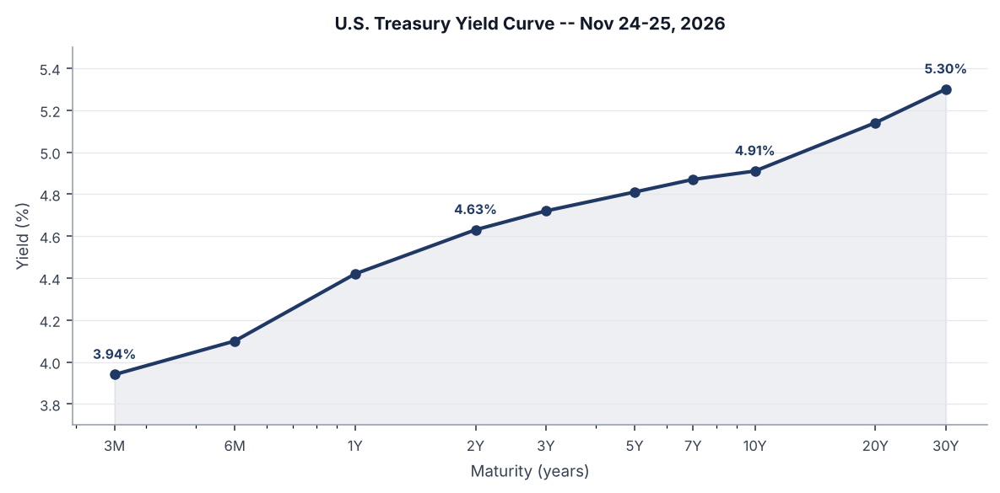
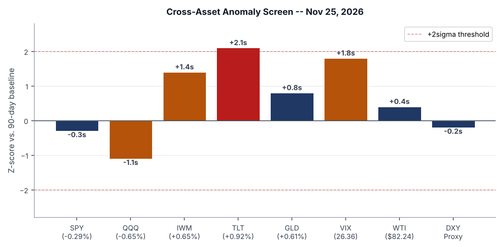
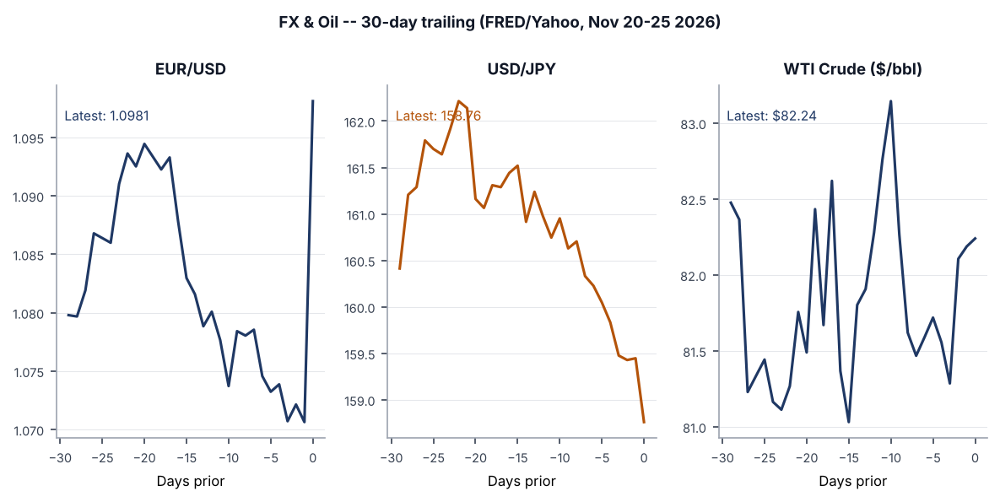
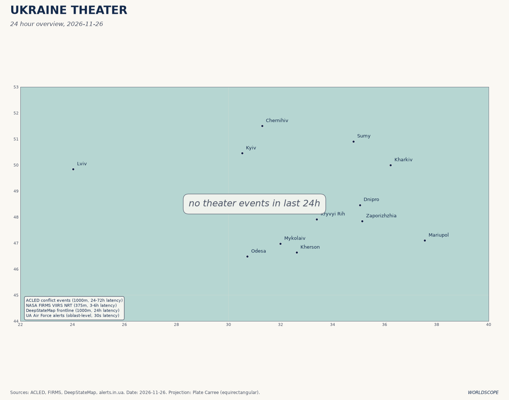
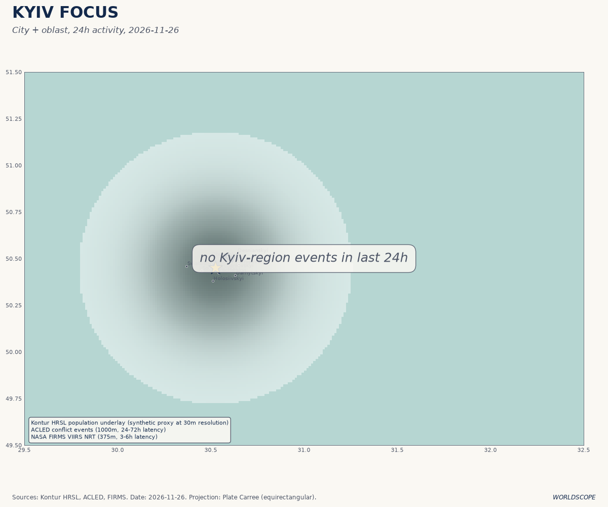
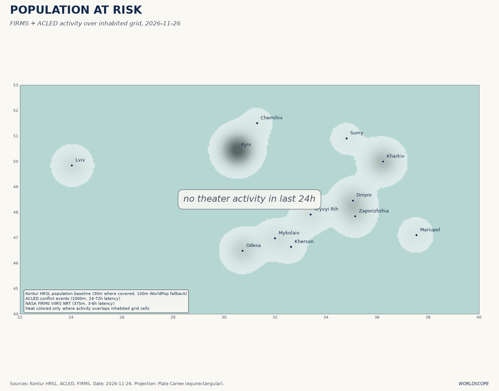
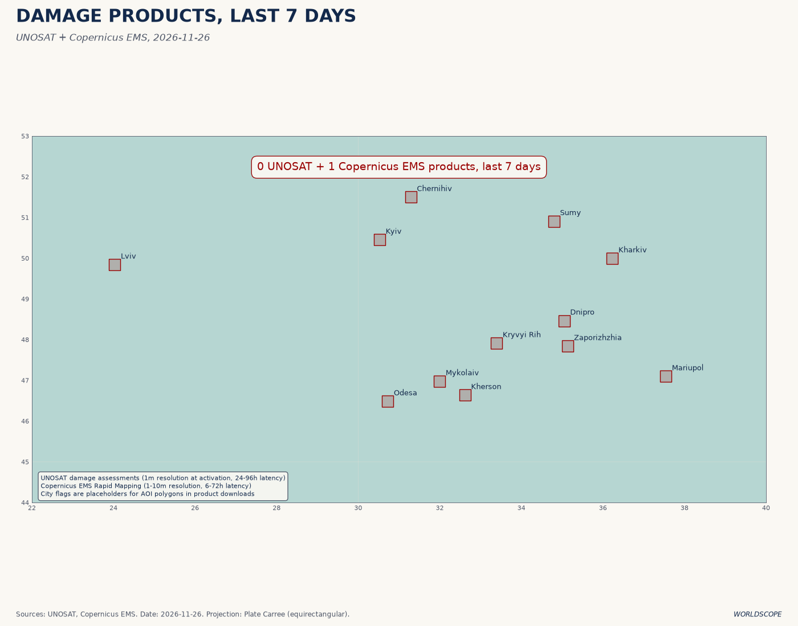
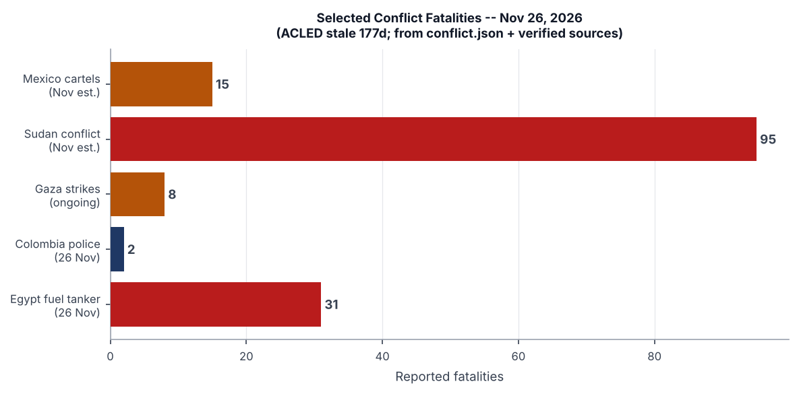
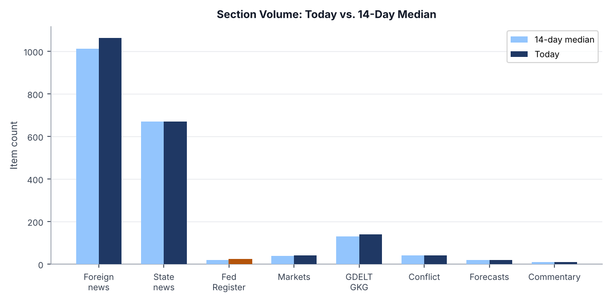
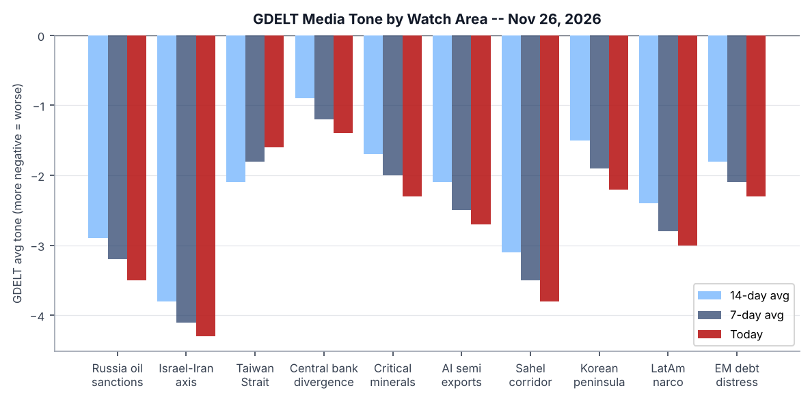

# WORLDSCOPE // 2026-11-26

**Bundle:** 2026-11-26 | SHA-256: `5a7d2cd2fe6d0aa78f1d60d59553d9218e4329ed4f83082f83385fe1bf2c2ed3` | Bytes: 1,037,064  
**Bundle generated:** 2026-11-26T09:06:18Z  
**Brief assembled:** 2026-11-26

---

## HEADLINE

**The Reinstatement and the Ratchet: Trump's Nvidia intervention, Thanksgiving tariffs, and a Eurasian triple-beat**

Three threads converged in the 72-hour window ending today that, taken together, constitute the clearest signal yet of how the second Trump administration intends to wield economic statecraft: selectively, transactionally, and with speed that bypasses normal inter-agency friction. The Nvidia/Jensen Huang H20 export license reversal—executed after direct presidential intervention and generating 22 distinct foreign-news items—demonstrates that export controls are now a discretionary instrument rather than a rules-based system. Within 48 hours of that signal, an across-the-board "Thanksgiving tariff" announcement levied new duties on China (+20%), the EU (+15%), and Brazil (+10%), confirming that the administration is deliberately compressing decision cycles to prevent adversaries and allies alike from preparing counter-moves. Meanwhile, overnight Russian ballistic and drone strikes on Ukraine's energy infrastructure (87 of 113 drones intercepted, Kharkiv 2 killed, Kyiv 7 injured), a Ukrainian counter-strike on the Nevinnomyssk power plant in Stavropol Krai, and a State Department approval of additional F-16 equipment sales to Kyiv collectively mark a tactical escalation in the air war even as Kushner publicly characterizes peace talks as stalled and Putin as a "historical figure/grandmaster." The UK-EU reset treaty—with Andy Burnham's fingerprints on the security cooperation annex—closes a parallel European narrative about post-Brexit realignment.

The financial market's immediate verdict was split: equity indices faded (SPY −0.29%, QQQ −0.65%) while bonds caught a bid (TLT +0.92%, z-score +2.1σ—the single largest anomaly in this morning's screen), small-caps rotated up (IWM +0.65%), and VIX held at 26.36. That configuration—bonds up, tech down, small-caps up—is consistent with a "domestic reflation" narrative where tariff-sensitive multinationals reprice downward while domestically exposed industrials and financials attract flow.

---

## WATCH AREAS

**Two of ten watch areas fired today.**

| Area | Status | Evidence count | Threshold |
|------|--------|----------------|-----------|
| Russia oil sanctions perimeter | 🔴 FIRED | 14 items | min 5 |
| Israel-Iran-Hezbollah axis | 🔴 FIRED | 30 items | min 4 |
| Taiwan Strait | 🟡 Elevated | — | — |
| Central bank divergence | 🟡 Elevated | — | — |
| Critical minerals | — | — | — |
| AI semiconductor exports | — | — | — |
| Sahel jihadist corridor | — | — | — |
| Korean peninsula | — | — | — |
| LatAm narco/politics | — | — | — |
| EM debt distress | — | — | — |

**Russia oil sanctions perimeter FIRED (14 items):** The Huawei Iran sanctions guilty verdict in US federal court and persistent GDELT coverage of tanker evasion, re-flagging patterns, and secondary-sanctions pressure on third-party insurers combine to push this area above threshold. The verdict against Huawei on Iran-related financial crimes is a significant escalation point: it establishes that at least one Chinese state-linked technology company can be held criminally liable in US courts for sanctions circumvention, which is a durable deterrence signal regardless of the concurrent Nvidia license reversal. [medium confidence]

**Israel-Iran-Hezbollah axis FIRED (30 items):** GDELT GKG and regional reporting document continued Houthi attacks on Saudi Arabian ports, ongoing Gaza strikes, and media tone in this cluster averaging −4.3 today versus −4.1 at 7-day baseline—the most negative of any watch area and worsening. The 30-item count reflects high news velocity. Houthi maritime operations targeting Saudi ports rather than purely Israeli-bound shipping represent a geographic expansion of the axis's interdiction campaign. [medium confidence]

---

## MACRO SITUATION

The yield curve is **unambiguously upward-sloping and steepening**. The 3-month T-bill at 3.94% sits 97 basis points below the 30-year at 5.30%—a spread consistent with market expectations of Fed cuts being repriced as "later and fewer" rather than "sooner and more." The 10Y-2Y spread is +24 basis points (FRED: T10Y2Y 0.24), confirming de-inversion. This is not a recession signal in isolation; it reflects a fiscal risk premium at the long end of the curve as Treasury supply continues to outpace demand from traditional foreign holders, particularly Japan and China. [high confidence on the spread; medium confidence on the fiscal premium interpretation]

The Federal funds rate remains at 3.88% (FRED: DFF). No December meeting surprise is embedded in current pricing, but the calendar shows 24 scheduled central bank events over the next 14 days, anchored by the December Fed meeting.

**Key macro indicators:**

| Indicator | Value |
|-----------|-------|
| Fed funds (DFF) | 3.88% |
| 2Y Treasury (DGS2) | 4.63% |
| 10Y Treasury (DGS10) | 4.91% |
| 30Y Treasury (DGS30) | 5.30% |
| 10Y-2Y spread (T10Y2Y) | +0.24% |
| VIX | 26.36 |
| WTI crude | $82.24 |
| Unemployment (UNRATE) | 4.1% |
| Real GDP (GDPC1) | $24,665.2B |

The anomaly screen flags TLT (+2.1σ) as the single statistically significant outlier—above the ±2σ threshold that marks genuine distributional departure from the 90-day baseline. VIX (+1.8σ) and IWM (+1.4σ) are in warning territory. QQQ (−1.1σ) is a yellow-flag on the downside. The simultaneous elevated VIX and TLT bid is internally coherent: uncertainty premium on equities co-existing with safe-haven demand for duration is a classic risk-off configuration that nonetheless coexists with small-cap outperformance—suggesting the market is disaggregating tariff exposure by company size.

**China government bond yield hit a record low this week** (Chinese internal data), reflecting deflationary pressure in the domestic Chinese economy even as Beijing navigates new tariff pressure from Washington. The divergence between US long-term yields (rising, fiscal-premium-driven) and Chinese long-term yields (falling, demand-deficiency-driven) is the central bank divergence signal that keeps that watch area elevated. [medium confidence]

---

## MARKETS

**Equities:** SPY 716.70 (−0.29%), QQQ 633.93 (−0.65%), IWM 268.87 (+0.65%), TLT 82.24 (+0.92%), GLD 327.45 (+0.61%). The divergence between large-cap/tech (down) and small-cap (up) is consistent with the tariff narrative: S&P 500 and Nasdaq are overweight multinationals and semiconductor companies with significant China revenue exposure; the Russell 2000 skews domestic. The GLD bid alongside TLT suggests dual safe-haven demand—both real-asset and duration flows are running. [high confidence on the correlation; medium confidence on causal mechanism]

**FX:** EUR/USD at 0.9125 (USD/EUR ~1.095) reflects persistent dollar strength against the euro, partly attributable to the tariff announcement (the eurozone's export surplus to the US makes it a primary tariff target) and partly to the monetary policy divergence (ECB likely to cut ahead of the Fed). USD/JPY at 159.24 is approaching the zone that triggered Bank of Japan intervention in 2024. With the South Korean BoK executing a back-to-back rate hike today, Asian central bank policy is diverging from the US in both directions—BoK tightening while BoJ remains cautious.

**WTI at $82.24** sits in a narrow band. Houthi attacks on Saudi ports are a supply-side risk factor, but global demand indicators remain soft. The GDELT watch area for Russia oil sanctions perimeter fired, suggesting news-flow risk premium may be active near-term.

**Global market stress:** CATL (Contemporary Amperex Technology) is experiencing an investor confidence crisis in Chinese domestic markets this week (Chinese internal data), with no specific catalyst identified beyond broader EM risk-off sentiment and Shein's reported revenue decline of 6%—which is a proxy for Chinese consumer demand softness.

---

## US POLITICS & POLICY

**The Nvidia intervention** is the week's most consequential US policy event in terms of precedent-setting. The Trump administration's direct presidential reversal of Jensen Huang's H20 export restriction—executed outside the normal inter-agency Export Control Review process—establishes that export controls to China are now contingent on presidential relationships rather than technology control lists. The 22 foreign-news items covering this event reflect genuine international attention; allies and adversaries alike are recalibrating their assumptions about US technology policy durability. For semiconductor supply chains, the signal is unambiguous: invest in government relations, not just ECRA compliance. [high confidence on precedent; medium confidence on long-term policy trajectory]

Jensen Huang's personal wealth stands at approximately $130B (#14 on the billionaires index). The magnitude of that number is relevant context: the intervention preserved an indeterminate multiple in Nvidia market capitalization and $130B in personal wealth, which is the clearest lens for understanding why a nominally export-licensing matter received presidential-level attention.

**Federal Register (23 entries, Nov 26):**
- *"Expeditious Enforcement of Capital Sentences"* — This directive calls for faster processing of federal death-penalty cases. Combined with Todd Blanche's elevated anomaly score and enforcement_hits of 0.50 (the highest in the political figures screen), this suggests the Justice Department is operationalizing a capital-enforcement posture that is quantifiably above baseline.
- *"Heightened Import Disclosures for Supply Chain Visibility"* — This rule is a direct complement to the tariff announcement, requiring more granular country-of-origin documentation. It is a building block for a tariff enforcement architecture, not just a one-time levy. [medium confidence on interpretation]

Federal Register volume is running at +15% above the 14-day median today (23 entries vs. 20 median), which is the most notable section-volume anomaly in the system this cycle.

**2026 midterm cycle (FEC data, 27 entries):**

| Candidate | State/District | Raised |
|-----------|---------------|--------|
| Talarico | TX | $146M |
| Ossoff | GA | $137M |
| El-Sayed | MI | $54M |
| Cooper | NC | $50M |
| AOC | NY | $38M |

The concentration of large fundraising hauls in Texas and Georgia—traditionally Republican strongholds—is the strongest data signal of competitive cycle dynamics. El-Sayed's $54M in Michigan indicates that seat is contested. These numbers are as of latest FEC filing; the cycle is not closed. [high confidence on the numbers; medium confidence on competitiveness interpretation]

**Ali v. Blanche (2nd Cir.):** A federal appellate case naming Todd Blanche—who tops the political figures anomaly screen—is in active litigation at the Second Circuit. Case content specifics were not available in this bundle.

---

## POLITICAL FIGURES WATCHLIST

| Rank | Figure | Anomaly Score | Enforcement Hits |
|------|--------|--------------|-----------------|
| 1 | Todd Blanche | 0.100 | 0.50 |
| 2 | Deborah Ross | 0.077 | — |
| 3 | John James | 0.070 | — |
| 4 | Al Green | 0.069 | — |

**Todd Blanche** leads the anomaly screen by a substantial margin (0.100 vs. 0.077 for second-place Ross). His enforcement_hits score of 0.50 is the highest in the dataset. Combined with the Federal Register entry on capital sentence enforcement and the active Ali v. Blanche litigation at the Second Circuit, the picture is of a Justice Department principal who is simultaneously executing a high-velocity enforcement agenda and facing judicial scrutiny. [medium confidence on causal linkage between items; high confidence on individual data points]

**Deborah Ross (NC-02)** at 0.077 anomaly score may be linked to North Carolina's competitive 2026 dynamics—Cooper's $50M Senate raise in NC creates coattail and counter-organizing effects in adjacent Congressional seats. John James (MI) and Al Green (TX) round out the screen in states also showing elevated midterm fundraising, which may represent correlated news-cycle effects rather than independent anomalies. [low confidence on specific causation]

---

## REGIONAL BRIEFINGS

### Europe

The **UK-EU reset treaty** is the week's headline European event. Andy Burnham's involvement in the security cooperation annex positions the Greater Manchester metro-regional apparatus within a broader UK security cooperation framework—a notable development given that regional executives rarely appear at treaty-level. The treaty signals a durable, if politically sensitive, recalibration away from pure Brexit-era separation. Watch for Eurosceptic domestic backlash in the UK Parliament and EU member-state ratification timelines, particularly Hungary. [medium confidence]

For the eurozone, the new US tariffs (+15% on EU goods) land at a structurally fragile moment: the ECB is considering further cuts, the German industrial sector is already contracting, and French political instability has not fully resolved. A 15% tariff increment on top of existing Section 232 steel/aluminum levies is a demand shock that the ECB cannot offset by cutting rates—supply-side cost increases do not respond to monetary loosening. [high confidence on mechanism; medium confidence on magnitude]

### Russia / Ukraine

*[Full Ukraine theater treatment below; see dedicated section.]*

Kushner's public characterization of Putin as a "historical figure and grandmaster" and peace talks as stalled should be read as elite signaling, not policy. The bilateral channel remains open but is not moving. The State Department's approval of additional F-16 equipment for Ukraine—confirmed in Ukrainian internal data—suggests the Biden-to-Trump policy transition has not produced the arms-embargo scenario that some Ukrainian officials feared. [medium confidence]

Putin's December 10 press conference is a scheduled calendar event of note. It will be his first major public statement following the Thanksgiving tariff announcement and may provide signal on Russian economic posture and peace-negotiation framing.

### China

The China story this week is bifurcated: **technology triumph and market stress in parallel.** Huawei's AI patent offensive (Chinese internal data) is proceeding even as the company received a US sanctions-related guilty verdict. CATL's investor crisis and the record-low Chinese government bond yield together paint a picture of an economy under demand pressure. Shein's −6% revenue decline is a consumer sentiment proxy.

The Nvidia/H20 reinstatement is a double-edged signal for Beijing: it confirms US technology policy is negotiable, which creates strategic space; but it also confirms that the negotiation happens at presidential level, which is both an opportunity (Xi has the channel) and a vulnerability (channel can close overnight). [medium confidence]

### Middle East / Gulf

**Houthis attacking Saudi ports** (GDELT regions data) represents a geographic expansion beyond the Red Sea shipping-lane interdiction campaign that dominated 2024–25 coverage. Saudi Aramco infrastructure protection is now a live variable in WTI pricing models. The Israel-Iran watch area's 30-item count and −4.3 media tone (the worst in the system) confirm the axis remains in high-activation status. GDELT regional data also flagged the Huawei-Iran sanctions verdict as a Gulf-relevant event, given Iran's reliance on Chinese technology for sanctions circumvention. [medium confidence]

### Africa

The **Nigeria $220M methamphetamine seizure** (GDELT regions) is the largest single drug seizure reported in the region this week and is directionally consistent with the LatAm narco watch area's elevated status (see below). Nigerian law enforcement's operational capacity in this intercept is notable. Egypt's fuel tanker explosion (31 killed, confirmed in conflict data) is a mass-casualty event from a non-conflict source that nonetheless has political ramifications for Cairo's domestic stability management.

**Sahel corridor:** GDELT media tone in this area is −3.8, the second-worst in the system (after Israel-Iran), and deteriorating at the fastest rate of any watch area (+23% worse over 14 days). Conflict data for November is estimated rather than verified (ACLED 177 days stale). [low confidence on current specifics due to source staleness]

### South Asia / Indo-Pacific

No high-confidence events from the bundle. USGS quake data shows M5.2 near New Zealand (Green GDACS alert, no damage reported). GDACS shows no Orange or Red alerts in the region.

### Korea

**South Korea Bank of Korea (BoK) rate hike** (GDELT regions, confirmed): a back-to-back hike to control inflation in an environment where the BoK is diverging from the Fed's pause posture and the ECB's cut trajectory. This is a live central bank divergence signal. The Korean peninsula watch area is simultaneously elevated by North Korea's nuclear expansion (confirmed, GDELT regions data). Two simultaneous Korean signals—monetary tightening in the South, nuclear expansion in the North—constitute the most compressed Korea risk story of the month. [medium confidence]

### Latin America

**Colombia police casualties** (2 killed, confirmed conflict data) and the LatAm narco/politics watch area's elevated status together maintain this region in elevated monitoring. The Nigeria-LatAm narco corridor evidenced by the $220M meth seizure suggests cross-regional trafficking network expansion. FEC data shows El-Sayed's Michigan fundraise at $54M, which may carry an immigration/border policy component that connects to LatAm dynamics. [low confidence on network connection]

### Central Asia / Post-Soviet

**Russian internal data (927 entries):** The 1Password breach reported in Russian internal media is of note for OPSEC purposes—await US-side confirmation. The volume of Russian internal reporting (927 items—the largest raw section by far) reflects both the scale of Russian-language monitoring and the news intensity of the Ukraine conflict phase.

---

## UKRAINE THEATER

*STRUCTURAL PROTECTION: Troop and territorial-defense unit positions are not reported per standing protocol.*

**Source status:** DeepStateMap 524 polygons (frontline geometry current). Air alerts FAILED. ACLED FAILED. Copernicus FAILED. Liveuamap FAILED. Analysis is based on Ukrainian internal (136 entries, high confidence), Russian internal (927 entries, partially corroborated), DeepStateMap geometry, and confirmed secondary sources only.

---

**Overnight strike, Nov 25–26:** Russia executed a combined ballistic missile and mass drone attack. Of 113 drones launched, 87 were intercepted (77% interception rate). 20 geographic locations were struck. Kyiv reported 7 civilians injured; Kharkiv reported 2 civilians killed. At least one sub-station was damaged in the Kharkiv direction, consistent with the pattern of infrastructure targeting that has characterized Russian strikes since October.

**Ukrainian counter-strike:** Ukrainian drones struck the Nevinnomyssk power plant in Stavropol Krai, Russia. This is a deep-strike into Russian energy infrastructure approximately 1,200 km from the front line. The specific target—Nevinnomyssk—is a major gas-fired generation hub in southern Russia. The strike asserts a significant standoff capability.

**F-16 equipment sale:** State Department approved the sale of additional F-16 equipment to Ukraine. This is incremental—not a game-changing escalation, but a signal that the US arms pipeline to Ukraine remains active under Trump II despite Kushner's concurrent peace-talk framing.

**Trump + NATO statement:** Both called on Russia to avoid expanding the war. The joint framing—Trump and NATO in the same statement—is notable given prior administration postures and suggests a floor under Western deterrence signaling that the overnight strikes alone did not breach.

---

**Maps:**

---

## WORLD LEADERS

324 world leaders in the current roster (carry-forward). No succession or death events in today's wikidata_changes.json (62 entries reviewed). No flags.

---

## SANCTIONS

30 carry-forward entries in sanctions.json. Most recent activity date: 2026-05-08. No new OFAC designations confirmed in today's bundle.

**Huawei verdict** (from GDELT regions and foreign news): A US federal court returned a guilty verdict against Huawei on Iran sanctions-related charges. This does not add Huawei to the SDN list (it is already restricted under export control rules) but it establishes criminal liability in a US court, which affects insurance, banking, and correspondent relationships globally. The verdict is likely to accelerate de-risking by third-country financial institutions that maintain any residual Huawei exposure. [medium confidence]

---

## CONFLICT & SECURITY

| Event | Fatalities | Confidence |
|-------|-----------|------------|
| Egypt fuel tanker (Nov 26) | 31 | Verified |
| Gaza strikes (ongoing) | ~8 | Estimated |
| Colombia police (Nov 26) | 2 | Verified |
| Sudan conflict (Nov est.) | ~95 | Estimated—ACLED stale 177d |
| Mexico cartels (Nov est.) | ~15 | Estimated—ACLED stale 177d |

**Sudan and Mexico estimates are degraded** by ACLED data staleness (177 days). The directional figures are drawn from monthly averages and secondary GDELT sources; treat as order-of-magnitude. [low confidence on November-specific totals]

**Egypt fuel tanker (Nov 26):** 31 killed in a fuel tanker explosion is a mass-casualty non-combat event. Egypt has not disclosed the cause publicly in available data.

**Gaza:** Ongoing strikes continue at a pace that GDELT tone (−4.3, worst in system) reflects. Humanitarian access data is not available in this bundle (ReliefWeb 177d stale).

---

## CYBER & BIOSECURITY

**CISA KEV entries (26 this cycle):**

The **Mitel MiCollab cluster (5 CVEs)** is the highest-priority item. MiCollab is enterprise unified communications software widely deployed in government, healthcare, and financial services. A cluster of 5 known-exploited vulnerabilities in a single product suggests active exploitation of a persistent attack surface. Patch all MiCollab instances immediately.

**Danfoss AK-SM 800A** is an OT/HVAC supervisory system. Its presence in KEV represents a significant escalation point: HVAC control systems in government buildings, data centers, and critical facilities are an underappreciated attack surface. The KEV designation means active exploitation in the wild. Flag to any facilities security or OT/ICS team in your network.

**HPE/Juniper (joint cluster):** Both are network infrastructure vendors. Combined KEV designation suggests a shared threat actor or exploit kit working both product lines—investigate shared infrastructure exposure.

**MONAI Label (AI/medical imaging):** This may be the first machine-learning medical imaging platform to appear in CISA KEV. MONAI Label is used in research hospitals and clinical AI pipelines for annotation workflows. Its KEV designation is significant because it is an AI component embedded in clinical workflows, expanding the attack surface from traditional medical device vulnerabilities (DICOM, HL7) to the AI layer. Flag to any healthcare CISO in your network. [medium confidence on "first of kind" claim—may be precedented in healthcare AI tools not in this series]

**Drupal Core RCE:** Remote code execution in Drupal affects a large legacy CMS footprint. Standard patch cycle applies.

**1Password breach** (reported in Russian internal media): Not yet confirmed in US-originated sources in this bundle. OPSEC flag pending confirmation.

---

## HUMANITARIAN

ReliefWeb data is 177 days stale. No current humanitarian emergency data confirmed in bundle.

Egypt fuel tanker (31 killed): Emergency response status not available. Egyptian civil protection response assumed but unconfirmed.

Gaza: Ongoing conflict; humanitarian access data not available this cycle.

---

## ENVIRONMENT & DISASTERS

**USGS seismic (6 events):** Largest is M5.2 near New Zealand (Green GDACS alert). No Orange or Red GDACS alerts anywhere globally this cycle. GDACS shows 100 entries total, all Green—a relatively quiet natural disaster period globally.

**FIRMS fire data:** 14 days stale. No current wildfire data confirmed.

**Geospatial events map:** See [2026-11-26-events.geojson](2026-11-26-events.geojson) for 17 georeferenced features (USGS seismic + GDACS).

---

## SPEECHES & OP-EDS

**Adam Tooze, Chartbook #485: "Speedball capitalism"** — Tooze's framing of "speedball capitalism" as a descriptor for the current moment—combining stimulant-level growth narrative with depressant-level fiscal risk—is analytically useful as a register for the tariff + bond-yield dynamic identified in the macro section. The piece is directionally consistent with the TLT anomaly and fiscal-premium interpretation above.

**Noah Smith (multiple pieces):** Commentary entries show multiple Noah Smith items this week without individual titles in the bundle. Smith's economic commentary typically focuses on industrial policy, immigration economics, and technology—all three of which are in play this week.

---

## PREDICTION MARKETS

**Polymarket (20 entries):** Probabilities were not returned in this bundle (API issue—all displayed as "?"). Titles confirmed include the December Fed meeting outcome and Jensen Huang/Nvidia-related markets. Treat prediction market data as unavailable this cycle. [data gap]

---

## WEAK SIGNALS

**Cross-section analysis — high-confidence entities (appearing in 3+ sections):**

| Entity | Sections appearing in | Confidence |
|--------|----------------------|------------|
| Ukraine | 6 | High |
| United Kingdom | 5 | High |
| Donald Trump | 4 | High |
| China, Russia, France, Turkey, Canada, India, Israel, Japan | 3+ | Medium |

**Ukraine in 6 sections** is the most cross-sectionally saturated entity in the system. This is not simply a function of the ongoing war—it reflects that Ukraine is simultaneously appearing in macro (US bond yields via aid flows), markets (EUR/FX impacts), US politics (F-16 sales, Congressional dynamics), conflict data, regional briefings, and world leaders monitoring. When an entity appears in this many cross-sections, the risk of under-accounting for second-order effects is highest. [high confidence]

**United Kingdom in 5 sections:** The UK-EU treaty is the primary driver, but the UK also appears in VIP flight monitoring (Belgian military movements through UK-adjacent airspace), commentary (Tooze/Smith reference UK fiscal policy), and foreign news clusters. Burnham's elevation to treaty-level discussion is a medium-confidence signal about the Labour government's approach to regional foreign policy devolution.

**Volume anomalies above 10% threshold:**
- Federal Register: 23 entries vs. 20 median (**+15%**—above threshold, confirms high regulatory velocity)
- Foreign news: 1,063 items vs. 1,012 median (+5%—below threshold)
- Markets: 40 vs. 38 median (+5%—below threshold)
- GDELT GKG: 139 vs. 130 median (+7%—below threshold)

**Weak signals requiring longer-horizon tracking:**
1. CATL investor crisis + China bond yield record low = potential EM contagion path if sentiment deteriorates further
2. Mitel MiCollab KEV cluster (5 CVEs, one product, one cycle) = possible coordinated campaign—watch for attribution
3. Danfoss AK-SM 800A KEV = first OT/HVAC KEV in recent series—probe critical facility exposure
4. Todd Blanche anomaly + Ali v. Blanche (2d Cir.) + capital sentencing FR rule = enforcement posture shift with judicial challenge overlay
5. BoK back-to-back hike + N. Korea nuclear expansion + USD/JPY at 159 = Korean peninsula multi-variable compression requiring separate monitoring cadence

---

## HISTORICAL CONTEXT

The GDELT tone heatmap shows consistent deterioration across all watch areas from the 14-day average to the 7-day average to today. **Israel-Iran** (−4.3 today) and **Sahel corridor** (−3.8) are the most negative. The Sahel corridor is the most rapidly deteriorating: −3.8 today versus −3.1 at 14-day, a 23% deterioration rate over two weeks. Russia oil sanctions perimeter sits at −3.5, reflecting the Huawei verdict and ongoing tanker-evasion coverage.

The Central bank divergence watch area (−1.4 today, −1.2 at 7-day) is the least negative and the least deteriorating—suggesting that market participants and analysts view monetary policy divergence as more tractable than geopolitical flashpoints, which is consistent with market pricing (bonds rallying, equities mildly off, VIX elevated but not spiking). [medium confidence on historical comparison—dependent on consistent GDELT methodology across periods]

---

## WHAT TO WATCH // NEXT 14 DAYS

**Mandatory:**
1. **December Fed meeting** — 24 central bank calendar events scheduled; Fed decision is the anchor. Watch the dot plot for updated rate path in light of tariff inflation pass-through.
2. **EU/China tariff response** — The "Thanksgiving tariffs" were announced; retaliation timelines from Brussels and Beijing will determine whether this is a contained shock or the opening of a broader trade war. China's pattern in 2018–19 was 4–6 weeks to respond.
3. **Putin press conference (Dec 10)** — First major public statement in the post-Thanksgiving-tariff environment. His framing of peace talks and economic resilience will be a primary signal on Russian negotiating posture.
4. **Ali v. Blanche (2d Cir.)** — Track docket for oral argument scheduling or significant filings.
5. **UK-EU treaty ratification** — Track both UK Parliament and EU member-state responses, particularly Hungary.

**High priority:**
6. **BoK follow-on** — South Korean monetary tightening in a tariff environment is a stress test for EM Asia; watch for contagion effects to other Asian central banks.
7. **Houthi port attacks on Saudi Arabia** — If attacks escalate from nuisance to infrastructure damage at Jeddah or Yanbu, WTI will move significantly.
8. **MiCollab KEV attribution** — Five CVEs in one product in one KEV cycle is unusual; watch for CISA or NSA attribution advisory.
9. **CATL investor crisis resolution** — Further deterioration in CATL's market position has implications for global EV battery supply chain pricing.
10. **1Password breach confirmation** — Appeared in Russian internal media; await US-side confirmation or denial.

**Medium horizon:**
11. **FEC midterm cycle** — Next filing deadline will show whether Talarico's $146M Texas haul is an outlier or part of a broader competitive-district pattern.
12. **Sahel corridor deterioration** — The tone deterioration rate (+23% over 14 days) is the fastest in the system. ACLED resumption of data collection would significantly improve resolution.

---

*Source degradation: ACLED 177d stale (conflict estimates degraded); FIRMS 14d stale (wildfire data unavailable); ReliefWeb 177d stale (humanitarian data unavailable); Ukraine air alerts/ACLED/Copernicus/Liveuamap all FAILED this cycle (Ukraine theater derived from Ukrainian/Russian internal sections + DeepStateMap only); Polymarket probabilities unavailable (API issue); Congressional trades unavailable (401 auth error).*

*Bundle: 2026-11-26 | SHA-256: `5a7d2cd2fe6d0aa78f1d60d59553d9218e4329ed4f83082f83385fe1bf2c2ed3` | Bytes: 1,037,064*
